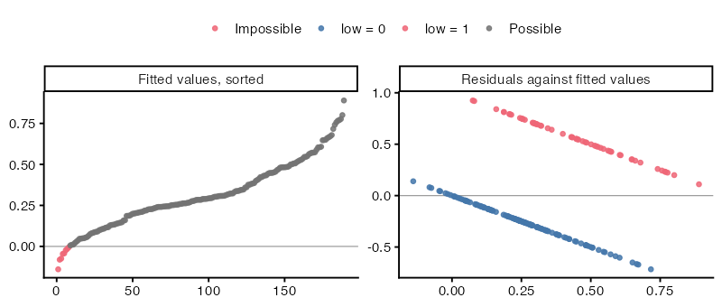
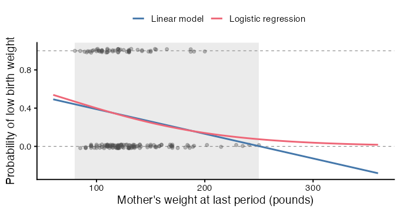
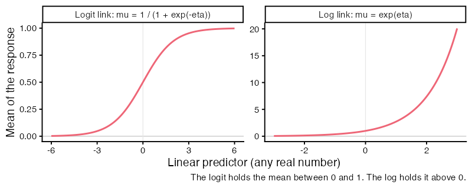
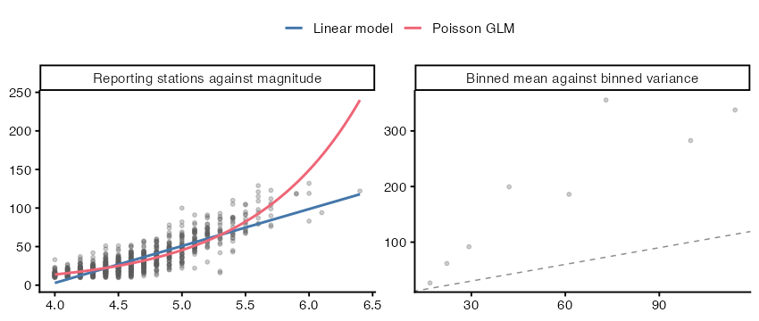

<script>
  MathJax = {
    tex: { inlineMath: [['$','$'], ['\\(','\\)']],
           displayMath: [['$$','$$'], ['\\[','\\]']] },
    svg: { fontCache: 'global' }
  };
</script>
<script src="https://cdn.jsdelivr.net/npm/mathjax@3/es5/tex-svg.js" id="MathJax-script" async></script>

<style>
  .site-footer,
  .footer { display: none; }

  html { scroll-behavior: smooth; }

  .ws-page {
    display: flex;
    gap: 34px;
    align-items: flex-start;
    max-width: 1150px;
    margin: 0 auto;
  }

  .ws-toc {
    position: sticky;
    top: 20px;
    flex: 0 0 225px;
    max-height: calc(100vh - 40px);
    overflow-y: auto;
    font-size: 0.88rem;
  }
  .ws-toc-title {
    font-weight: 700;
    text-transform: uppercase;
    letter-spacing: 0.05em;
    font-size: 0.74rem;
    color: #888;
    padding: 0 10px 8px;
  }
  .ws-toc nav ul { list-style: none; margin: 0; padding: 0; }
  .ws-toc nav a {
    display: block;
    padding: 5px 10px;
    color: #333;
    text-decoration: none;
    border-left: 2px solid transparent;
    line-height: 1.3;
  }
  .ws-toc nav a:hover {
    border-left-color: #666;
    background: rgba(0, 0, 0, 0.04);
    color: #000;
  }
  .ws-toc nav a.active {
    border-left-color: #EE6677;
    color: #000;
    font-weight: 600;
  }
  .ws-toc nav li.sub a {
    padding-left: 24px;
    font-size: 0.83rem;
    color: #666;
  }

  .ws-body { flex: 1 1 auto; min-width: 0; }
  .ws-body h1, .ws-body h2 { scroll-margin-top: 16px; }

  @media (max-width: 900px) {
    .ws-page { flex-direction: column; gap: 12px; }
    .ws-toc {
      position: static;
      flex-basis: auto;
      width: 100%;
      max-height: none;
      border-bottom: 1px solid #ddd;
      padding-bottom: 10px;
      margin-bottom: 6px;
    }
  }
</style>

# GLMs and GAMs in R (Part 1): Intro to Generalized Linear Models

<div class="ws-page">

  <aside class="ws-toc">
    <div class="ws-toc-title">On this page</div>
    <nav>
      <ul>
        <li><a href="#what-you-will-learn">What You Will Learn</a></li>
        <li><a href="#setup">Setup</a></li>
        <li><a href="#part-a">A. Where the Line Runs Out</a></li>
        <li class="sub"><a href="#binary-outcome">A binary outcome</a></li>
        <li class="sub"><a href="#count-outcome">A count outcome</a></li>
        <li class="sub"><a href="#anatomy">The three parts of a GLM</a></li>
        <li class="sub"><a href="#link-functions">Why the logit and the log</a></li>
        <li><a href="#part-b">B. Logistic Regression</a></li>
        <li class="sub"><a href="#fitting-logistic">Fitting</a></li>
        <li><a href="#part-c">C. Poisson Regression</a></li>
        <li class="sub"><a href="#fitting-poisson">Fitting</a></li>
        <li><a href="#summary">So... what did we learn?</a></li>
        <li><a href="#references">References</a></li>
      </ul>
    </nav>
  </aside>

  <div class="ws-body" markdown="1">

# GLMs and GAMs in R (Part 1): Intro to Generalized Linear Models

> This is the first workshop in a six-part series. Linear regression assumes a
continuous response, errors that are normally distributed, and a variance that
stays the same everywhere. Plenty of outcomes break all three at once. A yes or
no answer cannot be normal. A count cannot be negative. The spread of a count
grows as the count grows. Today we keep the linear predictor and change two
things around it, the distribution assumed for the response and the function
connecting that distribution to the predictors. Those two choices turn one
model into a family of models.

## What You Will Learn {#what-you-will-learn}

By the end of this session you will be able to:

1. Name the assumptions of a standard linear regression.
2. Show, with evidence rather than assertion, why a linear model is the wrong
tool for a binary or a count outcome.
3. Name the three parts of a GLM and point to each one in a fitted model.
4. Say what a link function does, and why the logit and the log are the usual choices.
5. Fit logistic and Poisson regressions with `glm()`, and read the coefficient table.

## Setup {#setup}

We use `ggplot2` for plots and `MASS` for the `birthwt` data. `MASS`
ships with base R, so there is nothing to install for it.


``` r
packages <- c("ggplot2")
toInstall <- packages[!(packages %in% installed.packages()[, "Package"])]
if (length(toInstall)) install.packages(toInstall)

library(ggplot2)
library(MASS)
theme_set(theme_classic(base_size = 14))

## Pearson chi-square over residual degrees of freedom. A Poisson or a
## binomial model claims this number is 1.
dispersion <- function(model) {
  sum(residuals(model, type = "pearson")^2) / df.residual(model)
}
```

# Assumptions of a linear model

A common thing that researchers first do when learning how to model is just to
call `lm()` on...well everything. However, linear models come with their own set
of assumptions baked in and if those assumptions are violated you cannot make 
valid inference to your population. Thankfully, there is a handy mnemonic to 
help us remember what those assumptions are HILE Gauss:

| Assumption                  | What `lm()` needs                                                                   |
|-----------------------------|-------------------------------------------------------------------------------------|
| **H**omogeneity of variance | same error variance at every value of the predictors                                |
| **I**ndependence            | errors are unrelated across observations                                            |
| **L**inearity               | mean is a straight-line function of the predictors                                  | 
| **E**xistence               | At predictor value, the response has a distribution with a finite mean and variance | 
| **Gauss**ian errors         | Errors follow a normal distribution                                                 | 

# Part A: Where the Linear Model Runs Out {#part-a}

## A Binary Outcome {#binary-outcome}

`birthwt` records 189 births at Baystate Medical Center in 1986. The response
`low` is 1 when the baby weighed under 2500 grams and 0 otherwise. The
predictors are the mother's age and weight, her race, whether she smoked during
pregnancy, whether she had a history of premature labor, and two clinical
indicators.


``` r
data(birthwt) # load the birthweight dataset
bw <- birthwt # create shorthand data frame
# code as factors
# factors allow for more readability
bw$race    <- factor(bw$race,  labels = c("white", "black", "other"))
bw$smoke   <- factor(bw$smoke, labels = c("no", "yes")) 
bw$ht      <- factor(bw$ht,    labels = c("no", "yes"))
bw$ui      <- factor(bw$ui,    labels = c("no", "yes"))
bw$preterm <- factor(ifelse(bw$ptl > 0, "yes", "no"), levels = c("no", "yes"))

# make quick summary of dataset
(list_description <- list(births = nrow(bw),
                          lowBirthWeight = sum(bw$low),
                          rate = round(mean(bw$low), 3)))
```

```
$births
[1] 189

$lowBirthWeight
[1] 59

$rate
[1] 0.312
```

``` r
table(bw$smoke, bw$low)
```

```
     
       0  1
  no  86 29
  yes 44 30
```

In the table, the column labeled 1 indicates babies whose birthrate was low.
The column labeled 0 is the 'else' case. 59
of the  189 babies were small, so the rate is
0.312. Now fit a linear model to that 0 and 1 column.


``` r
modelFormula <- low ~ age + lwt + race + smoke + preterm + ht + ui

lmBinary <- lm(modelFormula, data = bw)
round(c(minimumFit = min(fitted(lmBinary)),
        maximumFit = max(fitted(lmBinary)),
        outsideZeroOne = sum(fitted(lmBinary) < 0 | fitted(lmBinary) > 1)), 4)
```

```
    minimumFit     maximumFit outsideZeroOne 
       -0.1396         0.8898         8.0000 
```

Eight of the 189 mothers are given a negative probability of a small baby.
The smallest is -0.1396.



The left panel sorts the fitted values and marks the eight that cannot exist.
The right panel is the reason the usual residual plots are no help here. A
residual is $y_i - \hat{y}_i$, and $y_i$ is 0 or 1, so every residual sits on
one of two parallel lines. Nothing about that pattern tells you whether the
model is any good. It is what a binary outcome looks like no matter what you
fit.

Three things are worth noting about the above model.

**The predictions leave the range.** A probability must be between 0 and 1.
A straight line is unbounded, so far enough along any slope it will leave
that interval.

**The variance is not constant.** For a 0 or 1 outcome the variance is $p(1-p)$
, which is largest at $p = 0.5$ and shrinks to nothing at either end.
Least squares assumes constant variance, so it weights every observation the
same when it should not.

**The response is not normal.** It has two values, so it cannot possibly follow
a normal distribution.

Here is the same comparison with one predictor, so the shapes can be told apart.


``` r
lmOne  <- lm(low ~ lwt, data = bw)
glmOne <- glm(low ~ lwt, family = binomial(link = "logit"), data = bw)

newWeight <- data.frame(lwt = c(80, 150, 250))
round(cbind(lwt = newWeight$lwt,
            linearModel = predict(lmOne, newWeight),
            logistic = predict(glmOne, newWeight, type = "response")), 4)
```

```
  lwt linearModel logistic
1  80      0.4406   0.4685
2 150      0.2601   0.2478
3 250      0.0024   0.0747
```

``` r
round(c(crossesZeroAtLwt = unname(-coef(lmOne)[1] / coef(lmOne)[2]),
        largestObservedLwt = max(bw$lwt)), 1)
```

```
  crossesZeroAtLwt largestObservedLwt 
             250.9              250.0 
```

The straight line hits zero at 250.9 pounds. The heaviest mother in the data
weighs 250. The linear model runs out of valid probabilities at the edge of its
own data. Although we should not extrapolate, a 0.9 pounds extrapolation would
be reasonable in many cases.



The grey strip marks the observed weights. Inside it the two fits agree well
enough. Outside it one of them keeps going and the other flattens, because it
was built to.

## A Count Outcome {#count-outcome}

`InsectSprays` counts insects found on 72 agricultural units, twelve for each
of six insecticides.


``` r
sprayStats <- aggregate(count ~ spray, data = InsectSprays,
                        FUN = function(x) c(mean = mean(x), variance = var(x)))
sprayStats <- data.frame(spray = sprayStats$spray, round(sprayStats$count, 2))
sprayStats$ratio <- round(sprayStats$variance / sprayStats$mean, 2)
sprayStats
```

```
  spray  mean variance ratio
1     A 14.50    22.27  1.54
2     B 15.33    18.24  1.19
3     C  2.08     3.90  1.88
4     D  4.92     6.27  1.27
5     E  3.50     3.00  0.86
6     F 16.67    38.61  2.32
```

``` r
range(InsectSprays$count)
```

```
[1]  0 26
```

Read the first two columns against each other. The group with a mean of 2.08
has a variance of 3.90. The group with a mean of 16.67 has a variance of 38.61.
The spread travels with the level, which least squares (linear regression) is
not equipped for.

## Generalized vs Ordinary Linear Models

| Aspect        | `lm`                              | `glm()`                                         |
|---------------|-----------------------------------|-------------------------------------------------|
| Data ($y$)    | Independent                       | Independent                                     |
| Data ($y$)    | $y \sim \text{N}(\mu, \sigma^2)$  | $y \sim \text{Exponential family} (\mu, \phi)$  |
| Mean ($\mu$)  | $\mu = x^T \beta$                 | $g(\mu) = x^T \beta$                            |

A generalized linear model keeps the linear predictor and relaxes two
assumptions around it.

**1. The random component.** The response follows a distribution from the 
exponential family, chosen to match the kind of outcome. Each observation has
its own mean $\mu_i$, and a shared dispersion $\phi$.

$$Y_i \sim \text{EDM}(\mu_i, \phi), \qquad \text{Var}(Y_i) = \phi\,V(\mu_i)$$

EDM stands for exponential dispersion model. The variance function $V(\mu)$
ties the spread to the mean: $\mu(1-\mu)$ for the binomial, $\mu$ for the
Poisson, and $1$ for the normal.

**2. The systematic component.** The predictors enter in a straight sum,
as before.

$$\eta_i = \beta_0 + \beta_1 x_{i1} + \cdots + \beta_p x_{ip}$$

**3. The link function.** A function $g$ connects the mean to that sum.

$$g(\mu_i) = \eta_i \qquad \Longleftrightarrow \qquad \mu_i = g^{-1}(\eta_i)$$

The model is still linear, but you will typically hear it written and stated as
linear on the 'link' scale. $g(\mu_i)$ is a straight-line function of the
predictors. The mean itself, $\mu_i = g^{-1}(\eta_i)$, is not, because $g^{-1}$
bends the line to keep $\mu_i$ inside its allowed range. Note that
technically there *is* a link function in the linear case, but it's called the
identity link (i.e., $g(\mu) = \mu$)


| Response                           | Family   | Default link | $g(\mu)$                               | In R |
|------------------------------------|----------|--------------|----------                              |    ----------|
| Continuous, unbounded              | Gaussian | Identity     | $\mu$                                  | `gaussian()` |
| Binary, or successes out of trials | Binomial | Logit        | $\log\!\left(\frac{\mu}{1-\mu}\right)$ | `binomial()` |
| Count                              | Poisson  | Log          | $\log(\mu)$                            | `poisson()`  |
| Positive and right-skewed          | Gamma    | Inverse      | $1/\mu$                                | `Gamma(link = "log")` |
| Proportion strictly inside 0 and 1 | Beta     | Logit        | $\log\!\left(\frac{\mu}{1-\mu}\right)$ | `mgcv::betar()` |

> R's default link for `Gamma` is the inverse, which
is rarely what anyone wants, so write `Gamma(link = "log")` when you mean the
log. And a proportion built from a known number of trials is binomial, not beta.
Beta is for a proportion with no denominator behind it, such as the share of a
leaf covered in rust.

## Why the Logit and the Log {#link-functions}

The linear predictor $\eta_i$ is a sum of coefficients times predictors,
so it can be any number (we would say it's range extends from 
$(-\infty, \infty)$). Critically, the mean typically cannot exist on across
this entire range (depending upon what we are modelling). A count's mean must 
be positive, and a probability must sit between 0 and 1 (to test this try
calling `mean(rbeta(1000, 2, 2))` it will give a mean around 0.5). This 
creates a 'mismatch' between what we aim to predict (the mean) and what we 
use to predict it (the linear predictor). The link function solves this
mismatch by stretching the mean's restricted range over the whole number line,
where the linear predictor lives. Its inverse squeezes any value of $\eta_i$
back into the allowed range. Whatever the coefficients turn out to be, the
fitted mean cannot leave its range.

**Counts use the log.** The mean of a count is positive. Taking its log turns
$(0, \infty)$ into $(-\infty, \infty)$, and exponentiating goes back.

$$\log(\mu_i) = \eta_i \qquad \Longleftrightarrow \qquad \mu_i = e^{\eta_i}$$

$e^{\eta}$ is positive for every $\eta$. A linear predictor of $-2$ gives a mean of 0.14, $0$ gives 1, and $3$ gives 20.1. No value of $\eta_i$ produces a negative count.

**Probabilities use the logit.** A probability is stuck between 0 and 1, so the logit stretches it in two steps. Turning $\mu$ into the odds, $\mu/(1-\mu)$, removes the ceiling: odds run from 0 to $\infty$. Taking the log of the odds then removes the floor, as it did for counts.

$$\log\!\left(\frac{\mu_i}{1 - \mu_i}\right) = \eta_i \qquad \Longleftrightarrow \qquad \mu_i = \frac{1}{1 + e^{-\eta_i}}$$

The inverse on the right is the S-shaped logistic curve. A linear predictor of $-2$ gives a probability of 0.12, $0$ gives 0.5, and $3$ gives 0.95. However large or small $\eta_i$ gets, the curve flattens before it reaches 0 or 1.



Below is the 'anatomy' of the logistic regression case.

1. Random component, $Y_i \sim \text{Bernoulli}(\mu_i)$, where $P(Y_i = 1) = \mu_i$.
2. Systematic component, $\eta_i = \beta_0 + \beta_1 x_i$.
3. Link, $g(\mu_i) = \log \left(\frac{\mu_i}{1-\mu_i}\right) = \eta_i$.
4. Substitute:

$$
\begin{aligned}
\log\!\left(\frac{\mu_i}{1 - \mu_i}\right) &= \beta_0 + \beta_1 x_i \\
\frac{\mu_i}{1 - \mu_i} &= e^{\beta_0 + \beta_1 x_i} \\
&= e^{\beta_0} \cdot e^{\beta_1 x_i} \\
\text{odds}(x_i + 1) &= e^{\beta_0} \cdot e^{\beta_1 (x_i + 1)} \\
&= e^{\beta_0} \cdot e^{\beta_1 x_i} \cdot e^{\beta_1} \\
&= \text{odds}(x_i) \cdot e^{\beta_1}
\end{aligned}
$$
The quantity $\mu_i / (1 - \mu_i)$ is the odds. The model says the log-odds
move in a straight line. A one-unit increase in $x$ adds $\beta_1$ to the
log-odds, which multiplies the odds by $e^{\beta_1}$.

The Poisson case runs similarly.

1. Random component, $Y_i \sim \text{Poisson}(\mu_i)$, where $P(Y_i = y) = e^{-\mu_i}\mu_i^{y} / y!$.
2. Systematic component, $\eta_i = \beta_0 + \beta_1 x_i$.
3. Link, $g(\mu_i) = \log(\mu_i) = \eta_i$.
4. Substitute, $\mu_i = e^{\beta_0 + \beta_1 x_i} = e^{\beta_0} \cdot \left(e^{\beta_1}\right)^{x_i}$.

A one-unit increase in $x$ multiplies the expected count by $e^{\beta_1}$.

**Notice the pattern** On the link scale, a one-unit step in $x$ adds 
$\beta_1$, the same amount every time. Exponentiating turns that sum into a
product, because $e^{a+b} = e^a e^b$. So on the original scale the same step
multiplies by $e^{\beta_1}$. It changes the response by the same factor every
time, not the same amount. For the Poisson, the log link applies to the mean,
so $e^{\beta_1}$ multiplies the expected count. For the logistic, the log
applies to the odds, so $e^{\beta_1}$ multiplies the odds, not the probability.
The change in probability depends on where you start. R prints coefficients on
the link scale, and readers want the response scale. Most of Part B is about
moving between the two.

# Part B: Logistic Regression {#part-b}

## Fitting {#fitting-logistic}


``` r
logitModel <- glm(modelFormula, family = binomial(link = "logit"), data = bw)
summary(logitModel)
```

```

Call:
glm(formula = modelFormula, family = binomial(link = "logit"), 
    data = bw)

Coefficients:
            Estimate Std. Error z value Pr(>|z|)   
(Intercept)  0.63691    1.23028   0.518  0.60467   
age         -0.03775    0.03781  -0.998  0.31808   
lwt         -0.01491    0.00704  -2.118  0.03419 * 
raceblack    1.21274    0.53248   2.278  0.02275 * 
raceother    0.80412    0.44843   1.793  0.07294 . 
smokeyes     0.84640    0.40806   2.074  0.03806 * 
pretermyes   1.22175    0.46301   2.639  0.00832 **
htyes        1.83869    0.70324   2.615  0.00893 **
uiyes        0.71113    0.46311   1.536  0.12465   
---
Signif. codes:  0 '***' 0.001 '**' 0.01 '*' 0.05 '.' 0.1 ' ' 1

(Dispersion parameter for binomial family taken to be 1)

    Null deviance: 234.67  on 188  degrees of freedom
Residual deviance: 196.83  on 180  degrees of freedom
AIC: 214.83

Number of Fisher Scoring iterations: 4
```

**`z value`, rather than `t value`.** Recall the dispersion parameter
$\phi$ from the anatomy of a GLM. In linear regression, the variance $\sigma^2$
has to be estimated from the data, and the $t$ distribution accounts for the
extra uncertainty that adds (by estimating a t-score
$\frac{\bar{x} - \mu}{\frac{s}{\sqrt{n}}}$. The binomial variance is
$\mu(1-\mu)$, fixed by the mean, so $\phi = 1$ by definition. Without an
estimated variance there is no reason for a $t$ distribution, and R compares
each estimate divided by its standard error with a normal distribution instead. 

# Part C: Poisson Regression {#part-c}

## Fitting {#fitting-poisson}


``` r
poissonModel <- glm(count ~ spray, family = poisson(link = "log"),
                    data = InsectSprays)
summary(poissonModel)
```

```

Call:
glm(formula = count ~ spray, family = poisson(link = "log"), 
    data = InsectSprays)

Coefficients:
            Estimate Std. Error z value Pr(>|z|)    
(Intercept)  2.67415    0.07581  35.274  < 2e-16 ***
sprayB       0.05588    0.10574   0.528    0.597    
sprayC      -1.94018    0.21389  -9.071  < 2e-16 ***
sprayD      -1.08152    0.15065  -7.179 7.03e-13 ***
sprayE      -1.42139    0.17192  -8.268  < 2e-16 ***
sprayF       0.13926    0.10367   1.343    0.179    
---
Signif. codes:  0 '***' 0.001 '**' 0.01 '*' 0.05 '.' 0.1 ' ' 1

(Dispersion parameter for poisson family taken to be 1)

    Null deviance: 409.041  on 71  degrees of freedom
Residual deviance:  98.329  on 66  degrees of freedom
AIC: 376.59

Number of Fisher Scoring iterations: 5
```

The intercept is 2.67415 and $e^{2.67415} = 14.5$, which is the mean count for
spray A. On the log scale the intercept is the baseline group's log mean, and
every other coefficient is a difference of logs, which is a ratio once
exponentiated.

## Does the Model Hold Up? {#poisson-diagnostics}

Like the binomial, the Poisson ties its variance to its mean. For the Poisson
they are equal. We check this condition below


``` r
round(c(pearsonDispersion = dispersion(poissonModel),
        devianceOverDf = deviance(poissonModel) / df.residual(poissonModel)), 3)
```

```
pearsonDispersion    devianceOverDf 
            1.508             1.490 
```

Both statistics should sit near 1 if the claim holds. At 1.51 the counts are
about half again as variable as the Poisson expects. That is mild, and worth
knowing about, because the standard errors are built on that claim.


``` r
quasiModel <- glm(count ~ spray, family = quasipoisson(link = "log"),
                  data = InsectSprays)
round(data.frame(
  estimate = coef(poissonModel),
  poissonSE = summary(poissonModel)$coefficients[, 2],
  quasiSE = summary(quasiModel)$coefficients[, 2],
  inflation = summary(quasiModel)$coefficients[, 2] /
    summary(poissonModel)$coefficients[, 2]), 4)
```

```
            estimate poissonSE quasiSE inflation
(Intercept)   2.6741    0.0758  0.0931    1.2279
sprayB        0.0559    0.1057  0.1298    1.2279
sprayC       -1.9402    0.2139  0.2626    1.2279
sprayD       -1.0815    0.1507  0.1850    1.2279
sprayE       -1.4214    0.1719  0.2111    1.2279
sprayF        0.1393    0.1037  0.1273    1.2279
```

`quasipoisson` keeps the same coefficients and estimates the dispersion rather
than assuming it. Every standard error grows by the same factor,
$\sqrt{1.508} = 1.228$. The estimates do not move at all. Overdispersion is a
statement about precision, not about the fit.

## When the Check Fails {#overdispersion}

Dispersion in `InsectSprays` was mild. Below we examine earthquake data
where dispersion is not so mild using the dataset `quakes`. This dataset holds
1000 seismic events near Fiji, and `stations` counts how many monitoring
stations reported each one.


``` r
data(quakes)
# bind to vector for easy readout
c(events = nrow(quakes),
  meanStations = round(mean(quakes$stations), 2),
  varianceStations = round(var(quakes$stations), 2))
```

```
          events     meanStations varianceStations 
         1000.00            33.42           479.63 
```

``` r
# fit glm
quakePoisson <- glm(stations ~ mag + depth,
                    family = poisson(link = "log"),
                    data = quakes)
round(summary(quakePoisson)$coefficients, 5)
```

```
            Estimate Std. Error   z value Pr(>|z|)
(Intercept) -2.20476    0.05909 -37.31433        0
mag          1.18885    0.01171 101.54970        0
depth        0.00031    0.00003  12.18264        0
```

``` r
round(c(dispersion = dispersion(quakePoisson),
        standardErrorInflation = sqrt(dispersion(quakePoisson))), 3)
```

```
            dispersion standardErrorInflation 
                 2.874                  1.695 
```

The marginal variance is 479.63 against a mean of 33.42, and after fitting, the
dispersion is still 2.87. The standard errors in that table are too small by
about 70 percent.


``` r
quakeQuasi <- glm(stations ~ mag + depth, family = quasipoisson(link = "log"),
                  data = quakes)
round(summary(quakeQuasi)$coefficients, 5)
```

```
            Estimate Std. Error   t value Pr(>|t|)
(Intercept) -2.20476    0.10016 -22.01196        0
mag          1.18885    0.01985  59.90482        0
depth        0.00031    0.00004   7.18662        0
```

Nothing changes here, in the sense that a $t$ of 59.9 and a $z$ of 101.5 lead
to the same decision. A term sitting at $z = 2.3$ under the Poisson would
arrive at $z = 1.4$ once the dispersion is accounted for, and the conclusion
would reverse. Report the dispersion whenever you report a Poisson fit.

On the magnitude coefficient, $e^{1.18885} = 3.28$, so each extra point of
magnitude multiplies the expected number of reporting stations by about 3.3.



The left panel shows what the log link bought. A straight line cannot bend, so
it runs above the data at low magnitudes and below it at high ones, while the
exponential curve follows the shape. It also shows the cost. Above magnitude 6
there are few earthquakes, and the curve climbs steeply through that gap on the
strength of very little. The right panel bins the events by magnitude and plots
each bin's mean against its variance. Every bin sits well above the line where
the two would be equal.

What causes overdispersion? There are several possibilities. Something is
missing from the model, or the observations are grouped and not independent, or
the response has more zeros than the Poisson can produce. The negative binomial,
the quasi-Poisson, and mixed effects are the usual answers, which we will come
back to throughout this series.

## A Note on Exposure {#offsets}

Counts usually come with something that made them possible. Ten accidents in a
year mean one thing on a road carrying a hundred cars and another on a road
carrying a million. The quantity in the denominator is called exposure, and
you might choose to model it with an offset, which is a term whose coefficient
is fixed at 1.


``` r
glm(claims ~ age + region + offset(log(policyYears)),
    family = poisson(link = "log"), data = insurance)
```

Writing $\log(\mu_i) = \log(t_i) + \beta_0 + \beta_1 x_{i1}$ is the same as
writing $\log(\mu_i / t_i) = \beta_0 + \beta_1 x_{i1}$, so the model is about
the rate per unit of exposure while the response stays a whole count. Dividing
the count by the exposure first and fitting that is not the same thing, and it
throws away the information that a count of 10 out of 1000 is more
precisely measured than 1 out of 100.

# YOU TRY! {#you-try}

Work through these for the next 15 minutes. Both datasets come with R.


``` r
library(MASS)
data(Pima.tr)      # 200 women, type = Yes/No for diabetes
data(warpbreaks)   # 54 looms, breaks = a count
```

**Part 1. A binary outcome.** Fit 
`glm(type ~ glu + bmi + age + ped, family = binomial, data = Pima.tr)`. Before
that, fit the same formula with `lm()` after converting `type` to 0 and 1, and
count how many fitted values fall outside 0 and 1.

**Part 2. A count outcome.** Fit 
`glm(breaks ~ wool + tension, family = poisson, data = warpbreaks)`. Interpret
`tensionM` as a rate ratio in one sentence.

**Part 3. Check the variance claim.** Compute the dispersion. Compare the
Poisson standard errors with the `quasipoisson` ones. By what factor do they
grow, and does any conclusion change?

# So... what did we learn? {#summary}

1. A linear model on a binary outcome gave eight mothers a negative probability,
and its fitted line ran out of valid probabilities at 250.9 pounds, where the
heaviest mother in the data weighs 250.
2. Variance grew with the mean, from 3.0 to 38.6
3. A distribution for the response, a linear predictor, and a link that
connects them. A linear model is the case with a normal distribution and an
identity link.
4. A link takes a mean that is penned in and returns a number that is free. The
log handles counts, the logit handles probabilities.
5. Additive on the link scale means multiplicative on the response scale. This
is why coefficients get exponentiated before anyone reads them.
6. The Poisson claims the variance equals the mean. Check it. The insect data
came in at 1.51 and the earthquake data at 2.87.
7. Overdispersion leaves the coefficients alone and inflates the standard
errors, by $\sqrt{1.508} = 1.23$ in one case and $\sqrt{2.874} = 1.70$ in the
other. For GLMs it's often advisable to report dispersion parameters alongside
fitted coefficients.

# Next Time {#next-time}

Today we fit the models and read the coefficients one at a time. Next session
is about saying what they mean. We move between the link scale and the response
scale on purpose rather than by habit, and work through odds ratios,
rate ratios, fitted probabilities, and expected counts, including the cases
where two scales tell different stories about the same effect. The second half
is uncertainty and fit. Where the intervals come from, what deviance and AIC can
and cannot settle, and the diagnostics that decide whether a model is
worth interpreting at all.

# References {#references}

**The framework.**

- Nelder, J. A. and Wedderburn, R. W. M. (1972). Generalized linear models. *Journal of the Royal Statistical Society Series A*, 135(3), 370-384. The paper that unified the families into one fitting algorithm.
- McCullagh, P. and Nelder, J. A. (1989). *Generalized Linear Models*, 2nd edition. Chapman and Hall. The standard reference.
- Dobson, A. J. and Barnett, A. G. (2018). *An Introduction to Generalized Linear Models*, 4th edition. CRC Press. The gentler route into the same material.
- Fieberg, John. (2024). Statistics for Ecologists: A Frequentist and Bayesian Treatment of Modern Regression Moels. University of Minnesota Libraries Publishing. Retrieved from the University of Minnesota Digital Conservancy. https://doi.org/10.24926/9781959870029
- [GLM vs. GAM - Generalized Additive Models](https://www.youtube.com/watch?v=wVGvhT151lg)
- [The Dispersion Parameter in a GLM](https://metricgate.com/blogs/dispersion-parameter-in-glm/)

**Logistic regression.**

- Hosmer, D. W., Lemeshow, S. and Sturdivant, R. X. (2013). *Applied Logistic Regression*, 3rd edition. Wiley. The source of the `birthwt` data, and of the goodness-of-fit test used above.

**Counts and diagnostics.**

- Kleiber, C. and Zeileis, A. (2016). Visualizing count data regressions using rootograms. *The American Statistician*, 70(3), 296-303.

**Data.**

- Venables, W. N. and Ripley, B. D. (2002). *Modern Applied Statistics with S*, 4th edition. Springer. The `MASS` package.
- Run `?birthwt`, `?InsectSprays`, `?quakes`, `?Pima.tr` and `?warpbreaks` for the variable definitions and original sources.

  </div>
</div>

<script>
document.addEventListener('DOMContentLoaded', function () {
  var links = Array.prototype.slice.call(
    document.querySelectorAll('.ws-toc nav a'));
  var targets = links.map(function (a) {
    return document.getElementById(a.getAttribute('href').slice(1));
  });
  function update() {
    var best = -1;
    for (var i = 0; i < targets.length; i++) {
      if (targets[i] && targets[i].getBoundingClientRect().top <= 90) best = i;
    }
    links.forEach(function (a, i) { a.classList.toggle('active', i === best); });
  }
  window.addEventListener('scroll', update, { passive: true });
  update();
});
</script>
