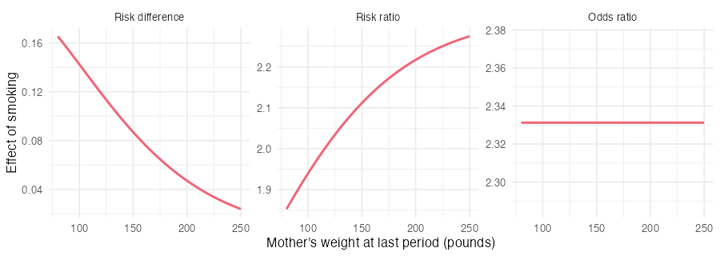
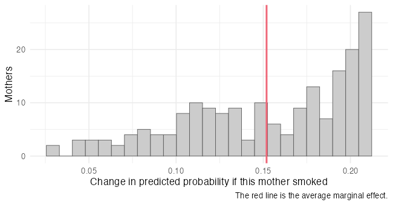
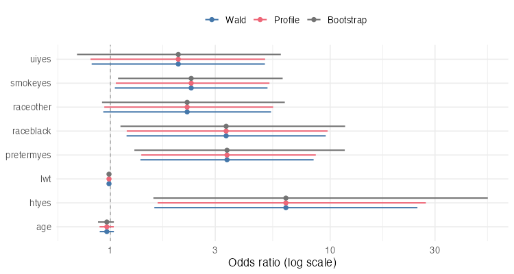
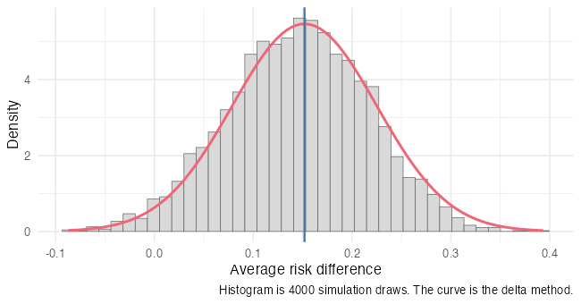
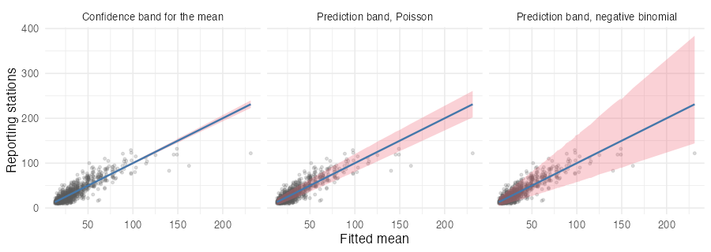
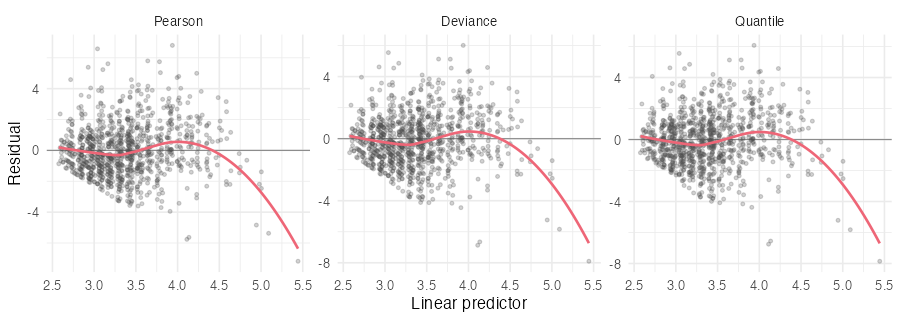
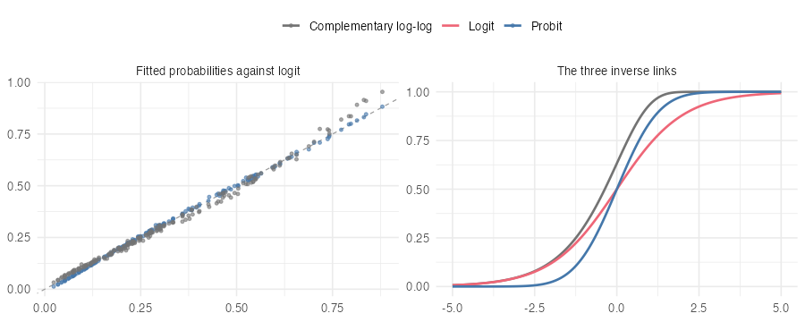
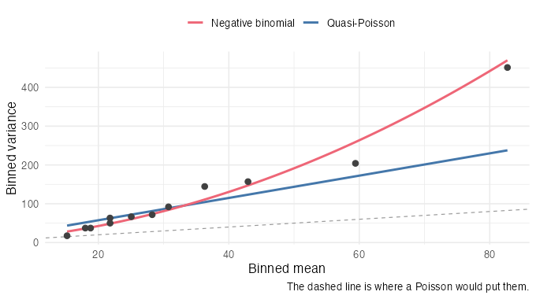
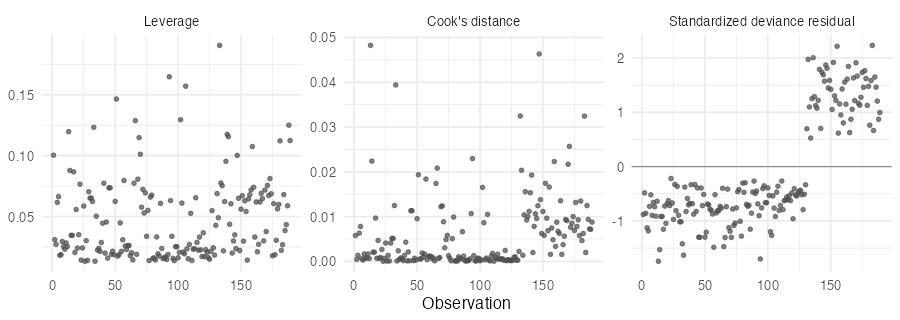
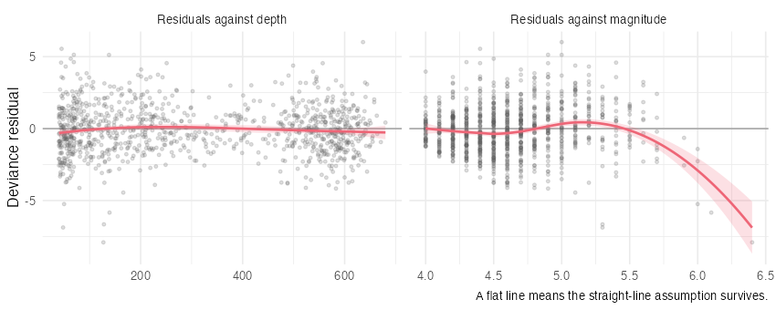

<script>
  MathJax = {
    tex: { inlineMath: [['$','$'], ['\\(','\\)']],
           displayMath: [['$$','$$'], ['\\[','\\]']] },
    svg: { fontCache: 'global' }
  };
</script>
<script src="https://cdn.jsdelivr.net/npm/mathjax@3/es5/tex-svg.js" id="MathJax-script" async></script>

<style>
  .site-footer,
  .footer { display: none; }

  html { scroll-behavior: smooth; }

  .ws-page {
    display: flex;
    gap: 34px;
    align-items: flex-start;
    max-width: 1150px;
    margin: 0 auto;
  }

  .ws-toc {
    position: sticky;
    top: 20px;
    flex: 0 0 225px;
    max-height: calc(100vh - 40px);
    overflow-y: auto;
    font-size: 0.88rem;
  }
  .ws-toc-title {
    font-weight: 700;
    text-transform: uppercase;
    letter-spacing: 0.05em;
    font-size: 0.74rem;
    color: #888;
    padding: 0 10px 8px;
  }
  .ws-toc nav ul { list-style: none; margin: 0; padding: 0; }
  .ws-toc nav a {
    display: block;
    padding: 5px 10px;
    color: #333;
    text-decoration: none;
    border-left: 2px solid transparent;
    line-height: 1.3;
  }
  .ws-toc nav a:hover {
    border-left-color: #666;
    background: rgba(0, 0, 0, 0.04);
    color: #000;
  }
  .ws-toc nav a.active {
    border-left-color: #EE6677;
    color: #000;
    font-weight: 600;
  }
  .ws-toc nav li.sub a {
    padding-left: 24px;
    font-size: 0.83rem;
    color: #666;
  }

  .ws-body { flex: 1 1 auto; min-width: 0; }
  .ws-body h1, .ws-body h2 { scroll-margin-top: 16px; }

  @media (max-width: 900px) {
    .ws-page { flex-direction: column; gap: 12px; }
    .ws-toc {
      position: static;
      flex-basis: auto;
      width: 100%;
      max-height: none;
      border-bottom: 1px solid #ddd;
      padding-bottom: 10px;
      margin-bottom: 6px;
    }
  }
</style>

# GLMs and GAMs in R (Part 2): Interpreting Generalized Linear Models

<div class="ws-page">

  <aside class="ws-toc">
    <div class="ws-toc-title">On this page</div>
    <nav>
      <ul>
        <li><a href="#what-you-will-learn">What You Will Learn</a></li>
        <li><a href="#setup">Setup</a></li>
        <li><a href="#part-a">A. One Coefficient, Many Answers</a></li>
        <li class="sub"><a href="#three-contrasts">Three contrasts</a></li>
        <li class="sub"><a href="#averaging">Averaging over the sample</a></li>
        <li class="sub"><a href="#simulation-interval">An interval by simulation</a></li>
        <li><a href="#part-b">B. Where Uncertainty Comes From</a></li>
        <li class="sub"><a href="#vcov">The covariance matrix</a></li>
        <li class="sub"><a href="#three-intervals">Three intervals</a></li>
        <li class="sub"><a href="#delta-method">The delta method</a></li>
        <li class="sub"><a href="#ci-vs-pi">Means against observations</a></li>
        <li><a href="#part-c">C. Does the Model Fit</a></li>
        <li class="sub"><a href="#deviance">Deviance and pseudo R-squared</a></li>
        <li class="sub"><a href="#residual-types">Three residuals</a></li>
        <li class="sub"><a href="#choosing-link">Choosing the link</a></li>
        <li class="sub"><a href="#overdispersion-fixes">Two fixes for overdispersion</a></li>
        <li class="sub"><a href="#influence">Influence</a></li>
        <li class="sub"><a href="#curvature">The assumption that is left</a></li>
        <li><a href="#you-try">YOU TRY!</a></li>
        <li><a href="#summary">So... what did we learn?</a></li>
        <li><a href="#next-time">Next Time</a></li>
        <li><a href="#references">References</a></li>
      </ul>
    </nav>
  </aside>

  <div class="ws-body" markdown="1">

> Part 1 fit the models. A coefficient came out, we exponentiated it, and we called that an odds ratio or a rate ratio. Today we ask harder questions of the same two models. What is the effect of smoking, in a unit a reader cares about, and why does that question have more than one correct answer. Where do the standard errors come from, and when do the three usual intervals disagree. What does the deviance tell you about fit, and what does it quietly refuse to tell you. We finish on the one assumption a GLM still makes after all of this, because removing it is what Part 3 is for.

## What You Will Learn {#what-you-will-learn}

By the end of this session you will be able to:

1. Give three correct and different answers to "what is the effect of smoking", and say when each one is the right thing to report.
2. Compute an average marginal effect by predicting the whole sample twice, and say why that beats picking a profile.
3. Read a variance-covariance matrix, and say where the standard errors in `summary()` come from.
4. Build Wald, profile likelihood, and bootstrap intervals, and recognise when they part company.
5. Put a confidence interval on a quantity that is a function of several coefficients, by the delta method and by simulation.
6. Tell a confidence interval for a mean from a prediction interval for an observation, and check the coverage of each.
7. Interpret deviance, and say why the residual deviance is not a goodness-of-fit test for binary data.
8. Choose between Pearson, deviance, and quantile residuals, and between a quasi-Poisson and a negative binomial.
9. Find the observations driving the fit, and check the straight-line assumption that remains.

## Setup {#setup}

Same two packages as Part 1. We rebuild the two models from last session and work on those throughout.

```r
packages <- c("ggplot2")
toInstall <- packages[!(packages %in% installed.packages()[, "Package"])]
if (length(toInstall)) install.packages(toInstall)

library(ggplot2)
library(MASS)          # birthwt, mvrnorm, glm.nb
theme_set(theme_classic(base_size = 14))

dispersion <- function(model) {
  sum(residuals(model, type = "pearson")^2) / df.residual(model)
}

data(birthwt)
bw <- birthwt
bw$race    <- factor(bw$race,  labels = c("white", "black", "other"))
bw$smoke   <- factor(bw$smoke, labels = c("no", "yes"))
bw$ht      <- factor(bw$ht,    labels = c("no", "yes"))
bw$ui      <- factor(bw$ui,    labels = c("no", "yes"))
bw$preterm <- factor(ifelse(bw$ptl > 0, "yes", "no"), levels = c("no", "yes"))

logitModel <- glm(low ~ age + lwt + race + smoke + preterm + ht + ui,
                  family = binomial(link = "logit"), data = bw)

data(quakes)
quakePoisson <- glm(stations ~ mag + depth, family = poisson(link = "log"),
                    data = quakes)
```

# Part A: One Coefficient, Many Answers {#part-a}

## Three Contrasts {#three-contrasts}

Part 1 ended on an awkward fact. The smoking coefficient is 0.8464, the odds ratio is 2.331, and that number is the same for every mother in the data. The change in her probability is not. For a 120-pound mother the risk went from 0.117 to 0.236, and for a 180-pound mother it went from 0.051 to 0.112.

So there are three ways to report one effect.

$$\text{risk difference} = p_1 - p_0 \qquad \text{risk ratio} = \frac{p_1}{p_0} \qquad \text{odds ratio} = \frac{p_1/(1-p_1)}{p_0/(1-p_0)}$$

where $p_1$ is the predicted probability with the predictor switched on and $p_0$ is the same prediction with it switched off.

```r
baseProfile <- function(lwt) {
  data.frame(lwt = lwt, age = 23,
             race = factor("white", levels = levels(bw$race)),
             preterm = factor("no", levels = c("no", "yes")),
             ht = factor("no", levels = c("no", "yes")),
             ui = factor("no", levels = c("no", "yes")))
}

threeContrasts <- function(model, profile) {
  noSmoke  <- cbind(profile, smoke = factor("no",  levels = c("no", "yes")))
  yesSmoke <- cbind(profile, smoke = factor("yes", levels = c("no", "yes")))
  p0 <- predict(model, noSmoke, type = "response")
  p1 <- predict(model, yesSmoke, type = "response")
  data.frame(lwt = profile$lwt,
             probabilityNo = p0,
             probabilityYes = p1,
             riskDifference = p1 - p0,
             riskRatio = p1 / p0,
             oddsRatio = (p1 / (1 - p1)) / (p0 / (1 - p0)))
}

round(threeContrasts(logitModel, baseProfile(c(100, 140, 200))), 4)
```

```
  lwt probabilityNo probabilityYes riskDifference riskRatio oddsRatio
1 100        0.1516         0.2940         0.1424    1.9398    2.3312
2 140        0.0896         0.1866         0.0970    2.0829    2.3312
3 200        0.0387         0.0857         0.0471    2.2171    2.3312
```



Only the third panel is flat. That is not a property of the data. It is what the logit link was built to do, and it is why the odds ratio is the quantity the model reports. The other two panels move because the probability moves.

Which one to report depends on the question.

**The odds ratio** is what the model estimates, it is stable across profiles, and it is what a meta-analysis may want. It also overstates the risk ratio whenever the outcome is common, which may be confusing for those reading a manuscript.

**The risk difference** is what a reader can act on. Twelve more small babies per hundred mothers is a sentence that means something. It is tied to the profile you computed it at, so say which one.

**The risk ratio** sits between them and is the usual choice in epidemiology.

> This is a point worth making. An odds ratio of 2.33 does not mean the risk doubled. At a baseline of 0.117 it meant a risk ratio of about 2.0, and at a baseline of 0.051 about 2.2. The gap between the two grows as the outcome gets more common. For a rare outcome they nearly agree, which is why the habit of reading odds ratios as risk ratios survives.

## Averaging Over the Sample {#averaging}

Picking a profile means picking a mother who may not exist. The alternative is to use the ones you have. Predict every mother twice, once with smoking switched on and once with it switched off, then compare the two averages.

```r
counterfactual <- function(data, variable, value) {
  d <- data
  d[[variable]] <- factor(value, levels = levels(data[[variable]]))
  d
}

noAll  <- counterfactual(bw, "smoke", "no")
yesAll <- counterfactual(bw, "smoke", "yes")

pNo  <- predict(logitModel, noAll,  type = "response")
pYes <- predict(logitModel, yesAll, type = "response")

round(c(averageIfNobodySmoked = mean(pNo),
        averageIfEverybodySmoked = mean(pYes),
        averageRiskDifference = mean(pYes - pNo),
        averageRiskRatio = mean(pYes) / mean(pNo),
        observedRate = mean(bw$low)), 4)
```

```
   averageIfNobodySmoked averageIfEverybodySmoked    averageRiskDifference         averageRiskRatio             observedRate 
                  0.2520                   0.4039                   0.1519                   1.6029                   0.3122 
```

This is the average marginal effect, and it answers a question we may want to ask. If every mother in this sample had smoked, how much higher would the rate of low birth weight have been. Each mother keeps her own age, weight, race, and clinical history. Only the one variable moves.

The average is not the whole story.

```r
round(summary(pYes - pNo), 4)
```

```
   Min. 1st Qu.  Median    Mean 3rd Qu.    Max. 
 0.0293  0.1133  0.1617  0.1519  0.1963  0.2085 
```



The effect of smoking is larger for mothers already at moderate risk and smaller for mothers at either extreme. That is the $p(1-p)$ factor again. **Report the average and say what it is averaging over.** A single number that hides a spread this wide is a number that will be misused.

A continuous predictor has a slope rather than a contrast. On the link scale that slope is the coefficient. On the probability scale it is

$$\frac{\partial p_i}{\partial x} = \beta \, p_i (1 - p_i)$$

which again depends on where the mother sits.

```r
pObserved <- fitted(logitModel)
slopeLwt <- coef(logitModel)["lwt"] * pObserved * (1 - pObserved)

round(c(atTheMean = unname(coef(logitModel)["lwt"] *
                             mean(pObserved) * (1 - mean(pObserved))),
        averageOfTheSlopes = mean(slopeLwt),
        smallest = min(slopeLwt), largest = max(slopeLwt)), 6)
```

```
         atTheMean averageOfTheSlopes           smallest            largest 
         -0.003202          -0.002582          -0.003727          -0.000340 
```

The first number is the marginal effect at the mean, where you build an average mother and ask about her. The second is the average marginal effect, where you ask about every mother and average the answers. They are different quantities and they are not interchangeable. The second is often more preferable, because the average of a nonlinear function is not the function of the average.

## An Interval by Simulation {#simulation-interval}

That average risk difference has no standard error in any R output, because it is not a coefficient. It is a function of all nine of them.

The fix is to use what the model does give you, which is a joint sampling distribution for the coefficients. Draw from it, redo the whole calculation inside each draw, and read the interval off the draws.

```r
designNo  <- model.matrix(delete.response(terms(logitModel)), noAll)
designYes <- model.matrix(delete.response(terms(logitModel)), yesAll)

set.seed(2026)
draws <- mvrnorm(4000, coef(logitModel), vcov(logitModel))
simulatedEffect <- apply(draws, 1, function(b) {
  mean(plogis(designYes %*% b)) - mean(plogis(designNo %*% b))
})

round(c(estimate = mean(pYes - pNo),
        lower = unname(quantile(simulatedEffect, 0.025)),
        upper = unname(quantile(simulatedEffect, 0.975))), 4)
```

```
estimate    lower    upper 
  0.1519   0.0035   0.2804 
```

The method works for any quantity you can write as a function of the coefficients. It is the same idea that `mgcv` uses to put intervals on a smooth, which is where Part 4 of this series picks it up.

# Part B: Where the Uncertainty Comes From {#part-b}

## The Covariance Matrix {#vcov}

The standard errors in `summary()` are not a separate calculation. They are the square roots of the diagonal of one matrix.

```r
round(sqrt(diag(vcov(logitModel))), 5)
round(summary(logitModel)$coefficients[, 2], 5)
```

```
> round(sqrt(diag(vcov(logitModel))), 5)
(Intercept)         age         lwt   raceblack   raceother    smokeyes  pretermyes       htyes       uiyes 
    1.23028     0.03781     0.00704     0.53248     0.44843     0.40806     0.46301     0.70324     0.46311 
    
> round(summary(logitModel)$coefficients[, 2], 5)
(Intercept)         age         lwt   raceblack   raceother    smokeyes  pretermyes       htyes       uiyes 
    1.23028     0.03781     0.00704     0.53248     0.44843     0.40806     0.46301     0.70324     0.46311 
```

The off-diagonal entries matter as soon as you combine coefficients. Two predictors that carry similar information produce estimates that move together, so the uncertainty in their sum is smaller than the two standard errors suggest.

```r
round(cov2cor(vcov(logitModel))[1:4, 1:4], 3)
```

```
            (Intercept)    age    lwt raceblack
(Intercept)       1.000 -0.613 -0.630    -0.109
age              -0.613  1.000 -0.131     0.137
lwt              -0.630 -0.131  1.000    -0.213
raceblack        -0.109  0.137 -0.213     1.000
```

This is why the simulation above drew from `mvrnorm` with the full matrix rather than perturbing each coefficient on its own. Ignoring the correlations gives an incorrect interval, which is usually too wide.

## Three Intervals {#three-intervals}

A coefficient has at least three different intervals which may of interest, and R will give you all of them.

**Wald.** Estimate plus or minus 1.96 standard errors, on the link scale. Fast, and it assumes the log-likelihood is a symmetric parabola near its peak.

**Profile likelihood.** Found by moving the coefficient away from its estimate and refitting everything else until the fit degrades by a set amount. Slower, and it does not assume symmetry. This is what `confint()` gives for a `glm`.

**Bootstrap.** Resample the rows, refit, and take the percentiles of the resulting coefficients. Slowest, and it assumes only that the rows are exchangeable.

```r
waldInterval <- confint.default(logitModel)
profileInterval <- confint(logitModel)

set.seed(11)
bootReplicates <- 1000
bootCoefficients <- matrix(NA, bootReplicates, length(coef(logitModel)),
                           dimnames = list(NULL, names(coef(logitModel))))
for (b in seq_len(bootReplicates)) {
  rows <- sample(nrow(bw), replace = TRUE)
  fit <- try(glm(low ~ age + lwt + race + smoke + preterm + ht + ui,
                 family = binomial, data = bw[rows, ]), silent = TRUE)
  if (!inherits(fit, "try-error") && fit$converged) {
    bootCoefficients[b, ] <- coef(fit)
  }
}
bootInterval <- t(apply(bootCoefficients, 2, quantile,
                        probs = c(0.025, 0.975), na.rm = TRUE))

c(bootstrapFailures = sum(!complete.cases(bootCoefficients)))
data.frame(
  estimate = round(exp(coef(logitModel)), 3),
  waldLower = round(exp(waldInterval[, 1]), 3),
  waldUpper = round(exp(waldInterval[, 2]), 3),
  profileLower = round(exp(profileInterval[, 1]), 3),
  profileUpper = round(exp(profileInterval[, 2]), 3),
  bootLower = round(exp(bootInterval[, 1]), 3),
  bootUpper = round(exp(bootInterval[, 2]), 3))
```

```
            estimate waldLower waldUpper profileLower profileUpper bootLower bootUpper
(Intercept)    1.891     0.170    21.078        0.175       22.277     0.175    33.837
age            0.963     0.894     1.037        0.892        1.036     0.878     1.037
lwt            0.985     0.972     0.999        0.971        0.998     0.966     0.999
raceblack      3.363     1.184     9.548        1.186        9.734     1.111    11.696
raceother      2.235     0.928     5.382        0.938        5.501     0.916     6.218
smokeyes       2.331     1.048     5.187        1.058        5.293     1.083     6.079
pretermyes     3.393     1.369     8.408        1.382        8.602     1.285    11.654
htyes          6.288     1.585    24.954        1.640       27.258     1.569    52.150
uiyes          2.036     0.822     5.047        0.812        5.058     0.705     5.963
```



Look along the rows for where the three methods agree and where they do not. They agree when the coefficient is well determined and the sample is large relative to the number of events. They differ more when terms are determined on only a few observations, where the likelihood is skewed and the Wald interval, being symmetric by construction, is incorrectly estimated on one side.

The hypertension term is the one to watch for our model. Part 1 of this series reported its odds ratio as 6.288 with a profile interval from 1.640 to 27.258, which is not remotely symmetric. There are twelve mothers with hypertension in the whole dataset.

## The Delta Method {#delta-method}

Simulation is not the only route. The delta method gets a standard error for any smooth function of the coefficients, using the gradient of that function.

If $\theta = h(\boldsymbol{\beta})$, then

$$\widehat{\text{Var}}(\hat{\theta}) \approx \nabla h(\hat{\boldsymbol{\beta}})^{\top} \, \widehat{\text{Var}}(\hat{\boldsymbol{\beta}}) \, \nabla h(\hat{\boldsymbol{\beta}})$$

where $\nabla h$ is the vector of partial derivatives. The gradient can be found numerically, so nothing has to be differentiated by hand.

```r
riskDifferenceOf <- function(b) {
  mean(plogis(designYes %*% b)) - mean(plogis(designNo %*% b))
}

numericGradient <- function(f, b, h = 1e-6) {
  sapply(seq_along(b), function(j) {
    up <- down <- b
    up[j] <- up[j] + h
    down[j] <- down[j] - h
    (f(up) - f(down)) / (2 * h)
  })
}

g <- numericGradient(riskDifferenceOf, coef(logitModel))
deltaSe <- sqrt(as.numeric(t(g) %*% vcov(logitModel) %*% g))
estimate <- riskDifferenceOf(coef(logitModel))

round(c(estimate = estimate,
        deltaLower = estimate - 1.96 * deltaSe,
        deltaUpper = estimate + 1.96 * deltaSe,
        simulationLower = unname(quantile(simulatedEffect, 0.025)),
        simulationUpper = unname(quantile(simulatedEffect, 0.975))), 4)
```

```
       estimate      deltaLower      deltaUpper simulationLower simulationUpper 
         0.1519          0.0089          0.2949          0.0035          0.2804 
```



The delta method is a normal approximation to the distribution in that histogram. It is quick and it is fine when the quantity is far from a boundary. It fails where the simulated distribution is skewed, and a probability near 0 or 1 is where that happens.

## Means Against Observations {#ci-vs-pi}

A confidence interval for $\mu_i$ says where the average sits. It says nothing about where the next observation will land. The two get confused often, and for a count model the gap between them can be very large.

The confidence band comes from the standard error of the linear predictor, as in Part 1 of the series. The prediction interval comes from the response distribution itself, evaluated at the fitted mean.

```r
negativeBinomial <- glm.nb(stations ~ mag + depth, data = quakes)

quakeLink <- predict(quakePoisson, type = "link", se.fit = TRUE)
mu <- exp(quakeLink$fit)

bands <- data.frame(
  observed = quakes$stations,
  mu = mu,
  confidenceLower = exp(quakeLink$fit - 1.96 * quakeLink$se.fit),
  confidenceUpper = exp(quakeLink$fit + 1.96 * quakeLink$se.fit),
  poissonLower = qpois(0.025, mu),
  poissonUpper = qpois(0.975, mu),
  nbLower = qnbinom(0.025, mu = fitted(negativeBinomial),
                    size = negativeBinomial$theta),
  nbUpper = qnbinom(0.975, mu = fitted(negativeBinomial),
                    size = negativeBinomial$theta))

round(c(
  confidenceBand = mean(bands$observed >= bands$confidenceLower &
                          bands$observed <= bands$confidenceUpper),
  poissonPrediction = mean(bands$observed >= bands$poissonLower &
                             bands$observed <= bands$poissonUpper),
  negativeBinomialPrediction = mean(bands$observed >= bands$nbLower &
                                      bands$observed <= bands$nbUpper),
  target = 0.95), 4)
```

```
            confidenceBand      poissonPrediction   negativeBinomialPrediction         target 
                     0.045                  0.795                        0.953          0.950 
```



Three bands and three coverage rates... only one of them is meant to be near 0.95. The confidence band is narrow and covers few of the points, which is the behaviour we would expect. With 1000 earthquakes, the well-determined mean tells you little about a single event.

The two prediction bands differ for the reason Part 1 in this series flagged. The Poisson one is built on a variance that equals the mean, and the dispersion in this model is 2.874, so that variance is too small and the band is too narrow. The negative binomial allows the extra spread.

**Say which interval you are reporting.** A reader who hears "95 percent interval" and sees a narrow band might assume it is about observations.

# Part C: Does the Model Fit {#part-c}

## Deviance and Pseudo R-squared {#deviance}

Deviance is twice the gap in log-likelihood between your model and a saturated model that fits every observation perfectly.

$$D = 2\left(\ell_{\text{saturated}} - \ell_{\text{model}}\right)$$

For binary data the saturated log-likelihood is zero, so the deviance is just $-2\ell$, and the familiar $R^2$ substitutes follow.

```r
n <- nrow(bw)
nullDeviance <- logitModel$null.deviance
residualDeviance <- deviance(logitModel)
coxSnell <- 1 - exp((residualDeviance - nullDeviance) / n)
round(c(nullDeviance = nullDeviance,
        residualDeviance = residualDeviance,
        mcFadden = 1 - residualDeviance / nullDeviance,
        coxSnell = coxSnell,
        nagelkerke = coxSnell / (1 - exp(-nullDeviance / n))), 4)
```

```
 nullDeviance residualDeviance         mcFadden         coxSnell       nagelkerke 
        234.6720         196.8337           0.1612           0.1814           0.2551 
```

McFadden's measure is about 0.16. That is not an $R^2$ and it does not mean 16 percent of anything was explained. Values from 0.2 to 0.4 are often described as a good fit for this measure. Cox and Snell's version cannot reach 1, and Nagelkerke's rescales it so that it can. Use these to compare models on the same data, not to judge one model on its own.

A tempting mistake follows closely from this.

```r
round(c(residualDeviance = residualDeviance,
        degreesOfFreedom = df.residual(logitModel),
        pValueIfYouBelievedIt =
          pchisq(residualDeviance, df.residual(logitModel),
                 lower.tail = FALSE)), 4)
```

```
     residualDeviance      degreesOfFreedom pValueIfYouBelievedIt 
             196.8337              180.0000                0.1852 
```

For grouped data, comparing the residual deviance against a chi-square on the residual degrees of freedom is a goodness-of-fit test. For ungrouped binary data it is not, whatever the number comes out as. The chi-square approximation needs the number of observations per covariate pattern to grow, and for this data, most patterns contain one mother. This is the gap the Hosmer-Lemeshow test in Part 1 of this series was meant to fill.

## Three Residuals {#residual-types}

A GLM has more than one definition of a residual and they answer different questions.

**Pearson.** The raw residual divided by the standard deviation the model predicts for it, $(y_i - \hat{\mu}_i)/\sqrt{V(\hat{\mu}_i)}$. Their sum of squares is the dispersion statistic.

**Deviance.** The signed square root of each observation's contribution to the deviance. Closer to symmetric than Pearson for count data, and what `rstandard()` works with.

**Quantile.** Introduced in Part 1 of this series. The only one of the three that follows a normal distribution when the model is correctly specified, for a discrete response.

```r
set.seed(7)
quakeMu <- fitted(quakePoisson)
quantileResidual <- qnorm(runif(nrow(quakes),
                                ppois(quakes$stations - 1, quakeMu),
                                ppois(quakes$stations, quakeMu)))

round(rbind(
  pearson = summary(residuals(quakePoisson, type = "pearson")),
  deviance = summary(residuals(quakePoisson, type = "deviance")),
  quantile = summary(quantileResidual)), 3)
```

```
           Min. 1st Qu. Median   Mean 3rd Qu.  Max.
pearson  -7.183  -1.118 -0.171 -0.011   0.929 6.804
deviance -7.902  -1.169 -0.171 -0.095   0.903 6.011
quantile -7.856  -1.133 -0.144 -0.061   0.939 6.074
```



Read the three panels for shape rather than for spread. A trend in the smoother means the mean may be incorrect somewhere, and that message should appear in all three. A fan means the variance assumption is not met. Stripes at the bottom of the Pearson and deviance panels are the discreteness of the response and mean nothing on their own, which is the reason the third panel exists.

## Choosing the Link {#choosing-link}

The logit is a default, but like everything, is data dependent. Two other links are in common use for binary data.

| Link | $g(\mu)$ | $g^{-1}(\eta)$ | Shape |
|---|---|---|---|
| Logit | $\log\!\left(\frac{\mu}{1-\mu}\right)$ | $\frac{1}{1+e^{-\eta}}$ | Symmetric, gives odds ratios |
| Probit | $\Phi^{-1}(\mu)$ | $\Phi(\eta)$ | Symmetric, slightly lighter tails |
| Complementary log-log | $\log(-\log(1-\mu))$ | $1 - e^{-e^{\eta}}$ | Asymmetric, approaches 1 faster than 0 |

```r
probitFit  <- update(logitModel, family = binomial(link = "probit"))
cloglogFit <- update(logitModel, family = binomial(link = "cloglog"))

round(data.frame(
  AIC = c(logit = AIC(logitModel), probit = AIC(probitFit),
          cloglog = AIC(cloglogFit)),
  residualDeviance = c(deviance(logitModel), deviance(probitFit),
                       deviance(cloglogFit)),
  largestDifferenceFromLogit = c(
    0,
    max(abs(fitted(probitFit) - fitted(logitModel))),
    max(abs(fitted(cloglogFit) - fitted(logitModel))))), 4)
```

```
             AIC residualDeviance largestDifferenceFromLogit
logit   214.8337         196.8337                     0.0000
probit  214.4520         196.4520                     0.0204
cloglog 214.6072         196.6072                     0.0830
```



The second panel is worth looking at. Where the fitted probabilities sit in the middle of the range, the three links produce nearly the same numbers, and any AIC difference between them is small. The choice starts to matter in the tails, and when the probability of the event is strongly asymmetric the complementary log-log is a viable option.

## Two Fixes for Overdispersion {#overdispersion-fixes}

Part 1 of this series left the earthquake model with a dispersion of 2.874 and a promise. There are two standard answers and they assume different things.

**Quasi-Poisson** keeps the Poisson mean and multiplies its variance by a constant.

$$\text{Var}(Y_i) = \phi \, \mu_i$$

**Negative binomial** adds a quadratic term, which comes from treating the rate itself as varying between observations.

$$\text{Var}(Y_i) = \mu_i + \frac{\mu_i^2}{\theta}$$

```r
negativeBinomial <- glm.nb(stations ~ mag + depth, data = quakes)
quakeQuasi <- glm(stations ~ mag + depth, family = quasipoisson(link = "log"),
                  data = quakes)

round(c(poissonDispersion = dispersion(quakePoisson),
        quasiDispersion = summary(quakeQuasi)$dispersion,
        negativeBinomialTheta = negativeBinomial$theta,
        thetaStandardError = negativeBinomial$SE.theta), 4)

round(data.frame(
  poisson = summary(quakePoisson)$coefficients[, 2],
  quasiPoisson = summary(quakeQuasi)$coefficients[, 2],
  negativeBinomial = summary(negativeBinomial)$coefficients[, 2]), 5)

round(c(poissonAIC = AIC(quakePoisson),
        negativeBinomialAIC = AIC(negativeBinomial)), 2)
```

```
### quasi-Poisson and negative binomial on the same data
    poissonDispersion       quasiDispersion negativeBinomialTheta    thetaStandardError 
               2.8736                2.8736               17.6793                1.2619 

### standard errors under the three treatments
(Intercept) 0.05909      0.10016          0.11457
mag         0.01171      0.01985          0.02352
depth       0.00003      0.00004          0.00005


### AIC exists for one of them and not the other
         poissonAIC negativeBinomialAIC 
            8052.75             7174.96 
```

Three things separate them in practice.

**The quasi-Poisson is not a likelihood.** It is an estimating equation with a variance adjustment bolted on. There is no AIC, no `logLik()`, and no likelihood ratio test. The negative binomial is a real distribution.

**They weight observations differently.** Under the quasi-Poisson the extra variance is proportional to the mean, so large counts stay influential. Under the negative binomial it grows with the square, so large counts are downweighted more. The two give different standard errors, not just rescaled ones.

**Only one of them is checkable from the data.** Plot the binned variance against the binned mean and see which shape it follows.

```r
varianceBins <- cut(fitted(quakePoisson),
                    breaks = quantile(fitted(quakePoisson),
                                      probs = seq(0, 1, length.out = 13)),
                    include.lowest = TRUE)
binnedVariance <- data.frame(
  mean = tapply(quakes$stations, varianceBins, mean),
  variance = tapply(quakes$stations, varianceBins, var))
round(binnedVariance, 2)
```

```
             mean variance
[13.1,17]   15.20    17.54
(17,18.9]   18.00    37.32
(18.9,21]   18.81    37.30
(21,22.5]   21.79    63.21
(22.5,24.9] 21.80    50.04
(24.9,27.6] 25.05    66.51
(27.6,30.5] 28.25    71.80
(30.5,33.7] 30.75    92.02
(33.7,38.2] 36.30   144.48
(38.2,48.1] 42.94   156.97
(48.1,61.6] 59.41   204.15
(61.6,231]  82.71   451.22
```



A straight line through the origin favours the quasi-Poisson. A curve that lifts away from the line as the mean grows favours the negative binomial. 

If neither fits, the usual causes are a missing predictor, grouped observations that are not independent, or more zeros than either distribution can produce. Part 6 of this series handles the grouping.

## Influence {#influence}

A GLM has leverage and influence in the same sense a linear model does, computed from the weighted design matrix rather than the raw one.

```r
influenceFrame <- data.frame(
  index = seq_len(nrow(bw)),
  leverage = hatvalues(logitModel),
  cook = cooks.distance(logitModel),
  standardized = rstandard(logitModel))

round(head(influenceFrame[order(-influenceFrame$cook), ], 6), 4)
round(c(averageLeverage = mean(influenceFrame$leverage),
        ruleOfThumb = 2 * length(coef(logitModel)) / nrow(bw),
        aboveRuleOfThumb = sum(influenceFrame$leverage >
                                 2 * length(coef(logitModel)) / nrow(bw))), 4)
```

```
    index leverage   cook standardized
98     13   0.1197 0.0482      -1.7431
28    147   0.1002 0.0463       1.8101
119    33   0.1233 0.0394      -1.6309
10    132   0.0490 0.0325       1.9752
77    183   0.0269 0.0324       2.2319
59    171   0.0756 0.0257       1.6670

 averageLeverage      ruleOfThumb aboveRuleOfThumb 
          0.0476           0.0952          19.0000 
```



Average leverage is always the number of coefficients divided by the number of observations, and twice that is a rule of thumb red flat. A high Cook's distance is a prompt to look at the row and make a decision as to whether or not you want to keep it. The observations that move a logistic fit the most are usually the ones whose outcome the model got most wrong, and those are often the interesting ones.

Separation is something else we should look at. When a predictor splits the outcome perfectly, the likelihood has no maximum, the coefficient runs toward infinity, and R reports a huge estimate with an even larger standard error alongside a warning about fitted probabilities of 0 or 1.

## The Assumption That Is Left {#curvature}

Everything so far has accepted one claim without checking it. A GLM says the effect of a predictor is a straight line on the link scale. The distribution and the link were chosen to match the response, and after that the model is as rigid about shape as a linear model was.

That claim is checkable the same way it always was.

```r
quakeDepthSquared <- glm(stations ~ mag + depth + I(depth^2),
                         family = poisson(link = "log"), data = quakes)
anova(quakePoisson, quakeDepthSquared, test = "Chisq")
round(c(linearAIC = AIC(quakePoisson),
        quadraticAIC = AIC(quakeDepthSquared)), 2)
```

```
Analysis of Deviance Table

Model 1: stations ~ mag + depth
Model 2: stations ~ mag + depth + I(depth^2)
  Resid. Df Resid. Dev Df Deviance  Pr(>Chi)    
1       997     2870.6                          
2       996     2857.7  1   12.889 0.0003305 ***
---
Signif. codes:  0 ‘***’ 0.001 ‘**’ 0.01 ‘*’ 0.05 ‘.’ 0.1 ‘ ’ 1

   linearAIC quadraticAIC 
     8052.75      8041.86 
```



A flat smoother (curve) means the straight-line assumption is met. A bend means it is not met, and the model is paying for that bend somewhere else, usually in the dispersion statistic, which is how a shape problem gets misdiagnosed as an overdispersion problem.

Adding a squared term is one possible answer, but not always the correct answer. You have to guess the shape before you fit, a quadratic has to turn around once and cannot do anything else, and the fit at one end of the range is controlled by the data at the other end. Part 3 of this series replaces the guess.

# YOU TRY! {#you-try}

Work through these for the next 15 minutes. Both datasets come with R.

```r
library(MASS)
data(Pima.tr)   # 200 women, type = Yes/No for diabetes
data(quine)     # 146 children, Days = days absent from school
```

**Part 1. Three contrasts.** Fit `glm(type ~ glu + bmi + age + ped, family = binomial, data = Pima.tr)`. Take a 10-unit rise in `glu` and report it as an odds ratio, a risk ratio, and a risk difference, at the first and third quartiles of `glu`. Which of the three changed most between the two starting points?

**Part 2. The average marginal effect.** Predict the whole sample twice, once at each woman's own `glu` and once at `glu + 10`, and average the difference. Compare that with the marginal effect at the mean.

**Part 3. An interval for it.** Put a 95 percent interval on that average using `mvrnorm` and 4000 draws. Then do the same with the delta method. Do they agree?

**Part 4. Three intervals.** Compute Wald and profile likelihood intervals for all four coefficients. Which term shows the largest disagreement, and what is different about that term?

**Part 5. A count model.** Fit `glm(Days ~ Eth + Sex + Age + Lrn, family = poisson, data = quine)` and compute the dispersion. It is large. Before fixing it, check whether a missing term explains it by adding an interaction and looking again.

**Part 6. Pick a fix.** Fit both `quasipoisson` and `glm.nb` versions. Plot the binned variance against the binned mean and decide which variance function the data supports. Report how much the standard errors change.

**Part 7. Which interval.** Build a confidence band for the mean and a prediction interval for a child's absences. What fraction of the observed values does each one contain?

**Part 8. The honest summary.** Write three sentences on what predicts absence, for a school administrator. Include an effect on the day scale rather than the log scale, state the uncertainty, and name the dispersion.

# So... what did we learn? {#summary}

1. One fitted logistic model gives three correct answers to "what does smoking do". Only the odds ratio is constant across mothers, and that is a property of the link rather than a finding.
2. An odds ratio is not a risk ratio. The two separate as the outcome becomes common, and reporting the first while meaning the second is a widespread error.
3. The average marginal effect predicts every observation twice and averages the difference. It answers a question about this sample rather than about an invented average person.
4. The marginal effect at the mean and the average marginal effect are different numbers, because the average of a nonlinear function is not the function of the average.
5. Standard errors are the square roots of the diagonal of `vcov()`. The off-diagonal entries matter as soon as coefficients are combined, so simulate from the whole matrix.
6. Wald, profile likelihood, and bootstrap intervals agree when a coefficient rests on plenty of data and disagree when it does not. The hypertension term in this model rests on twelve mothers.
7. Any function of the coefficients can carry an interval, by the delta method or by simulation. The delta method is a normal approximation, and it is the one that fails near a boundary.
8. A confidence interval for a mean is not a prediction interval for an observation. With 1000 earthquakes the first is narrow and correct, and it tells you almost nothing about the next earthquake.
9. Deviance measures the gap to a perfect fit. For ungrouped binary data the residual deviance is not a goodness-of-fit test, whatever a chi-square p-value on it says.
10. Pseudo R-squared measures compare models on the same data. They do not mean what $R^2$ means and they do not travel between datasets.
11. Pearson, deviance, and quantile residuals answer different questions. Only the quantile version is normal under a correct model for discrete data.
12. Quasi-Poisson and negative binomial assume different variance functions, one linear in the mean and one quadratic. The binned variance plot tells you which the data supports, and only the negative binomial has an AIC.
13. A GLM still assumes a straight line on the link scale. Curvature in a residual plot against a predictor is a shape problem, and it often shows up disguised as overdispersion.

# Next Time {#next-time}

**Part 3: Intro to Generalized Additive Models.** Today ended on a bend in a residual plot and a squared term that was not a real answer. Next session removes the straight-line assumption rather than patching around it. We replace $\beta_j x_j$ with a smooth function $f_j(x_j)$ built from basis functions, and let a penalty decide how much the curve is allowed to wiggle rather than fixing the shape in advance. The model becomes

$$g(\mu_i) = \beta_0 + f_1(x_{i1}) + f_2(x_{i2}) + \cdots$$

We move from `glm()` to `mgcv::gam()`, which takes the same `family` argument you already know, fit the earthquake depth effect as a smooth, and compare it with today's quadratic. Every GLM is a GAM with all its smooths forced to be straight.

# References {#references}

**Interpretation and marginal effects.**

- Norton, E. C., Dowd, B. E. and Maciejewski, M. L. (2018). Odds ratios, current best practice and use. *JAMA*, 320(1), 84-85. Short, and worth handing to a coauthor.
- Arel-Bundock, V., Greifer, N. and Heiss, A. (2024). How to interpret statistical models using `marginaleffects` in R and Python. *Journal of Statistical Software*, 111(9). The package that automates Part A.

**Uncertainty.**

- Efron, B. and Tibshirani, R. J. (1993). *An Introduction to the Bootstrap*. Chapman and Hall.

**Fit and diagnostics.**

- McCullagh, P. and Nelder, J. A. (1989). *Generalized Linear Models*, 2nd edition. Chapman and Hall. Chapter 2 for deviance and residuals.
- Dunn, P. K. and Smyth, G. K. (1996). Randomized quantile residuals. *Journal of Computational and Graphical Statistics*, 5(3), 236-244.
- Hosmer, D. W., Lemeshow, S. and Sturdivant, R. X. (2013). *Applied Logistic Regression*, 3rd edition. Wiley. Chapter 5 for why the residual deviance is not a fit test here.
- Ver Hoef, J. M. and Boveng, P. L. (2007). Quasi-Poisson vs. negative binomial regression, how should we model overdispersed count data? *Ecology*, 88(11), 2766-2772. The paper behind the variance function plot.

**Data.**

- Venables, W. N. and Ripley, B. D. (2002). *Modern Applied Statistics with S*, 4th edition. Springer.
- Run `?birthwt`, `?quakes`, `?Pima.tr` and `?quine` for the variable definitions and original sources.

  </div>
</div>

<script>
document.addEventListener('DOMContentLoaded', function () {
  var links = Array.prototype.slice.call(
    document.querySelectorAll('.ws-toc nav a'));
  var targets = links.map(function (a) {
    return document.getElementById(a.getAttribute('href').slice(1));
  });
  function update() {
    var best = -1;
    for (var i = 0; i < targets.length; i++) {
      if (targets[i] && targets[i].getBoundingClientRect().top <= 90) best = i;
    }
    links.forEach(function (a, i) { a.classList.toggle('active', i === best); });
  }
  window.addEventListener('scroll', update, { passive: true });
  update();
});
</script>
