<script>
  MathJax = {
    tex: { inlineMath: [['$','$'], ['\\(','\\)']],
           displayMath: [['$$','$$'], ['\\[','\\]']] },
    svg: { fontCache: 'global' }
  };
</script>
<script src="https://cdn.jsdelivr.net/npm/mathjax@3/es5/tex-svg.js" id="MathJax-script" async></script>

<style>
  .site-footer,
  .footer { display: none; }
</style>

# Linear Regression in R (Part 1): Intro to Linear Regression

> This is the first workshop in a six-part series on linear regression. Today we work with a single explanatory variable. Next time we extend to several predictors at once (multiple linear regression).

## What You Will Learn

By the end of this session you will be able to:

1. Fit a simple linear regression model in R with `lm()`.
2. Interpret the slope and the intercept.
3. Visualize the fitted relationship and its uncertainty.
4. Tell the errors $\epsilon_i$ apart from the residuals $e_i$, and know which one the assumptions describe.
5. State the assumptions that decide whether the model can be trusted, and write each one as an equation.
6. Check those assumptions two ways, with diagnostic plots and with test statistics you compute yourself.
7. Read the standard model output, including the coefficient table, the residual standard error, and $R^2$.

The approach is visual first. We plot the data, fit a model, plot what the model claims, and then write down the algebra behind the output.

## Setup

We use base R for the modeling and `ggplot2` for plots. Install `ggplot2` once, then load it at the start of every session.


```r
# install once (skip if already installed)
packages <- c("ggplot2")
toInstall <- packages[!(packages %in% installed.packages()[, "Package"])]
if (length(toInstall)) install.packages(toInstall)

library(ggplot2)
theme_set(theme_classic(base_size = 14))
```

## The Data

We use `trees`, a dataset built into R. It records measurements on 31 black cherry trees. We predict the volume of usable timber in a tree from its girth.


```r
data(trees)
head(trees)
nTrees <- nrow(trees)
nTrees
```

```
  Girth Height Volume
1   8.3     70   10.3
2   8.6     65   10.3
3   8.8     63   10.2
4  10.5     72   16.4
5  10.7     81   18.8
6  10.8     83   19.7
```

Each row is one tree. `Girth` is the trunk diameter in inches, measured at 4 ft 6 in above the ground. `Height` is in feet. `Volume` is in cubic feet. We will use `Girth` to explain `Volume` and leave `Height` for the multiple regression workshop.

A wider trunk should hold more wood. Linear regression lets us say how much more. It also lets us put a number on how sure we are.

## Visualizing the Relationship First

Always look at the data before fitting anything. A scatter plot shows the shape of the relationship. It also warns you early if a straight line is the wrong tool.


```r
ggplot(trees, aes(x = Girth, y = Volume)) +
  geom_point() +
  labs(x = "Trunk girth (inches)",
       y = "Timber volume (cubic feet)",
       title = "")
```

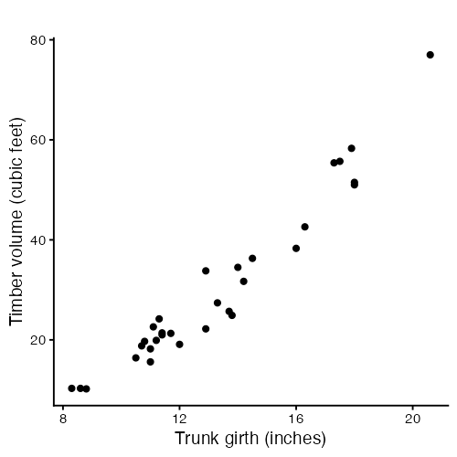

The points rise from the lower left to the upper right. The trend looks close to a straight line, so simple linear regression is a reasonable starting model.

## Looking at Each Variable on Its Own

It helps to see the shape of each variable before fitting. We put two curves on each histogram. The blue curve is a kernel density estimate, which follows whatever shape the data has. The dashed orange curve is a normal curve with the same mean and standard deviation as the variable. Comparing the two is how you judge by eye how far a variable sits from normal.


```r
ggplot(trees, aes(x = Girth)) +
  geom_histogram(aes(y = after_stat(density)), bins = 10,
                 fill = "grey85", colour = "white") +
  geom_density(colour = "steelblue", linewidth = 1) +
  stat_function(fun = dnorm,
                args = list(mean = mean(trees$Girth), sd = sd(trees$Girth)),
                colour = "darkorange", linetype = "dashed", linewidth = 1) +
  labs(x = "Trunk girth (inches)", y = "Density", title = "")
```

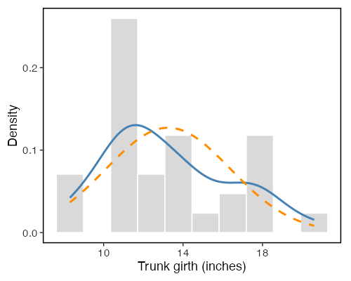


```r
ggplot(trees, aes(x = Volume)) +
  geom_histogram(aes(y = after_stat(density)), bins = 10,
                 fill = "grey85", colour = "white") +
  geom_density(colour = "steelblue", linewidth = 1) +
  stat_function(fun = dnorm,
                args = list(mean = mean(trees$Volume), sd = sd(trees$Volume)),
                colour = "darkorange", linetype = "dashed", linewidth = 1) +
  labs(x = "Timber volume (cubic feet)", y = "Density", title = "")
```

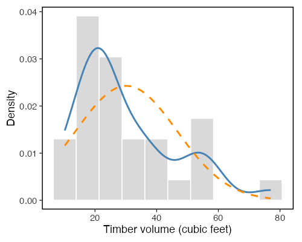

We can also test each variable for normality. Shapiro-Wilk starts from the hypothesis that the data came from a normal distribution, so a small p-value is evidence against normality.


```r
shapiro.test(trees$Girth)
shapiro.test(trees$Volume)
```

```
	Shapiro-Wilk normality test

data:  trees$Girth
W = 0.94117, p-value = 0.08893

data:  trees$Volume
W = 0.88757, p-value = 0.003579
```

> Simple linear regression does not assume that $x$ is normal. It does not assume that $Y$ is normal either. The normality assumption is about the errors $\epsilon_i$, which describes $Y$ at a fixed value of $x$, not the spread of $Y$ on its own. A right-skewed `Volume` is what you would expect here even if the model were perfect, because `Volume` picks up the spread of `Girth` through the regression line. We plot these two variables to understand them and to spot outliers and odd scales. The assumption check comes later, and it runs on the residuals.

## What Is Simple Linear Regression?

A simple linear regression model says the mean of a response variable changes linearly with one predictor variable.

- Response (dependent variable) is the quantity we want to explain. Here, `Volume`. We call it $Y$.
- Predictor (independent variable) is the quantity we use to explain it. Here, `Girth`. We call it $x$.

The model is

$$Y_i = \beta_0 + \beta_1 x_i + \epsilon_i, \qquad i = 1, \dots, n,$$

where

- $\beta_0$ is the intercept, the mean of $Y$ when $x$ is zero,
- $\beta_1$ is the slope, the change in the mean of $Y$ for a one-unit increase in $x$,
- $\epsilon_i$ is the random error, the part of $Y_i$ the line does not explain.

The same model can be written a second way, which makes clear what we are modeling,

$$E[Y_i \mid x_i] = \beta_0 + \beta_1 x_i, \qquad \text{Var}(Y_i \mid x_i) = \sigma^2 .$$

The line $\beta_0 + \beta_1 x$ is the mean of $Y$ at a given $x$. Individual observations scatter around that line with variance $\sigma^2$, and that variance does not change with $x$. So the model has three unknown parameters, not two. They are $\beta_0$, $\beta_1$, and $\sigma^2$.

Stacking the $n$ observations gives the matrix form

$$\mathbf{Y} = \mathbf{X}\beta + \epsilon, \qquad
\beta = \begin{bmatrix} \beta_0 \\ \beta_1 \end{bmatrix},$$

where $\mathbf{Y}$ holds the $n$ responses, $\mathbf{X}$ is an $n \times 2$ matrix, and $\epsilon$ holds the $n$ errors.

Fitting the model means estimating $\beta_0$ and $\beta_1$ from the data. We write the estimates as $\hat\beta_0$ and $\hat\beta_1$.

## Errors and Residuals Are Not the Same Thing

This distinction runs through everything that follows, so we spell it out.

The **error** for observation $i$ is

$$\epsilon_i = Y_i - (\beta_0 + \beta_1 x_i).$$

It is defined using the true parameters, which we never know. So we can never compute it. All five assumptions are statements about this quantity.

The **fitted value** for observation $i$ is the height of the estimated line at $x_i$,

$$\hat{Y}_i = \hat\beta_0 + \hat\beta_1 x_i .$$

The **residual** for observation $i$ is

$$e_i = Y_i - \hat{Y}_i = Y_i - \hat\beta_0 - \hat\beta_1 x_i .$$

It is defined using the estimates, so we can compute it for every observation. A residual is the vertical distance from a point to the fitted line, carrying a sign. It is positive when the point sits above the line and negative when the point sits below.

Residuals are what we see. Errors are what the assumptions describe. Every diagnostic in this workshop works by using $e_i$ as a stand-in for the unknown $\epsilon_i$. That swap is good but imperfect, and we will see where it falls short when we get to leverage.

In matrix form,

$$\hat{\mathbf{Y}} = \mathbf{X}\hat\beta, \qquad \mathbf{e} = \mathbf{Y} - \hat{\mathbf{Y}}.$$

## How Are the Coefficients Estimated?

We choose the line that sits as close to the points as possible. Closeness is measured by the vertical distances we just defined. The least squares method picks the estimates that minimize the sum of squared residuals (SSE),

$$\text{SSE}(\hat\beta_0, \hat\beta_1) = \sum_{i=1}^{n} e_i^2 = \sum_{i=1}^{n} (Y_i - \hat{Y}_i)^2 = \sum_{i=1}^{n} (Y_i - \hat\beta_0 - \hat\beta_1 x_i)^2.$$

Squaring stops positive and negative misses from cancelling. It also punishes large misses more than small ones. Setting both partial derivatives of SSE to zero gives

$$\frac{\partial \text{SSE}}{\partial \hat\beta_0} = -2\sum_{i=1}^{n}(Y_i - \hat\beta_0 - \hat\beta_1 x_i) = 0,
\qquad
\frac{\partial \text{SSE}}{\partial \hat\beta_1} = -2\sum_{i=1}^{n}x_i(Y_i - \hat\beta_0 - \hat\beta_1 x_i) = 0.$$

These two equations are called the **normal equations**. The bracketed term in both is $e_i$, so the normal equations say

$$\sum_{i=1}^{n} e_i = 0 \qquad \text{and} \qquad \sum_{i=1}^{n} x_i e_i = 0 .$$

We come back to those two identities after fitting the model. They cause a lot of confusion, and they are worth a section of their own. Solving the normal equations gives the closed form

$$\hat\beta_1 = \frac{\sum_{i=1}^{n} (x_i - \bar{x})(Y_i - \bar{Y})}{\sum_{i=1}^{n} (x_i - \bar{x})^2} = \frac{S_{xY}}{S_{xx}}, \qquad \hat\beta_0 = \bar{Y} - \hat\beta_1 \bar{x}.$$

The slope is the covariance of $x$ and $Y$ divided by the variance of $x$. The intercept forces the line through the point of averages $(\bar{x}, \bar{Y})$.

## Fitting the Model in R

The function `lm()` fits a linear model. The formula `Volume ~ Girth` reads as "Volume explained by Girth".


```r
treeModel <- lm(Volume ~ Girth, data = trees)
summary(treeModel)
```

```
Call:
lm(formula = Volume ~ Girth, data = trees)

Residuals:
   Min     1Q Median     3Q    Max 
-8.065 -3.107  0.152  3.495  9.587 

Coefficients:
            Estimate Std. Error t value Pr(>|t|)    
(Intercept) -36.9435     3.3651  -10.98 7.62e-12 ***
Girth         5.0659     0.2474   20.48  < 2e-16 ***
---
Signif. codes:  0 ‘***’ 0.001 ‘**’ 0.01 ‘*’ 0.05 ‘.’ 0.1 ‘ ’ 1

Residual standard error: 4.252 on 29 degrees of freedom
Multiple R-squared:  0.9353,	Adjusted R-squared:  0.9331 
F-statistic: 419.4 on 1 and 29 DF,  p-value: < 2.2e-16
```

The summary prints a coefficient table. Each row is one coefficient, the intercept first and then the slope on `Girth`, with four columns.

- `Estimate` is the fitted value of the coefficient.
- `Std. Error` is how much the estimate would vary across repeated samples.
- `t value` is the estimate divided by its standard error.
- `Pr(>|t|)` is the p-value for testing whether that coefficient is zero.

A small p-value on `Girth` is evidence that girth helps explain volume, rather than appearing useful by chance. Below the table, the residual standard error is $\hat\sigma$, the estimated standard deviation of the errors, reported on $n - 2$ degrees of freedom. We reproduce every number in this output by hand later in the session.

## The Coefficients by Hand

`lm()` is doing arithmetic we can reproduce. Computing the estimates ourselves makes the formulas concrete. It also sets up the matrix approach we rely on in the next workshop.

### Using the Closed-Form Formulas


```r
girth  <- trees$Girth
volume <- trees$Volume
slopeHat     <- sum((girth - mean(girth)) * (volume - mean(volume))) /
  sum((girth - mean(girth))^2)
interceptHat <- mean(volume) - slopeHat * mean(girth)
c(intercept = interceptHat, slope = slopeHat)
```

```
 intercept      slope 
-36.943459   5.065856 
```

The hand calculation and `coef(treeModel)` agree!

### Using the Model Matrix

Even with a single predictor there is a model matrix. It has one column of ones for the intercept and one column for the predictor,

$$
\mathbf{X} =
\begin{bmatrix}
1 & x_1 \\
1 & x_2 \\
\vdots & \vdots \\
1 & x_n
\end{bmatrix}.
$$

The two normal equations are the two rows of one matrix equation, $\mathbf{X}^\top(\mathbf{Y} - \mathbf{X}\hat\beta) = \mathbf{0}$. Rearranging gives $\mathbf{X}^\top\mathbf{X}\hat\beta = \mathbf{X}^\top\mathbf{Y}$, which solves as

$$\hat\beta = (\mathbf{X}^\top \mathbf{X})^{-1} \mathbf{X}^\top \mathbf{Y}.$$

This needs $\mathbf{X}^\top\mathbf{X}$ to be invertible, which holds as long as the columns of $\mathbf{X}$ are linearly independent. With one predictor that means $x$ is not constant. In R:


```r
designMatrix <- cbind(intercept = 1, girth = girth)   # the matrix X
betaHat <- solve(t(designMatrix) %*% designMatrix) %*%
  t(designMatrix) %*% volume
betaHat
coef(treeModel)
```

```
                [,1]
intercept -36.943459
girth       5.065856
```

This returns the same intercept and slope again. The column of ones is what lets the model fit a non-zero intercept. The same $(\mathbf{X}^\top\mathbf{X})^{-1}\mathbf{X}^\top\mathbf{Y}$ expression handles two predictors, ten predictors, or a hundred, which is why we introduce it now. Next workshop we add columns to $\mathbf{X}$ instead of changing the method.

> In practice, always fit with `lm()`. It handles the numerical work carefully and returns standard errors, p-values, and diagnostics.

## Fitted Values and Residuals in R

Both quantities come straight out of the fitted model.


```r
fittedVolume   <- fitted(treeModel)      # Yhat_i, same as predict(treeModel)
residualVolume <- residuals(treeModel)   # e_i = Y_i - Yhat_i
head(data.frame(Girth    = girth,
                Volume   = volume,
                fitted   = fittedVolume,
                residual = residualVolume))

# a residual is the observed value minus the fitted value
all.equal(as.numeric(residualVolume), volume - as.numeric(fittedVolume))
```

```
  Girth Volume    fitted  residual
1   8.3   10.3  5.103149 5.1968508
2   8.6   10.3  6.622906 3.6770939
3   8.8   10.2  7.636077 2.5639226
4  10.5   16.4 16.248033 0.1519667
5  10.7   18.8 17.261205 1.5387954
6  10.8   19.7 17.767790 1.9322098

> all.equal(as.numeric(residualVolume), volume - as.numeric(fittedVolume))
[1] TRUE
```

## Properties That Hold

The normal equations are not assumptions, and they are not findings about the data. They follow from the way least squares picks $\hat\beta$, and they hold for every dataset you will ever fit. In matrix form they collapse to one statement,

$$\mathbf{X}^\top \mathbf{e} = \mathbf{0}.$$

Written out, along with two consequences that follow from it,

$$\text{(i)} \quad \sum_{i=1}^{n} e_i = 0,
\qquad
\text{(ii)} \quad \sum_{i=1}^{n} x_i e_i = 0,
\qquad
\text{(iii)} \quad \sum_{i=1}^{n} \hat{Y}_i e_i = 0,
\qquad
\text{(iv)} \quad \bar{Y} = \hat\beta_0 + \hat\beta_1 \bar{x}.$$

Identity (i) is the first normal equation. It says the residuals average to zero. Identity (ii) is the second normal equation. It says the residuals are orthogonal to the predictor. Identity (iii) follows from (i) and (ii), because $\hat{Y}_i$ is built from a constant and $x_i$. It says the residuals are orthogonal to the fitted values. Identity (iv) follows from (i) and says the fitted line passes through the point of averages.

There is a geometric way to say (i) through (iii) in one sentence. The vector $\hat{\mathbf{Y}}$ is the orthogonal projection of $\mathbf{Y}$ onto the column space of $\mathbf{X}$, and $\mathbf{e}$ is what is left over, perpendicular to that space.

Verify them in R:

```r
# X^T e = 0
sum(residualVolume)                 # sum of e_i
sum(girth * residualVolume)         # sum of x_i e_i
sum(fittedVolume * residualVolume)  # sum of Yhat_i e_i

# the fitted line passes through the point of averages
c(xbar = mean(girth), ybar = mean(volume))

interceptHat + slopeHat * mean(girth)

# the fitted values have the same mean as the observations
c(mean(fittedVolume), mean(volume))
```

```
> # X^T e = 0, written out one entry at a time
> sum(residualVolume)                 # sum of e_i
[1] -3.552714e-15
> sum(girth * residualVolume)         # sum of x_i e_i
[1] -1.705303e-13
> sum(fittedVolume * residualVolume)  # sum of Yhat_i e_i
[1] -4.547474e-13

> # the fitted line passes through the point of averages
> c(xbar = mean(girth), ybar = mean(volume))
    xbar     ybar 
13.24839 30.17097 

> interceptHat + slopeHat * mean(girth)
[1] 30.17097

> # the fitted values have the same mean as the observations
> c(mean(fittedVolume), mean(volume))
[1] 30.17097 30.17097
```

You will see numbers like `-1.4e-14` rather than clean zeros. That is floating-point rounding.

> **A warning** These identities hold by construction, so they can never tell you whether the model is right. A residual mean of zero is not evidence of a well-specified model. It is arithmetic. In the final section we fit a deliberately wrong model to curved data and confirm that $\sum e_i = 0$ and $\sum x_i e_i = 0$ still hold there. Treat them as a numerical check on your code, not as a diagnostic.
>
> The same warning runs the other way for the uncorrelated-errors assumption. That assumption is $E[\epsilon_i \epsilon_j] = 0$ for $i \neq j$. It describes the errors across hypothetical repeated samples. It is not the same thing as $\sum_i x_i e_i = 0$, which describes the residuals in the one sample you have and is automatically true. The two look alike on the page and mean different things.

## Interpreting the Output

Pull the coefficients out on their own:


```r
coef(treeModel)
```

```
(Intercept)       Girth 
 -36.943459    5.065856 
```

Read them in the units of the data.

- Intercept is the predicted volume when girth is zero. A tree with zero girth has no trunk, so this value carries no physical meaning on its own. The intercept anchors the line. It is not always a quantity worth interpreting.
- Slope on `Girth` is the predicted increase in timber volume, in cubic feet, for each additional inch of girth. This is the number that answers our original question.

Interpreting the intercept outside the range of the observed data is a common mistake. Our trees have girths well above zero, so a prediction at girth zero sits far from any data we saw.

## Visualizing the Fitted Line

Overlay the fitted line on the data. `geom_smooth()` with `method = "lm"` fits the same model and draws it, with a shaded band for the uncertainty in the mean.


```r
ggplot(trees, aes(x = Girth, y = Volume)) +
  geom_point() +
  geom_smooth(method = "lm", se = TRUE,
              color = "darkorange", fill = "darkorange") +
  labs(x = "Trunk girth (inches)",
       y = "Timber volume (cubic feet)",
       title = "")
```

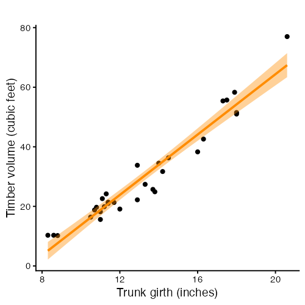

The orange line is the estimated mean volume at each girth. The band is a 95% confidence interval for that mean. The band is narrow in the middle of the data and widens toward the edges, because we have less information about the relationship far from the bulk of the observations.

## Seeing the Residuals

Least squares minimizes the sum of the squared lengths of the grey segments below. Each segment runs from an observation down or up to the fitted line, and its signed length is $e_i$.


```r
treesFitted <- data.frame(trees, fitted = as.numeric(fittedVolume))

ggplot(treesFitted, aes(x = Girth, y = Volume)) +
  geom_segment(aes(xend = Girth, yend = fitted), colour = "grey55") +
  geom_line(aes(y = fitted), colour = "darkorange", linewidth = 1) +
  geom_point() +
  labs(x = "Trunk girth (inches)",
       y = "Timber volume (cubic feet)",
       title = "")
```

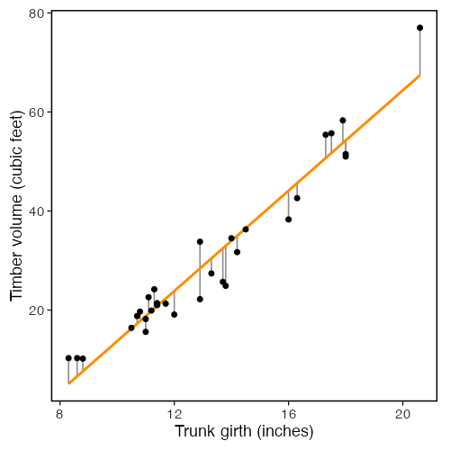

The segments are vertical, not perpendicular to the line. That follows from measuring error only in $Y$, which is assumption 1 below. A method that measured perpendicular distances would be answering a different question.

Look at the pattern of segment lengths across the plot rather than at any one segment. If the model is right, the lengths should look like random draws of constant spread. No stretch of the $x$ axis should have lengths that are long, short, or one-sided as a group.

## Making Predictions

Use the model to predict volume at girth values of interest. `predict()` returns the fitted mean, and with `interval = "confidence"` it returns an interval for that mean.

```r
newTrees <- data.frame(Girth = c(10, 14, 18))
predict(treeModel, newdata = newTrees, interval = "confidence")
```

```
       fit      lwr      upr
1 13.71511 11.44781 15.98240
2 33.97853 32.37101 35.58606
3 54.24196 51.37508 57.10883
```

Each row gives the predicted mean volume at that girth (`fit`) and the lower and upper bounds of the 95% confidence interval. Predict only within the range of girths you observed. Pushing the line far beyond the data assumes the straight-line relationship continues where you have no evidence that it does.

## How Well Does the Model Fit?

Regression splits the total variation in $Y$ into a part the model explains and a part it does not,

$$\text{SST} = \text{SSR} + \text{SSE},$$

where

$$\text{SST} = \sum_{i=1}^{n}(Y_i - \bar{Y})^2,
\qquad
\text{SSR} = \sum_{i=1}^{n}(\hat{Y}_i - \bar{Y})^2,
\qquad
\text{SSE} = \sum_{i=1}^{n}(Y_i - \hat{Y}_i)^2.$$

- SST (total) is how much $Y$ varies around its own mean, ignoring $x$.
- SSR (regression) is how much of that variation the fitted line explains.
- SSE (error) is what is left over in the residuals.

When you expand SST a cross term appears, and it vanishes because of identity (iii) above, $\sum_i \hat{Y}_i e_i = 0$. The split is a Pythagorean identity for the projection, which is why it holds with no remainder.


```r
SST <- sum((volume - mean(volume))^2)
SSR <- sum((fittedVolume - mean(volume))^2)
SSE <- sum((volume - fittedVolume)^2)

SST
SSR + SSE
```

```
> SST
[1] 8106.084
> SSR + SSE        
[1] 8106.084
```

The coefficient of determination, $R^2$, is the share of total variation the model explains,

$$R^2 = \frac{\text{SSR}}{\text{SST}} = 1 - \frac{\text{SSE}}{\text{SST}}.$$


```r
SSR / SST                      # by hand
summary(treeModel)$r.squared   # from the model
```

```
> SSR / SST                      
[1] 0.9353199
> summary(treeModel)$r.squared   
[1] 0.9353199
```

An $R^2$ near one means girth accounts for most of the variation in volume. An $R^2$ near zero means it accounts for very little. For these trees, girth alone explains most of the variation, which matches how tightly the points hug the line.

One caution belongs here. $R^2$ measures how much variation the line captures, not whether the line is the right shape. A curved relationship can still produce a high $R^2$. We will watch that happen to this dataset in the diagnostics.

## Estimating the Error Variance

The third parameter, $\sigma^2$, controls how far points scatter from the line. We estimate it by dividing SSE by the degrees of freedom left after estimating two coefficients,

$$\hat\sigma^2 = \frac{\text{SSE}}{n - 2} = \frac{1}{n-2}\sum_{i=1}^{n} e_i^2 .$$

The square root $\hat\sigma$ is what R prints as the residual standard error. Every standard error in the coefficient table follows from it. Under the assumptions below,

$$\text{Var}(\hat\beta) = \sigma^2 (\mathbf{X}^\top\mathbf{X})^{-1},$$

and we estimate it by substituting $\hat\sigma^2$ for $\sigma^2$. For the simple case this works out to

$$\text{SE}(\hat\beta_1) = \frac{\hat\sigma}{\sqrt{S_{xx}}},
\qquad
\text{SE}(\hat\beta_0) = \hat\sigma\sqrt{\frac{1}{n} + \frac{\bar{x}^2}{S_{xx}}},
\qquad S_{xx} = \sum_{i=1}^{n}(x_i - \bar{x})^2 .$$

Read the slope formula for a moment. The standard error shrinks as $\hat\sigma$ gets smaller, as $n$ grows, and as the $x$ values spread out. Spread in the predictor buys you precision in the slope.

The t statistic in the summary table tests $H_0: \beta_1 = 0$ against $H_1: \beta_1 \neq 0$ using

$$t = \frac{\hat\beta_1 - 0}{\text{SE}(\hat\beta_1)},$$

which follows a $t$ distribution on $n-2$ degrees of freedom when $H_0$ is true. The 95% confidence interval is $\hat\beta_1 \pm t_{0.975,\, n-2}\,\text{SE}(\hat\beta_1)$. The $t$ distribution, and so the p-values and the intervals, is what the normality assumption buys us.


```r
sigmaHatSq <- SSE / (nTrees - 2)
sqrt(sigmaHatSq)                 # residual standard error
summary(treeModel)$sigma         # the same quantity, from the model

covBetaHat <- sigmaHatSq * solve(t(designMatrix) %*% designMatrix)
covBetaHat
sqrt(diag(covBetaHat))           # standard errors by hand
summary(treeModel)$coefficients  # standard errors from the model

# the t statistic and p-value for the slope, by hand
tSlope <- slopeHat / sqrt(diag(covBetaHat))[2]
tSlope
2 * pt(abs(tSlope), df = nTrees - 2, lower.tail = FALSE)

# a 95% confidence interval for the slope, by hand and from the model
slopeHat + c(-1, 1) * qt(0.975, df = nTrees - 2) * sqrt(diag(covBetaHat))[2]
confint(treeModel)
```

```
> sigmaHatSq <- SSE / (nTrees - 2)
> sqrt(sigmaHatSq)                 # residual standard error
[1] 4.251988

> summary(treeModel)$sigma         # the same quantity, from the model
[1] 4.251988

> covBetaHat <- sigmaHatSq * solve(t(designMatrix) %*% designMatrix)
> covBetaHat
           intercept       girth
intercept 11.3242005 -0.81073976
girth     -0.8107398  0.06119536

> sqrt(diag(covBetaHat))           # standard errors by hand
intercept     girth 
 3.365145  0.247377 
 
> summary(treeModel)$coefficients  # standard errors from the model
              Estimate Std. Error   t value     Pr(>|t|)
(Intercept) -36.943459   3.365145 -10.97827 7.621449e-12
Girth         5.065856   0.247377  20.47829 8.644334e-19

> # the t statistic and p-value for the slope, by hand
> tSlope <- slopeHat / sqrt(diag(covBetaHat))[2]
> tSlope
   girth 
20.47829 

> 2 * pt(abs(tSlope), df = nTrees - 2, lower.tail = FALSE)
       girth 
8.644334e-19 

> # a 95% confidence interval for the slope, by hand and from the model
> slopeHat + c(-1, 1) * qt(0.975, df = nTrees - 2) * sqrt(diag(covBetaHat))[2]
[1] 4.559914 5.571799

> confint(treeModel)
                 2.5 %     97.5 %
(Intercept) -43.825953 -30.060965
Girth         4.559914   5.571799
```

Every number in the `summary()` coefficient table is now something you have computed yourself.

## The Assumptions Behind the Model

The coefficient estimates come out of any dataset you give `lm()`. Whether the p-values and intervals can be trusted depends on five assumptions. Each one appears in words, then as an equation.

**1. Certainty in $x$.** The predictor is measured without error and is treated as fixed. All randomness lives in $Y$.

$$x_1, \dots, x_n \text{ fixed and known}, \qquad \text{rank}(\mathbf{X}) = 2 .$$

The rank condition rules out a constant predictor, which would make $\mathbf{X}^\top\mathbf{X}$ singular.

**2. Linearity.** The mean of $Y$ is a straight-line function of $x$. Equivalently, the errors have mean zero at every $x$.

$$E[\epsilon_i] = 0 \quad \text{for all } i
\qquad \Longleftrightarrow \qquad
E[Y_i \mid x_i] = \beta_0 + \beta_1 x_i .$$

**3. Homoscedasticity.** The errors have the same variance everywhere. The spread does not depend on $x$.

$$\text{Var}(\epsilon_i) = E[\epsilon_i^2] = \sigma^2 \quad \text{for all } i .$$

**4. Independence (uncorrelated errors).** One observation's error carries no information about another's.

$$\text{Cov}(\epsilon_i, \epsilon_j) = E[\epsilon_i \epsilon_j] = 0 \quad \text{for all } i \neq j .$$

**5. Normality.** The errors follow a normal distribution.

$$\epsilon_i \sim N(0, \sigma^2).$$

Assumptions 3, 4, and 5 combine into one statement about the whole error vector,

$$\epsilon \sim N_n\!\left(\mathbf{0},\; \sigma^2 \mathbf{I}_n\right),$$

where $\mathbf{I}_n$ is the $n \times n$ identity matrix. The constant diagonal is homoscedasticity. The zero off-diagonals are uncorrelated errors. The $N$ is normality.

The five do different amounts of work, and it is worth knowing which is which.

- Assumptions 1 to 4 are enough for the Gauss-Markov theorem. Least squares is the best linear unbiased estimator of $\beta$, meaning it has the smallest variance among all linear unbiased estimators. Normality is not needed for this.
- Assumption 5 is what gives $\hat\beta \sim N(\beta,\; \sigma^2(\mathbf{X}^\top\mathbf{X})^{-1})$, and with it the $t$ tests, the F test, and the confidence intervals in the summary output.

Violations do not stop R from returning a number. They make the inference around that number unreliable. P-values, confidence intervals, and predictions can all be off.

## Leverage, the Hat Matrix, and Standardized Residuals

One more piece of theory before the diagnostics, because R's plots use it. The fitted values are a linear transformation of the observed response,

$$\hat{\mathbf{Y}} = \mathbf{X}(\mathbf{X}^\top\mathbf{X})^{-1}\mathbf{X}^\top \mathbf{Y} = \mathbf{H}\mathbf{Y},$$

where $\mathbf{H} = \mathbf{X}(\mathbf{X}^\top\mathbf{X})^{-1}\mathbf{X}^\top$ is the **hat matrix**, named for putting the hat on $\mathbf{Y}$. It is symmetric and idempotent, meaning $\mathbf{H}\mathbf{H} = \mathbf{H}$, which is the defining property of a projection. The residuals are the complementary projection,

$$\mathbf{e} = (\mathbf{I}_n - \mathbf{H})\mathbf{Y}.$$

The diagonal entries $h_{ii}$ are called **leverages**. With one predictor,

$$h_{ii} = \frac{1}{n} + \frac{(x_i - \bar{x})^2}{S_{xx}}, \qquad \sum_{i=1}^{n} h_{ii} = 2 .$$

Leverage measures how far an observation's $x$ value sits from the bulk of the data, and so how much pull that observation has on the fitted line. The leverages sum to the number of estimated coefficients.

Here is the consequence that matters, and the reason residuals are an imperfect stand-in for errors. Even when every $\epsilon_i$ has the same variance $\sigma^2$, the residuals do not,

$$\text{Var}(e_i) = \sigma^2 (1 - h_{ii}).$$

A high-leverage point has a residual that is pulled toward zero, because the line is dragged toward that point. So a raw residual plot understates the error at the edges of the $x$ range. Dividing out the known factor fixes this and gives the **standardized residual**

$$r_i = \frac{e_i}{\hat\sigma\sqrt{1 - h_{ii}}},$$

which has roughly unit variance for every $i$. R's Q-Q plot, Scale-Location plot, and Residuals vs Leverage plot all use $r_i$ rather than $e_i$, for this reason.


```r
hatMatrix <- designMatrix %*% solve(t(designMatrix) %*% designMatrix) %*%
  t(designMatrix)
leverage <- diag(hatMatrix)

head(cbind(byHand = leverage, fromModel = hatvalues(treeModel)))
sum(leverage)   # equals the number of estimated coefficients


leverageFormula <- 1 / nTrees +
  (girth - mean(girth))^2 / sum((girth - mean(girth))^2)
all.equal(as.numeric(leverage), leverageFormula)

standardizedByHand <- residualVolume / (sqrt(sigmaHatSq) * sqrt(1 - leverage))
head(cbind(byHand = standardizedByHand, fromModel = rstandard(treeModel)))
```

```
# Leverage
      byHand  fromModel
1 0.11514037 0.11514037
2 0.10539539 0.10539539
3 0.09923722 0.09923722
4 0.05782568 0.05782568
5 0.05423997 0.05423997
6 0.05254865 0.05254865

# Standardized
     byHand  fromModel
1 1.29930490 1.29930490
2 0.91431779 0.91431779
3 0.63534221 0.63534221
4 0.03682059 0.03682059
5 0.37213320 0.37213320
6 0.46685695 0.46685695
```

> Building the full $n \times n$ hat matrix is fine for 31 trees and a bad idea for large $n$. Use `hatvalues()` in practice. We form $\mathbf{H}$ here to make the projection concrete.

## Checking the Assumptions Visually

Base R gives four diagnostic plots for any `lm` object. Set up a two-by-two grid and plot the model.


```r
par(mfrow = c(2, 2))
plot(treeModel)
par(mfrow = c(1, 1))
```

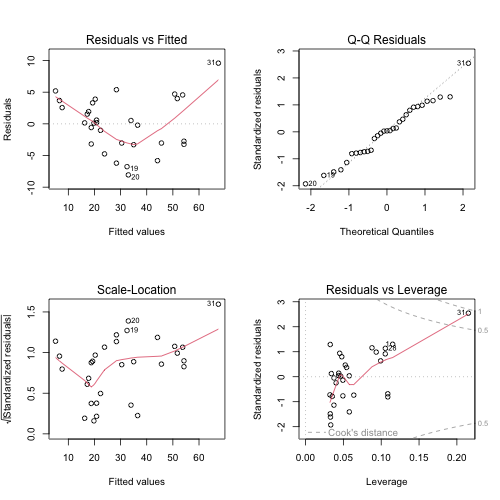

Each panel targets a specific assumption.

| Panel | Assumption | What you want to see |
|---|---|---|
| Residuals vs Fitted | 2, linearity | A flat band around zero with no curve. A curve means the mean is not a straight line. A funnel means the variance is not constant. |
| Q-Q Residuals | 5, normality | Points close to the diagonal. Departures at the ends mean heavy or light tails. |
| Scale-Location | 3, constant variance | A flat trend in $\sqrt{\lvert r_i \rvert}$. A rising or falling trend means the spread changes with the fitted value. |
| Residuals vs Leverage | influence | No point far to the right with a large standardized residual, which would mean one observation is driving the fit. |

For the tree data the Residuals vs Fitted panel shows a curve. Residuals are positive at both ends of the fitted range and negative in the middle. That is the signature of a bending relationship fitted with a straight line.

This is not a surprise if you think about the geometry. Volume is a three-dimensional quantity and girth is a one-dimensional one. For a solid of roughly fixed shape and height, volume grows with the square of the diameter, not in step with it. The straight line is a decent approximation over this range of girths, which is why $R^2$ is high, but it is the wrong functional form. A later workshop in this series covers what to do about it.

### Residuals Against the Predictor

The base plot puts residuals against fitted values. With one predictor those two are a linear rescaling of each other, so a plot against $x$ carries the same information in the units you care about. A loess curve makes any trend easier to see.


```r
residualFrame <- data.frame(girth        = girth,
                            fitted       = as.numeric(fittedVolume),
                            residual     = as.numeric(residualVolume),
                            standardized = as.numeric(rstandard(treeModel)))

ggplot(residualFrame, aes(x = girth, y = residual)) +
  geom_hline(yintercept = 0, linetype = "dashed", colour = "grey40") +
  geom_point() +
  geom_smooth(method = "loess", formula = y ~ x, se = FALSE,
              colour = "darkorange") +
  labs(x = "Trunk girth (inches)", y = "Residual", title = "")
```

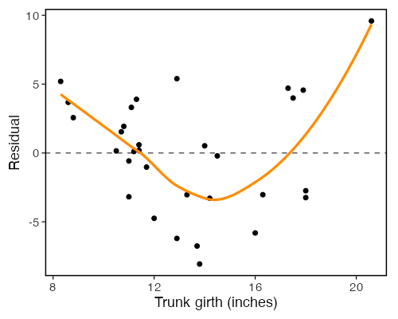

A loess curve that wanders well away from the dashed zero line is evidence against assumption 2. A model that satisfied the assumption would give a curve that stays close to zero across the whole range.

### Are the Residuals Normal?

Now we run the density comparison from earlier, on the quantity the assumption is about. The dashed orange curve is $N(0, \hat\sigma^2)$, the distribution assumption 5 claims the errors have.


```r
ggplot(residualFrame, aes(x = residual)) +
  geom_histogram(aes(y = after_stat(density)), bins = 10,
                 fill = "grey85", colour = "white") +
  geom_density(colour = "steelblue", linewidth = 1) +
  stat_function(fun = dnorm,
                args = list(mean = 0, sd = sqrt(sigmaHatSq)),
                colour = "darkorange", linetype = "dashed", linewidth = 1) +
  labs(x = "Residual", y = "Density", title = "")
```

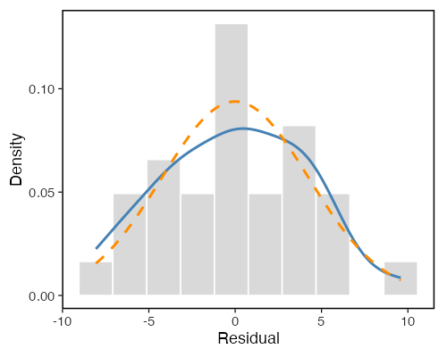

A histogram of 31 values is a blunt instrument, and the kernel density curve depends on a bandwidth choice, so do not over-read small wiggles. The Q-Q plot is the better visual check. It compares the ordered standardized residuals against the quantiles they would take if they were normal. Points on the line mean agreement.


```r
ggplot(residualFrame, aes(sample = standardized)) +
  stat_qq() +
  stat_qq_line(colour = "darkorange", linewidth = 1) +
  labs(x = "Theoretical normal quantile",
       y = "Standardized residual", title = "")
```

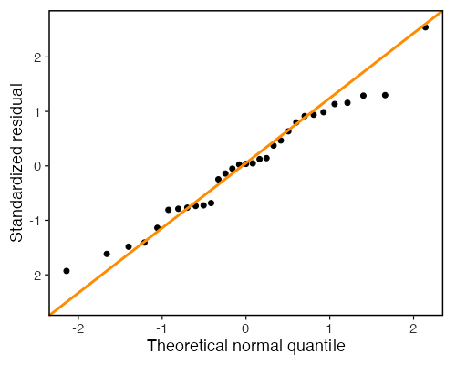

### Are Consecutive Residuals Related?

Assumption 4 is about pairs of errors. One way to look for a violation is to plot each residual against the one before it in the data order. Structure in this plot, such as points clustering along a diagonal, says that neighbouring observations carry related errors.


```r
lagFrame <- data.frame(previous = head(residualFrame$residual, -1),
                       current  = tail(residualFrame$residual, -1))

ggplot(lagFrame, aes(x = previous, y = current)) +
  geom_hline(yintercept = 0, linetype = "dashed", colour = "grey70") +
  geom_vline(xintercept = 0, linetype = "dashed", colour = "grey70") +
  geom_point() +
  labs(x = "Previous residual", y = "Current residual", title = "")
```

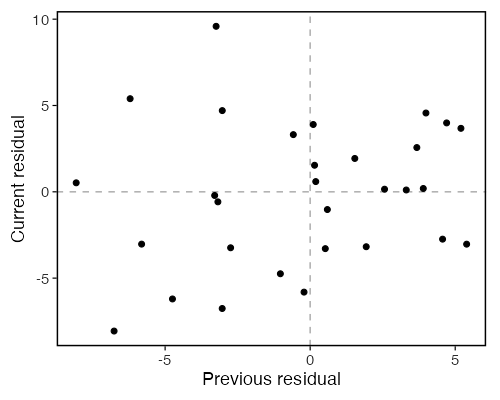

This plot only means something if the row order means something, such as time or a spatial sequence. We come back to that in a moment, because the row order in `trees` is not arbitrary.

## Checking the Assumptions Numerically

Plots are the primary tool. Each of assumptions 3, 4, and 5 also has a formal test. All three run on the residuals, since the errors are unobservable.

**Normality (assumption 5).** Shapiro-Wilk, starting from the hypothesis that the residuals came from a normal distribution. A small p-value is evidence against normality.

**Constant variance (assumption 3).** The Breusch-Pagan test, starting from the hypothesis that $\text{Var}(\epsilon_i) = \sigma^2$ for all $i$. The idea is plain. If the variance is constant, the squared residuals should have no relationship with $x$. So regress $e_i^2$ on $x_i$ and test whether that second regression explains anything. The test statistic is

$$\text{LM} = n R^2_{\text{aux}},$$

which follows a $\chi^2$ distribution on $p$ degrees of freedom when the null is true, where $R^2_{\text{aux}}$ comes from the auxiliary regression and $p$ is the number of predictors in it, here 1. We build it from scratch below. The version in `lmtest::bptest()` returns the same statistic.

**Uncorrelated errors (assumption 4).** The Durbin-Watson statistic,

$$d = \frac{\sum_{i=2}^{n}(e_i - e_{i-1})^2}{\sum_{i=1}^{n} e_i^2},$$

which lies between 0 and 4 and sits near 2 when neighbouring residuals are unrelated. Values well below 2 point to positive correlation between neighbours, and values well above 2 point to negative correlation. The statistic is easy to compute. Its null distribution is not standard, so use `lmtest::dwtest()` for a p-value.


```r
## Normality of the errors: Shapiro-Wilk on the residuals
shapiro.test(residualVolume)

## Constant variance: Breusch-Pagan, computed by hand.
## Regress the squared residuals on the predictor; the test
## statistic is n * R^2 of that auxiliary regression.
auxModel <- lm(residualVolume^2 ~ girth)
bpStatistic <- nTrees * summary(auxModel)$r.squared
bpStatistic
pchisq(bpStatistic, df = 1, lower.tail = FALSE)

## Uncorrelated errors: the Durbin-Watson statistic, computed by hand
dwStatistic <- sum(diff(residualVolume)^2) / sum(residualVolume^2)
dwStatistic

## What order are the rows actually in? This decides whether the
## statistic above means anything.
all(diff(girth) >= 0)
```

```
	Shapiro-Wilk normality test

data:  residualVolume
W = 0.97889, p-value = 0.7811

> bpStatistic
[1] 5.619694

> pchisq(bpStatistic, df = 1, lower.tail = FALSE)
[1] 0.01775975

> dwStatistic
[1] 1.437206

> ## This decides whether the statistic above means anything.
> all(diff(girth) >= 0)
[1] TRUE
```

> **Read the Durbin-Watson result with care here.** The last line checks whether the rows of `trees` are sorted by girth. They are. So "consecutive rows" is not a time ordering or a sampling ordering. It is increasing $x$. A $d$ well below 2 in this dataset reflects the curvature we already found in the residual plot, not serial dependence between measurements. Run Durbin-Watson when the row order means something, such as observations collected over time, and read it against that ordering.

Three cautions apply to all three tests.

1. A large p-value is not proof that an assumption holds. It means the test did not detect a violation, which with $n = 31$ is a weak statement. These tests have low power in small samples.
2. Large samples bring the opposite problem. The tests become sensitive enough to flag departures too small to change any conclusion you would draw.
3. The tests are not independent of each other. A broken linearity assumption leaves structure in the residuals, and that structure can show up as apparent non-normality or apparent non-constant variance. Fix the functional form first, then re-check the rest.

Use the tests to support what the plots show, not to replace them.

## When the Straight Line Is Wrong

Non-constant variance (heteroscedasticity). The spread of residuals grows as the fitted value grows, producing a funnel shape. The data below are simulated with the standard deviation of $\epsilon_i$ set to $x_i$, so assumption 3 is violated by construction.


```r
set.seed(2026)
nPoints <- 400
widthSpread <- runif(nPoints, min = 0, max = 10)
fanResponse <- 2 + 3 * widthSpread + rnorm(nPoints, mean = 0, sd = widthSpread)

fanModel <- lm(fanResponse ~ widthSpread)
plot(fanModel, which = 1)
```

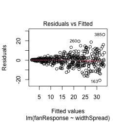

The same failure shows up numerically, using the Breusch-Pagan statistic we built above:


```r
fanAux <- lm(residuals(fanModel)^2 ~ widthSpread)
fanBP <- nPoints * summary(fanAux)$r.squared
fanBP
pchisq(fanBP, df = 1, lower.tail = FALSE)
```

```
> fanBP
[1] 71.24246

> pchisq(fanBP, df = 1, lower.tail = FALSE)
[1] 3.159152e-17
```

Curvature (broken linearity). The true relationship bends, so a straight line leaves a curved pattern in the residuals. The data below come from a quadratic, so assumption 2 fails.


```r
set.seed(2026)
nPoints <- 150
inputValue     <- runif(nPoints, min = 0, max = 5)
curvedResponse <- 10 + 5 * inputValue - inputValue^2 + rnorm(nPoints, mean = 0, sd = 2)

curvedModel <- lm(curvedResponse ~ inputValue)
plot(curvedModel, which = 1)
```

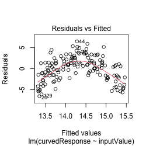

This model is the wrong shape for the data, and we know it. Confirm the warning from earlier, that the normal-equation identities say nothing about whether a model is correct:


```r
zapsmall(c(sumResiduals = sum(residuals(curvedModel)),
           sumXResiduals = sum(inputValue * residuals(curvedModel))))
```

```
 sumResiduals sumXResiduals 
-1.110223e-14 -3.830269e-14 
```

Both are zero, as they are for the tree model, because least squares makes them zero no matter what. Each plot shows the straight-line model failing in a specific way. The fix depends on which assumption broke.

## YOU TRY!

Work through these on your own for the next 15 minutes. Use a different built-in dataset: `faithful`, which records eruptions of the Old Faithful geyser. Each row has `eruptions` (the duration of an eruption in minutes) and `waiting` (the wait until the next eruption in minutes). The question: can the length of an eruption predict how long until the next one?


```r
data(faithful)
head(faithful)
```

**Part 1. Explore the data.**
Make a scatter plot of `waiting` against `eruptions`. Does the relationship look linear? Which way does it slope?

**Part 2. Fit the model.**
Fit a simple linear regression predicting `waiting` from `eruptions` with `lm()`. Save it as `geyserModel` and call `summary()` on it.

**Part 3. Interpret the coefficients.**
Write one sentence for the slope in plain language. Fill in the blank: "Each extra minute of eruption is associated with about ___ more minutes of waiting." Is the intercept meaningful here? Why or why not?

**Part 4. Confirm the slope by hand.**
Reproduce the slope and intercept using the closed-form formulas, then again with the model matrix $\hat\beta = (X^\top X)^{-1} X^\top Y$. Check that all three approaches agree with `coef(geyserModel)`.

**Part 5. Visualize the fit.**
Add the fitted line and its confidence band to your scatter plot with `geom_smooth(method = "lm")`.

**Part 6. Predict.**
Predict the waiting time after an eruption lasting 3.5 minutes, with a 95% confidence interval. Would you trust a prediction for an eruption lasting 10 minutes? Explain.

**Part 7. Check the assumptions.**
Produce the four diagnostic plots. Do the residuals look flat and patternless, or do you see a problem?

**Part 8. Measure the fit.**
Report `R`-squared. What share of the variation in waiting time does eruption duration explain?

If you finish early, compare the eruption durations in a histogram (`hist(faithful$eruptions)`). The shape you see will come up when we discuss what the independence and normality assumptions really require.

## So... what did we learn?

1. Simple linear regression models the mean of a response as a straight-line function of one predictor, $E[Y_i \mid x_i] = \beta_0 + \beta_1 x_i$.
2. Errors $\epsilon_i$ cannot be observed, and they are what the assumptions describe. Residuals $e_i = Y_i - \hat{Y}_i$ can be computed, and every diagnostic uses them as a stand-in.
3. Least squares finds the line by minimizing $\sum_i e_i^2$. For one predictor the estimates have a closed form, and the matrix solution $(\mathbf{X}^\top\mathbf{X})^{-1}\mathbf{X}^\top\mathbf{Y}$ gives the same answer.
4. The normal equations force $\sum_i e_i = 0$ and $\sum_i x_i e_i = 0$ for every dataset. They are identities, not evidence, and a wrong model satisfies them as fully as a right one.
5. $\hat\sigma^2 = \text{SSE}/(n-2)$ estimates the error variance, and $\hat\sigma^2(\mathbf{X}^\top\mathbf{X})^{-1}$ gives every standard error in the coefficient table.
6. $R^2 = \text{SSR}/\text{SST}$ reports the share of variation the model explains. It says nothing about whether the functional form is right.
7. Five assumptions decide whether the inference can be trusted, and together they say $\epsilon \sim N_n(\mathbf{0}, \sigma^2\mathbf{I}_n)$. Check them with diagnostic plots first and formal tests second. Normality of the raw variables was never one of them.

## What Is Next

We used one predictor today. Real questions usually involve several at once. A tree's volume depends on both its girth and its height. A waiting time might depend on more than eruption duration.

Next workshop is Multiple Linear Regression. We add predictors by adding columns to the model matrix `X`, and the same estimator $\hat\beta = (X^\top X)^{-1} X^\top Y$ carries over without change. We will also meet new issues that only appear with more than one predictor, such as how to handle predictors that carry overlapping information.

## References

**Textbooks.** Any of these covers the material above in full, with the derivations we skipped.

- Kutner, M. H., Nachtsheim, C. J., Neter, J. and Li, W. (2005). *Applied Linear Statistical Models*, 5th edition. McGraw-Hill/Irwin. Standard treatment of least squares, the sums-of-squares decomposition, and the Gauss-Markov theorem.
- Weisberg, S. (2014). *Applied Linear Regression*, 4th edition. Wiley.
- Faraway, J. J. (2014). *Linear Models with R*, 2nd edition. Chapman and Hall/CRC. Closest in spirit to this workshop, since it works through the theory in R.
- Fox, J. and Weisberg, S. (2019). *An R Companion to Applied Regression*, 3rd edition. Sage. Documents the `car` package used for alternative diagnostics.

**Methods used in this workshop.**

- Hoaglin, D. C. and Welsch, R. E. (1978). The hat matrix in regression and ANOVA. *The American Statistician*, 32(1), 17-22. Source for leverage, $\text{Var}(e_i) = \sigma^2(1 - h_{ii})$, and standardized residuals.
- Shapiro, S. S. and Wilk, M. B. (1965). An analysis of variance test for normality (complete samples). *Biometrika*, 52, 591-611. The test behind `shapiro.test()`.
- Breusch, T. S. and Pagan, A. R. (1979). A simple test for heteroscedasticity and random coefficient variation. *Econometrica*, 47(5), 1287-1294. The original constant-variance test.
- Koenker, R. (1981). A note on studentizing a test for heteroscedasticity. *Journal of Econometrics*, 17(1), 107-112. The $n R^2$ form of the Breusch-Pagan statistic we computed by hand, which is more robust to non-normal errors than the original.
- Durbin, J. and Watson, G. S. (1950). Testing for serial correlation in least squares regression. I. *Biometrika*, 37, 409-428. Also Durbin, J. and Watson, G. S. (1951). Testing for serial correlation in least squares regression. II. *Biometrika*, 38, 159-178.
- Cleveland, W. S. (1979). Robust locally weighted regression and smoothing scatterplots. *Journal of the American Statistical Association*, 74(368), 829-836. The loess smoother used in the residual plots.

**Data.**

- Ryan, T. A., Joiner, B. L. and Ryan, B. F. (1976). *The Minitab Student Handbook*. Duxbury Press. Source of the `trees` data.
