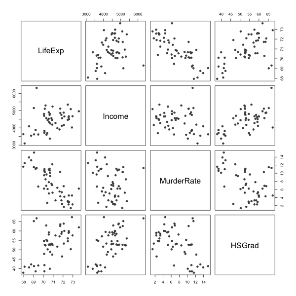
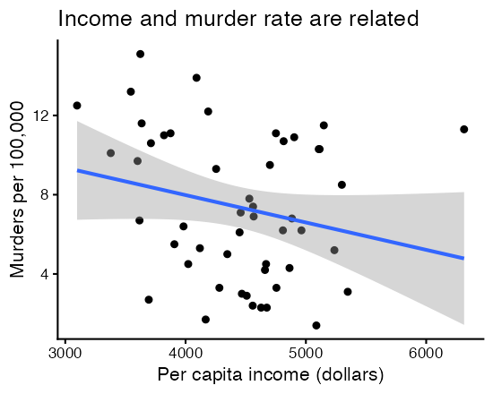
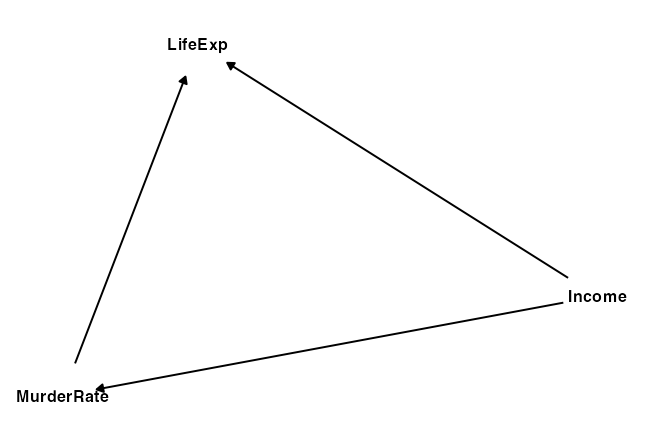
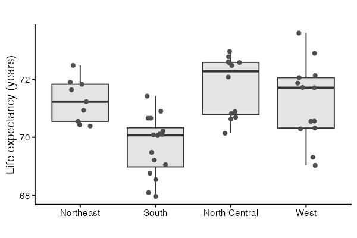
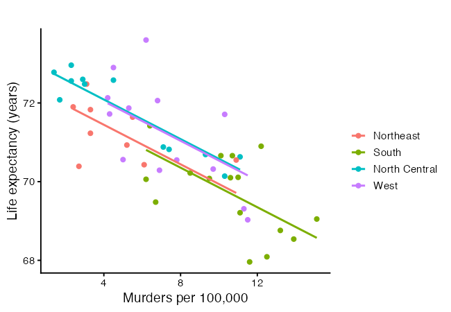
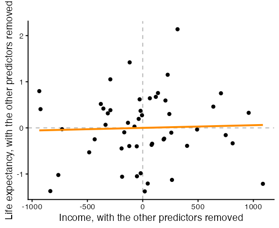
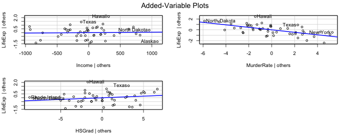
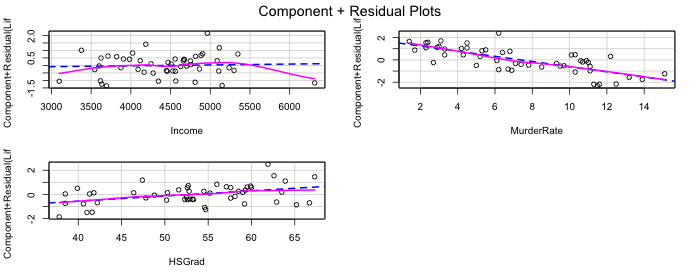
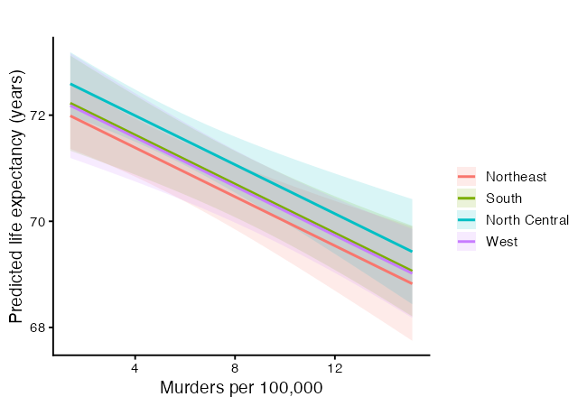

<script>
  MathJax = {
    tex: { inlineMath: [['$','$'], ['\\(','\\)']],
           displayMath: [['$$','$$'], ['\\[','\\]']] },
    svg: { fontCache: 'global' }
  };
</script>
<script src="https://cdn.jsdelivr.net/npm/mathjax@3/es5/tex-svg.js" id="MathJax-script" async></script>

<style>
  .site-footer,
  .footer { display: none; }
</style>

# Linear Regression in R (Part 2): Multiple Linear Regression

> This is the second workshop in a six-part series on linear regression. Last time we used a single predictor. Today we use several at once, and we see how the meaning of a coefficient changes when other predictors sit beside it.

## What You Will Learn

By the end of this session you will be able to:

1. Fit a multiple linear regression model in R with `lm()`.
2. Interpret a coefficient as a partial effect, holding the other predictors fixed.
3. Add a categorical predictor, and see the columns R builds from it.
4. Diagnose collinearity with the variance inflation factor, including the version for factors.
5. Draw partial effect plots, which show one predictor's contribution with the others taken out.
6. Reason about confounding with a directed acyclic graph before trusting a coefficient.
7. Compare models with adjusted $R^2$ and understand why more predictors is not always better.

## Setup

We use base R for modeling, `ggplot2` for plots, `car` for the variance inflation factor and the partial effect plots, and `ggdag` with `dagitty` for drawing causal diagrams. Install once, then load each session.


```r
packages <- c("ggplot2", "car", "dagitty", "ggdag", "leaps")
toInstall <- packages[!(packages %in% installed.packages()[, "Package"])]
if (length(toInstall)) install.packages(toInstall)

library(ggplot2)
library(car)
library(dagitty)
library(ggdag)
theme_set(theme_classic(base_size = 14))
```

## The Data

We use `state.x77`, built into R. It holds eight measurements on each of the 50 US states, recorded in the 1970s. We predict life expectancy from the other variables.

`state.x77` is a matrix with state names as row names, and several column names contain spaces. We clean it into a tidy data frame with workable names. We also attach each state's region from `state.region`, which gives us a categorical predictor.


```r
states <- as.data.frame(state.x77)

# give the awkward column names clean versions
names(states)[names(states) == "Life Exp"] <- "LifeExp"
names(states)[names(states) == "HS Grad"] <- "HSGrad"
names(states)[names(states) == "Murder"]  <- "MurderRate"   # murders per 100,000

# state.region lines up with the rows of state.x77, so we can attach it directly
states$Region <- state.region

head(states)
```

```
   Population Income Illiteracy LifeExp MurderRate HSGrad Frost   Area Region
Alabama          3615   3624        2.1   69.05       15.1   41.3    20  50708  South
Alaska            365   6315        1.5   69.31       11.3   66.7   152 566432   West
Arizona          2212   4530        1.8   70.55        7.8   58.1    15 113417   West
Arkansas         2110   3378        1.9   70.66       10.1   39.9    65  51945  South
California      21198   5114        1.1   71.71       10.3   62.6    20 156361   West
Colorado         2541   4884        0.7   72.06        6.8   63.9   166 103766   West
```

The variables we use today:

- `LifeExp` is life expectancy in years. This is the response.
- `Income` is per capita income in dollars.
- `MurderRate` is murders per 100,000 people.
- `HSGrad` is the percent of adults who are high school graduates.
- `Region` is a categorical variable with four levels (Northeast, South, North Central, West).

> **One caveat about these data.** The columns come from different years. Life expectancy covers 1969 to 1971, the murder rate is from 1976, income is from 1974, and the graduation rate is from 1970. So the response was measured before some of the predictors. We use the dataset because it is built in and convenient for learning the mechanics. Do not read the coefficients as causal effects.

## Looking at the Predictors Together

In Part 1 we plotted one predictor against the response. With several predictors we also want to see how the predictors relate to each other, because that relationship is what makes multiple regression different.


```r
pairs(states[, c("LifeExp", "Income", "MurderRate", "HSGrad")],
      pch = 19, col = "grey30")

round(cor(states[, c("LifeExp", "Income", "MurderRate", "HSGrad")]), 3)
```



```
           LifeExp Income MurderRate HSGrad
LifeExp      1.000   0.34     -0.781  0.582
Income       0.340   1.00     -0.230  0.620
MurderRate  -0.781  -0.23      1.000 -0.488
HSGrad       0.582   0.62     -0.488  1.000
```

Read the top row for the response against each predictor. Read the rest of the panels for the predictors against each other. Strong relationships among the predictors are the thing to watch. They are harmless for prediction and they make individual coefficients hard to pin down, which is the subject of the collinearity section below.

## From One Predictor to Several

Simple linear regression used one predictor,

$$Y_i = \beta_0 + \beta_1 x_i + \epsilon_i.$$

Multiple linear regression uses $p$ predictors at once,

$$Y_i = \beta_0 + \beta_1 x_{i1} + \beta_2 x_{i2} + \cdots + \beta_p x_{ip} + \epsilon_i,$$

where

- $Y_i$ is the response for observation $i$,
- $x_{ij}$ is the value of predictor $j$ for observation $i$,
- $\beta_j$ is the coefficient for predictor $j$,
- $\epsilon_i$ is the error, assumed $N(0, \sigma^2)$ as before.

In matrix form nothing changes from Part 1 except the width of $\mathbf{X}$,

$$\mathbf{Y} = \mathbf{X}\beta + \epsilon, \qquad \hat\beta = (\mathbf{X}^\top\mathbf{X})^{-1}\mathbf{X}^\top\mathbf{Y},$$

where $\mathbf{X}$ is now $n \times (p+1)$. The assumptions from Part 1 carry over unchanged. Certainty in the predictors, linearity, constant error variance, independence, and normal errors.

The one idea that changes is interpretation. In simple regression, $\beta_1$ is the total effect of $x$ on $Y$. In multiple regression, $\beta_j$ is the effect of $x_j$ **holding every other predictor fixed**. This is called a partial effect.

## Fitting a First Model

Start with one predictor, income, so we have a baseline to compare against.


```r
incomeModel <- lm(LifeExp ~ Income, data = states)
summary(incomeModel)
```

```
Residuals:
     Min       1Q   Median       3Q      Max 
-2.96547 -0.76381 -0.03428  0.92876  2.32951 

Coefficients:
             Estimate Std. Error t value Pr(>|t|)    
(Intercept) 6.758e+01  1.328e+00  50.906   <2e-16 ***
Income      7.433e-04  2.965e-04   2.507   0.0156 *  
---
Signif. codes:  0 ‘***’ 0.001 ‘**’ 0.01 ‘*’ 0.05 ‘.’ 0.1 ‘ ’ 1

Residual standard error: 1.275 on 48 degrees of freedom
Multiple R-squared:  0.1158,	Adjusted R-squared:  0.09735 
F-statistic: 6.285 on 1 and 48 DF,  p-value: 0.01562
```

Income has a positive, statistically detectable association with life expectancy, but the adjusted $R^2$ is low. The model leaves most of the variation in life expectancy unexplained, which suggests we are missing predictors that matter.

## Adding a Second Predictor

Add the murder rate. Predictors are joined with `+` in the formula.


```r
twoModel <- lm(LifeExp ~ Income + MurderRate, data = states)
summary(twoModel)
```

```
Residuals:
     Min       1Q   Median       3Q      Max 
-1.48301 -0.62099 -0.01714  0.47768  2.20831 

Coefficients:
              Estimate Std. Error t value Pr(>|t|)    
(Intercept) 71.2255815  0.9673952  73.626  < 2e-16 ***
Income       0.0003705  0.0001973   1.878   0.0666 .  
MurderRate  -0.2697594  0.0328408  -8.214 1.22e-10 ***
---
Signif. codes:  0 ‘***’ 0.001 ‘**’ 0.01 ‘*’ 0.05 ‘.’ 0.1 ‘ ’ 1

Residual standard error: 0.8259 on 47 degrees of freedom
Multiple R-squared:  0.637,	Adjusted R-squared:  0.6215 
F-statistic: 41.23 on 2 and 47 DF,  p-value: 4.561e-11
```

Two things happen worth pausing on.

First, the adjusted $R^2$ jumps. Murder rate explains a large share of the variation that income alone missed.

Second, the coefficient and p-value for income **change**. Income looked useful on its own, and now it looks weaker. Nothing is wrong. Income and murder rate are related, so some of what income appeared to explain was really the murder rate working through it. Once murder rate is in the model, income is credited only with what it adds *beyond* murder rate.

You can see the relationship between the two predictors on its own:


```r
ggplot(states, aes(x = Income, y = MurderRate)) +
  geom_point() +
  geom_smooth(method = "lm", formula = y ~ x) +
  labs(x = "Per capita income (dollars)",
       y = "Murders per 100,000",
       title = "")
```



A coefficient is not a fixed property of a predictor. It depends on which other predictors share the model.

## Thinking About Confounding with a DAG

Before adding more predictors, it helps to draw what we believe about how the variables influence one another. A directed acyclic graph (DAG) is a picture of assumed causal relationships. Arrows point from cause to effect. DAGs make confounding visible. A confounder is a variable that influences both a predictor and the response, and ignoring it distorts the coefficient you care about.

We sketch a DAG where income affects life expectancy both directly and through the murder rate.


```r
lifeDag <- dagify(
  LifeExp ~ Income + MurderRate,
  MurderRate ~ Income,
  labels = c(LifeExp = "Life expectancy",
             Income = "Income",
             MurderRate = "Murder rate")
)

ggdag(lifeDag, text = TRUE) + theme_dag()
```



The arrow from income into murder rate, and from murder rate into life expectancy, is the indirect path that explains why income's coefficient shifted when we added murder rate. The DAG is a reasoning tool, not an output of the data. You bring the arrows. The data cannot tell you their direction.

## Categorical Predictors

So far every predictor is numeric. Region is categorical. Look at it before modeling it.


```r
table(states$Region)
tapply(states$LifeExp, states$Region, mean)

ggplot(states, aes(x = Region, y = LifeExp)) +
  geom_boxplot(outlier.shape = NA, fill = "grey90") +
  geom_jitter(width = 0.15, height = 0, colour = "grey30") +
  labs(x = "", y = "Life expectancy (years)", title = "")
```



```
> table(states$Region)
    Northeast         South North Central          West 
            9            16            12            13 
            
> tapply(states$LifeExp, states$Region, mean)
    Northeast         South North Central          West 
     71.26444      69.70625      71.76667      71.23462 
```

The boxes sit at different heights, so region carries information about life expectancy. The question is how a label like "South" enters a model built on arithmetic.

### What R Builds From a Factor

A factor with $k$ levels enters the model as $k - 1$ indicator columns, also called dummy variables. Each column is 1 when an observation belongs to that level and 0 otherwise. The level with no column of its own is the baseline. With Northeast as the baseline, the model for region alone is

$$Y_i = \beta_0 + \beta_1 D_{i,\text{South}} + \beta_2 D_{i,\text{NorthCentral}} + \beta_3 D_{i,\text{West}} + \epsilon_i,$$

where each $D$ is 0 or 1. Reading off the fitted means one level at a time shows what the coefficients mean. A Northeast state has all three indicators at 0, so its mean is $\beta_0$. A South state has only the first indicator at 1, so its mean is $\beta_0 + \beta_1$. Each coefficient is the difference between that region's mean and the baseline's mean.

You can see the columns R builds:


```r
levels(states$Region)       
contrasts(states$Region)    

regionDummies <- model.matrix(~ Region, data = states)
head(regionDummies)
colnames(regionDummies)

# a factor on its own reproduces the group means
coef(lm(LifeExp ~ Region, data = states))
tapply(states$LifeExp, states$Region, mean)
```

```
> contrasts(states$Region)
              South North Central West
Northeast         0             0    0
South             1             0    0
North Central     0             1    0
West              0             0    1

> head(regionDummies)
           (Intercept) RegionSouth RegionNorth Central RegionWest
Alabama              1           1                   0          0
Alaska               1           0                   0          1
Arizona              1           0                   0          1
Arkansas             1           1                   0          0
California           1           0                   0          1
Colorado             1           0                   0          1

> coef(lm(LifeExp ~ Region, data = states))
        (Intercept)         RegionSouth RegionNorth Central          RegionWest 
        71.26444444         -1.55819444          0.50222222         -0.02982906
        
> tapply(states$LifeExp, states$Region, mean)
    Northeast         South North Central          West 
     71.26444      69.70625      71.76667      71.23462 
```

Compare the last two lines. The intercept matches the Northeast mean, and each coefficient matches the gap between a region's mean and that figure.

> **Why $k - 1$ columns and not $k$.** If we gave every level its own indicator, those four columns would add up to the column of ones that carries the intercept. The model matrix would lose full column rank, $\mathbf{X}^\top\mathbf{X}$ would be singular, and $(\mathbf{X}^\top\mathbf{X})^{-1}$ would not exist. That is assumption 1 from Part 1 failing. Dropping one level fixes it, and the dropped level becomes the reference point.

### Dummy Variables Shift the Intercept

Put a factor and a numeric predictor in the same model and you get a set of parallel lines. The numeric predictor sets one common slope. Each indicator moves its region's line up or down.


```r
regionLineModel <- lm(LifeExp ~ MurderRate + Region, data = states)
summary(regionLineModel)

statesLines <- data.frame(states, fitted = as.numeric(fitted(regionLineModel)))

ggplot(statesLines, aes(x = MurderRate, y = LifeExp, colour = Region)) +
  geom_point() +
  geom_line(aes(y = fitted), linewidth = 1) +
  labs(x = "Murders per 100,000",
       y = "Life expectancy (years)",
       colour = "", title = "")
```



```
lm(formula = LifeExp ~ MurderRate + Region, data = states)

Residuals:
     Min       1Q   Median       3Q      Max 
-1.49034 -0.42439  0.04298  0.50142  2.11032 

Coefficients:
                    Estimate Std. Error t value Pr(>|t|)    
(Intercept)         72.45066    0.33239 217.967  < 2e-16 ***
MurderRate          -0.25120    0.04114  -6.105 2.18e-07 ***
RegionSouth         -0.08642    0.41444  -0.209   0.8358    
RegionNorth Central  0.64108    0.35749   1.793   0.0797 .  
RegionWest           0.59645    0.36553   1.632   0.1097    
---
Signif. codes:  0 ‘***’ 0.001 ‘**’ 0.01 ‘*’ 0.05 ‘.’ 0.1 ‘ ’ 1

Residual standard error: 0.8091 on 45 degrees of freedom
Multiple R-squared:  0.6664,	Adjusted R-squared:  0.6367 
F-statistic: 22.47 on 4 and 45 DF,  p-value: 2.998e-10
```

The four lines are parallel because the model has one slope on `MurderRate` shared across regions. Letting the slope change by region requires an interaction term, which is a later workshop.

### Changing the Baseline

The baseline is whichever level comes first, which by default is alphabetical or whatever order the factor was built in. It changes the coefficients without changing the fitted values, so pick the level that makes the comparisons you want to report.


```r
statesSouth <- states
statesSouth$Region <- relevel(statesSouth$Region, ref = "South")

coef(lm(LifeExp ~ MurderRate + Region, data = states))        # Northeast baseline
coef(lm(LifeExp ~ MurderRate + Region, data = statesSouth))   # South baseline
```

```
> coef(lm(LifeExp ~ MurderRate + Region, data = states))        # Northeast baseline
        (Intercept)          MurderRate         RegionSouth RegionNorth Central          RegionWest 
        72.45065547         -0.25119763         -0.08642056          0.64107869          0.59644742 
        
> coef(lm(LifeExp ~ MurderRate + Region, data = statesSouth))   # South baseline
        (Intercept)          MurderRate     RegionNortheast RegionNorth Central          RegionWest 
        72.36423492         -0.25119763          0.08642056          0.72749925          0.68286798 
```

> Note that we relevelled a copy of the data. Calling `relevel()` on `states$Region` would change the baseline for every model fitted afterwards in the session, which makes earlier output in your notes stop matching your code.

## Four Predictors, Including the Factor


```r
regionModel <- lm(LifeExp ~ Income + MurderRate + Region + HSGrad, data = states)
summary(regionModel)
```

```
Residuals:
     Min       1Q   Median       3Q      Max 
-1.37772 -0.39428  0.02323  0.45469  2.12002 

Coefficients:
                      Estimate Std. Error t value Pr(>|t|)    
(Intercept)          6.978e+01  1.617e+00  43.167  < 2e-16 ***
Income               5.807e-05  2.545e-04   0.228    0.821    
MurderRate          -2.310e-01  4.459e-02  -5.180  5.6e-06 ***
RegionSouth          2.389e-01  4.536e-01   0.527    0.601    
RegionNorth Central  6.040e-01  3.550e-01   1.702    0.096 .  
RegionWest           1.949e-01  4.676e-01   0.417    0.679    
HSGrad               4.275e-02  3.346e-02   1.278    0.208    
---
Signif. codes:  0 ‘***’ 0.001 ‘**’ 0.01 ‘*’ 0.05 ‘.’ 0.1 ‘ ’ 1

Residual standard error: 0.8015 on 43 degrees of freedom
Multiple R-squared:  0.6871,	Adjusted R-squared:  0.6435 
F-statistic: 15.74 on 6 and 43 DF,  p-value: 1.837e-09
```

Each region coefficient is the difference in mean life expectancy between that region and the Northeast, now holding income, murder rate, and graduation rate fixed. Interpreting a categorical coefficient uses the same partial-effect idea as a numeric one. It is a comparison against the baseline, with the other predictors held constant.

Notice that no single region coefficient stands out, even though the boxplot showed clear separation between regions. That is the collinearity story, and we come to it after the model matrix.

## The Model Matrix Still Does the Work

In Part 1 we solved the single-predictor model by hand with the model matrix. The same estimator handles any number of predictors. Nothing about the method changes. We only add columns to $\mathbf{X}$.


```r
designMatrix <- cbind(intercept  = 1,
                      Income     = states$Income,
                      MurderRate = states$MurderRate,
                      HSGrad     = states$HSGrad)

betaHat <- solve(t(designMatrix) %*% designMatrix) %*%
  t(designMatrix) %*% states$LifeExp
betaHat

coef(lm(LifeExp ~ Income + MurderRate + HSGrad, data = states))   # compare

# the matrix lm() builds for the model with the factor in it
dim(model.matrix(regionModel))
head(model.matrix(regionModel))
```

```
> betaHat
                    [,1]
intercept   7.014211e+01
Income      9.525615e-05
MurderRate -2.385975e-01
HSGrad      3.905862e-02
> coef(lm(LifeExp ~ Income + MurderRate + HSGrad, data = states))
  (Intercept)        Income    MurderRate        HSGrad 
 7.014211e+01  9.525615e-05 -2.385975e-01  3.905862e-02 
```

The last two lines show the matrix for the model that includes `Region`. The three indicator columns are there beside the numeric ones. Once a factor is turned into columns, least squares cannot tell the difference between an indicator and any other predictor.

## The Full Model

Nothing stops us from using every variable in the data frame. The dot on the right-hand side of the formula means "every other column".


```r
fullModel <- lm(LifeExp ~ ., data = states)
summary(fullModel)
```

```
Call:
lm(formula = LifeExp ~ ., data = states)

Residuals:
     Min       1Q   Median       3Q      Max 
-1.17171 -0.42762 -0.01391  0.48361  1.19012 

Coefficients:
                      Estimate Std. Error t value Pr(>|t|)    
(Intercept)          6.908e+01  2.237e+00  30.883  < 2e-16 ***
Population           5.490e-05  3.432e-05   1.600   0.1178    
Income              -1.623e-05  2.428e-04  -0.067   0.9471    
Illiteracy           4.075e-01  3.959e-01   1.029   0.3097    
MurderRate          -3.075e-01  5.311e-02  -5.789 1.02e-06 ***
HSGrad               6.790e-02  3.393e-02   2.001   0.0524 .  
Frost               -4.824e-03  3.673e-03  -1.313   0.1968    
Area                -1.065e-06  1.722e-06  -0.618   0.5399    
RegionSouth          3.679e-01  5.091e-01   0.723   0.4742    
RegionNorth Central  8.724e-01  3.542e-01   2.463   0.0183 *  
RegionWest           3.018e-01  4.963e-01   0.608   0.5466    
---
Signif. codes:  0 ‘***’ 0.001 ‘**’ 0.01 ‘*’ 0.05 ‘.’ 0.1 ‘ ’ 1

Residual standard error: 0.7129 on 39 degrees of freedom
Multiple R-squared:  0.7756,	Adjusted R-squared:  0.718 
F-statistic: 13.48 on 10 and 39 DF,  p-value: 8.265e-10
```

Compare this output against `regionModel`. The residual standard error changes little, several coefficients have large standard errors, and few predictors look individually useful even though the overall F test is strong. That pattern is the signature of collinearity, and the next section measures it.

## Collinearity and the Variance Inflation Factor

Two predictors that move together carry overlapping information. Least squares then has trouble deciding how much credit each should get, and the standard errors grow. The variance of a coefficient makes this precise,

$$\text{Var}(\hat\beta_j) = \frac{\sigma^2}{S_{jj}} \cdot \frac{1}{1 - R_j^2},
\qquad S_{jj} = \sum_{i=1}^{n}(x_{ij} - \bar{x}_j)^2,$$

where $R_j^2$ is the $R^2$ from regressing predictor $j$ on all the other predictors. The second factor is the **variance inflation factor**,

$$\text{VIF}_j = \frac{1}{1 - R_j^2}.$$

Read it as a multiplier. A VIF of 1 means predictor $j$ is unrelated to the others and nothing is lost. A VIF of 9 means the variance of $\hat\beta_j$ is nine times what it would be, so the standard error is $\sqrt{9} = 3$ times larger. The common thresholds of 5 and 10 are conventions, not results. Treat them as a prompt to look closer.


```r
vif(regionModel)
vif(fullModel)
```

```
> vif(regionModel)
               GVIF Df GVIF^(1/(2*Df))
Income     1.865535  1        1.365846
MurderRate 2.066116  1        1.437399
Region     5.845983  3        1.342176
HSGrad     5.570531  1        2.360197
> vif(fullModel)

                GVIF Df GVIF^(1/(2*Df))
Population  2.264138  1        1.504705
Income      2.147101  1        1.465299
Illiteracy  5.616334  1        2.369881
MurderRate  3.706646  1        1.925265
HSGrad      7.244044  1        2.691476
Frost       3.515058  1        1.874849
Area        2.081605  1        1.442777
Region     13.712583  3        1.547105
```

When every term has one degree of freedom, `vif()` returns one number per predictor. With a factor in the model it returns three columns instead, because a factor occupies several columns of $\mathbf{X}$ and the plain formula does not apply to a group of columns. The columns are `GVIF`, the generalized variance inflation factor for the whole term, `Df`, the number of indicator columns, and `GVIF^(1/(2*Df))`, which rescales the first column so terms with different `Df` can be compared. To use the familiar thresholds, square that third column and compare it against 5 or 10.

Region comes out high here. The reason is visible in the boxplot and the pairs plot. Region is a coarse summary of things the numeric predictors already measure, since murder rate, illiteracy, income, and frost all vary by region in a systematic way. Once those are in the model, the region indicators have little left to contribute, and their coefficients become hard to estimate.

Compute one VIF by hand to see where the number comes from:


```r
incomeOnRest <- lm(Income ~ Population + Illiteracy + MurderRate +
                     HSGrad + Frost + Area + Region, data = states)
rSqIncome <- summary(incomeOnRest)$r.squared
rSqIncome
1 / (1 - rSqIncome)        

# how much the standard error is inflated
sqrt(1 / (1 - rSqIncome))
```

```
> rSqIncome
[1] 0.5342557

> 1 / (1 - rSqIncome)        
[1] 2.147101

> # how much the standard error is inflated
> sqrt(1 / (1 - rSqIncome))
[1] 1.465299
```

A high VIF is not an error. It does not bias the coefficients and it does not hurt prediction. It means the data cannot separate the predictors, so individual coefficients should be read with caution. The usual responses are to drop one of the overlapping predictors, to combine them, or to keep them and report that the model cannot tell them apart.

## Partial Effect Plots

A coefficient is one number summarizing a partial effect. A partial effect plot shows the same thing as a picture, which makes it easier to spot curvature and influential points. There are three kinds worth knowing, and they answer slightly different questions.

### Added-Variable Plots

An added-variable plot takes the other predictors out of both the response and the predictor of interest, then plots what is left. The recipe is two regressions and a scatter plot.

1. Regress $Y$ on all predictors except $x_j$. Keep the residuals.
2. Regress $x_j$ on all predictors except $x_j$ itself. Keep the residuals.
3. Plot the first set against the second.

The slope of that scatter plot equals $\hat\beta_j$ from the full model. That is the Frisch-Waugh-Lovell theorem, and it is worth seeing demonstrated, because it says what "holding the others fixed" means in operational terms.


```r
# take the other predictors out of both the response and Income
yOnRest <- lm(LifeExp ~ MurderRate + HSGrad + Region, data = states)
xOnRest <- lm(Income  ~ MurderRate + HSGrad + Region, data = states)

avFrame <- data.frame(xResid = as.numeric(resid(xOnRest)),
                      yResid = as.numeric(resid(yOnRest)))

# the slope of this one-predictor fit equals Income's coefficient
coef(lm(yResid ~ xResid, data = avFrame))
coef(regionModel)["Income"]

ggplot(avFrame, aes(x = xResid, y = yResid)) +
  geom_hline(yintercept = 0, linetype = "dashed", colour = "grey70") +
  geom_vline(xintercept = 0, linetype = "dashed", colour = "grey70") +
  geom_point() +
  geom_smooth(method = "lm", formula = y ~ x, se = FALSE,
              colour = "darkorange") +
  labs(x = "Income, with the other predictors removed",
       y = "Life expectancy, with the other predictors removed",
       title = "")
```



```
> coef(lm(yResid ~ xResid, data = avFrame))
  (Intercept)        xResid 
-3.630505e-17  5.806810e-05 

> coef(regionModel)["Income"]
     Income 
5.80681e-05 
```

A nearly flat cloud means the predictor adds little once the others are present. The `car` package draws these for every term at once.


```r
avPlots(regionModel, terms = ~ Income + MurderRate + HSGrad)
```



Compare the three panels. A steep, tight band means the predictor carries its own information. A flat scatter means it does not. The horizontal spread in each panel is also informative. A predictor whose residuals barely spread out is one the other predictors have nearly pinned down, which is collinearity shown as a picture.

### Partial Residual Plots

A partial residual plot asks a different question. Instead of asking whether a predictor helps, it asks whether its contribution is shaped like a straight line. For predictor $j$ it plots

$$e_i + \hat\beta_j x_{ij} \quad \text{against} \quad x_{ij},$$

which adds that predictor's fitted contribution back into the residuals. The dashed line is the fitted linear contribution and the solid curve is a smoother. The two separating is evidence that the predictor belongs in the model in some other form.


```r
crPlots(regionModel, terms = ~ Income + MurderRate + HSGrad)
```



### Predicted Values Over a Grid

The most direct way to show a partial effect is to vary one predictor across its range, hold the others at fixed values, and plot the predictions. This one needs no theory to explain to an audience, and it handles the factor naturally by drawing one line per level.


```r
effectGrid <- expand.grid(
  MurderRate = seq(min(states$MurderRate), max(states$MurderRate),
                   length.out = 50),
  Region     = levels(states$Region),
  Income     = mean(states$Income),
  HSGrad     = mean(states$HSGrad)
)
effectGrid$Region <- factor(effectGrid$Region, levels = levels(states$Region))

effectFrame <- data.frame(effectGrid,
                          predict(regionModel, newdata = effectGrid,
                                  interval = "confidence"))

ggplot(effectFrame, aes(x = MurderRate, y = fit,
                        colour = Region, fill = Region)) +
  geom_ribbon(aes(ymin = lwr, ymax = upr), alpha = 0.15, colour = NA) +
  geom_line(linewidth = 1) +
  labs(x = "Murders per 100,000",
       y = "Predicted life expectancy (years)",
       colour = "", fill = "", title = "")
```



The four lines are parallel again, for the same reason as before. The vertical gaps between them are the region coefficients. The bands are confidence intervals for the mean, and where they overlap heavily the model cannot separate those regions. Holding income and graduation rate at their means is a choice. Any fixed value works, and the shape of the lines does not depend on which you pick.

## More Predictors Is Not Always Better

Adjusted $R^2$ is the version to trust when comparing models of different sizes. Plain $R^2$ can only rise when you add a predictor, even a useless one. Adjusted $R^2$ charges for extra predictors,

$$R^2_{\text{adj}} = 1 - \frac{(1 - R^2)(n - 1)}{n - p - 1}.$$

It rises only when a new predictor earns its place. Compare the models we built:


```r
summary(incomeModel)$adj.r.squared
summary(twoModel)$adj.r.squared
summary(regionModel)$adj.r.squared
summary(fullModel)$adj.r.squared
```

```
> summary(incomeModel)$adj.r.squared
[1] 0.09735231

> summary(twoModel)$adj.r.squared
[1] 0.6215054

> summary(regionModel)$adj.r.squared
[1] 0.6434798

> summary(fullModel)$adj.r.squared
[1] 0.7180018
```

Watch whether adjusted $R^2$ keeps climbing as predictors are added, or whether it stalls. A stall means the new predictors are not adding explanatory power, only complexity.

## Letting the Data Suggest a Model

Best subset selection fits every combination of predictors and reports the strongest at each size. It is a useful check, not a replacement for judgment. The `regsubsets()` function in the `leaps` package does this.


```r
library(leaps)

allNumeric <- states[, c("LifeExp", "Income", "MurderRate", "HSGrad")]
subsetSearch <- regsubsets(LifeExp ~ ., data = allNumeric, nvmax = 3)
summary(subsetSearch)
```

```
Subset selection object
Call: regsubsets.formula(LifeExp ~ ., data = allNumeric, nvmax = 3)
3 Variables  (and intercept)
           Forced in Forced out
Income         FALSE      FALSE
MurderRate     FALSE      FALSE
HSGrad         FALSE      FALSE
1 subsets of each size up to 3
Selection Algorithm: exhaustive
         Income MurderRate HSGrad
1  ( 1 ) " "    "*"        " "   
2  ( 1 ) " "    "*"        "*"   
3  ( 1 ) "*"    "*"        "*"   
```

The output marks which predictors are chosen at each model size. Do not take the "best" subset as a final answer. Variable selection driven only by fit can pick predictors that happen to correlate with the response in this sample. Pair it with what you know about the problem, which is where a DAG earns its keep.

## Statistical Significance Is Not Causal Effect

A small p-value says a coefficient is unlikely to be zero in this sample. It does not say the predictor causes the response. Collinearity can make a real effect look insignificant, and a confounder can make a spurious association look strong. This is why we draw DAGs. They force us to state our causal assumptions in the open, separate from whatever the regression output happens to show.

## YOU TRY!

Work through these for the next 15 minutes. Pick one of R's built-in datasets below and build a multiple regression model. Each has a clear response and several candidate predictors.


```r
# Option 1: mtcars   - predict mpg (fuel economy)
#   ?mtcars
# Option 2: swiss    - predict Fertility
#   ?swiss
# Option 3: airquality - predict Ozone (drop missing rows first)
#   ?airquality
```

**Part 1. Explore.**
Load your dataset and look at it with `head()` and `summary()`. Pick a response variable and three or four predictors that you think explain it.

**Part 2. Fit a simple model first.**
Fit a one-predictor model with `lm()` and read the adjusted `R`-squared. This is your baseline.

**Part 3. Add predictors.**
Fit a model with all your chosen predictors. Did the adjusted `R`-squared improve over the baseline?

**Part 4. Watch a coefficient move.**
Compare the coefficient of your first predictor between the one-predictor model and the full model. Did it change? Write one sentence explaining why adding other predictors can shift it.

**Part 5. Interpret a partial effect.**
Pick one predictor from your full model and write its interpretation in plain language, including the phrase "holding the other predictors constant".

**Part 6. Check collinearity.**
Run `vif()` on your full model. Are any values above 5? Above 10? What would you consider dropping?

**Part 7. Try a categorical predictor.**
If your dataset has one, add it. If not, create one by cutting a numeric variable into groups, for example `cut(mtcars$hp, breaks = 3)`, and add that. Read the coefficients against the baseline level.

**Part 8. Decide.**
Based on adjusted `R`-squared and the VIFs, which predictors would you keep? Justify your choice in one or two sentences.

If you finish early, draw a DAG for your variables with `dagify()` and `ggdag()`. State which variable you think is a confounder and why.

## So... what did we learn?

1. Multiple regression extends the linear model to several predictors, $Y = \beta_0 + \beta_1 x_1 + \cdots + \beta_p x_p + \epsilon$.
2. Each coefficient is a partial effect, the change in the response per unit change in that predictor, holding the others constant.
3. A coefficient depends on the company it keeps. Adding or removing predictors can move it.
4. A factor with $k$ levels becomes $k-1$ indicator columns. Each coefficient compares one level against the baseline, and using all $k$ columns would break the rank condition from Part 1.
5. The variance inflation factor measures how much collinearity widens a coefficient's standard error. Factors get a generalized version with one row per term.
6. Partial effect plots show a coefficient as a picture. Added-variable plots show what a predictor contributes, partial residual plots show whether that contribution is linear, and a prediction grid shows the effect in the units of the response.
7. Adjusted $R^2$ charges for complexity, so more predictors is not always better.
8. The model matrix estimator $(\mathbf{X}^\top\mathbf{X})^{-1}\mathbf{X}^\top\mathbf{Y}$ from Part 1 handles any number of predictors unchanged.
9. Statistical significance is not causal effect. Use a DAG to reason about causality.

## What Is Next

There are many more diagnostics and visuals we can use to validate our model and explore it more. Next time, we will look into these more.

## References

Part 1 lists the general regression textbooks. The entries below cover what is new in this workshop.

**Methods.**

- Waugh, F. V. and Frisch, R. (1933). Partial time regressions as compared with individual trends. *Econometrica*, 1(4), 387-401. The original result behind added-variable plots.
- Lovell, M. C. (1963). Seasonal adjustment of economic time series and multiple regression analysis. *Journal of the American Statistical Association*, 58, 993-1010. The second half of what is now called the Frisch-Waugh-Lovell theorem.
- Fox, J. and Monette, G. (1992). Generalized collinearity diagnostics. *Journal of the American Statistical Association*, 87, 178-183. The source of the GVIF that `vif()` reports for factors.
- Fox, J. (2003). Effect displays in R for generalised linear models. *Journal of Statistical Software*, 8(15). Background for the prediction-grid plots.
- Fox, J. and Weisberg, S. (2019). *An R Companion to Applied Regression*, 3rd edition. Sage. Documents `vif()`, `avPlots()`, and `crPlots()`.
- Miller, A. J. (2002). *Subset Selection in Regression*, 2nd edition. Chapman and Hall/CRC. The method behind `regsubsets()`.

**Causal diagrams.**

- Textor, J., van der Zander, B., Gilthorpe, M. S., Liśkiewicz, M. and Ellison, G. T. (2016). Robust causal inference using directed acyclic graphs: the R package 'dagitty'. *International Journal of Epidemiology*, 45(6), 1887-1894.
- Pearl, J. (2009). *Causality: Models, Reasoning, and Inference*, 2nd edition. Cambridge University Press.

**Data.**

- U.S. Department of Commerce, Bureau of the Census (1977). *Statistical Abstract of the United States*, and *County and City Data Book*. Sources for `state.x77`. Run `?state.x77` for the measurement year of each column.
- Becker, R. A., Chambers, J. M. and Wilks, A. R. (1988). *The New S Language*. Chapman and Hall. Cited in R's help page for the state datasets.
