<script>
  MathJax = {
    tex: { inlineMath: [['$','$'], ['\\(','\\)']],
           displayMath: [['$$','$$'], ['\\[','\\]']] },
    svg: { fontCache: 'global' }
  };
</script>
<script src="https://cdn.jsdelivr.net/npm/mathjax@3/es5/tex-svg.js" id="MathJax-script" async></script>

<style>
  .site-footer,
  .footer { display: none; }
</style>

# Linear Regression in R (Part 3): Interpreting Results

> This is the third workshop in a six-part series on linear regression. Parts 1 and 2 built models. Today we check one and then read one. The first half is a troubleshooting guide: how to tell whether a specific problem is present, and what to do about it. The second half returns to the model from Part 2 and asks what the output actually licenses us to say.

## What You Will Learn

By the end of this session you will be able to:

1. Detect nonlinearity, non-constant variance, non-normal errors, correlated errors, collinearity, and influential observations, each with a plot and a test.
2. Choose a remedy for each, and know what the remedy costs.
3. Avoid the model-comparison traps that missing data sets.
4. Read a coefficient and a confidence interval in the units of the problem.
5. Separate statistical significance from practical significance.
6. Report a result in language the model can support.

## Setup


```r
packages <- c("ggplot2", "car", "lmtest", "sandwich", "corrplot",
              "maps", "broom", "leaps", "MASS")
toInstall <- packages[!(packages %in% installed.packages()[, "Package"])]
if (length(toInstall)) install.packages(toInstall)

library(ggplot2); library(car); library(lmtest); library(sandwich)
library(corrplot); library(maps); library(broom); library(leaps)
theme_set(theme_classic(base_size = 14))
```

# Part A: Diagnosing Problems

The `states` data from Part 2 is well behaved, which makes it a poor teacher. For this half we use `airquality`, built into R: daily measurements in New York from 1 May to 30 September 1973. Ozone is in parts per billion, solar radiation in Langleys, wind in miles per hour, temperature in degrees Fahrenheit.


```r
aq <- airquality
aq$Date <- as.Date(paste(1973, aq$Month, aq$Day, sep = "-"))

colSums(is.na(aq))
nrow(aq)

# lm() drops incomplete rows silently. Do it ourselves, so we know which
# rows the model used and so the residuals line up with the dates.
modelVars <- c("Ozone", "Solar.R", "Wind", "Temp")
aqComplete <- aq[complete.cases(aq[, modelVars]), ]
nrow(aqComplete)

ozoneModel <- lm(Ozone ~ Solar.R + Wind + Temp, data = aqComplete)
summary(ozoneModel)
```

```
'data.frame':	153 obs. of  7 variables:
 $ Ozone  : int  41 36 12 18 NA 28 23 19 8 NA ...
 $ Solar.R: int  190 118 149 313 NA NA 299 99 19 194 ...
 $ Wind   : num  7.4 8 12.6 11.5 14.3 14.9 8.6 13.8 20.1 8.6 ...
 $ Temp   : int  67 72 74 62 56 66 65 59 61 69 ...
 $ Month  : int  5 5 5 5 5 5 5 5 5 5 ...
 $ Day    : int  1 2 3 4 5 6 7 8 9 10 ...
 $ Date   : Date, format: "1973-05-01" "1973-05-02" "1973-05-03" ...

> colSums(is.na(aq))
  Ozone Solar.R    Wind    Temp   Month     Day    Date 
     37       7       0       0       0       0       0 
     
Residuals:
    Min      1Q  Median      3Q     Max 
-40.485 -14.219  -3.551  10.097  95.619 

Coefficients:
             Estimate Std. Error t value Pr(>|t|)    
(Intercept) -64.34208   23.05472  -2.791  0.00623 ** 
Solar.R       0.05982    0.02319   2.580  0.01124 *  
Wind         -3.33359    0.65441  -5.094 1.52e-06 ***
Temp          1.65209    0.25353   6.516 2.42e-09 ***
---
Signif. codes:  0 ‘***’ 0.001 ‘**’ 0.01 ‘*’ 0.05 ‘.’ 0.1 ‘ ’ 1

Residual standard error: 21.18 on 107 degrees of freedom
Multiple R-squared:  0.6059,	Adjusted R-squared:  0.5948 
F-statistic: 54.83 on 3 and 107 DF,  p-value: < 2.2e-16
```

## Nonlinearity

### How can I tell if a predictor enters nonlinearly?

Three plots and two tests. Start with the response against each predictor, with a smoother on top.


```r
longFrame <- data.frame(
  Ozone     = rep(aqComplete$Ozone, 3),
  value     = c(aqComplete$Solar.R, aqComplete$Wind, aqComplete$Temp),
  predictor = rep(c("Solar radiation (lang)", "Wind (mph)",
                    "Temperature (F)"), each = nrow(aqComplete))
)
longFrame$predictor <- factor(longFrame$predictor,
                              levels = unique(longFrame$predictor))

ggplot(longFrame, aes(x = value, y = Ozone)) +
  geom_point(colour = "grey35", size = 1.5) +
  geom_smooth(method = "loess", formula = y ~ x, se = FALSE,
              colour = "darkorange", linewidth = 1) +
  facet_wrap(~ predictor, scales = "free_x") +
  labs(x = NULL, y = "Ozone (ppb)", title = "")
```

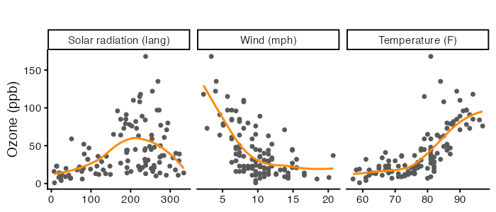

A smoother that bends is a warning, BUT these marginal plots ignore the other predictors. The residual plot is the one that matters, because it looks at what is left after the model has done its work.


```r
residFrame <- data.frame(fitted = as.numeric(fitted(ozoneModel)),
                         resid  = as.numeric(resid(ozoneModel)))

ggplot(residFrame, aes(x = fitted, y = resid)) +
  geom_hline(yintercept = 0, linetype = "dashed", colour = "grey55") +
  geom_point(colour = "grey35", size = 1.8) +
  geom_smooth(method = "loess", formula = y ~ x, se = FALSE,
              colour = "darkorange", linewidth = 1) +
  labs(x = "Fitted ozone (ppb)", y = "Residual (ppb)", title = "")
```

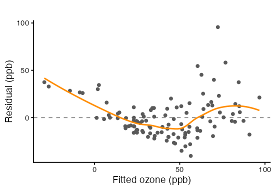

Component plus residual plots, from Part 2, isolate one predictor at a time. The dashed line is the fitted linear contribution and the solid curve is a smoother. Separation between them is the signal.


```r
crPlots(ozoneModel, layout = c(1, 3), ask = FALSE, main = "", grid = FALSE)
```

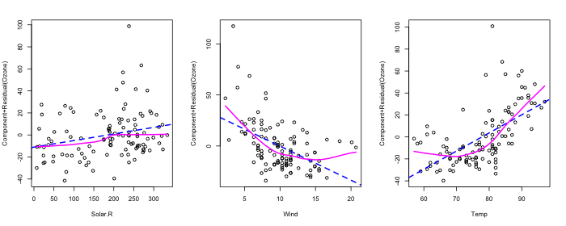

Two tests put a number on it. The first adds squared terms and asks whether they earn their place, using the partial F test from Part 2. The second, Box-Tidwell, estimates a power for each predictor and tests whether it differs from 1.


```r
squaredModel <- lm(Ozone ~ Solar.R + Wind + Temp +
                     I(Solar.R^2) + I(Wind^2) + I(Temp^2), data = aqComplete)
anova(ozoneModel, squaredModel)

boxTidwell(Ozone ~ Solar.R + Wind + Temp, data = aqComplete)
```

```
Analysis of Variance Table

Model 1: Ozone ~ Solar.R + Wind + Temp
Model 2: Ozone ~ Solar.R + Wind + Temp + I(Solar.R^2) + I(Wind^2) + I(Temp^2)
  Res.Df   RSS Df Sum of Sq      F    Pr(>F)    
1    107 48003                                  
2    104 34826  3     13177 13.116 2.492e-07 ***
---
Signif. codes:  0 ‘***’ 0.001 ‘**’ 0.01 ‘*’ 0.05 ‘.’ 0.1 ‘ ’ 1


        MLE of lambda Score Statistic (t)  Pr(>|t|)    
Solar.R       0.81892             -0.4863  0.627796    
Wind         -0.56060              4.6130 1.135e-05 ***
Temp          5.09797              2.9094  0.004428 ** 
---
Signif. codes:  0 ‘***’ 0.001 ‘**’ 0.01 ‘*’ 0.05 ‘.’ 0.1 ‘ ’ 1

iterations =  21 

Score test for null hypothesis that all lambdas = 1:
F = 13.31, df = 3 and 104, Pr(>F) = 2.029e-07
```

We can also whether the model predicts values the response cannot take.


```r
range(fitted(ozoneModel))
range(aqComplete$Ozone)
```

```
> range(fitted(ozoneModel))
[1] -29.43301  96.74703

> range(aqComplete$Ozone)
[1]   1 168
```

Ozone cannot be negative. A model whose fitted values go below zero is telling you its functional form is wrong, before any test is run.

### I have a nonlinear predictor. What should I do?

Four options.

**Transform the response.** Box-Cox profiles the exponent $\lambda$ in $Y^\lambda$ and reports the value the data prefer, with an interval.


```r
MASS::boxcox(ozoneModel, lambda = seq(-0.5, 1, by = 0.01))
summary(powerTransform(ozoneModel))
```

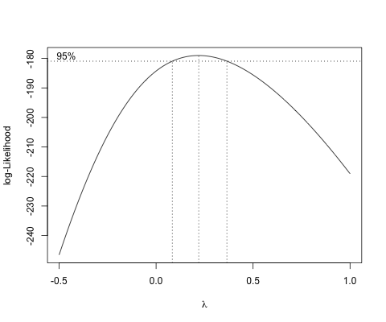

```
> summary(powerTransform(ozoneModel))
Likelihood ratio test that transformation parameter is equal to 0
 (log transformation)
                           LRT df      pval
LR test, lambda = (0) 10.52797  1 0.0011758

Likelihood ratio test that no transformation is needed
                           LRT df       pval
LR test, lambda = (1) 80.08416  1 < 2.22e-16
```

Read $\hat\lambda$ and its interval off the output, then round to something a reader can name: $\lambda = 0$ is the log, $\lambda = 1/3$ the cube root, $\lambda = 1/2$ the square root. Prefer the log when the interval covers zero, because a coefficient on `log(Y)` reads as an approximate percentage change in `Y` per unit of the predictor.


```r
logModel  <- lm(log(Ozone) ~ Solar.R + Wind + Temp, data = aqComplete)
cubeModel <- lm(Ozone^(1/3) ~ Solar.R + Wind + Temp, data = aqComplete)
summary(logModel)
```

```
> summary(logModel)
Residuals:
     Min       1Q   Median       3Q      Max 
-2.06193 -0.29970 -0.00231  0.30756  1.23578 

Coefficients:
              Estimate Std. Error t value Pr(>|t|)    
(Intercept) -0.2621323  0.5535669  -0.474 0.636798    
Solar.R      0.0025152  0.0005567   4.518 1.62e-05 ***
Wind        -0.0615625  0.0157130  -3.918 0.000158 ***
Temp         0.0491711  0.0060875   8.077 1.07e-12 ***
---
Signif. codes:  0 ‘***’ 0.001 ‘**’ 0.01 ‘*’ 0.05 ‘.’ 0.1 ‘ ’ 1

Residual standard error: 0.5086 on 107 degrees of freedom
Multiple R-squared:  0.6644,	Adjusted R-squared:  0.655 
F-statistic: 70.62 on 3 and 107 DF,  p-value: < 2.2e-16


> summary(cubeModel)
Residuals:
     Min       1Q   Median       3Q      Max 
-1.12163 -0.37628 -0.02561  0.33578  1.49536 

Coefficients:
              Estimate Std. Error t value Pr(>|t|)    
(Intercept) -0.2989449  0.5554379  -0.538 0.591547    
Solar.R      0.0022061  0.0005586   3.949 0.000141 ***
Wind        -0.0759672  0.0157661  -4.818 4.80e-06 ***
Temp         0.0500576  0.0061081   8.195 5.86e-13 ***
---
Signif. codes:  0 ‘***’ 0.001 ‘**’ 0.01 ‘*’ 0.05 ‘.’ 0.1 ‘ ’ 1

Residual standard error: 0.5103 on 107 degrees of freedom
Multiple R-squared:  0.6805,	Adjusted R-squared:  0.6716 
F-statistic: 75.97 on 3 and 107 DF,  p-value: < 2.2e-16
```

**Transform the predictor.** Use this when the problem is one predictor rather than the whole response. `log(x)`, `sqrt(x)`, or `1/x` keep one coefficient per predictor, so the model stays readable.

**Add a polynomial term.** `poly(Wind, 2)` fits a curve while leaving the response alone. The cost is that the effect of wind is now two coefficients, so you interpret it from a plot rather than a number.

**Use a spline.** `splines::ns(Wind, 3)` is more flexible again, and gives up on a coefficient you can quote.


```r
polyModel   <- lm(Ozone ~ Solar.R + poly(Wind, 2) + poly(Temp, 2),
                  data = aqComplete)
splineModel <- lm(Ozone ~ Solar.R + splines::ns(Wind, 3) +
                    splines::ns(Temp, 3), data = aqComplete)
```

Whatever you pick, look at the residuals again. Compare the two models side by side.


```r
compareFrame <- rbind(
  data.frame(model = "Ozone (untransformed)",
             fitted = as.numeric(fitted(ozoneModel)),
             std    = as.numeric(rstandard(ozoneModel))),
  data.frame(model = "log(Ozone)",
             fitted = as.numeric(fitted(logModel)),
             std    = as.numeric(rstandard(logModel)))
)
compareFrame$model <- factor(compareFrame$model,
                             levels = c("Ozone (untransformed)", "log(Ozone)"))

ggplot(compareFrame, aes(x = fitted, y = std)) +
  geom_hline(yintercept = 0, linetype = "dashed", colour = "grey55") +
  geom_point(colour = "grey35", size = 1.6) +
  geom_smooth(method = "loess", formula = y ~ x, se = FALSE,
              colour = "darkorange", linewidth = 1) +
  facet_wrap(~ model, scales = "free_x") +
  labs(x = "Fitted value", y = "Standardized residual", title = "")
```

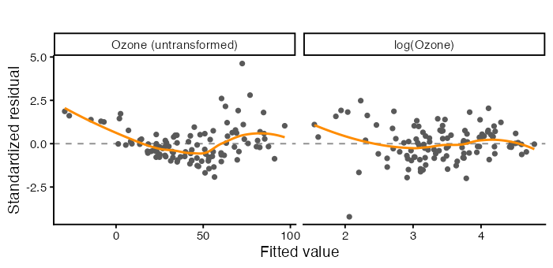

> The model now describes the mean of `log(Ozone)`, not the mean of `Ozone`. Back-transforming a fitted value with `exp()` gives roughly the median, not the mean, because the exponential of an average is not the average of exponentials.

## Non-Constant Variance

### How can I tell if the residual spread changes?

Look at the same residual plot for a funnel rather than a curve. The scale-location plot makes it easier by plotting $(r_i)^{1/2}$ against the fitted values, which folds the negative residuals onto the positive ones so only the spread is left.


```r
compareFrame$rootAbs <- sqrt(abs(compareFrame$std))

ggplot(compareFrame, aes(x = fitted, y = rootAbs)) +
  geom_point(colour = "grey35", size = 1.6) +
  geom_smooth(method = "loess", formula = y ~ x, se = FALSE,
              colour = "darkorange", linewidth = 1) +
  facet_wrap(~ model, scales = "free_x") +
  labs(x = "Fitted value",
       y = expression(sqrt(abs("standardized residual"))), title = "")
```

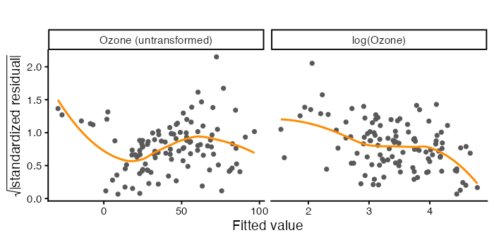

A flat smoother is what you want. A rising one means the model is less certain where the response is large, which is common whenever the response is a count or a concentration.

Three tests, each with a different alternative in mind.


```r
ncvTest(ozoneModel)    # variance changes with the FITTED VALUES
bptest(ozoneModel)     # variance changes with the PREDICTORS
bptest(ozoneModel, ~ Solar.R * Wind * Temp + I(Solar.R^2) +
         I(Wind^2) + I(Temp^2), data = aqComplete)   # White's test

ncvTest(logModel)
bptest(logModel)
```

```
> ncvTest(logModel)

Non-constant Variance Score Test 
Variance formula: ~ fitted.values 
Chisquare = 5.375405, Df = 1, p = 0.020423

> bptest(ozoneModel)

	studentized Breusch-Pagan test
data:  ozoneModel
BP = 5.0554, df = 3, p-value = 0.1678

> bptest(ozoneModel, ~ Solar.R * Wind * Temp + I(Solar.R^2) +
+          I(Wind^2) + I(Temp^2), data = aqComplete)

	studentized Breusch-Pagan test
data:  ozoneModel
BP = 30.868, df = 10, p-value = 0.000617
```

`ncvTest()` from `car` regresses the squared residuals on the fitted values. `bptest()` from `lmtest` regresses them on the predictors and studentizes by default, which is Koenker's version and does not lean on normal errors. White's test adds squares and cross products, so it catches more shapes. Disagreement between them is informative, because it tells you which direction the variance moves in.

### My residual spread is not constant. What should I do?

**Transform the response.** Often the same transformation fixes curvature and spread together, because both come from the response being on the wrong scale. That is what happens here.

**Keep the model, fix the standard errors.** The coefficients are still unbiased under non-constant variance. It is the standard errors that are wrong, and a heteroscedasticity-consistent estimator repairs them without changing a single estimate. Use `HC3`, which is the recommended choice below about 250 observations.


```r
coeftest(ozoneModel)            # ordinary SEs
coeftest(ozoneModel, vcov = vcovHC(ozoneModel, type = "HC3"))

round(cbind(ordinary = sqrt(diag(vcov(ozoneModel))),
            HC3      = sqrt(diag(vcovHC(ozoneModel, type = "HC3")))), 4)
```

```
> coeftest(ozoneModel)   

t test of coefficients:
              Estimate Std. Error t value  Pr(>|t|)    
(Intercept) -64.342079  23.054724 -2.7908  0.006227 ** 
Solar.R       0.059821   0.023186  2.5800  0.011237 *  
Wind         -3.333591   0.654407 -5.0941 1.516e-06 ***
Temp          1.652093   0.253530  6.5164 2.424e-09 ***
---
Signif. codes:  0 ‘***’ 0.001 ‘**’ 0.01 ‘*’ 0.05 ‘.’ 0.1 ‘ ’ 1

> coeftest(ozoneModel, vcov = vcovHC(ozoneModel, type = "HC3"))

t test of coefficients:
              Estimate Std. Error t value  Pr(>|t|)    
(Intercept) -64.342079  21.916498 -2.9358 0.0040732 ** 
Solar.R       0.059821   0.019804  3.0206 0.0031554 ** 
Wind         -3.333591   0.914468 -3.6454 0.0004139 ***
Temp          1.652093   0.207917  7.9459 2.085e-12 ***
---
Signif. codes:  0 ‘***’ 0.001 ‘**’ 0.01 ‘*’ 0.05 ‘.’ 0.1 ‘ ’ 1


> round(cbind(ordinary = sqrt(diag(vcov(ozoneModel))),
+             HC3      = sqrt(diag(vcovHC(ozoneModel, type = "HC3")))), 4)

            ordinary     HC3
(Intercept)  23.0547 21.9165
Solar.R       0.0232  0.0198
Wind          0.6544  0.9145
Temp          0.2535  0.2079
```

```r
linearHypothesis(ozoneModel, c("Solar.R", "Wind"),
                 vcov = vcovHC(ozoneModel, type = "HC3"))
```

```
> linearHypothesis(ozoneModel, c("Solar.R", "Wind"),
+                  vcov = vcovHC(ozoneModel, type = "HC3"))

Linear hypothesis test:
Solar.R = 0
Wind = 0

Model 1: restricted model
Model 2: Ozone ~ Solar.R + Wind + Temp

Note: Coefficient covariance matrix supplied.

  Res.Df Df      F    Pr(>F)    
1    109                        
2    107  2 8.5411 0.0003619 ***
---
Signif. codes:  0 ‘***’ 0.001 ‘**’ 0.01 ‘*’ 0.05 ‘.’ 0.1 ‘ ’ 1
```

**Weighted least squares.** When you can model the variance, give each observation a weight of $1/\hat\sigma_i^2$. 


```r
varianceModel <- lm(log(resid(ozoneModel)^2) ~ fitted(ozoneModel))
weightsHat <- 1 / exp(fitted(varianceModel))
wlsModel <- lm(Ozone ~ Solar.R + Wind + Temp, data = aqComplete,
               weights = weightsHat)
```

```
Weighted Residuals:
    Min      1Q  Median      3Q     Max 
-3.4715 -1.6167 -0.5157  1.1722  8.9616 

Coefficients:
             Estimate Std. Error t value Pr(>|t|)    
(Intercept) -58.41940   20.21617  -2.890 0.004669 ** 
Solar.R       0.04531    0.02001   2.264 0.025567 *  
Wind         -2.25213    0.56954  -3.954 0.000138 ***
Temp          1.45932    0.22973   6.352 5.28e-09 ***
---
Signif. codes:  0 ‘***’ 0.001 ‘**’ 0.01 ‘*’ 0.05 ‘.’ 0.1 ‘ ’ 1

Residual standard error: 2.143 on 107 degrees of freedom
Multiple R-squared:  0.5525,	Adjusted R-squared:   0.54 
F-statistic: 44.04 on 3 and 107 DF,  p-value: < 2.2e-16
```

Robust standard errors are the usual choice in practice. They fix the inference and leave the model alone, which is honest when you do not know where the extra variance comes from.

## Non-Normal Errors

### How can I tell?

The Q-Q plot from Part 1, and Shapiro-Wilk on the residuals.


```r
ggplot(compareFrame, aes(sample = std)) +
  stat_qq(colour = "grey35", size = 1.6) +
  stat_qq_line(colour = "darkorange", linewidth = 1) +
  facet_wrap(~ model) +
  labs(x = "Theoretical normal quantile", y = "Standardized residual",
       title = "")
```

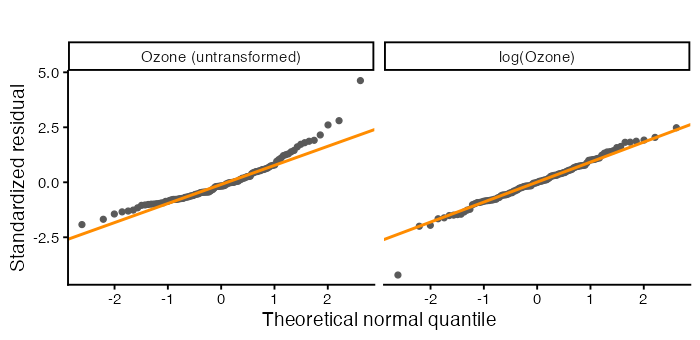


```r
shapiro.test(resid(ozoneModel))
shapiro.test(resid(logModel))

# skewness, as a number
mean((resid(ozoneModel) / sd(resid(ozoneModel)))^3)
mean((resid(logModel)   / sd(resid(logModel)))^3)
```

```
> shapiro.test(resid(ozoneModel))

	Shapiro-Wilk normality test

data:  resid(ozoneModel)
W = 0.91709, p-value = 3.618e-06

> shapiro.test(resid(logModel))

	Shapiro-Wilk normality test

data:  resid(logModel)
W = 0.97749, p-value = 0.05726
```

```
> mean((resid(ozoneModel) / sd(resid(ozoneModel)))^3)
[1] 1.344119
> mean((resid(logModel)   / sd(resid(logModel)))^3)
[1] -0.39293
```

Points curving up at the right end mean a long right tail. Zero skewness is what a normal distribution has.

### My errors are not normal. What should I do?

Often nothing, and that answer deserves explaining. Of the five assumptions from Part 1, normality is the one that matters least. The central limit theorem means the sampling distribution of $\hat\beta$ approaches normal as $n$ grows whether or not the errors are, so t tests and confidence intervals for coefficients are reasonably robust in samples of this size.

It matters in three situations.

- **Small samples.** Below roughly 30 observations the t distribution is doing real work and needs the assumption.
- **Prediction intervals.** An interval for a single new observation depends on the shape of the error distribution, not just its variance.
- **As a symptom.** Skewed residuals are usually a sign that something else is wrong, most often the response scale. Fix that and the normality might take care of itself.

If it persists and you need it, transform the response, or use a bootstrap, or fit a model whose error distribution matches the data (a generalized linear model for counts, for instance). Do not delete observations to make a Q-Q plot straighter.

## Correlated Errors

### How can I tell?

Only if the data have an order that means something. These are daily measurements, so they do.

The subtlety is that the model dropped the days with missing values, so consecutive rows of the model frame are not consecutive days. Putting the residuals back on the calendar, with the dropped days left as gaps, is the honest way to look.


```r
residSeries <- rep(NA_real_, nrow(aq))
residSeries[match(aqComplete$Date, aq$Date)] <- as.numeric(resid(logModel))
dateFrame <- data.frame(Date = aq$Date, resid = residSeries)

ggplot(dateFrame, aes(x = Date, y = resid)) +
  geom_hline(yintercept = 0, linetype = "dashed", colour = "grey55") +
  geom_line(colour = "grey70", linewidth = 0.4) +
  geom_point(colour = "darkorange", size = 1.4) +
  labs(x = NULL, y = "Residual, log(Ozone) model", title = "")
```

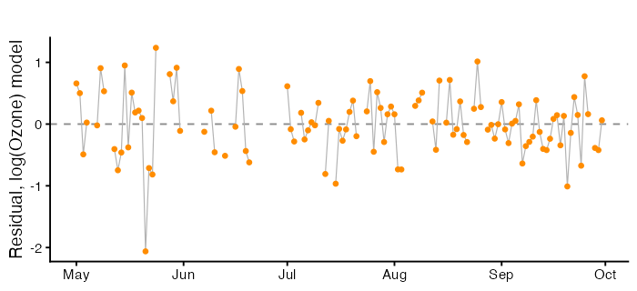

Runs of consecutive points on the same side of zero are the pattern to look for. The autocorrelation function tests every lag at once, and `na.action = na.pass` keeps the spacing correct.


```r
acf(residSeries, na.action = na.pass, main = "")
```

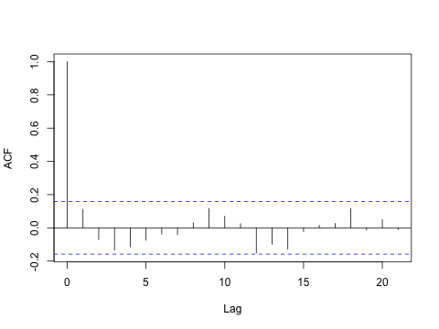


```r
durbinWatsonTest(logModel)   # uses model row order, gaps removed
dwtest(logModel)
bgtest(logModel, order = 3)  # Breusch-Godfrey, several lags at once
```

```
> durbinWatsonTest(logModel)
 lag Autocorrelation D-W Statistic p-value
   1      0.08870798       1.80676    0.23
 Alternative hypothesis: rho != 0
 
> dwtest(logModel)
	Durbin-Watson test
data:  logModel
DW = 1.8068, p-value = 0.1334
alternative hypothesis: true autocorrelation is greater than 0


> bgtest(logModel, order = 3)
	Breusch-Godfrey test for serial correlation of order up to 3
data:  logModel
LM test = 5.8487, df = 3, p-value = 0.1192
```

Durbin-Watson from Part 1 is a one-lag test and it works on the model's row order, so here it treats non-adjacent days as neighbours. The ACF plot is the better evidence. Breusch-Godfrey generalizes the test to several lags.

### My errors are correlated. What should I do?

**Add the missing structure.** Correlated residuals usually mean a variable has been left out. For a daily series that is often a trend or a season. Adding `Month`, a day index, or yesterday's value can absorb it, and that is the preferred fix because it makes the model better rather than only making the standard errors bigger.

**Use standard errors that allow for it.** `sandwich::NeweyWest()` for a time series, or cluster-robust errors when observations group by site or person. Same logic as `HC3`: the coefficients stand, the inference is repaired.

**Model the correlation.** `nlme::gls()` with a correlation structure, or an explicit time series model. More work, more assumptions, correct standard errors and a better fit.

Doing nothing is the one option, but positively correlated errors make standard errors too small, so confidence intervals are too narrow and p-values too small. 

## Collinearity

### How can I tell?

Here is a dataset with two predictors and 100 observations. Diagnose it before you look at how it was made.

<details markdown="1">
<summary>Show the code that generates this dataset (contains the answer)</summary>

```r
set.seed(2026)
nObs <- 100
trueBeta <- c(1, 1)
rhoHigh <- 0.995

z1 <- rnorm(nObs)
z2 <- rnorm(nObs)
predictorA <- z1
predictorB <- rhoHigh * z1 + sqrt(1 - rhoHigh^2) * z2
response <- 1 + trueBeta[1] * predictorA + trueBeta[2] * predictorB +
  rnorm(nObs)

mystery <- data.frame(response, predictorA, predictorB)
```

</details>


```r
mysteryModel <- lm(response ~ predictorA + predictorB, data = mystery)
summary(mysteryModel)
```

```
Residuals:
    Min      1Q  Median      3Q     Max 
-2.7427 -0.5634 -0.1146  0.5697  2.1214 

Coefficients:
            Estimate Std. Error t value Pr(>|t|)    
(Intercept)   1.0953     0.0901  12.156   <2e-16 ***
predictorA    0.4761     0.9311   0.511    0.610    
predictorB    1.5286     0.9368   1.632    0.106    
---
Signif. codes:  0 ‘***’ 0.001 ‘**’ 0.01 ‘*’ 0.05 ‘.’ 0.1 ‘ ’ 1

Residual standard error: 0.8902 on 97 degrees of freedom
Multiple R-squared:  0.8374,	Adjusted R-squared:  0.8341 
F-statistic: 249.8 on 2 and 97 DF,  p-value: < 2.2e-16
```

A large $R^2$, an overall F test with a tiny p-value, and neither individual coefficient significant. The model as a whole explains the response well, and it cannot say which predictor deserves the credit.

Confirm it with a joint test and three measurements.


```r
linearHypothesis(mysteryModel, c("predictorA", "predictorB"))

cor(mystery$predictorA, mystery$predictorB)
vif(mysteryModel)
kappa(cor(mystery[, c("predictorA", "predictorB")]), exact = TRUE)
summary(lm(predictorA ~ predictorB, data = mystery))$r.squared
```

```
> ## the F test says the pair matters, the t tests say neither does
> linearHypothesis(mysteryModel, c("predictorA", "predictorB"))

Linear hypothesis test:
predictorA = 0
predictorB = 0

Model 1: restricted model
Model 2: response ~ predictorA + predictorB

  Res.Df    RSS Df Sum of Sq      F    Pr(>F)    
1     99 472.80                                  
2     97  76.86  2    395.93 249.83 < 2.2e-16 ***
---
Signif. codes:  0 ‘***’ 0.001 ‘**’ 0.01 ‘*’ 0.05 ‘.’ 0.1 ‘ ’ 1

> ## 1. the correlation
> cor(mystery$predictorA, mystery$predictorB)
[1] 0.9954013

> ## 2. variance inflation factors
> vif(mysteryModel)
predictorA predictorB 
  108.9759   108.9759 

> ## 3. the condition number of the scaled model matrix
> kappa(cor(mystery[, c("predictorA", "predictorB")]), exact = TRUE)
[1] 433.9012

> ## 4. each predictor fitted from the others
> summary(lm(predictorA ~ predictorB, data = mystery))$r.squared
[1] 0.9908237
```

The variance inflation factor from Part 2 is the usual measure, $\text{VIF}_j = 1/(1 - R_j^2)$, where $R_j^2$ comes from fitting predictor $j$ on the others. The condition number of the correlation matrix is an alternative that summarizes the whole design in one number rather than one per predictor.

### Does collinearity bias my estimates?

No, and the distinction matters, because the symptoms look like bias. Under collinearity ordinary least squares is still unbiased, $E[\hat\beta] = \beta$. What changes is the variance,

$$\text{Var}(\hat\beta_j) = \frac{\sigma^2}{S_{jj}} \cdot \frac{1}{1 - R_j^2},$$

and that second factor is the VIF. So the estimates are centred on the truth across repeated samples, and any one sample can land a long way from it. In practice you have one sample, so a coefficient can be far too large, far too small, or the wrong sign entirely.

We can watch that happen, because we know the true values. Run the whole experiment a thousand times under low and high correlation, holding the true coefficients and the noise the same.


```r
simulateBeta <- function(rho, nSim = 1000, n = 100,
                         beta = c(1, 1), sigma = 1) {
  out <- matrix(NA_real_, nSim, 2)
  for (s in seq_len(nSim)) {
    e1 <- rnorm(n); e2 <- rnorm(n)
    xA <- e1
    xB <- rho * e1 + sqrt(1 - rho^2) * e2
    y  <- 1 + beta[1] * xA + beta[2] * xB + rnorm(n, sd = sigma)
    out[s, ] <- coef(lm(y ~ xA + xB))[2:3]
  }
  data.frame(bA = out[, 1], bB = out[, 2])
}

lowCollin  <- simulateBeta(rho = 0.20)
highCollin <- simulateBeta(rho = 0.995)

round(rbind(low = colMeans(lowCollin), high = colMeans(highCollin)), 3)
round(rbind(low = apply(lowCollin, 2, sd),
            high = apply(highCollin, 2, sd)), 3)
c(low = mean(lowCollin$bA < 0), high = mean(highCollin$bA < 0))
```

```
> ## unbiased in both cases: the averages sit on the truth
> round(rbind(low  = colMeans(lowCollin),
+             high = colMeans(highCollin)), 3)
        bA    bB
low  0.998 1.004
high 1.024 0.977

> ## but the spread is enormous under high collinearity
> round(rbind(low  = apply(lowCollin,  2, sd),
+             high = apply(highCollin, 2, sd)), 3)
        bA    bB
low  0.101 0.105
high 0.990 0.992

> ## how often does an estimate come out with the wrong sign?
> c(low  = mean(lowCollin$bA  < 0),
+   high = mean(highCollin$bA < 0))
  low  high 
0.000 0.139 
```


```r
simFrame <- rbind(
  data.frame(design = "Correlation 0.20",  estimate = lowCollin$bA),
  data.frame(design = "Correlation 0.995", estimate = highCollin$bA)
)

ggplot(simFrame, aes(x = estimate, fill = design, colour = design)) +
  geom_density(alpha = 0.25, linewidth = 0.9) +
  geom_vline(xintercept = 1, linetype = "dashed", colour = "grey30") +
  labs(x = expression(hat(beta)[A] ~ "across 1000 simulated samples"),
       y = "Density", fill = "", colour = "", title = "")
```

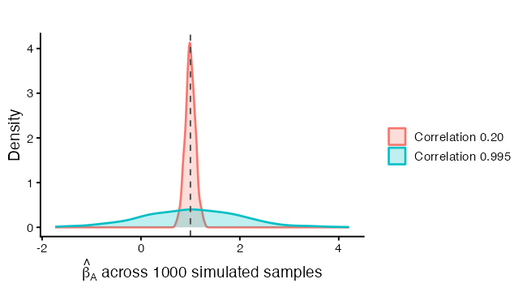

Both distributions sit on the dashed line at the true value of 1. That is the unbiasedness. The wide one is the collinear design, and the share of it lying below zero is the share of samples where a researcher would report an effect with the wrong sign and no way to know.

### I have high collinearity. What should I do?

First, decide whether it matters for your question. Collinearity does not hurt predictions within the range of the observed predictors, and it does not hurt the joint test. It hurts individual coefficients. If you only need the model to predict, you can leave it alone.


```r
newPoint <- data.frame(predictorA = 0.5, predictorB = 0.5)
predict(mysteryModel, newdata = newPoint, interval = "confidence")
```

```
> predict(mysteryModel, newdata = newPoint, interval = "confidence")
       fit      lwr     upr
1 2.097653 1.891355 2.30395
```

If you do need the individual coefficients:

**Drop one of the pair,** and say in the write-up that you did and why. The surviving coefficient now carries both effects, so interpret it as the pair rather than as one predictor.

**Combine them.** An average, a sum, or the first principal component replaces two overlapping measurements with one that is measured better than either.

**Collect more data,** or data with more spread in the predictors. The $S_{jj}$ in the denominator above says that spread in a predictor buys precision, which is the same point Part 1 made about the slope.

**Keep both and change what you report.** Give the joint F test and the prediction, and say plainly that the data cannot separate the two predictors. This is often the most honest option.


```r
dropOneModel <- lm(response ~ predictorA, data = mystery)
mystery$average <- (mystery$predictorA + mystery$predictorB) / 2
averageModel <- lm(response ~ average, data = mystery)
```

What not to do: drop a predictor because its p-value is large, and then interpret the others as though nothing happened. Part 2 showed that coefficients move when their companions change.

## Outliers, Leverage and Influence

### How can I tell which observations are a problem, and which ones are they?

Three different things, worth keeping apart.

- An **outlier** has a large residual. The model fits it badly.
- A **high-leverage** point has unusual predictor values. It has the potential to move the fit, whether or not it does.
- An **influential** point actually moves the fit. That takes both of the above.

Cook's distance from Part 1 measures the third. Plot all three at once: studentized residual against leverage, with the point area proportional to Cook's distance.


```r
influenceFrame <- data.frame(
  row      = seq_len(nrow(aqComplete)),
  Date     = aqComplete$Date,
  ozone    = aqComplete$Ozone,
  student  = as.numeric(rstudent(logModel)),
  leverage = as.numeric(hatvalues(logModel)),
  cooks    = as.numeric(cooks.distance(logModel))
)
influenceFrame$label <- format(influenceFrame$Date, "%b %d")

pPlusOne    <- length(coef(logModel))
leverageCut <- 2 * pPlusOne / nrow(aqComplete)
cooksCut    <- 4 / nrow(aqComplete)

flagged <- influenceFrame[influenceFrame$cooks > cooksCut |
                            influenceFrame$leverage > leverageCut |
                            abs(influenceFrame$student) > 3, ]
flagged[order(-flagged$cooks), c("label", "ozone", "student",
                                 "leverage", "cooks")]

ggplot(influenceFrame, aes(x = leverage, y = student)) +
  geom_hline(yintercept = c(-2, 0, 2),
             linetype = c("dotted", "dashed", "dotted"), colour = "grey55") +
  geom_vline(xintercept = leverageCut, linetype = "dotted", colour = "grey55") +
  geom_point(aes(size = cooks), colour = "darkorange", alpha = 0.65) +
  geom_text(data = flagged, aes(label = label), size = 2.9,
            hjust = -0.15, colour = "grey25") +
  scale_size_area(max_size = 9, name = "Cook's D") +
  labs(x = "Leverage", y = "Studentized residual", title = "")
```

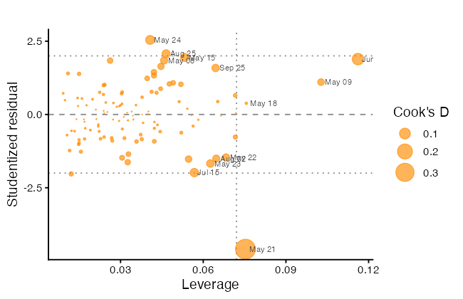

```
> flagged[order(-flagged$cooks),
+         c("label", "ozone", "student", "leverage", "cooks")]
     label ozone    student   leverage       cooks
17  May 21     1 -4.5955714 0.07531628 0.361982094
30  Jun 17    37  1.8895194 0.11615763 0.114553041
20  May 24    32  2.5435652 0.04071527 0.065310597
45  Jul 15     7 -1.9824454 0.05678446 0.057574243
11  May 15    18  1.9440092 0.05327268 0.051817937
77  Aug 25   168  2.0729667 0.04651548 0.050842607
19  May 23     4 -1.6725623 0.06258886 0.045923668
107 Sep 25    14  1.5867375 0.06447682 0.042774241
6   May 08    19  1.8441437 0.04581198 0.039924334
18  May 22    11 -1.4587866 0.06825601 0.038566765
61  Aug 02     9 -1.5017186 0.06472518 0.038564378
7   May 09     8  1.1049583 0.10273618 0.034877013
14  May 18     6  0.3823483 0.07563549 0.003014533
```

The reference lines are conventions: $\pm 2$ for a studentized residual, $2(p+1)/n$ for leverage, $4/n$ for Cook's distance. Points in the top right and bottom right are the ones that matter, because they combine a bad fit with the leverage to act on it.

A formal test exists for the largest studentized residual, with a Bonferroni correction for the fact that you looked at all of them before picking the biggest.


```r
outlierTest(logModel)
```

```
> outlierTest(logModel)
    rstudent unadjusted p-value Bonferroni p
21 -4.595571         1.1961e-05    0.0013276
```

To see which coefficient an observation moves, use DFBETA, the change in a coefficient when that observation is deleted, in standard error units.


```r
dfFrame <- as.data.frame(dfbetas(logModel))
dfFrame$row <- influenceFrame$row

ggplot(dfFrame, aes(x = row, y = Wind)) +
  geom_hline(yintercept = 0, colour = "grey55") +
  geom_hline(yintercept = c(-2, 2) / sqrt(nrow(aqComplete)),
             linetype = "dotted", colour = "grey55") +
  geom_segment(aes(xend = row, yend = 0), colour = "grey75") +
  geom_point(size = 1.6, colour = "darkorange") +
  labs(x = "Observation", y = "DFBETA for Wind", title = "")
```

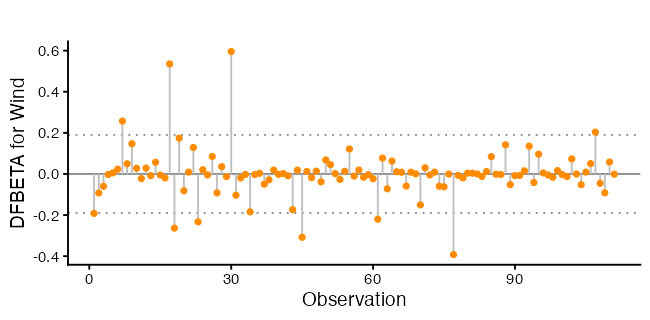

### I have influential observations. What should I do?

**Check them first.** A Cook's distance of 0.4 and an impossible value in the raw data are a different story from a Cook's distance of 0.4 and a legitimate extreme day. Go back to the source.

**Refit without them and compare.** This is the step that turns a flagged point into a reportable finding.


```r
worst <- influenceFrame$row[which.max(influenceFrame$cooks)]
withoutWorst <- lm(log(Ozone) ~ Solar.R + Wind + Temp,
                   data = aqComplete[-worst, ])

round(cbind(all       = coef(logModel),
            dropped   = coef(withoutWorst),
            pctChange = 100 * (coef(withoutWorst) - coef(logModel)) /
              abs(coef(logModel))), 4)
```

```
                all dropped pctChange
(Intercept) -0.2621  0.2614  199.7345
Solar.R      0.0025  0.0022  -12.9111
Wind        -0.0616 -0.0693  -12.5407
Temp         0.0492  0.0445   -9.5873
```

If the coefficients barely move, keep every observation and say the result is not sensitive to any single one. If one coefficient swings, your conclusion rests on one observation, and that is the finding.

**Downweight rather than delete.** A robust fit reduces the pull of extreme points without throwing them away, which avoids the choice of a cutoff.


```r
robustModel <- MASS::rlm(log(Ozone) ~ Solar.R + Wind + Temp, data = aqComplete)
round(cbind(ols = coef(logModel), robust = coef(robustModel)), 4)
```

```
                ols  robust
(Intercept) -0.2621 -0.0842
Solar.R      0.0025  0.0022
Wind        -0.0616 -0.0654
Temp         0.0492  0.0482
```

Deleting an observation because it is inconvenient, and not saying so, is the one response that is never defensible. If you delete, report what you deleted, why, and what changed.

## Missing Data

### How can I tell if it is causing a problem?

`lm()` drops any row with a missing value in the model and tells you only in the degrees of freedom. Two models with different predictors can therefore be fitted to different observations, and comparing them is then meaningless.


```r
withSolar    <- lm(Ozone ~ Solar.R + Wind + Temp, data = aq)
withoutSolar <- lm(Ozone ~ Wind + Temp, data = aq)
c(withSolar = nobs(withSolar), withoutSolar = nobs(withoutSolar))

AIC(withSolar, withoutSolar)   # not a valid comparison
```

```
> c(withSolar = nobs(withSolar), withoutSolar = nobs(withoutSolar))
   withSolar withoutSolar 
         111          116 
> ## so this comparison is not valid
> AIC(withSolar, withoutSolar)
             df       AIC
withSolar     5  998.7171
withoutSolar  4 1049.7410
Warning message:
In AIC.default(withSolar, withoutSolar) :
  models are not all fitted to the same number of observations
```

AIC, BIC, and `anova()` all require the same observations in both models. The numbers print without complaint, which is what makes this worth checking by hand.

### What should I do?

Fit every candidate model to the same rows. Build the complete-case data frame once, at the top, and use it everywhere, which is what `aqComplete` is for.


```r
withSolarSame    <- lm(Ozone ~ Solar.R + Wind + Temp, data = aqComplete)
withoutSolarSame <- lm(Ozone ~ Wind + Temp, data = aqComplete)
AIC(withSolarSame, withoutSolarSame)
anova(withoutSolarSame, withSolarSame)
```

Beyond that, complete-case analysis is unbiased only when the missingness is unrelated to the response. Here the missing ozone readings may well be the days the instrument failed, and those may not be typical days. Report how many rows you dropped and from which variables. Multiple imputation is the better tool when the fraction missing is large, and it is a workshop of its own.

## Choosing a Model and Choosing Variables

### How can I decide which variables to include?

Start from the question, not the output. Part 2 made the point that a coefficient depends on its companions, so "which variables" is a question about what you want the coefficients to mean.

After that, the automated tools are a check rather than an answer. All-subsets scores every combination on several criteria at once.


```r
subsetSearch <- regsubsets(log(Ozone) ~ Solar.R + Wind + Temp +
                             I(Wind^2) + I(Temp^2), data = aqComplete, nvmax = 5)
subsetSummary <- summary(subsetSearch)
subsetSummary

criterionFrame <- rbind(
  data.frame(size = seq_along(subsetSummary$adjr2), value = subsetSummary$adjr2,
             criterion = "Adjusted R-squared (higher better)"),
  data.frame(size = seq_along(subsetSummary$bic), value = subsetSummary$bic,
             criterion = "BIC (lower better)"),
  data.frame(size = seq_along(subsetSummary$cp), value = subsetSummary$cp,
             criterion = "Mallows Cp (lower better)")
)

ggplot(criterionFrame, aes(x = size, y = value)) +
  geom_line(colour = "grey70", linewidth = 0.7) +
  geom_point(size = 2.2, colour = "darkorange") +
  facet_wrap(~ criterion, scales = "free_y") +
  scale_x_continuous(breaks = seq_along(subsetSummary$bic)) +
  labs(x = "Number of predictors", y = NULL, title = "")
```

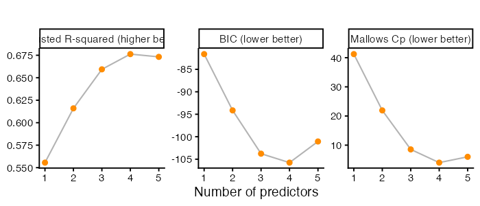


Look for where each curve flattens rather than for its exact optimum. BIC charges more per predictor than adjusted $R^2$ or $C_p$, so it usually points at a smaller model, and disagreement between the three criteria means the data do not strongly prefer one size.


```r
stepModel <- MASS::stepAIC(logModel, direction = "both", trace = FALSE)
formula(stepModel)

candidateList <- list(
  linear = logModel,
  poly   = lm(log(Ozone) ~ Solar.R + poly(Wind, 2) + poly(Temp, 2),
              data = aqComplete),
  spline = lm(log(Ozone) ~ Solar.R + splines::ns(Wind, 3) +
                splines::ns(Temp, 3), data = aqComplete)
)

data.frame(
  model = names(candidateList),
  df    = sapply(candidateList, function(m) length(coef(m))),
  sigma = sapply(candidateList, function(m) summary(m)$sigma),
  adjR2 = sapply(candidateList, function(m) summary(m)$adj.r.squared),
  AIC   = sapply(candidateList, AIC),
  BIC   = sapply(candidateList, BIC),
  row.names = NULL
)
```

```
   model df     sigma     adjR2      AIC      BIC
1 linear  4 0.5085709 0.6550153 170.8251 184.3727
2   poly  6 0.4949716 0.6732185 166.7135 185.6802
3 spline  8 0.4942849 0.6741246 168.2706 192.6564
```

### What these tools cannot do


# Part B: Back to the States Data

With the checklist in hand, return to the model from Part 2 and read it properly.


```r
states <- as.data.frame(state.x77)
names(states)[names(states) == "Life Exp"] <- "LifeExp"
names(states)[names(states) == "HS Grad"] <- "HSGrad"
names(states)[names(states) == "Murder"]  <- "MurderRate"
states$Region <- state.region
states$StateName <- rownames(states)
states$PopMillions <- states$Population / 1000   # recorded in thousands

bestModel <- lm(LifeExp ~ PopMillions + MurderRate + HSGrad + Frost,
                data = states)
summary(bestModel)
```

```
Call:
lm(formula = LifeExp ~ Population + MurderRate + HSGrad + Frost, 
    data = states)

Residuals:
     Min       1Q   Median       3Q      Max 
-1.47095 -0.53464 -0.03701  0.57621  1.50683 

Coefficients:
              Estimate Std. Error t value Pr(>|t|)    
(Intercept)  7.103e+01  9.529e-01  74.542  < 2e-16 ***
Population   5.014e-05  2.512e-05   1.996  0.05201 .  
MurderRate  -3.001e-01  3.661e-02  -8.199 1.77e-10 ***
HSGrad       4.658e-02  1.483e-02   3.142  0.00297 ** 
Frost       -5.943e-03  2.421e-03  -2.455  0.01802 *  
---
Signif. codes:  0 ‘***’ 0.001 ‘**’ 0.01 ‘*’ 0.05 ‘.’ 0.1 ‘ ’ 1

Residual standard error: 0.7197 on 45 degrees of freedom
Multiple R-squared:  0.736,	Adjusted R-squared:  0.7126 
F-statistic: 31.37 on 4 and 45 DF,  p-value: 1.696e-12
```

Run the Part A checks before interpreting anything.


```r
ncvTest(bestModel)
shapiro.test(resid(bestModel))
vif(bestModel)
outlierTest(bestModel)
```

```
> ncvTest(bestModel)
Non-constant Variance Score Test 
Variance formula: ~ fitted.values 
Chisquare = 0.1918053, Df = 1, p = 0.66142

> shapiro.test(resid(bestModel))
	Shapiro-Wilk normality test

data:  resid(bestModel)
W = 0.97935, p-value = 0.525

> vif(bestModel)
PopMillions  MurderRate      HSGrad       Frost 
   1.189835    1.727844    1.356791    1.498077 
   
> outlierTest(bestModel)
No Studentized residuals with Bonferroni p < 0.05
Largest |rstudent|:
       rstudent unadjusted p-value Bonferroni p
Hawaii 2.543016           0.014582       0.7291
> 
```

## Where the Predictors Overlap


```r
numericVars <- states[, c("LifeExp", "Population", "Income", "Illiteracy",
                          "MurderRate", "HSGrad", "Frost", "Area")]
corrplot(cor(numericVars),
         method = "color", type = "upper", diag = FALSE,
         addCoef.col = "black", number.cex = 0.75,
         tl.col = "black", tl.srt = 45,
         col = colorRampPalette(c("#2166AC", "white", "#B2182B"))(200))
```

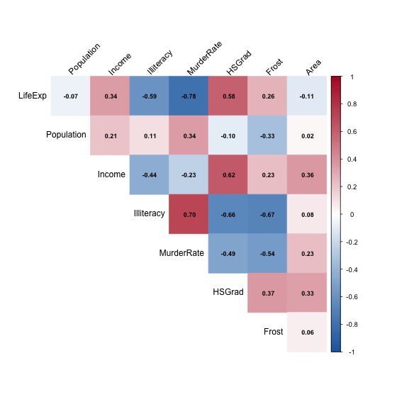

The `LifeExp` row is the one most people read first. The rest of the grid matters more, because it shows which predictors carry overlapping information. `Frost` is related to several other columns, which is the first hint about what its coefficient is really measuring.

## The Response on a Map


```r
statesMap <- map_data("state")
mapValues <- data.frame(region  = tolower(states$StateName),
                        LifeExp = states$LifeExp)
lifeMap <- merge(statesMap, mapValues, by = "region", all.x = TRUE)
lifeMap <- lifeMap[order(lifeMap$order), ]   # merge scrambles the order

ggplot(lifeMap, aes(x = long, y = lat, group = group, fill = LifeExp)) +
  geom_polygon(colour = "white", linewidth = 0.2) +
  coord_quickmap() +
  scale_fill_viridis_c(option = "mako", direction = -1, name = "Years") +
  labs(x = NULL, y = NULL, title = "") +
  theme_void(base_size = 14)
```

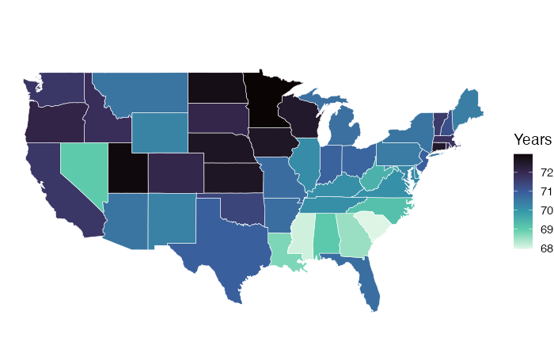

The `order()` line is not optional. `merge()` returns rows in an order that suits the join and `geom_polygon` draws vertices in row order, so skipping it produces scribble. And `map_data("state")` covers the lower 48, so Alaska and Hawaii are missing from the maps even though both are in the model.

## Reading a Coefficient

Each coefficient is a partial effect, as in Part 2. Reading one out loud takes four pieces: **direction**, **size with units on both sides**, **what is held fixed**, and **the uncertainty**.

For the murder rate: each additional murder per 100,000 people is associated with a drop of about 0.30 years in mean life expectancy, among states with the same population, graduation rate, and number of frost days.

That sentence does not say that lowering the murder rate would raise life expectancy. These are 50 observations with no experiment behind them.

`Frost` shows why the fourth piece is not enough on its own. Its coefficient is negative, so colder states have shorter life expectancy once the others are held fixed. Nobody believes frost days shorten lives. `Frost` is standing in for latitude and the bundle of regional differences that travel with it, which is visible in the correlation plot above. A coefficient on a proxy describes the proxy, and the model cannot tell you which one you are looking at.

### Confidence Intervals

$$\hat\beta_j \pm t_{0.975,\, n-p-1} \cdot \text{SE}(\hat\beta_j),$$

on the 45 degrees of freedom printed in the summary.


```r
confint(bestModel)
```

```
> confint(bestModel)
                    2.5 %       97.5 %
(Intercept) 69.1079841538 72.946272910
PopMillions -0.0004543308  0.100734287
MurderRate  -0.3738840302 -0.226413571
HSGrad       0.0167190063  0.076445487
Frost       -0.0108191818 -0.001067398
```

The interval and the p-value carry the same verdict for a single coefficient, and the interval carries more information because it is in the units of the response. "Between 0.23 and 0.37 fewer years per murder" tells a reader how large the effect might be. "p = 1.77e-10" does not.

Population is the one to look at. Its p-value sits just above 0.05, which the usual convention calls "not significant". The interval is the better description: it runs from slightly below zero to a clearly positive value, so the data rule out a large negative effect and are consistent with anything from nothing to a moderate positive one. That is imprecision, not a finding of no effect.

### Plotting Them

Raw coefficients here are in four different units, so bar length would say more about units than about effects. Standardizing puts them on one scale.


```r
standardModel <- lm(scale(LifeExp) ~ scale(PopMillions) + scale(MurderRate) +
                      scale(HSGrad) + scale(Frost), data = states)

standardFrame <- tidy(standardModel, conf.int = TRUE)
standardFrame <- standardFrame[standardFrame$term != "(Intercept)", ]
standardFrame$label <- gsub("scale\\(|\\)", "", standardFrame$term)
standardFrame$label <- factor(standardFrame$label,
                              levels = standardFrame$label[order(standardFrame$estimate)])

ggplot(standardFrame, aes(x = estimate, y = label)) +
  geom_vline(xintercept = 0, linetype = "dashed", colour = "grey55") +
  geom_errorbarh(aes(xmin = conf.low, xmax = conf.high), height = 0.18) +
  geom_point(size = 2.6, colour = "darkorange") +
  labs(x = "Standardized coefficient (SD of life expectancy)",
       y = NULL, title = "")
```

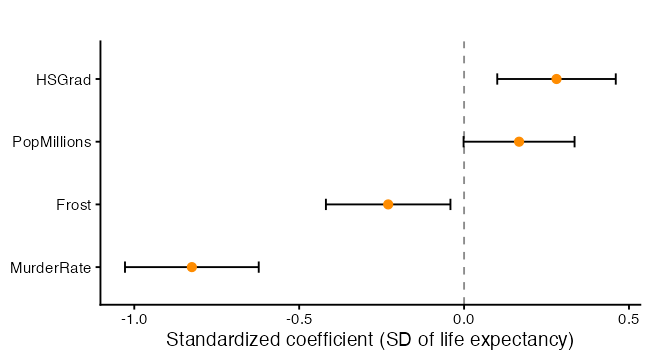

```
> round(summary(standardModel)$coefficients, 3)
                   Estimate Std. Error t value Pr(>|t|)
(Intercept)           0.000      0.076   0.000    1.000
scale(PopMillions)    0.167      0.084   1.996    0.052
scale(MurderRate)    -0.825      0.101  -8.199    0.000
scale(HSGrad)         0.280      0.089   3.142    0.003
scale(Frost)         -0.230      0.094  -2.455    0.018
```

Each standardized coefficient is the change in standard deviations of life expectancy per one standard deviation of the predictor. Use it to compare magnitudes, and report the raw coefficients for interpretation, since standard deviations are not units a general reader can picture.

## Statistical Significance Is Not Practical Significance

A p-value answers one narrow question: if the coefficient were zero, how surprising would this estimate be? Two separate things make it small, a large effect and a precise estimate, so a trivial effect measured precisely gets a small p-value too.

Put the effect back into the units of the problem. Moving a predictor across the middle 80% of its observed range is a realistic comparison; moving it by one unit often is not, since one extra frost day is a rounding error.


```r
sd(states$LifeExp)
summary(bestModel)$sigma

predictorNames <- c("PopMillions", "MurderRate", "HSGrad", "Frost")
rangeWidths <- sapply(states[predictorNames],
                      function(v) diff(quantile(v, c(0.10, 0.90))))

effectFrame <- tidy(bestModel, conf.int = TRUE)
effectFrame <- effectFrame[effectFrame$term != "(Intercept)", ]
effectFrame$width  <- rangeWidths[effectFrame$term]
effectFrame$change <- effectFrame$estimate  * effectFrame$width
effectFrame$low    <- effectFrame$conf.low  * effectFrame$width
effectFrame$high   <- effectFrame$conf.high * effectFrame$width

effectFrame[, c("term", "width", "change", "low", "high")]
```

```
> effectFrame[, c("term", "width", "change", "low", "high")]
# A tibble: 4 × 5
  term         width change      low   high
  <chr>        <dbl>  <dbl>    <dbl>  <dbl>
1 PopMillions  10.1   0.509 -0.00461  1.02 
2 MurderRate    8.99 -2.70  -3.36    -2.04 
3 HSGrad       22     1.02   0.368    1.68 
4 Frost       148.   -0.882 -1.61    -0.158
```

Multiplying a coefficient and its interval by a fixed width is a linear rescaling, so the interval stays valid.


```r
effectFrame$term <- factor(effectFrame$term,
                           levels = effectFrame$term[order(effectFrame$change)])

ggplot(effectFrame, aes(x = change, y = term)) +
  geom_vline(xintercept = 0, linetype = "dashed", colour = "grey55") +
  geom_errorbarh(aes(xmin = low, xmax = high), height = 0.18) +
  geom_point(size = 2.6, colour = "darkorange") +
  labs(x = "Change in life expectancy across the 10th to 90th percentile (years)",
       y = NULL, title = "")
```

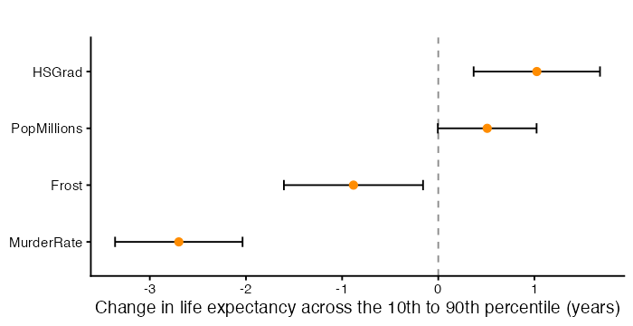

Read each bar against two yardsticks. The standard deviation of life expectancy is how much states differ to begin with. The residual standard error, 0.72 years, is how far this model typically misses. An effect smaller than the model's own typical error is hard to call important, whatever its p-value.

## Where the Model Misses


```r
fitFrame <- data.frame(state    = states$StateName,
                       Region   = states$Region,
                       observed = states$LifeExp,
                       fitted   = as.numeric(fitted(bestModel)),
                       residual = as.numeric(resid(bestModel)))
fitFrame$cooks <- as.numeric(cooks.distance(bestModel))
labelFrame <- fitFrame[abs(fitFrame$residual) > 1, ]

ggplot(fitFrame, aes(x = fitted, y = observed)) +
  geom_abline(slope = 1, intercept = 0, linetype = "dashed", colour = "grey55") +
  geom_point(aes(colour = Region), size = 2.4) +
  geom_text(data = labelFrame, aes(label = state),
            hjust = -0.12, size = 3.2, colour = "grey25") +
  labs(x = "Fitted life expectancy (years)",
       y = "Observed life expectancy (years)", colour = "", title = "") +
  coord_equal()
```

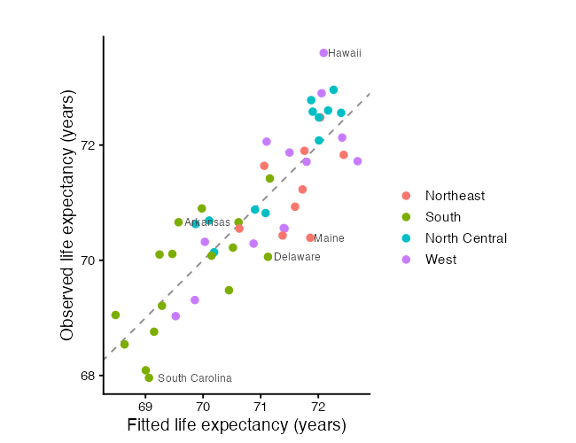

```
            state observed   fitted  residual
11         Hawaii    73.60 72.09317  1.506831
19          Maine    70.39 71.86095 -1.470954
40 South Carolina    67.96 69.06109 -1.101092
4        Arkansas    70.66 69.57374  1.086261
8        Delaware    70.06 71.12647 -1.066469
```

A perfect model puts every point on the dashed line. Labelling the states that miss by more than a year turns an abstract number into named cases. Colouring by region is worth doing even though region is not in the model, because a region sitting mostly on one side of the line is structure the model has not captured.

### Which States Move the Fit


```r
cooksThreshold <- 4 / nrow(states)
fitFrame$stateOrdered <- factor(fitFrame$state,
                                levels = fitFrame$state[order(fitFrame$cooks)])

ggplot(fitFrame, aes(x = stateOrdered, y = cooks)) +
  geom_segment(aes(xend = stateOrdered, yend = 0), colour = "grey75") +
  geom_point(size = 1.8, colour = "darkorange") +
  geom_hline(yintercept = cooksThreshold, linetype = "dashed", colour = "grey40") +
  coord_flip() +
  labs(x = NULL, y = "Cook's distance", title = "") +
  theme(axis.text.y = element_text(size = 8))
```

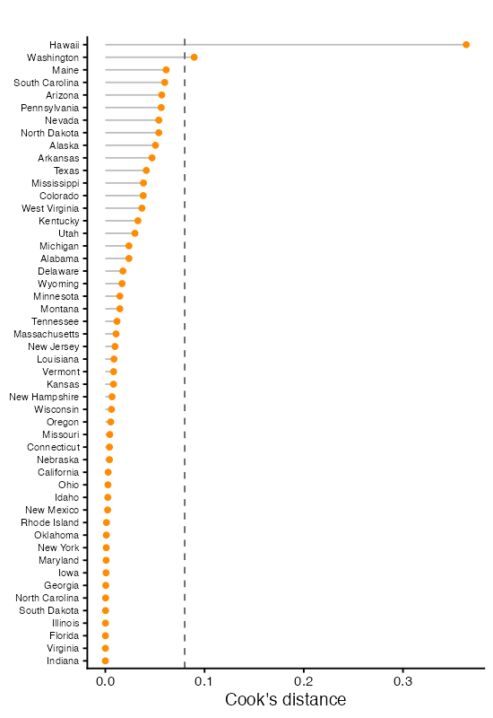


```r
mostInfluential <- fitFrame$state[which.max(fitFrame$cooks)]
droppedModel <- lm(LifeExp ~ PopMillions + MurderRate + HSGrad + Frost,
                   data = states[states$StateName != mostInfluential, ])
round(cbind(full = coef(bestModel), dropped = coef(droppedModel)), 4)
```

### Structure the Model Missed


```r
residValues <- data.frame(region   = tolower(fitFrame$state),
                          residual = fitFrame$residual)
residMap <- merge(statesMap, residValues, by = "region", all.x = TRUE)
residMap <- residMap[order(residMap$order), ]

ggplot(residMap, aes(x = long, y = lat, group = group, fill = residual)) +
  geom_polygon(colour = "white", linewidth = 0.2) +
  coord_quickmap() +
  scale_fill_gradient2(low = "#2166AC", mid = "white", high = "#B2182B",
                       midpoint = 0, name = "Residual\n(years)") +
  labs(x = NULL, y = NULL, title = "") +
  theme_void(base_size = 14)

round(tapply(fitFrame$residual, fitFrame$Region, mean), 3)
```

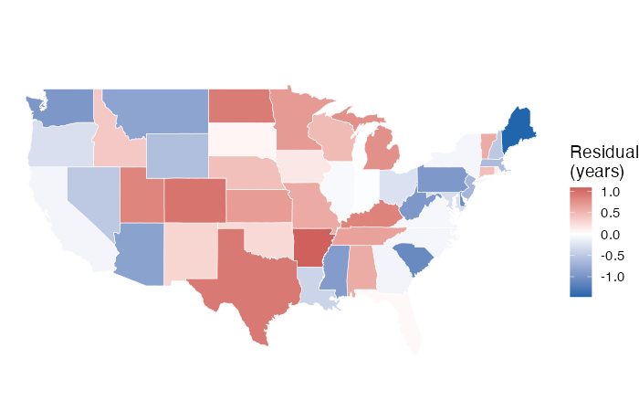

```
    Northeast         South North Central          West 
       -0.346        -0.037         0.368        -0.054 
```

Neighbouring states sharing a colour means nearby states miss in the same direction, which is the correlated-errors problem from Part A in its spatial form. Region is not in this model, so nothing has absorbed regional differences on purpose, and the `tapply()` line puts a number on what the map shows.

## Communicating the Result

> In a linear model of state life expectancy on murder rate, population, high school graduation rate, and frost days, the murder rate was the strongest predictor (b = -0.30 years per murder per 100,000, 95% CI [-0.37, -0.23], p < 0.001). Moving from the 10th to the 90th percentile of murder rate corresponds to a difference of about 2.7 years, against a standard deviation of [value] years across states. Graduation rate was positively associated with life expectancy and frost days negatively associated, though frost days is best read as a proxy for geography rather than a cause. Population was not statistically significant at the 5% level (p = 0.052), with an interval consistent with anything from no effect to a moderate positive one. The model explains 71% of the variation in life expectancy (adjusted $R^2$), with a residual standard error of 0.72 years. Residuals show regional clustering, so the standard errors are likely optimistic. These predictors were chosen after comparing several models, so the p-values are descriptive of this sample. The data are cross-sectional 1970s state-level measurements taken in different years and do not support causal claims.

What makes it defensible is as much what it leaves out as what it includes.

- Estimates with intervals and units, not just p-values.
- A realistic comparison with a yardstick beside it.
- The borderline predictor described by its interval, not by the 0.05 cutoff.
- The proxy variable flagged rather than interpreted at face value.
- The diagnostic failure reported rather than buried.
- The admission that the model was selected.
- "Associated with", never "causes", "drives", or "reduces".

Two failure modes. The first is treating a coefficient as an intervention, which is the move from "states with higher murder rates have lower life expectancy" to "lowering the murder rate would raise life expectancy". The second is a conclusion about individuals from data measured on states. Nothing here describes a person.

## YOU TRY!

Work through these for the next 15 minutes. Use `mtcars`, and fit `lm(mpg ~ disp + hp + wt + qsec, data = mtcars)`.

**Part 1. Nonlinearity.**
Plot `mpg` against each predictor with a loess smoother, then plot residuals against fitted values. Which predictor looks worst? Run the squared-terms F test.

**Part 2. Fix it.**
Run `MASS::boxcox()` on the model. What does it suggest? Fit the transformed model and compare the residual plots before and after.

**Part 3. Non-constant variance.**
Run `ncvTest()` and `bptest()` on both models. Do they agree? Draw the scale-location plot.

**Part 4. Robust standard errors.**
Compare `coeftest(model)` against `coeftest(model, vcov = vcovHC(model, type = "HC3"))`. Which coefficients change their story?

**Part 5. Collinearity.**
Run `vif()`. Three of these four predictors measure something close to "how big is the engine". Which would you drop, and what does the surviving coefficient now mean?

**Part 6. Influence.**
Build the leverage-versus-studentized-residual plot with Cook's distance as the point size. Which cars are flagged? Refit without the worst one and report what moved.

**Part 7. Choose.**
Use `regsubsets()` with all four predictors. Where does BIC flatten? Does it agree with adjusted $R^2$?

**Part 8. Write it up.**
One paragraph, in the shape of the write-up above, including every diagnostic problem you found.

## So... what did we learn?

1. Every assumption has a plot and a test. The plot tells you what is wrong, the test tells you whether you are imagining it. Use both.
2. Curvature and non-constant variance often share one cause, the response being on the wrong scale, and one transformation fixes both.
3. Robust standard errors repair inference without touching the estimates. Reach for them when you cannot fix the variance properly.
4. Normality matters least of the five assumptions, and matters most for prediction intervals and small samples.
5. Correlated errors only make sense where the data have a meaningful order, and missing rows break that order.
6. Collinearity does not bias the estimates. It inflates their variance, so a single sample can give a coefficient with the wrong sign, and simulation shows this directly.
7. Outliers, leverage, and influence are three different things. Only the third one moves your conclusions.
8. Refit without the flagged observation and report what changed. That turns a diagnostic into a finding.
9. Missing data silently changes which observations a model is fitted to, which makes AIC and `anova()` comparisons invalid.
10. Every selection criterion here scores fit to the data you already have, and any inference after selection is optimistic.
11. Report associations, intervals, units, limits, diagnostic failures, and the fact that a model was selected.

## What Is Next

Everything in this session described the data we already have. A model can pass every diagnostic here and still predict badly, and a criterion like AIC penalizes complexity with a formula rather than by checking.

Next workshop is Fitting vs Predicting. We separate explanatory modelling from prediction, split the data into training and test sets, and evaluate out of sample. We will meet the common prediction metrics, draw the distinction between a confidence interval for a mean and a prediction interval for a new observation, and watch overfitting produce a model that looks excellent on the data it has seen and fails on anything else.

## References

Parts 1 and 2 list the general regression textbooks and the sources for `state.x77`.

**Data.**

- Chambers, J. M., Cleveland, W. S., Kleiner, B. and Tukey, P. A. (1983). *Graphical Methods for Data Analysis*. Wadsworth. The reference given in R's help page for `airquality`. Ozone data from the New York State Department of Conservation, meteorological data from the National Weather Service.

**Transformations.**

- Box, G. E. P. and Cox, D. R. (1964). An analysis of transformations. *Journal of the Royal Statistical Society Series B*, 26(2), 211-243. The method behind `boxcox()` and `powerTransform()`.
- Box, G. E. P. and Tidwell, P. W. (1962). Transformation of the independent variables. *Technometrics*, 4, 531-550. The method behind `boxTidwell()`.

**Non-constant variance.**

- White, H. (1980). A heteroskedasticity-consistent covariance matrix estimator and a direct test for heteroskedasticity. *Econometrica*, 48(4), 817-838.
- Long, J. S. and Ervin, L. H. (2000). Using heteroscedasticity consistent standard errors in the linear regression model. *The American Statistician*, 54. The source of the advice to use HC3 below roughly 250 observations.
- Zeileis, A. (2004). Econometric computing with HC and HAC covariance matrix estimators. *Journal of Statistical Software*, 11(10), 1-17. Documents `sandwich`.
- Breusch and Pagan (1979) and Koenker (1981) are cited in Part 1.

**Influence and diagnostics.**

- Cook, R. D. (1977). Detection of influential observation in linear regression. *Technometrics*, 19(1), 15-18.
- Belsley, D. A., Kuh, E. and Welsch, R. E. (1980). *Regression Diagnostics: Identifying Influential Data and Sources of Collinearity*. Wiley. The source for DFBETA and the condition number.
- Fox, J. and Weisberg, S. (2019). *An R Companion to Applied Regression*, 3rd edition. Sage. Documents `car`, including `crPlots()`, `ncvTest()`, `outlierTest()`, and `influencePlot()`.

**Interpretation and reporting.**

- Wasserstein, R. L. and Lazar, N. A. (2016). The ASA's statement on p-values: context, process, and purpose. *The American Statistician*, 70(2), 129-133.
- Greenland, S., Senn, S. J., Rothman, K. J., Carlin, J. B., Poole, C., Goodman, S. N. and Altman, D. G. (2016). Statistical tests, P values, confidence intervals, and power: a guide to misinterpretations. *European Journal of Epidemiology*, 31, 337-350.
- Gelman, A. and Stern, H. (2006). The difference between "significant" and "not significant" is not itself statistically significant. *The American Statistician*, 60.

