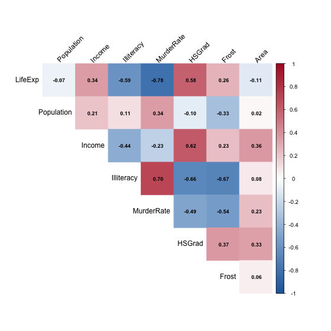
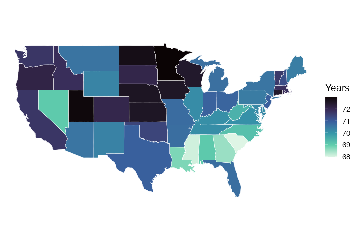
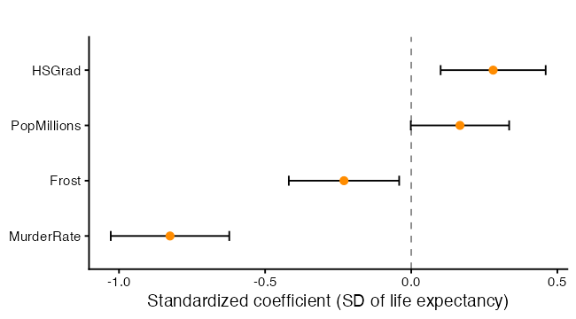
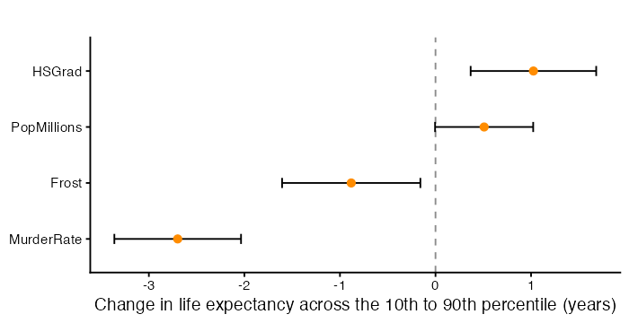
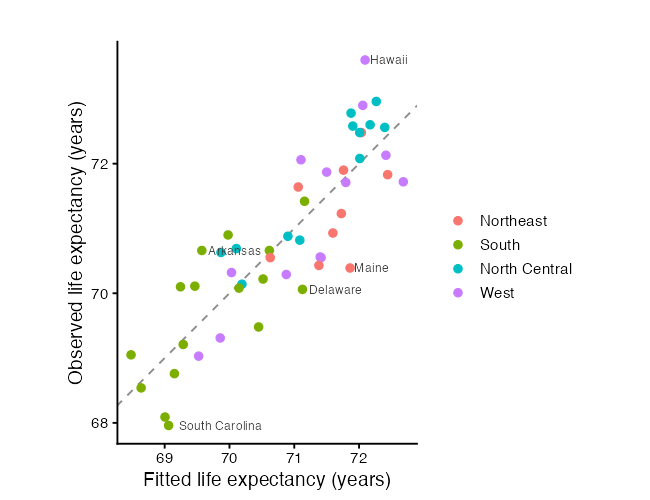
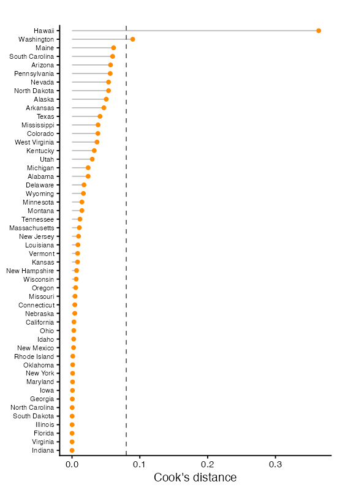
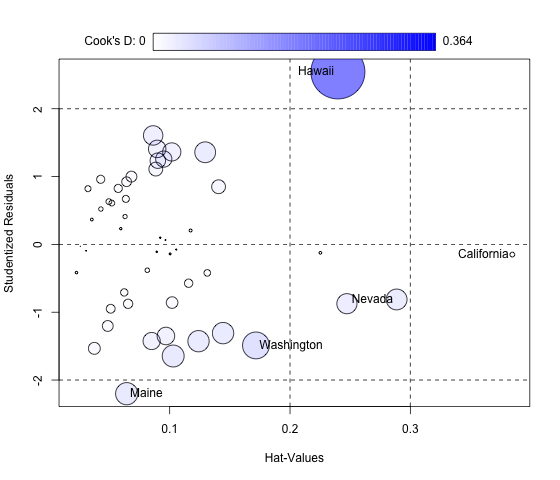
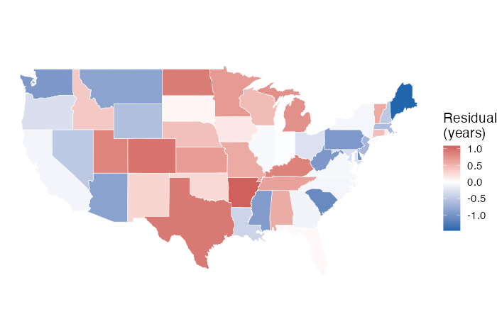

<script>
  MathJax = {
    tex: { inlineMath: [['$','$'], ['\\(','\\)']],
           displayMath: [['$$','$$'], ['\\[','\\]']] },
    svg: { fontCache: 'global' }
  };
</script>
<script src="https://cdn.jsdelivr.net/npm/mathjax@3/es5/tex-svg.js" id="MathJax-script" async></script>

<style>
  .site-footer,
  .footer { display: none; }
</style>

# Linear Regression in R (Part 3): Interpreting Results

> This is the third workshop in a six-part series on linear regression. Parts 1 and 2 built models. Today we read one. Regression output holds a lot of information, and statistical significance is only part of it. We work through coefficients, confidence intervals, hypothesis tests, and measures of fit, all anchored to a research question, and we finish on how to report results without claiming more than the model supports.

## What You Will Learn

By the end of this session you will be able to:

1. Read a coefficient in the units of the data, and see why changing units changes the number but not the evidence.
2. Build and interpret confidence intervals, and plot them.
3. Test a group of coefficients at once rather than one row at a time.
4. Separate statistical significance from practical significance.
5. Read measures of fit, including the one reported in the units of the response.
6. Find the observations that move the fit, and check for structure the model missed.
7. Write up a result in language the model can support.

## Setup

We use `ggplot2` for plots, `car` for tests and influence measures, `corrplot` for the correlation display, `maps` for the state outlines, and `broom` for turning model output into a data frame.


```r
packages <- c("ggplot2", "car", "corrplot", "maps", "broom")
toInstall <- packages[!(packages %in% installed.packages()[, "Package"])]
if (length(toInstall)) install.packages(toInstall)

library(ggplot2)
library(car)
library(corrplot)
library(maps)
library(broom)
theme_set(theme_classic(base_size = 14))
```

## The Model

We continue with the `states` data from Part 2. Rebuild it, then fit the model we will read for the rest of the session.

Population in `state.x77` is recorded in thousands. The help page does not say so, but the values make it clear, since California shows 21198 for 1975. We convert to millions now so the coefficient is readable later.


```r
states <- as.data.frame(state.x77)
names(states)[names(states) == "Life Exp"] <- "LifeExp"
names(states)[names(states) == "HS Grad"] <- "HSGrad"
names(states)[names(states) == "Murder"]  <- "MurderRate"
states$Region <- state.region
states$StateName <- rownames(states)

# Population is recorded in thousands
states$PopMillions <- states$Population / 1000

bestModel <- lm(LifeExp ~ PopMillions + MurderRate + HSGrad + Frost,
                data = states)
summary(bestModel)
```

```
Call:
lm(formula = LifeExp ~ Population + MurderRate + HSGrad + Frost, 
    data = states)

Residuals:
     Min       1Q   Median       3Q      Max 
-1.47095 -0.53464 -0.03701  0.57621  1.50683 

Coefficients:
              Estimate Std. Error t value Pr(>|t|)    
(Intercept)  7.103e+01  9.529e-01  74.542  < 2e-16 ***
Population   5.014e-05  2.512e-05   1.996  0.05201 .  
MurderRate  -3.001e-01  3.661e-02  -8.199 1.77e-10 ***
HSGrad       4.658e-02  1.483e-02   3.142  0.00297 ** 
Frost       -5.943e-03  2.421e-03  -2.455  0.01802 *  
---
Signif. codes:  0 ‘***’ 0.001 ‘**’ 0.01 ‘*’ 0.05 ‘.’ 0.1 ‘ ’ 1

Residual standard error: 0.7197 on 45 degrees of freedom
Multiple R-squared:  0.736,	Adjusted R-squared:  0.7126 
F-statistic: 31.37 on 4 and 45 DF,  p-value: 1.696e-12
```

The question this model answers: **which state-level characteristics are associated with life expectancy, and how large are those associations?**

## Looking at the Data Before the Output

Two displays set up everything that follows.


```r
numericVars <- states[, c("LifeExp", "Population", "Income", "Illiteracy",
                          "MurderRate", "HSGrad", "Frost", "Area")]
corrMatrix <- cor(numericVars)
corrplot(corrMatrix,
         method = "color", type = "upper", diag = FALSE,
         addCoef.col = "black", number.cex = 0.75,
         tl.col = "black", tl.srt = 45,
         col = colorRampPalette(c("#2166AC", "white", "#B2182B"))(200))
```



The `LifeExp` row is the one most people read first. The rest of the grid matters more for interpretation, because it shows which predictors carry overlapping information. Watch `Frost` in particular, since it is strongly related to several other columns.

The response also has a geography, which is easier to see on a map than in a column of numbers.


```r
statesMap <- map_data("state")
mapValues <- data.frame(region  = tolower(states$StateName),
                        LifeExp = states$LifeExp)
lifeMap <- merge(statesMap, mapValues, by = "region", all.x = TRUE)
lifeMap <- lifeMap[order(lifeMap$order), ]   # merge scrambles the drawing order

ggplot(lifeMap, aes(x = long, y = lat, group = group, fill = LifeExp)) +
  geom_polygon(colour = "white", linewidth = 0.2) +
  coord_quickmap() +
  scale_fill_viridis_c(option = "mako", direction = -1, name = "Years") +
  labs(x = NULL, y = NULL, title = "") +
  theme_void(base_size = 14)
```



Two notes on the code. The `order()` line is not optional. `merge()` returns rows in an order that suits the join, and `geom_polygon` draws vertices in row order, so skipping it produces scribble instead of state outlines. And `map_data("state")` covers the lower 48, so Alaska and Hawaii are missing from every map in this workshop even though both are in the model.

## Reading a Coefficient

The model is

$$\text{LifeExp}_i = \beta_0 + \beta_1 \text{Pop}_i + \beta_2 \text{MurderRate}_i + \beta_3 \text{HSGrad}_i + \beta_4 \text{Frost}_i + \epsilon_i .$$

Each coefficient is a partial effect, as in Part 2. Reading one out loud takes four pieces.

1. **The direction.** Positive or negative.
2. **The size, with units on both sides.** A one-unit increase in the predictor is associated with $\hat\beta_j$ units of change in the response. Name both units.
3. **What is being held fixed.** The other predictors in the model, and nothing else.
4. **The uncertainty.** The interval, not just the estimate.

For the murder rate, the sentence is: each additional murder per 100,000 people is associated with a drop of about 0.30 years in mean life expectancy, among states with the same population, graduation rate, and number of frost days.

Note what that sentence does not say. It does not say that lowering the murder rate would raise life expectancy. The model is fitted to 50 observations with no experiment behind them, and Part 2 showed how tangled these predictors are. Association is what regression returns.

`Frost` is the predictor that makes this concrete. Its coefficient is negative, so colder states have shorter life expectancy once the others are held fixed. Nobody believes that frost days shorten lives. `Frost` is standing in for something else, most likely latitude and the bundle of regional differences that travel with it. A coefficient on a proxy variable describes the proxy, not the thing it stands for, and the model has no way to tell you which one you are looking at.

### Units Change the Number, Not the Evidence

Population in thousands gives a coefficient with four leading zeros, which reads as "nothing" even when it is not. Convert the predictor to millions and refit.


```r
thousandsModel <- lm(LifeExp ~ Population + MurderRate + HSGrad + Frost,
                     data = states)

summary(thousandsModel)$coefficients["Population", ]
summary(bestModel)$coefficients["PopMillions", ]

c(thousands = summary(thousandsModel)$r.squared,
  millions  = summary(bestModel)$r.squared)
all.equal(as.numeric(fitted(thousandsModel)), as.numeric(fitted(bestModel)))
```

```
> summary(thousandsModel)$coefficients["Population", ]
    Estimate   Std. Error      t value     Pr(>|t|) 
5.013998e-05 2.512002e-05 1.996017e+00 5.200514e-02 

> summary(bestModel)$coefficients["PopMillions", ]
  Estimate Std. Error    t value   Pr(>|t|) 
0.05013998 0.02512002 1.99601698 0.05200514 

> c(thousands = summary(thousandsModel)$r.squared,
+   millions  = summary(bestModel)$r.squared)
thousands  millions 
0.7360328 0.7360328 

> all.equal(as.numeric(fitted(thousandsModel)), as.numeric(fitted(bestModel)))
[1] TRUE
```

The estimate and the standard error are both multiplied by 1000, so the t statistic, the p-value, and every fitted value are unchanged. Dividing a predictor by a constant $c$ multiplies its coefficient by $c$ and leaves the model otherwise identical. Units are a presentation choice. Pick the one a reader can hold in their head, which here is years of life expectancy per million people.

## Confidence Intervals

A coefficient estimate is one number from one sample. The confidence interval says which values are consistent with the data,

$$\hat\beta_j \pm t_{0.975,\, n-p-1} \cdot \text{SE}(\hat\beta_j),$$

with $n - p - 1$ degrees of freedom, the 45 printed at the bottom of the summary.


```r
confint(bestModel)
confint(bestModel, level = 0.99)
```

```
> confint(bestModel)
                    2.5 %       97.5 %
(Intercept) 69.1079841538 72.946272910
PopMillions -0.0004543308  0.100734287
MurderRate  -0.3738840302 -0.226413571
HSGrad       0.0167190063  0.076445487
Frost       -0.0108191818 -0.001067398

> confint(bestModel, level = 0.99)
                   0.5 %        99.5 %
(Intercept) 68.464349482 73.5899075823
PopMillions -0.017422440  0.1177023961
MurderRate  -0.398613045 -0.2016845553
HSGrad       0.006703597  0.0864608966
Frost       -0.012454438  0.0005678588
```

The interval and the p-value carry the same information for a single coefficient. An interval that excludes zero corresponds to a p-value below 0.05. The interval says more, because it is in the units of the response. "Between 0.23 and 0.37 fewer years per murder" tells a reader how large the effect might be. "p = 1.77e-10" does not.

Say what the interval means with care. Over many repeated samples, 95% of intervals built this way would contain the true coefficient. The usual shorthand, that there is a 95% chance the true value lies in this one interval, is a different claim and not what the procedure provides.

Population is the predictor to look at here. Its p-value sits just above 0.05, which under the usual convention gets it called "not significant". The interval is the better description. It runs from slightly below zero to a clearly positive value, so the data rule out a large negative effect and are consistent with everything from nothing to a moderate positive one. That is a statement about imprecision, not a finding of no effect.

### Plotting the Coefficients

A forest plot shows every estimate and interval at once. Plotting the raw coefficients here would be misleading, since they are in four different units and bar length would say more about units than about effects. Standardizing first puts them on one scale.


```r
standardModel <- lm(scale(LifeExp) ~ scale(PopMillions) + scale(MurderRate) +
                      scale(HSGrad) + scale(Frost), data = states)
round(summary(standardModel)$coefficients, 3)

standardFrame <- tidy(standardModel, conf.int = TRUE)
standardFrame <- standardFrame[standardFrame$term != "(Intercept)", ]
standardFrame$label <- gsub("scale\\(|\\)", "", standardFrame$term)
standardFrame$label <- factor(standardFrame$label,
                              levels = standardFrame$label[order(standardFrame$estimate)])

ggplot(standardFrame, aes(x = estimate, y = label)) +
  geom_vline(xintercept = 0, linetype = "dashed", colour = "grey55") +
  geom_errorbarh(aes(xmin = conf.low, xmax = conf.high), height = 0.18) +
  geom_point(size = 2.6, colour = "darkorange") +
  labs(x = "Standardized coefficient (SD of life expectancy)",
       y = NULL, title = "")
```



```
> round(summary(standardModel)$coefficients, 3)
                   Estimate Std. Error t value Pr(>|t|)
(Intercept)           0.000      0.076   0.000    1.000
scale(PopMillions)    0.167      0.084   1.996    0.052
scale(MurderRate)    -0.825      0.101  -8.199    0.000
scale(HSGrad)         0.280      0.089   3.142    0.003
scale(Frost)         -0.230      0.094  -2.455    0.018
```

Each standardized coefficient is the change in standard deviations of life expectancy per one standard deviation of the predictor. The dashed line at zero is the reference, bars crossing it are coefficients the data cannot distinguish from no effect, and bar width is precision. Standardizing makes magnitudes comparable and makes the units meaningless to a general reader, so use it for comparison and report the raw coefficients for interpretation.

## Testing More Than One Coefficient at a Time

The coefficient table tests each coefficient on its own. Some questions are about several at once. "Do population and climate matter at all here" is a question about two coefficients, and asking it one row at a time inflates the chance of a false positive.

The right test compares two models, one with the terms and one without, through the partial F statistic

$$F = \frac{(\text{SSE}_{\text{reduced}} - \text{SSE}_{\text{full}}) / q}{\text{SSE}_{\text{full}} / (n - p - 1)},$$

where $q$ is the number of coefficients dropped. It follows an $F$ distribution on $q$ and $n-p-1$ degrees of freedom when the dropped coefficients are all zero.


```r
# drop two predictors at once
murderGradModel <- lm(LifeExp ~ MurderRate + HSGrad, data = states)
anova(murderGradModel, bestModel)
```

```
Analysis of Variance Table

Model 1: LifeExp ~ MurderRate + HSGrad
Model 2: LifeExp ~ PopMillions + MurderRate + HSGrad + Frost
  Res.Df    RSS Df Sum of Sq      F   Pr(>F)   
1     47 29.770                                
2     45 23.308  2    6.4623 6.2383 0.004062 **
---
Signif. codes:  0 ‘***’ 0.001 ‘**’ 0.01 ‘*’ 0.05 ‘.’ 0.1 ‘ ’ 1
```

```r
linearHypothesis(bestModel, c("PopMillions", "Frost"))
```

```
Linear hypothesis test:
PopMillions = 0
Frost = 0

Model 1: restricted model
Model 2: LifeExp ~ PopMillions + MurderRate + HSGrad + Frost

  Res.Df    RSS Df Sum of Sq      F   Pr(>F)   
1     47 29.770                                
2     45 23.308  2    6.4623 6.2383 0.004062 **
---
Signif. codes:  0 ‘***’ 0.001 ‘**’ 0.01 ‘*’ 0.05 ‘.’ 0.1 ‘ ’ 1
```

```r
# does Region add anything beyond the four predictors? three coefficients
regionAddedModel <- lm(LifeExp ~ PopMillions + MurderRate + HSGrad + Frost +
                         Region, data = states)
anova(bestModel, regionAddedModel)
```

```
Analysis of Variance Table

Model 1: LifeExp ~ PopMillions + MurderRate + HSGrad + Frost
Model 2: LifeExp ~ PopMillions + MurderRate + HSGrad + Frost + Region
  Res.Df    RSS Df Sum of Sq      F Pr(>F)
1     45 23.308                           
2     42 20.408  3    2.9001 1.9895 0.1302
```

```r
# the overall F test from the summary, as a model comparison
nullModel <- lm(LifeExp ~ 1, data = states)
anova(nullModel, bestModel)
```

```
Analysis of Variance Table

Model 1: LifeExp ~ 1
Model 2: LifeExp ~ PopMillions + MurderRate + HSGrad + Frost
  Res.Df    RSS Df Sum of Sq      F    Pr(>F)    
1     49 88.299                                  
2     45 23.308  4    64.991 31.369 1.696e-12 ***
---
Signif. codes:  0 ‘***’ 0.001 ‘**’ 0.01 ‘*’ 0.05 ‘.’ 0.1 ‘ ’ 1
```

Four tests, four different questions.

- `anova(murderGradModel, bestModel)` asks whether population and frost days together earn their two coefficients.
- `linearHypothesis()` asks the same question and returns the same F statistic. It is the general tool, and it is the one to reach for when a term occupies several columns or when you want a contrast rather than a zero test.
- The Region comparison is the case where this test is not optional. A factor with four levels occupies three coefficients, and reading three t-rows separately does not answer "does region matter". One F test does.
- `anova(nullModel, bestModel)` reproduces the F statistic at the bottom of `summary()`. That test asks whether the model beats an intercept. It is a low bar, and clearing it is not evidence that any particular coefficient is right.

## Statistical Significance Is Not Practical Significance

A p-value answers one narrow question. If the coefficient were zero, how surprising would this estimate be? It says nothing about whether the effect is large enough to care about. Two separate things drive a small p-value: a large effect, and a precise estimate. A tiny effect measured precisely gets a small p-value too.

The fix is to put the effect back into the units of the problem and compare it against something meaningful. Moving a predictor across the middle 80% of its observed range is a realistic comparison. Moving it by one unit often is not, since one extra frost day is a rounding error and one extra murder per 100,000 is a small step.


```r
sd(states$LifeExp)
summary(bestModel)$sigma        # typical miss, in years

predictorNames <- c("PopMillions", "MurderRate", "HSGrad", "Frost")
rangeWidths <- sapply(states[predictorNames],
                      function(v) diff(quantile(v, c(0.10, 0.90))))
rangeWidths

effectFrame <- tidy(bestModel, conf.int = TRUE)
effectFrame <- effectFrame[effectFrame$term != "(Intercept)", ]
effectFrame$width  <- rangeWidths
effectFrame$change <- effectFrame$estimate  * effectFrame$width
effectFrame$low    <- effectFrame$conf.low  * effectFrame$width
effectFrame$high   <- effectFrame$conf.high * effectFrame$width

effectFrame[, c("term", "width", "change", "low", "high")]
```

```
> effectFrame[, c("term", "width", "change", "low", "high")]
# A tibble: 4 × 5
  term         width change      low   high
  <chr>        <dbl>  <dbl>    <dbl>  <dbl>
1 PopMillions  10.1   0.509 -0.00461  1.02 
2 MurderRate    8.99 -2.70  -3.36    -2.04 
3 HSGrad       22     1.02   0.368    1.68 
4 Frost       148.   -0.882 -1.61    -0.158
```

Multiplying a coefficient and its interval by a fixed range width is a linear rescaling, so the interval stays valid. Plotting the result gives the whole model in the units of the question.


```r
effectFrame$term <- factor(effectFrame$term,
                           levels = effectFrame$term[order(effectFrame$change)])

ggplot(effectFrame, aes(x = change, y = term)) +
  geom_vline(xintercept = 0, linetype = "dashed", colour = "grey55") +
  geom_errorbarh(aes(xmin = low, xmax = high), height = 0.18) +
  geom_point(size = 2.6, colour = "darkorange") +
  labs(x = "Change in life expectancy across the 10th to 90th percentile (years)",
       y = NULL, title = "")
```



Read each bar against two yardsticks. The standard deviation of life expectancy is how much states differ to begin with. The residual standard error, 0.72 years, is how far this model typically misses. An effect smaller than the model's own typical error is hard to describe as important, whatever its p-value.

Two more habits worth building.

- Sample size moves p-values and leaves effects alone. With 50 observations a real effect can miss significance, which is what happens to population here. With 50,000 a trivial one can clear it. Report the size and the interval and let the reader judge.
- A large p-value is not evidence of no effect. A wide interval that includes zero and also includes a large effect is not the same finding as a narrow interval tight around zero, though both produce the same verdict.

## Measures of Fit

Three numbers describe how the model fits, and they answer different questions.

$R^2$ is the share of variation explained. It can only rise as predictors are added. Adjusted $R^2$ charges for each one,

$$R^2_{\text{adj}} = 1 - \frac{(1 - R^2)(n - 1)}{n - p - 1},$$

so it can fall. It is the one to use when comparing models of different sizes.

The residual standard error $\hat\sigma$ is the most useful of the three for interpretation and the least reported. It is in the units of the response, so it answers "how far off is this model, typically, in years".

AIC and BIC score fit against complexity on a different scale. Lower is better, only the differences matter, and comparisons are valid only across models fitted to the same observations. BIC charges more per predictor than AIC, so the two can disagree, and when they do it is usually BIC preferring the smaller model.


```r
summary(bestModel)$r.squared
summary(bestModel)$adj.r.squared
summary(bestModel)$sigma

threeModel <- lm(LifeExp ~ PopMillions + MurderRate + HSGrad, data = states)

AIC(murderGradModel, threeModel, bestModel, regionAddedModel)
BIC(murderGradModel, threeModel, bestModel, regionAddedModel)
```

```
> summary(bestModel)$r.squared
[1] 0.7360328

> summary(bestModel)$adj.r.squared
[1] 0.712569

> summary(bestModel)$sigma
[1] 0.719692

> threeModel <- lm(LifeExp ~ PopMillions + MurderRate + HSGrad, data = states)
> AIC(murderGradModel, threeModel, bestModel, regionAddedModel)
                 df      AIC
murderGradModel   4 123.9684
threeModel        5 120.0174
bestModel         6 115.7326
regionAddedModel  9 115.0889

> BIC(murderGradModel, threeModel, bestModel, regionAddedModel)
                 df      BIC
murderGradModel   4 131.6165
threeModel        5 129.5775
bestModel         6 127.2048
regionAddedModel  9 132.2971
```

All of these describe fit to the data we already have. None of them says how the model would do on a state it has never seen, and the model was selected partly on these very numbers. That gap is the subject of Part 4.

## Where the Model Misses

Fit statistics are summaries. Plots show which observations produce them.


```r
fitFrame <- data.frame(state    = states$StateName,
                       Region   = states$Region,
                       observed = states$LifeExp,
                       fitted   = as.numeric(fitted(bestModel)),
                       residual = as.numeric(resid(bestModel)))
fitFrame$cooks <- as.numeric(cooks.distance(bestModel))

labelFrame <- fitFrame[abs(fitFrame$residual) > 1, ]

ggplot(fitFrame, aes(x = fitted, y = observed)) +
  geom_abline(slope = 1, intercept = 0, linetype = "dashed", colour = "grey55") +
  geom_point(aes(colour = Region), size = 2.4) +
  geom_text(data = labelFrame, aes(label = state),
            hjust = -0.12, size = 3.2, colour = "grey25") +
  labs(x = "Fitted life expectancy (years)",
       y = "Observed life expectancy (years)",
       colour = "", title = "") +
  coord_equal()
```



```
            state observed   fitted  residual
11         Hawaii    73.60 72.09317  1.506831
19          Maine    70.39 71.86095 -1.470954
40 South Carolina    67.96 69.06109 -1.101092
4        Arkansas    70.66 69.57374  1.086261
8        Delaware    70.06 71.12647 -1.066469
```

A perfect model would put every point on the dashed line. The vertical distance from a point to that line is its residual, the same quantity we defined in Part 1. Labelling the states that miss by more than a year turns an abstract number into named cases you can investigate. Colouring by region is worth doing even though region is not in the model, because a region whose points sit mostly on one side of the line is structure the model has not captured.

### Which Observations Move the Fit

Part 1 introduced leverage, which measures how unusual an observation's predictors are. Cook's distance goes one step further and measures how much the fitted values would change if an observation were removed,

$$D_i = \frac{\sum_{k=1}^{n} (\hat{Y}_k - \hat{Y}_{k(i)})^2}{(p+1)\,\hat\sigma^2},$$

where $\hat{Y}_{k(i)}$ is the fitted value for observation $k$ from a model fitted without observation $i$. It combines a large residual with high leverage, since either alone is survivable and both together are not.


```r
cooksThreshold <- 4 / nrow(states)
cooksThreshold

fitFrame$stateOrdered <- factor(fitFrame$state,
                                levels = fitFrame$state[order(fitFrame$cooks)])

ggplot(fitFrame, aes(x = stateOrdered, y = cooks)) +
  geom_segment(aes(xend = stateOrdered, yend = 0), colour = "grey75") +
  geom_point(size = 1.8, colour = "darkorange") +
  geom_hline(yintercept = cooksThreshold, linetype = "dashed", colour = "grey40") +
  coord_flip() +
  labs(x = NULL, y = "Cook's distance", title = "") +
  theme(axis.text.y = element_text(size = 8))
```



The dashed line is at $4/n$, a common rule of thumb and nothing more. Points above it are worth a look, not automatic deletion.

The `car` package draws the same information as a bubble plot, with studentized residual against leverage and bubble area proportional to Cook's distance. It puts the two ingredients and the result on one set of axes.


```r
influencePlot(bestModel)
```



The honest way to use any of this is to refit without the flagged observation and see whether your conclusion survives.


```r
mostInfluential <- fitFrame$state[which.max(fitFrame$cooks)]
mostInfluential

droppedModel <- lm(LifeExp ~ PopMillions + MurderRate + HSGrad + Frost,
                   data = states[states$StateName != mostInfluential, ])
round(cbind(full = coef(bestModel), dropped = coef(droppedModel)), 4)
```

```
```

If the coefficients barely move, say so and keep the full model. If one swings, your result rests on a single observation, and that is the finding to report. Dropping a point because it is inconvenient, without saying that you did, is not an option.

### Structure the Model Missed

Residuals should look like noise. Mapping them is a quick way to check, because geography is the kind of structure a table of numbers hides.


```r
residValues <- data.frame(region   = tolower(fitFrame$state),
                          residual = fitFrame$residual)

residMap <- merge(statesMap, residValues, by = "region", all.x = TRUE)
residMap <- residMap[order(residMap$order), ]

ggplot(residMap, aes(x = long, y = lat, group = group, fill = residual)) +
  geom_polygon(colour = "white", linewidth = 0.2) +
  coord_quickmap() +
  scale_fill_gradient2(low = "#2166AC", mid = "white", high = "#B2182B",
                       midpoint = 0, name = "Residual\n(years)") +
  labs(x = NULL, y = NULL, title = "") +
  theme_void(base_size = 14)

round(tapply(fitFrame$residual, fitFrame$Region, mean), 3)
```



```
    Northeast         South North Central          West 
       -0.346        -0.037         0.368        -0.054 
```

Look for neighbouring states sharing a colour. Patches of one colour mean nearby states miss in the same direction, which is assumption 4 from Part 1 under strain. Errors that cluster are not independent, and standard errors computed as though they were will be too small.

This map has more to say than it would have if region were in the model, since nothing here has absorbed regional differences on purpose. The `tapply()` line puts a number on it. A region whose mean residual is far from zero is a region the four predictors do not describe well, and it is worth asking what that region has that the model does not.

## YOU TRY!

Work through these for the next 15 minutes. Use `swiss`, built into R, which records fertility and five socioeconomic indicators for 47 French-speaking provinces of Switzerland around 1888.


```r
data(swiss)
head(swiss)
?swiss
```

**Part 1. State a question.**
Fit `lm(Fertility ~ Education + Agriculture + Catholic, data = swiss)`. Write the research question this model answers in one sentence, naming what is held fixed.

**Part 2. Read one coefficient out loud.**
Pick `Education` and write its interpretation using all four pieces from this workshop: direction, size with units on both sides, what is held fixed, and uncertainty.

**Part 3. Intervals.**
Run `confint()` on your model. Which predictors have intervals that exclude zero? For one that does not, write a sentence describing what the interval does and does not rule out.

**Part 4. Plot the coefficients.**
Build the standardized coefficient plot from this session. Which predictor has the largest standardized effect? Is that the same one with the smallest p-value?

**Part 5. Practical significance.**
Compute the change in fertility across the 10th to 90th percentile of `Education`. Compare it against `sd(swiss$Fertility)` and against the model's residual standard error. Is the effect large?

**Part 6. Test a group.**
Add `Examination` and `Infant.Mortality`. Use `anova()` to test whether the two together improve the model. Does your answer differ from reading their two t-tests separately?

**Part 7. Influence.**
Compute `cooks.distance()` and find the province with the largest value. Refit without it. Which coefficients move, and does any conclusion change?

**Part 8. Write it up.**
Produce one paragraph in the shape of the write-up above. Then reread it and cross out any word implying causation.

If you finish early, plot the residuals against each predictor and look for leftover structure.

## So... what did we learn?

1. A coefficient needs four things said about it: direction, size with units, what is held fixed, and uncertainty.
2. Rescaling a predictor multiplies its coefficient and its standard error by the same constant. The t statistic, the p-value, and the fitted values do not change.
3. A confidence interval carries the same verdict as a p-value and more information, because it is in the units of the response. Use it to describe borderline predictors instead of leaning on the 0.05 cutoff.
4. Several coefficients are tested together with a partial F test, not one row at a time. This is not optional for a factor, which occupies several coefficients at once.
5. Statistical significance and practical significance are different. Translate an effect into a realistic change in the units of the problem before calling it important.
6. The residual standard error is the fit measure most people skip and the easiest to explain, since it is in the units of the response.
7. A predictor can be a proxy for something the model does not contain. Its coefficient describes the proxy.
8. Cook's distance finds the observations that move the fit. Refit without them and report what happened.
9. Mapping residuals reveals structure the model missed. Clustered residuals mean the independence assumption is under strain.
10. Report associations, intervals, limits, and the fact that a model was selected. Causal language needs more than a regression on observational data.

## What Is Next

Everything in this session described how well the model fits the data it was built on. That is not the same as how well it would do on a state it has never seen, and a model that describes the observed data well can predict new observations badly. The problem is sharper here because the model was chosen by looking at those same fit statistics.

Next workshop is Fitting vs Predicting. We separate explanatory modelling from prediction, split the data into training and test sets, and evaluate out of sample. We will meet the common prediction metrics, draw the distinction between a confidence interval for a mean and a prediction interval for a new observation, and watch overfitting produce a model that looks excellent on the data it has seen and fails on anything else.

## References

Parts 1 and 2 list the general regression textbooks and the sources for the `state.x77` data. The entries below cover what is new here.

**Influence and diagnostics.**

- Cook, R. D. (1977). Detection of influential observation in linear regression. *Technometrics*, 19(1), 15-18. The original definition of Cook's distance.
- Belsley, D. A., Kuh, E. and Welsch, R. E. (1980). *Regression Diagnostics: Identifying Influential Data and Sources of Collinearity*. Wiley.
- Fox, J. and Weisberg, S. (2019). *An R Companion to Applied Regression*, 3rd edition. Sage. Documents `influencePlot()` and `linearHypothesis()`.

**Interpretation and reporting.**

- Wasserstein, R. L. and Lazar, N. A. (2016). The ASA's statement on p-values: context, process, and purpose. *The American Statistician*, 70(2), 129-133. The reference for what a p-value does and does not say.
- Gelman, A. and Stern, H. (2006). The difference between "significant" and "not significant" is not itself statistically significant. *The American Statistician*, 60. Why comparing two p-values is not a test of whether two effects differ.
- Greenland, S., Senn, S. J., Rothman, K. J., Carlin, J. B., Poole, C., Goodman, S. N. and Altman, D. G. (2016). Statistical tests, P values, confidence intervals, and power: a guide to misinterpretations. *European Journal of Epidemiology*, 31, 337-350.

**Software.**

- Robinson, D., Hayes, A. and Couch, S. *broom: Convert Statistical Objects into Tidy Tibbles*. Run `citation("broom")` for the current entry.
- Wei, T. and Simko, V. *R package 'corrplot': Visualization of a Correlation Matrix*. Run `citation("corrplot")` for the current entry.
- Becker, R. A., Wilks, A. R., Brownrigg, R., Minka, T. P. and Deckmyn, A. *maps: Draw Geographical Maps*. Run `citation("maps")` for the current entry.