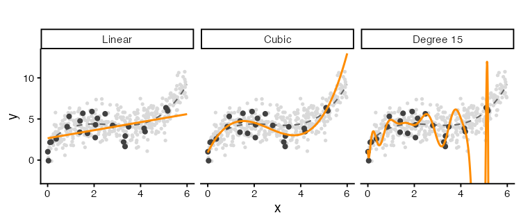
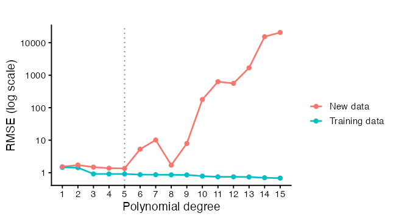
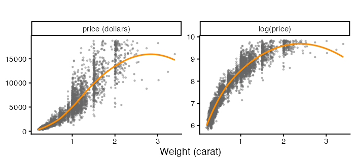
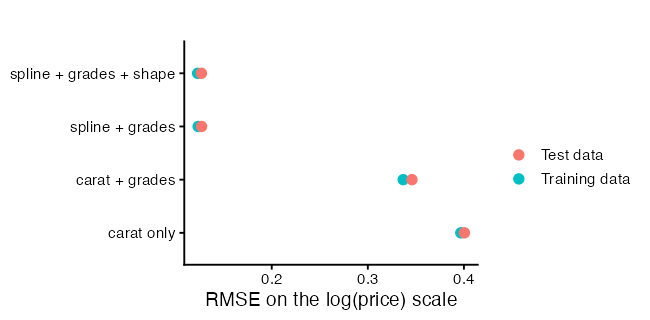
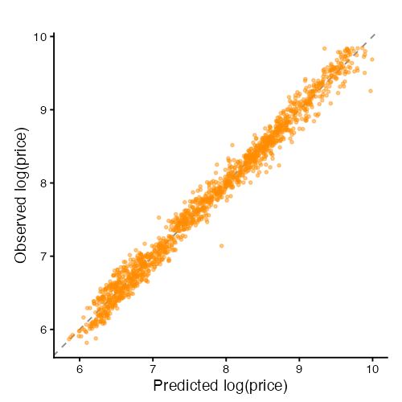
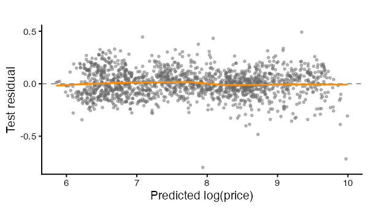
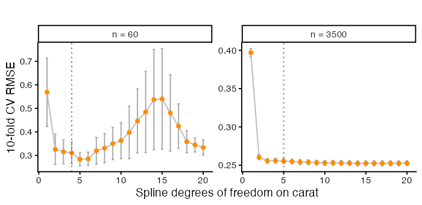
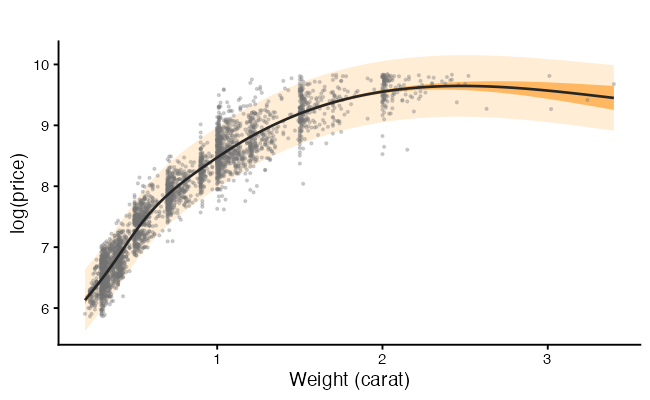
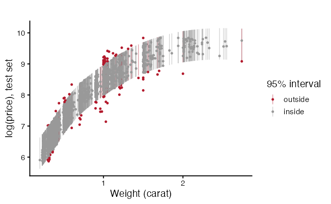

<script>
  MathJax = {
    tex: { inlineMath: [['$','$'], ['\\(','\\)']],
           displayMath: [['$$','$$'], ['\\[','\\]']] },
    svg: { fontCache: 'global' }
  };
</script>
<script src="https://cdn.jsdelivr.net/npm/mathjax@3/es5/tex-svg.js" id="MathJax-script" async></script>

<style>
  .site-footer,
  .footer { display: none; }
</style>

# Linear Regression in R (Part 4): Fitting vs Predicting

> This is the fourth workshop in a six-part series on linear regression. Parts 1 to 3 built a model and read it. Every number we used described the data the model was fitted to. A model can describe that data well and predict new observations badly. Today we separate the two goals and measure the second one properly.

## What You Will Learn

By the end of this session you will be able to:

1. Tell overfitting from underfitting, and name the tradeoff that connects them.
2. Explain why $R^2$ on the fitted data cannot detect overfitting.
3. Split data into training and test sets, and say what each one is for.
4. Compute RMSE, MAE, MAPE, and out-of-sample $R^2$, and choose between them.
5. Run k-fold cross-validation and read its standard error.
6. Distinguish a confidence interval for a mean from a prediction interval for a new observation.
7. Avoid spending the test set on model selection.

## Setup


```r
packages <- c("ggplot2", "splines")
toInstall <- packages[!(packages %in% installed.packages()[, "Package"])]
if (length(toInstall)) install.packages(toInstall)

library(ggplot2)
library(splines)
theme_set(theme_classic(base_size = 14))
```

# Part A: A Motivating Example

Here are 25 observations. Fit something to them before reading how they were made.

<details markdown="1">
<summary>Show the code that generates this dataset (contains the answer)</summary>

```r
set.seed(2026)

trueCurve <- function(x) 2 + 3 * x - 1.2 * x^2 + 0.15 * x^3

nTrain <- 25
trainSim <- data.frame(x = runif(nTrain, 0, 6))
trainSim$y <- trueCurve(trainSim$x) + rnorm(nTrain, sd = 1.2)

nTest <- 400
testSim <- data.frame(x = runif(nTest, 0, 6))
testSim$y <- trueCurve(testSim$x) + rnorm(nTest, sd = 1.2)
```

</details>

We fit three models. A straight line, a cubic, and a degree 15 polynomial.


```r
fitLinear <- lm(y ~ x, data = trainSim)
fitCubic  <- lm(y ~ poly(x, 3), data = trainSim)
fitWild   <- lm(y ~ poly(x, 15), data = trainSim)

c(linear = summary(fitLinear)$r.squared,
  cubic  = summary(fitCubic)$r.squared,
  wild   = summary(fitWild)$r.squared)
```

```
> c(linear = summary(fitLinear)$r.squared,
+   cubic  = summary(fitCubic)$r.squared,
+   wild   = summary(fitWild)$r.squared)
   linear     cubic      wild 
0.2061668 0.6868474 0.8270647 
```

The degree 15 model has the highest $R^2$. Part 1 said $R^2$ can only rise as predictors are added, and this is that fact doing damage. Judged on the data it was fitted to, the most flexible model wins every time.

Now score all three on 400 observations none of them has seen. Root mean squared error is

$$\text{RMSE} = \sqrt{\frac{1}{n}\sum_{i=1}^{n}(y_i - \hat{y}_i)^2},$$

where $\hat{y}_i$ is the model's prediction for observation $i$.


```r
rmse <- function(actual, predicted) sqrt(mean((actual - predicted)^2))

simResults <- data.frame(
  model = c("Linear", "Cubic", "Degree 15"),
  trainRMSE = c(rmse(trainSim$y, predict(fitLinear)),
                rmse(trainSim$y, predict(fitCubic)),
                rmse(trainSim$y, predict(fitWild))),
  testRMSE  = c(rmse(testSim$y, predict(fitLinear, newdata = testSim)),
                rmse(testSim$y, predict(fitCubic,  newdata = testSim)),
                rmse(testSim$y, predict(fitWild,   newdata = testSim)))
)
simResults
```

```
      model trainRMSE     testRMSE
1    Linear 1.4598070     1.520382
2     Cubic 0.9168723     1.483178
3 Degree 15 0.6813538 20684.155041
```

The ordering reverses. The degree 15 model has the smallest training error and the largest test error. Plotting the three fits shows why.


```r
grid <- data.frame(x = seq(0, 6, length.out = 400))
gridFits <- rbind(
  data.frame(grid, fit = predict(fitLinear, newdata = grid), model = "Linear"),
  data.frame(grid, fit = predict(fitCubic,  newdata = grid), model = "Cubic"),
  data.frame(grid, fit = predict(fitWild,   newdata = grid), model = "Degree 15")
)
gridFits$model <- factor(gridFits$model,
                         levels = c("Linear", "Cubic", "Degree 15"))
gridFits$truth <- trueCurve(gridFits$x)

ggplot(gridFits, aes(x = x)) +
  geom_point(data = testSim, aes(x = x, y = y), colour = "grey85", size = 1) +
  geom_line(aes(y = truth), colour = "grey40", linetype = "dashed",
            linewidth = 0.7) +
  geom_point(data = trainSim, aes(x = x, y = y), colour = "grey25", size = 1.9) +
  geom_line(aes(y = fit), colour = "darkorange", linewidth = 1) +
  facet_wrap(~ model) +
  coord_cartesian(ylim = range(testSim$y) + c(-2, 2)) +
  labs(x = "x", y = "y", title = "")
```



Dark points are the 25 observations used for fitting. Pale points are the 400 new observations. The dashed grey line is the curve the data came from, which we know only because we simulated it.

The straight line misses the shape of the curve everywhere. The degree 15 model passes close to the training points and swings away from the dashed line between them. It has learned the noise in those 25 observations, and the noise does not repeat in the new data.

## Underfitting, Overfitting, and the Tradeoff

Sweep the degree from 1 to 15 and track both errors.


```r
degrees <- 1:15
degreeFrame <- data.frame(degree = degrees, train = NA_real_, test = NA_real_)

for (i in seq_along(degrees)) {
  fit <- lm(y ~ poly(x, degrees[i]), data = trainSim)
  degreeFrame$train[i] <- rmse(trainSim$y, predict(fit))
  degreeFrame$test[i]  <- rmse(testSim$y, predict(fit, newdata = testSim))
}

bestDegree <- degreeFrame$degree[which.min(degreeFrame$test)]
degreeFrame
```

```
   degree     train         test
1       1 1.4598070     1.520382
2       2 1.4312220     1.718257
3       3 0.9168723     1.483178
4       4 0.9127046     1.373463
5       5 0.9126361     1.353035
6       6 0.8715520     5.291153
7       7 0.8667544    10.142382
8       8 0.8568539     1.711985
9       9 0.8548870     7.896888
10     10 0.7842254   178.414526
11     11 0.7457240   631.086186
12     12 0.7456541   561.284104
13     13 0.7374822  1685.593871
14     14 0.6976541 15302.942157
15     15 0.6813538 20684.155041 
```


```r
degreeLong <- rbind(
  data.frame(degree = degreeFrame$degree, rmse = degreeFrame$train,
             sample = "Training data"),
  data.frame(degree = degreeFrame$degree, rmse = degreeFrame$test,
             sample = "New data")
)

ggplot(degreeLong, aes(x = degree, y = rmse, colour = sample)) +
  geom_vline(xintercept = bestDegree, linetype = "dotted", colour = "grey50") +
  geom_line(linewidth = 0.9) +
  geom_point(size = 2) +
  scale_y_log10() +
  scale_x_continuous(breaks = degrees) +
  labs(x = "Polynomial degree", y = "RMSE (log scale)", colour = "", title = "")
```



Training error falls as degree rises, and keeps falling. Test error falls, reaches a minimum, then climbs. The two regions have names.

**Underfitting** sits to the left of the minimum. The model is too rigid to represent the pattern, so it misses in the same direction every time it is refitted. That systematic miss is **bias**.

**Overfitting** sits to the right. The model is flexible enough to chase the noise, so a different sample of 25 observations would give a different curve. That instability is **variance**.

For a new observation at $x_0$, the expected squared prediction error decomposes as

$$E\left[(y_0 - \hat{f}(x_0))^2\right] = \underbrace{\sigma^2}_{\text{noise}} + \underbrace{\left(E[\hat{f}(x_0)] - f(x_0)\right)^2}_{\text{squared bias}} + \underbrace{\text{Var}(\hat{f}(x_0))}_{\text{variance}},$$

where $f$ is the true function and $\hat{f}$ is our fitted one. The first term is irreducible. No model removes the noise in the response. The other two trade against each other as flexibility changes, which is why the test curve has a minimum rather than an edge.

We can see both terms by refitting each model on 60 fresh training sets.


```r
set.seed(99)
nRep <- 60
repList <- list()

for (r in seq_len(nRep)) {
  simTrain <- data.frame(x = runif(nTrain, 0, 6))
  simTrain$y <- trueCurve(simTrain$x) + rnorm(nTrain, sd = 1.2)
  for (d in c(1, 3, 15)) {
    fit <- lm(y ~ poly(x, d), data = simTrain)
    repList[[length(repList) + 1]] <- data.frame(
      x = grid$x, fit = predict(fit, newdata = grid),
      rep = r, model = paste("Degree", d))
  }
}

repFrame <- do.call(rbind, repList)
repFrame$model <- factor(repFrame$model,
                         levels = c("Degree 1", "Degree 3", "Degree 15"))
repFrame$truth <- trueCurve(repFrame$x)

ggplot(repFrame, aes(x = x, y = fit, group = rep)) +
  geom_line(colour = "darkorange", alpha = 0.18, linewidth = 0.5) +
  geom_line(aes(y = truth, group = 1), colour = "grey20", linewidth = 1) +
  facet_wrap(~ model) +
  coord_cartesian(ylim = c(-10, 20)) +
  labs(x = "x", y = "Fitted value", title = "")
```


Each orange line is one fitted model. The dark line is the truth. Degree 1 gives a tight bundle of lines sitting away from the truth, which is low variance and high bias. Degree 15 gives a wide spray centred nearer the truth, which is low bias and high variance. Degree 3 does both jobs adequately, because it matches how the data were generated.

The same thing as numbers, evaluated at one value of $x$:


```r
targetX <- data.frame(x = 4.5)
biasVarFrame <- data.frame(model = character(), bias = numeric(),
                           variance = numeric())

for (d in c(1, 3, 15)) {
  predictions <- numeric(nRep)
  set.seed(99)
  for (r in seq_len(nRep)) {
    simTrain <- data.frame(x = runif(nTrain, 0, 6))
    simTrain$y <- trueCurve(simTrain$x) + rnorm(nTrain, sd = 1.2)
    fit <- lm(y ~ poly(x, d), data = simTrain)
    predictions[r] <- predict(fit, newdata = targetX)
  }
  biasVarFrame <- rbind(biasVarFrame, data.frame(
    model = paste("Degree", d),
    bias = mean(predictions) - trueCurve(targetX$x),
    variance = var(predictions)))
}
biasVarFrame$squaredBias <- biasVarFrame$bias^2
biasVarFrame$total <- biasVarFrame$squaredBias + biasVarFrame$variance
biasVarFrame
```

```
      model       bias   variance squaredBias      total
1  Degree 1 0.80335682  0.1791461 0.645382178  0.8245283
2  Degree 3 0.04127212  0.2355044 0.001703388  0.2372078
3 Degree 15 0.68756564 10.8695793 0.472746512 11.3423258
```

## Two Different Goals

Parts 1 to 3 were explanatory modelling. Today is predictive modelling. The distinction changes what counts as a good model.

| | Explanatory | Predictive |
|---|---|---|
| Question | Which variables are associated with the response, and how strongly | How close will my guess be for a new observation |
| What matters | Unbiased interpretable coefficients, correct standard errors | Low expected error on data the model has not seen |
| Measured on | The data the model was fitted to | Data held back from fitting |
| Judged by | $R^2$, $\hat\sigma$, coefficient intervals, assumption checks | Test error, cross-validated error |
| Extra predictors | Change what each coefficient means | Fine, if they lower test error |

A model can do well on one and badly on the other. A degree 15 polynomial has an excellent $R^2$ and no usable coefficients. A model with correlated predictors, from Part 2, has unstable coefficients and predicts perfectly well. Decide which question you are asking before choosing a model, because the two goals point at different answers.

# Part B: Doing It on Real Data

We use `diamonds`, which ships with `ggplot2`. It records 53,940 round-cut diamonds, with price in US dollars from \$326 to \$18,823 and weight in carats from 0.2 to 5.01. We take a sample of 5,000 for speed.


```r
data(diamonds)
dim(diamonds)

set.seed(2026)
gems <- as.data.frame(diamonds[sample(nrow(diamonds), 5000), ])
gems$logPrice <- log(gems$price)

summary(gems[, c("price", "carat", "depth", "table")])
sapply(gems[, c("cut", "color", "clarity")], nlevels)
```

```
> summary(gems[, c("price", "carat", "depth", "table")])
     price           carat            depth           table     
 Min.   :  336   Min.   :0.2000   Min.   :54.60   Min.   :50.0  
 1st Qu.:  942   1st Qu.:0.4000   1st Qu.:61.00   1st Qu.:56.0  
 Median : 2424   Median :0.7000   Median :61.80   Median :57.0  
 Mean   : 3939   Mean   :0.7963   Mean   :61.77   Mean   :57.5  
 3rd Qu.: 5340   3rd Qu.:1.0400   3rd Qu.:62.50   3rd Qu.:59.0  
 Max.   :18823   Max.   :3.4000   Max.   :79.00   Max.   :73.0  
 
> sapply(gems[, c("cut", "color", "clarity")], nlevels)
    cut   color clarity 
      5       7       8 
```

`cut`, `color`, and `clarity` are ordered factors, which enter the model as the indicator columns from Part 2. The three shape measurements `x`, `y`, and `z` are the stone's length, width, and depth in millimetres.

Price gets a log. Part 3 covered the diagnostic reason. The practical reason is visible in one plot.


```r
scaleFrame <- rbind(
  data.frame(carat = gems$carat, value = gems$price, scale = "price (dollars)"),
  data.frame(carat = gems$carat, value = gems$logPrice, scale = "log(price)")
)
scaleFrame$scale <- factor(scaleFrame$scale,
                           levels = c("price (dollars)", "log(price)"))

ggplot(scaleFrame, aes(x = carat, y = value)) +
  geom_point(colour = "grey40", size = 0.7, alpha = 0.4) +
  geom_smooth(method = "loess", formula = y ~ x, se = FALSE,
              colour = "darkorange", linewidth = 1) +
  facet_wrap(~ scale, scales = "free_y") +
  labs(x = "Weight (carat)", y = NULL, title = "")
```



The left panel fans out as weight rises. The right panel does not. Every model below predicts `logPrice`, so the errors are comparable across models.

## Splitting the Data


```r
set.seed(2026)
trainRows <- sample(nrow(gems), size = floor(0.7 * nrow(gems)))
train <- gems[trainRows, ]
test  <- gems[-trainRows, ]

c(train = nrow(train), test = nrow(test))
rbind(train = summary(train$logPrice), test = summary(test$logPrice))
```

```
> c(train = nrow(train), test = nrow(test))
train  test 
 3500  1500 

> rbind(train = summary(train$logPrice), test = summary(test$logPrice))
          Min.  1st Qu.   Median     Mean  3rd Qu.     Max.
train 5.863631 6.848005 7.806086 7.792705 8.587977 9.840601
test  5.817111 6.848801 7.766629 7.768429 8.577771 9.842835
```

Three rules make a split worth having.

**Split first.** Anything you learn from the data before splitting leaks into the test set. Choosing a transformation, dropping outliers, or picking predictors by looking at a correlation matrix all count. The test set is only a test if nothing about it influenced the model.

**Split at random, with a seed.** `sample()` with `set.seed()` gives a split you can reproduce. Where the data have a structure, respect it. A time series splits by date, not at random, because predicting the past from the future is not the task. Repeated measurements on the same subject split by subject, which is Part 5.

**Check the split.** Summaries of the response should look alike in both halves. A 70/30 split is a convention. Smaller test sets give noisier estimates, larger ones leave less for fitting.

## Prediction Metrics

Four quantities, each answering a slightly different question. Let $y_i$ be the observed value and $\hat{y}_i$ the prediction, over $n$ test observations.

$$\text{RMSE} = \sqrt{\frac{1}{n}\sum (y_i - \hat{y}_i)^2}
\qquad
\text{MAE} = \frac{1}{n}\sum |y_i - \hat{y}_i|$$

$$\text{MAPE} = \frac{100}{n}\sum \left|\frac{y_i - \hat{y}_i}{y_i}\right|
\qquad
R^2_{\text{out}} = 1 - \frac{\sum (y_i - \hat{y}_i)^2}{\sum (y_i - \bar{y}_{\text{test}})^2}$$

RMSE squares the errors, so one bad miss costs more than several small ones. It is in the units of the response. MAE treats all errors in proportion to their size, which makes it the choice when a few extreme observations should not dominate the score. MAPE is scale-free and reports a percentage, and it breaks down when the response is near zero. Out-of-sample $R^2$ compares the model against predicting the test mean, and it can come out negative, which happens when a model does worse than that baseline.


```r
mae <- function(actual, predicted) mean(abs(actual - predicted))

mape <- function(actual, predicted) {
  100 * mean(abs((actual - predicted) / actual))
}

rsqOut <- function(actual, predicted) {
  1 - sum((actual - predicted)^2) / sum((actual - mean(actual))^2)
}

evaluate <- function(fit, newdata, actual) {
  predicted <- predict(fit, newdata = newdata)
  data.frame(RMSE = rmse(actual, predicted),
             MAE  = mae(actual, predicted),
             MAPE = mape(actual, predicted),
             R2   = rsqOut(actual, predicted))
}
```

## Scoring Four Candidate Models


```r
modelList <- list(
  "carat only" =
    lm(logPrice ~ carat, data = train),
  "carat + grades" =
    lm(logPrice ~ carat + cut + color + clarity, data = train),
  "spline + grades" =
    lm(logPrice ~ ns(carat, 5) + cut + color + clarity, data = train),
  "spline + grades + shape" =
    lm(logPrice ~ ns(carat, 5) + cut + color + clarity +
         depth + table + x + y + z, data = train)
)

comparison <- do.call(rbind, lapply(names(modelList), function(nm) {
  fit <- modelList[[nm]]
  inSample  <- evaluate(fit, train, train$logPrice)
  outSample <- evaluate(fit, test,  test$logPrice)
  data.frame(model = nm,
             parameters = length(coef(fit)),
             trainRMSE = inSample$RMSE,
             testRMSE  = outSample$RMSE,
             testMAE   = outSample$MAE,
             testR2    = outSample$R2)
}))
comparison
```

```
                    model parameters trainRMSE  testRMSE    testMAE    testR2
1              carat only          2 0.3967723 0.4005180 0.31242865 0.8458166
2          carat + grades         19 0.3368288 0.3459260 0.27569143 0.8849836
3         spline + grades         23 0.1234134 0.1270195 0.09847673 0.9844928
4 spline + grades + shape         28 0.1228835 0.1268330 0.09815301 0.9845383
```


```r
compareLong <- rbind(
  data.frame(model = comparison$model, rmse = comparison$trainRMSE,
             sample = "Training data"),
  data.frame(model = comparison$model, rmse = comparison$testRMSE,
             sample = "Test data")
)
compareLong$model <- factor(compareLong$model, levels = comparison$model)

ggplot(compareLong, aes(x = rmse, y = model, colour = sample)) +
  geom_line(aes(group = model), colour = "grey75", linewidth = 0.8) +
  geom_point(size = 3) +
  labs(x = "RMSE on the log(price) scale", y = NULL, colour = "", title = "")
```



Read the gap between the two points on each row. Training error below test error is normal, because the model was fitted to one and not the other. A gap that widens as the model grows is the overfitting signature from Part A. A gap that stays narrow means the extra predictors are earning their place.

With 3,500 training observations, the flexible models here can afford their parameters. The degree 15 disaster in Part A came from 25 observations. Overfitting is about flexibility relative to sample size, not flexibility on its own.

## Looking at the Test Predictions

Two plots, both on the test set only.


```r
chosen <- modelList[["spline + grades"]]

testFrame <- data.frame(
  observed  = test$logPrice,
  predicted = as.numeric(predict(chosen, newdata = test)))
testFrame$residual <- testFrame$observed - testFrame$predicted

ggplot(testFrame, aes(x = predicted, y = observed)) +
  geom_abline(slope = 1, intercept = 0, linetype = "dashed", colour = "grey55") +
  geom_point(colour = "darkorange", size = 1.1, alpha = 0.45) +
  coord_equal() +
  labs(x = "Predicted log(price)", y = "Observed log(price)", title = "")
```




```r
ggplot(testFrame, aes(x = predicted, y = residual)) +
  geom_hline(yintercept = 0, linetype = "dashed", colour = "grey55") +
  geom_point(colour = "grey40", size = 1.1, alpha = 0.45) +
  geom_smooth(method = "loess", formula = y ~ x, se = FALSE,
              colour = "darkorange", linewidth = 1) +
  labs(x = "Predicted log(price)", y = "Test residual", title = "")
```



The first plot shows whether predictions track observations across the whole range. Points bending away from the dashed line at one end mean the model is biased in that region, even when the overall RMSE looks acceptable.

The second plot is the residual plot from Part 3, computed out of sample. Structure here is worse news than structure in a training residual plot, because the model cannot have fitted it away.

## Cross-Validation

A single split wastes data and gives one noisy number. Which observations landed in the test set changes the answer, and with a small dataset it changes it a lot.

K-fold cross-validation splits the data into $k$ parts. Each part is held out once while the model is fitted on the other $k-1$, and the $k$ errors are averaged. Every observation is used for fitting and once for testing.


```r
cvRMSE <- function(data, df, k = 10, seed = 7) {
  set.seed(seed)
  folds <- sample(rep(seq_len(k), length.out = nrow(data)))
  errors <- numeric(k)
  for (i in seq_len(k)) {
    fit <- lm(logPrice ~ ns(carat, df), data = data[folds != i, ])
    predicted <- predict(fit, newdata = data[folds == i, ])
    errors[i] <- rmse(data$logPrice[folds == i], predicted)
  }
  c(mean = mean(errors), se = sd(errors) / sqrt(k))
}
```

`k = 10` is the usual choice, and `k = 5` is common when fitting is slow. Setting $k = n$ gives leave-one-out cross-validation, where each observation is held out on its own. Leave-one-out has low bias and high variance, and for `lm` it has a closed form that avoids refitting $n$ times.

> **A trap with factors.** A held-out fold can contain a factor level that the training folds do not, and `predict()` fails with an error about new levels. The function above uses only numeric predictors, which sidesteps it. With rare factor levels, either group them first or use a stratified split.

Run the sweep at two sample sizes.


```r
dfGrid <- 1:20

set.seed(2026)
smallTrain <- train[sample(nrow(train), 60), ]

cvList <- list()
for (df in dfGrid) {
  bigResult   <- cvRMSE(train, df)
  smallResult <- cvRMSE(smallTrain, df)
  cvList[[length(cvList) + 1]] <- data.frame(
    df = df,
    mean = c(bigResult["mean"], smallResult["mean"]),
    se   = c(bigResult["se"],   smallResult["se"]),
    size = c(paste0("n = ", nrow(train)), paste0("n = ", nrow(smallTrain))))
}
cvFrame <- do.call(rbind, cvList)
cvFrame$size <- factor(cvFrame$size,
                       levels = c(paste0("n = ", nrow(smallTrain)),
                                  paste0("n = ", nrow(train))))
cvFrame
```

```
> cvFrame
   df      mean          se     size
1   1 0.3969296 0.005305474 n = 3500
2   1 0.5685074 0.145784727   n = 60
3   2 0.2603643 0.003239983 n = 3500
4   2 0.3259142 0.064931501   n = 60
5   3 0.2556905 0.003119346 n = 3500
6   3 0.3154900 0.051147676   n = 60
7   4 0.2558822 0.003105190 n = 3500
8   4 0.3106426 0.046748415   n = 60
9   5 0.2553288 0.003219214 n = 3500
10  5 0.2834216 0.027715669   n = 60
11  6 0.2548061 0.003169230 n = 3500
12  6 0.2853823 0.028239430   n = 60
13  7 0.2541386 0.003287724 n = 3500
14  7 0.3195846 0.056979872   n = 60
15  8 0.2538841 0.003187824 n = 3500
16  8 0.3307388 0.062306787   n = 60
17  9 0.2533042 0.003117171 n = 3500
18  9 0.3505242 0.068518490   n = 60
19 10 0.2529819 0.003141228 n = 3500
20 10 0.3628381 0.076672746   n = 60
21 11 0.2530567 0.003177815 n = 3500
22 11 0.3975790 0.111836683   n = 60
23 12 0.2528512 0.003178058 n = 3500
24 12 0.4464974 0.135869082   n = 60
25 13 0.2527579 0.003207993 n = 3500
26 13 0.4847783 0.172249556   n = 60
27 14 0.2524297 0.003173596 n = 3500
28 14 0.5372049 0.213398353   n = 60
29 15 0.2524678 0.003162094 n = 3500
30 15 0.5403385 0.213830837   n = 60
31 16 0.2524822 0.003177927 n = 3500
32 16 0.4804790 0.162607224   n = 60
33 17 0.2524402 0.003252178 n = 3500
34 17 0.4246342 0.094546898   n = 60
35 18 0.2524776 0.003231829 n = 3500
36 18 0.3583050 0.047058607   n = 60
37 19 0.2524350 0.003192727 n = 3500
38 19 0.3448005 0.030323514   n = 60
39 20 0.2526223 0.003171373 n = 3500
40 20 0.3336088 0.031819435   n = 60
```

The standard error across folds is what turns a cross-validated number into a comparison. Two models whose CV errors differ by less than a standard error are not distinguishable on this data. The **one standard error rule** takes the simplest model whose CV error falls within one standard error of the lowest.


```r
oneSE <- do.call(rbind, lapply(split(cvFrame, cvFrame$size), function(part) {
  best <- which.min(part$mean)
  cutoff <- part$mean[best] + part$se[best]
  data.frame(size = part$size[1],
             bestDf = part$df[best],
             oneSEDf = min(part$df[part$mean <= cutoff]))
}))
oneSE

ggplot(cvFrame, aes(x = df, y = mean)) +
  geom_errorbar(aes(ymin = mean - se, ymax = mean + se),
                width = 0.3, colour = "grey65") +
  geom_line(colour = "grey75", linewidth = 0.7) +
  geom_point(size = 1.9, colour = "darkorange") +
  geom_vline(data = oneSE, aes(xintercept = oneSEDf),
             linetype = "dotted", colour = "grey35") +
  facet_wrap(~ size, scales = "free_y") +
  labs(x = "Spline degrees of freedom on carat", y = "10-fold CV RMSE",
       title = "")
```



```
             size bestDf oneSEDf
n = 60     n = 60      5       4
n = 3500 n = 3500     14       5
```

Compare the two panels. The same complexity knob behaves differently at the two sample sizes, which is the Part A lesson again on real data.

## Confidence Intervals and Prediction Intervals

Part 3 used `interval = "confidence"`. There is a second kind, and the difference matters whenever someone asks what a single new observation will be.

A **confidence interval** covers the mean response at $x_0$. Its width comes from uncertainty in the coefficients,

$$\hat{y}_0 \pm t_{0.975,\,n-p-1}\;\hat\sigma \sqrt{\mathbf{x}_0^\top(\mathbf{X}^\top\mathbf{X})^{-1}\mathbf{x}_0}.$$

A **prediction interval** covers one new observation at $x_0$. It carries that same uncertainty plus the noise in the observation itself,

$$\hat{y}_0 \pm t_{0.975,\,n-p-1}\;\hat\sigma \sqrt{1 + \mathbf{x}_0^\top(\mathbf{X}^\top\mathbf{X})^{-1}\mathbf{x}_0}.$$

The extra $1$ under the root is the whole difference. It does not depend on $n$, so a prediction interval has a floor it cannot go below however much data you collect. A confidence interval shrinks towards zero width as $n$ grows. Asking "what is average price at this weight" and "what will this stone cost" are different questions, and only the second one needs the prediction interval.


```r
intervalModel <- lm(logPrice ~ ns(carat, 5), data = train)

caratGrid <- data.frame(carat = seq(min(train$carat), max(train$carat),
                                    length.out = 300))
ciBand <- predict(intervalModel, newdata = caratGrid, interval = "confidence")
piBand <- predict(intervalModel, newdata = caratGrid, interval = "prediction")

bandFrame <- data.frame(
  carat = caratGrid$carat, fit = ciBand[, "fit"],
  ciLow = ciBand[, "lwr"], ciHigh = ciBand[, "upr"],
  piLow = piBand[, "lwr"], piHigh = piBand[, "upr"])

mean(bandFrame$piHigh - bandFrame$piLow) /
  mean(bandFrame$ciHigh - bandFrame$ciLow)
```

```
> head(bandFrame)
      carat      fit    ciLow   ciHigh    piLow   piHigh
1 0.2000000 6.129518 6.063721 6.195316 5.624623 6.634414
2 0.2107023 6.165391 6.105805 6.224977 5.661267 6.669515
3 0.2214047 6.201309 6.147836 6.254782 5.697871 6.704746
4 0.2321070 6.237316 6.189800 6.284832 5.734476 6.740156
5 0.2428094 6.273458 6.231681 6.315236 5.771128 6.775788
6 0.2535117 6.309780 6.273448 6.346113 5.807873 6.811687

> mean(bandFrame$piHigh - bandFrame$piLow) /
+   mean(bandFrame$ciHigh - bandFrame$ciLow)
[1] 9.070277
```


```r
ggplot(bandFrame, aes(x = carat)) +
  geom_ribbon(aes(ymin = piLow, ymax = piHigh),
              fill = "darkorange", alpha = 0.16) +
  geom_ribbon(aes(ymin = ciLow, ymax = ciHigh),
              fill = "darkorange", alpha = 0.55) +
  geom_point(data = train, aes(x = carat, y = logPrice),
             colour = "grey45", size = 0.6, alpha = 0.3) +
  geom_line(aes(y = fit), colour = "grey15", linewidth = 0.9) +
  labs(x = "Weight (carat)", y = "log(price)", title = "")
```



The dark band is the confidence interval and the pale band the prediction interval. With 3,500 observations the dark band is narrow enough to be hard to see, which is the point. More data pins down the mean and leaves the spread of individual stones where it was.

### Does the Interval Do What It Claims?

A 95% prediction interval should contain about 95% of new observations. We have a test set, so we can check rather than assume.


```r
testPI <- predict(intervalModel, newdata = test, interval = "prediction")

coverageFrame <- data.frame(
  carat = test$carat, observed = test$logPrice,
  low = testPI[, "lwr"], high = testPI[, "upr"])
coverageFrame$inside <- coverageFrame$observed >= coverageFrame$low &
  coverageFrame$observed <= coverageFrame$high

mean(coverageFrame$inside)

coverageFrame$caratBin <- cut(coverageFrame$carat,
                              breaks = quantile(coverageFrame$carat,
                                                probs = seq(0, 1, 0.2)),
                              include.lowest = TRUE)
round(tapply(coverageFrame$inside, coverageFrame$caratBin, mean), 3)
```

```
> mean(coverageFrame$inside)
[1] 0.952

> round(tapply(coverageFrame$inside, coverageFrame$caratBin, mean), 3)
  [0.2,0.34] (0.34,0.526]  (0.526,0.9]   (0.9,1.13]  (1.13,2.74] 
       0.974        0.973        0.974        0.898        0.932 
```


```r
ggplot(coverageFrame, aes(x = carat)) +
  geom_linerange(aes(ymin = low, ymax = high, colour = inside),
                 alpha = 0.5, linewidth = 0.4) +
  geom_point(aes(y = observed, colour = inside), size = 0.9) +
  scale_colour_manual(values = c("TRUE" = "grey60", "FALSE" = "#B2182B"),
                      labels = c("TRUE" = "inside", "FALSE" = "outside"),
                      name = "95% interval") +
  labs(x = "Weight (carat)", y = "log(price), test set", title = "")
```



Overall coverage near 0.95 means the interval is honest on average. The breakdown by weight is the more searching check. A prediction interval assumes constant error variance, from Part 1, so where that assumption fails the interval is too wide in some regions and too narrow in others while still averaging out to 95%. Report coverage by slice, not only overall.

### Getting Back to Dollars

The model predicts `log(price)`, and someone will want a number in dollars. Applying `exp()` to a prediction on the log scale estimates the median price at those predictor values, not the mean, because the exponential of an average is not the average of exponentials. Duan's smearing estimator multiplies by the average of `exp(residual)` to correct towards the mean.


```r
logPredictions <- predict(chosen, newdata = test)

naiveDollars <- exp(logPredictions)
smearing <- mean(exp(resid(chosen)))
smearedDollars <- exp(logPredictions) * smearing

data.frame(
  method = c("exp() alone", "with smearing"),
  RMSE = c(rmse(test$price, naiveDollars), rmse(test$price, smearedDollars)),
  MAE  = c(mae(test$price, naiveDollars),  mae(test$price, smearedDollars)),
  MAPE = c(mape(test$price, naiveDollars), mape(test$price, smearedDollars)))
```

```
> smearing
[1] 1.007696

         method     RMSE      MAE      MAPE
1   exp() alone 803.4550 391.8618  9.921416
2 with smearing 804.7874 391.6775 10.016882
```

State which quantity you are reporting. A median and a mean price differ by enough to matter when the response is skewed.

## Spending the Test Set

Here is a way to get a misleading number while following every rule so far. Fit 20 models, score each on the test set, and report the best score.


```r
testPicked <- sapply(dfGrid, function(df) {
  fit <- lm(logPrice ~ ns(carat, df), data = train)
  rmse(test$logPrice, predict(fit, newdata = test))
})
names(testPicked) <- dfGrid
round(testPicked, 4)

dfGrid[which.min(testPicked)]
min(testPicked)
```

```
> round(testPicked, 4)
     1      2      3      4      5      6      7      8      9     10     11     12     13     14     15     16 
0.4005 0.2632 0.2582 0.2583 0.2580 0.2572 0.2576 0.2572 0.2568 0.2567 0.2568 0.2571 0.2562 0.2564 0.2566 0.2568 
    17     18     19     20 
0.2568 0.2569 0.2569 0.2571 

> dfGrid[which.min(testPicked)]
[1] 13

> min(testPicked)
[1] 0.2562093
```

That minimum is optimistic. It is the best of 20 draws, and the test set chose it, so the test set is no longer an independent check. This is the same problem Part 3 flagged about selecting a model and then reporting its p-values.

The fix is a third split. Fit on the training set, choose among models on a validation set, and touch the test set once, at the end, for the number you report.


```r
set.seed(2026)
shuffled <- sample(nrow(gems))
nTrainRows <- floor(0.6 * nrow(gems))
nValidRows <- floor(0.2 * nrow(gems))

trainThree <- gems[shuffled[1:nTrainRows], ]
validThree <- gems[shuffled[(nTrainRows + 1):(nTrainRows + nValidRows)], ]
testThree  <- gems[shuffled[(nTrainRows + nValidRows + 1):nrow(gems)], ]

validErrors <- sapply(dfGrid, function(df) {
  fit <- lm(logPrice ~ ns(carat, df), data = trainThree)
  rmse(validThree$logPrice, predict(fit, newdata = validThree))
})

chosenDf <- dfGrid[which.min(validErrors)]
chosenDf

finalFit <- lm(logPrice ~ ns(carat, chosenDf), data = trainThree)
rmse(testThree$logPrice, predict(finalFit, newdata = testThree))
```

```
> rmse(testThree$logPrice, predict(finalFit, newdata = testThree))
[1] 0.2611676
```

Cross-validation on the training set does the same job without giving up a third of the data, which is why it is the usual choice when data are limited. Either way, the rule holds. Every time you look at a number and change the model, that number stops being an honest estimate of future performance.

## YOU TRY!

Work through these for the next 15 minutes. Use `mpg`, which also ships with `ggplot2`, and predict highway fuel economy `hwy` from engine displacement `displ`, `cyl`, `drv`, and `class`.


```r
data(mpg)
mpgData <- as.data.frame(mpg)
head(mpgData)
nrow(mpgData)
```

**Part 1. Split.**
Split the data 70/30 with `set.seed()`. Check that `summary(hwy)` looks similar in both halves.

**Part 2. Baseline.**
Fit `hwy ~ displ` on the training set. Report training RMSE and test RMSE. Which is larger, and why would you expect that before computing anything?

**Part 3. Add predictors.**
Fit a second model with all four predictors. Did test RMSE improve? Did the gap between training and test RMSE widen?

**Part 4. Overfit on purpose.**
Fit `hwy ~ poly(displ, 10)` on the training set. Compare its training $R^2$ against its test RMSE. Plot the fitted curve over the training points.

**Part 5. Cross-validate.**
Write a 10-fold CV loop for `hwy ~ ns(displ, df)` over `df` from 1 to 10. Plot CV RMSE with error bars. Which `df` does the one standard error rule pick?

**Part 6. Metrics.**
Compute RMSE, MAE, and MAPE for your best model on the test set. Do they rank your candidate models in the same order? Construct a case where RMSE and MAE would disagree.

**Part 7. Intervals.**
Predict `hwy` for a new car with `displ = 3.5` using both `interval = "confidence"` and `interval = "prediction"`. Explain the difference in width to someone who has not taken a statistics course.

**Part 8. Coverage.**
Compute 95% prediction intervals for every test observation. What fraction fall inside? Is it close to 0.95?

With 234 observations this dataset is small enough that your answers will move when you change the seed. Try two or three seeds and see how much the test RMSE varies. That variation is the argument for cross-validation.

## So... what did we learn?

1. $R^2$ on the fitted data rises with flexibility and cannot detect overfitting. Only data held back from fitting can.
2. Underfitting is bias, where the model misses the pattern the same way every time. Overfitting is variance, where the model chases noise and changes with the sample.
3. Expected prediction error splits into irreducible noise, squared bias, and variance. The last two trade against each other, so test error has a minimum.
4. Overfitting depends on flexibility relative to sample size. A degree 15 polynomial ruins 25 observations and is affordable with 3,500.
5. Explanatory and predictive modelling are different goals and point at different models. Decide which one you are doing.
6. Split before you do anything else. Choices made by looking at all the data leak into the test set.
7. RMSE punishes large misses, MAE does not, MAPE is a percentage and fails near zero, and out-of-sample $R^2$ can be negative.
8. K-fold cross-validation uses every observation and reports a standard error. Models within one standard error of the best are not distinguishable.
9. A confidence interval covers a mean and shrinks with $n$. A prediction interval covers one new observation and has a floor it cannot go below.
10. Check interval coverage on held-out data, overall and by slice.
11. Choosing a model by test-set score spends the test set. Use a validation set or cross-validation, and keep the test set for one look.

## What Is Next

Every model so far has assumed one relationship holding across all observations, and errors that are independent of each other. Both assumptions fail in common situations. The effect of a predictor can differ by group. Observations measured on the same subject, school, or site carry related errors, which is the independence assumption from Part 1 breaking in a structured way.

Next workshop is Interaction Terms and Hierarchical Linear Models. Interaction terms let the slope on one predictor change with the value of another, which is how a model represents an effect that is not the same everywhere. Hierarchical models handle grouped and repeated observations by giving groups their own intercepts and slopes. We will work on interpreting conditional effects, where a coefficient means something only at a stated value of another predictor, and on the difference between fixed and random effects.

## References

**The distinction.**

- Shmueli, G. (2010). To explain or to predict? *Statistical Science*, 25(3), 289-310. The reference for the two goals and why they lead to different models.

**Cross-validation.**

- Stone, M. (1974). Cross-validatory choice and assessment of statistical predictions. *Journal of the Royal Statistical Society Series B*, 36(2), 111-147.
- Arlot, S. and Celisse, A. (2010). A survey of cross-validation procedures for model selection. *Statistics Surveys*, 4, 40-79. Covers the choice of $k$ and what each variant estimates.

**Textbooks.**

- James, G., Witten, D., Hastie, T. and Tibshirani, R. (2021). *An Introduction to Statistical Learning*, 2nd edition. Springer. Chapters 2 and 5 cover the bias-variance decomposition and resampling at this level.
- Hastie, T., Tibshirani, R. and Friedman, J. (2009). *The Elements of Statistical Learning*, 2nd edition. Springer. The same material in more depth, including the one standard error rule.
- Kuhn, M. and Johnson, K. (2013). *Applied Predictive Modeling*. Springer. Practical guidance on splitting, resampling, and leakage.
- Harrell, F. E. (2015). *Regression Modeling Strategies*, 2nd edition. Springer. On validation and the cost of selecting a model from the data.

**Back-transformation.**

- Duan, N. (1983). Smearing estimate: a nonparametric retransformation method. *Journal of the American Statistical Association*, 78(383), 605-610.

**Data.**

- The `diamonds` and `mpg` datasets ship with `ggplot2`. Run `?diamonds` and `?mpg` for the variable definitions.
- Wickham, H. (2016). *ggplot2: Elegant Graphics for Data Analysis*, 2nd edition. Springer.
