<script>
  MathJax = {
    tex: { inlineMath: [['$','$'], ['\\(','\\)']],
           displayMath: [['$$','$$'], ['\\[','\\]']] },
    svg: { fontCache: 'global' }
  };
</script>
<script src="https://cdn.jsdelivr.net/npm/mathjax@3/es5/tex-svg.js" id="MathJax-script" async></script>

<style>
  .site-footer,
  .footer { display: none; }
</style>

# Linear Regression in R (Part 5): Interaction Terms and Hierarchical Linear Models

> This is the fifth workshop in a six-part series on linear regression. Every model so far has made two assumptions we never questioned. One relationship holds across all observations, and the errors are independent of each other. Today both fail. The effect of a predictor changes from group to group, and observations taken on the same subject carry related errors. Interaction terms handle the first. Hierarchical models handle the second.

## What You Will Learn

By the end of this session you will be able to:

1. Fit an interaction between a continuous predictor and a factor, and say what each coefficient means.
2. Explain why a main effect in an interaction model is conditional, and show what moving the zero does to it.
3. Test a whole interaction with one F test rather than reading individual terms.
4. Recognise when observations are grouped, and show what the grouping does to the residuals.
5. Fit random intercepts and random slopes with `lmer()`, and read the variance components.
6. Compute the intraclass correlation and say what it costs you in effective sample size.
7. Tell fixed effects from random effects, and say why a nested factor cannot be both.
8. Explain partial pooling and compute the weight it puts on a group's own data.
9. Predict at the population level and at the group level, and know which one a new group gets.

## Setup

We use `lme4` for the mixed models and `ggplot2` for plots.


```r
packages <- c("ggplot2", "lme4")
toInstall <- packages[!(packages %in% installed.packages()[, "Package"])]
if (length(toInstall)) install.packages(toInstall)

library(ggplot2)
library(lme4)
theme_set(theme_classic(base_size = 14))
```

# Part A: Interaction Terms

## The Data

We use `ChickWeight` from base R. It records the body weight of 50 chicks raised on four protein diets, each weighed at hatching and every second day to day 20, with one more weighing on day 21.


```r
data(ChickWeight)
dim(ChickWeight)
head(ChickWeight)
```

```
[1] 578   4

Grouped Data: weight ~ Time | Chick
  weight Time Chick Diet
1     42    0     1    1
2     51    2     1    1
3     59    4     1    1
4     64    6     1    1
5     76    8     1    1
6     93   10     1    1
```

One thing needs fixing before we start. `Chick` is given as as an ordered factor, and the ordering here was built from the chicks' final weights (the response). Convert it to a plain factor.


```r
class(ChickWeight$Chick)
head(levels(ChickWeight$Chick))

chicks <- as.data.frame(ChickWeight)
chicks$Chick <- factor(as.character(chicks$Chick))
chicks$logWeight <- log(chicks$weight)
```

```
> class(ChickWeight$Chick)
[1] "ordered" "factor" 

> head(levels(ChickWeight$Chick))
[1] "18" "16" "15" "13" "9"  "20"
```

Lets look at the data a bit.


```r
c(observations = nrow(chicks), chickCount = nlevels(chicks$Chick))
tapply(chicks$Chick, chicks$Diet, function(z) length(unique(z)))
table(table(chicks$Chick))
sort(unique(chicks$Time))

all(tapply(chicks$Diet, chicks$Chick, function(z) length(unique(z))) == 1)
```

```
> c(observations = nrow(chicks), chickCount = nlevels(chicks$Chick))
observations   chickCount 
         578           50 

> tapply(chicks$Chick, chicks$Diet, function(z) length(unique(z)))
 1  2  3  4 
20 10 10 10 

> table(table(chicks$Chick))

 2  7  8 10 11 12 
 1  1  1  1  1 45 

> sort(unique(chicks$Time))
 [1]  0  2  4  6  8 10 12 14 16 18 20 21

> all(tapply(chicks$Diet, chicks$Chick, function(z) length(unique(z))) == 1)
[1] TRUE
```

Three things to note about the dataset.

**578 observations, 50 chicks.** The rows are not 578 separate pieces of information. Twelve of them describe the same chick.

**The design is unbalanced.** Forty-five chicks have all twelve measurements. Five have fewer, and one chick only has two measures. A chick whose record stops early carries less information than one that was followed to day 21, and a good method should treat them differently.

**Chicks are nested in diets.** Every chick stayed on one diet for the whole study. This becomes important in Part B.

Here is mean weight in grams by diet at four ages.


```r
ages <- subset(chicks, Time %in% c(0, 6, 12, 20))
round(tapply(ages$weight, list(ages$Time, ages$Diet), mean), 1)
```

```
       1     2     3     4
0   41.4  40.7  40.8  41.0
6   66.8  75.4  77.9  83.9
12 108.5 131.3 144.4 151.4
20 170.4 205.6 258.9 233.9
```

Read down the first row. The four diets start at the same weight, near 41 grams, which is what hatching weight should look like when chicks are assigned to diets at random. Read down the last row and they are far apart. Whatever the diets do, they do it to the growth rate, not to the starting point. 

One more thing in that table. Diet 4 leads at day 12 and diet 3 has overtaken it by day 20. We will return to this later.

## Each Chick Has Its Own Curve


```r
ggplot(chicks, aes(x = Time, y = weight, group = Chick)) +
  geom_line(colour = "grey55", linewidth = 0.4) +
  geom_point(colour = "grey35", size = 0.5) +
  stat_summary(aes(group = 1), fun = mean, geom = "line",
               colour = "darkorange", linewidth = 1.1) +
  facet_wrap(~ Diet, nrow = 1,
             labeller = labeller(Diet = function(z) paste("Diet", z))) +
  labs(x = "Days since hatching", y = "Body weight (g)", title = "")
```

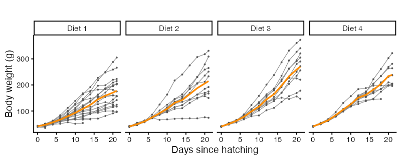

Each grey line is one chick. The orange line is the diet mean. 

The lines fan out. Chicks start together and end far apart, so the spread grows with age. The lines also keep their order. A chick above its diet mean at day 6 is usually still above it at day 18 (has independence been broken?)

## Why the Response Gets a Log

Because of that fanny phenomenom from the plot, of course!


```r
round(tapply(chicks$weight, chicks$Time, sd), 1)
round(tapply(chicks$logWeight, chicks$Time, sd), 3)
```

```
> round(tapply(chicks$weight, chicks$Time, sd), 1)
   0    2    4    6    8   10   12   14   16   18   20   21 
 1.1  3.7  4.5  9.0 16.2 24.0 34.1 38.3 46.9 57.4 66.5 71.5 

> round(tapply(chicks$logWeight, chicks$Time, sd), 3)
    0     2     4     6     8    10    12    14    16    18    20    21 
0.028 0.080 0.077 0.125 0.183 0.239 0.291 0.289 0.305 0.330 0.351 0.363 
```

On the gram scale the standard deviation grows 65-fold between day 0 and day 21. On the log scale it grows 13-fold. The log helps, but not fully. Why? Part of that spread is noise, which the log stabilizes. The rest is chicks growing apart from each other, which no transformation removes. Part B models it instead.

Box-Cox picks the transformation for us. The method is from Part 3.


```r
bc <- MASS::boxcox(lm(weight ~ Time * Diet + Chick, data = chicks),
                   lambda = seq(-0.5, 1, 0.02), plotit = FALSE)
round(bc$x[which.max(bc$y)], 3)
```

```
[1] 0.06
```

The best $\lambda$ sits at 0.06. A $\lambda$ of 0 is the log, so it was a good idea to choose the log. Every model below predicts `logWeight`.


```r
scaleFrame <- rbind(
  data.frame(Time = chicks$Time, value = chicks$weight,
             scale = "weight (g)"),
  data.frame(Time = chicks$Time, value = chicks$logWeight,
             scale = "log(weight)"))
             
scaleFrame$scale <- factor(scaleFrame$scale,
                           levels = c("weight (g)", "log(weight)"))

ggplot(scaleFrame, aes(x = factor(Time), y = value)) +
  geom_boxplot(outlier.size = 0.6, colour = "grey35",
               fill = "grey92", linewidth = 0.4) +
  facet_wrap(~ scale, scales = "free_y") +
  labs(x = "Days since hatching", y = NULL, title = "")
```

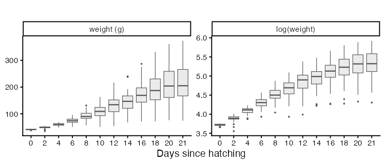

A coefficient on the log scale is a proportional change. A slope of $b$ per day means weight is multiplied by $e^{b}$ each day, which is a rise of $100(e^{b} - 1)$ percent.

## One Growth Rate for Everyone

Start with the additive model from Part 2 of this workshop series.

$$\log(w_i) = \beta_0 + \beta_1 \text{Time}_i + \beta_2 D2_i + \beta_3 D3_i + \beta_4 D4_i + \varepsilon_i,$$

where $D2_i$, $D3_i$, and $D4_i$ are the indicator columns for diets 2, 3, and 4, and diet 1 is the reference.


```r
additive <- lm(logWeight ~ Time + Diet, data = chicks)
summary(additive)
```

```
Residuals:
     Min       1Q   Median       3Q      Max 
-1.12169 -0.11939  0.02129  0.12597  0.65207 

Coefficients:
            Estimate Std. Error t value Pr(>|t|)    
(Intercept) 3.678196   0.021301 172.680  < 2e-16 ***
Time        0.077548   0.001406  55.161  < 2e-16 ***
Diet2       0.119065   0.025897   4.598 5.26e-06 ***
Diet3       0.246586   0.025897   9.522  < 2e-16 ***
Diet4       0.246354   0.026034   9.463  < 2e-16 ***
---
Signif. codes:  0 ‘***’ 0.001 ‘**’ 0.01 ‘*’ 0.05 ‘.’ 0.1 ‘ ’ 1

Residual standard error: 0.2281 on 573 degrees of freedom
Multiple R-squared:  0.8484,	Adjusted R-squared:  0.8474 
F-statistic:   802 on 4 and 573 DF,  p-value: < 2.2e-16
```

Every diet term is large and significant, so this model says the diets differ. There is one `Time` coefficient, 0.0775, and it applies to all four diets. The model grants each diet its own intercept and forces a shared growth rate of about 8.1 percent per day. Four parallel lines at different heights.

That is the wrong shape for data whose diets start together and separate. The diet coefficients come out large because a parallel-lines model can only express a late gap as an early one.

## Letting the Rate Depend on Diet

An interaction adds the product of `Time` and each diet indicator.

$$\log(w_i) = \beta_0 + \beta_1 \text{Time}_i + \beta_2 D2_i + \beta_3 D3_i + \beta_4 D4_i
+ \beta_5 (\text{Time}_i \times D2_i) + \beta_6 (\text{Time}_i \times D3_i) + \beta_7 (\text{Time}_i \times D4_i) + \varepsilon_i.$$

In R, `Time * Diet` expands to `Time + Diet + Time:Diet`, so it fits all seven terms at once.


```r
interact <- lm(logWeight ~ Time * Diet, data = chicks)
summary(interact)
```

```
Residuals:
     Min       1Q   Median       3Q      Max 
-1.10363 -0.09713 -0.00138  0.11729  0.65401 

Coefficients:
            Estimate Std. Error t value Pr(>|t|)    
(Intercept) 3.765345   0.027717 135.849  < 2e-16 ***
Time        0.069233   0.002224  31.127  < 2e-16 ***
Diet2       0.051470   0.047430   1.085  0.27830    
Diet3       0.027535   0.047430   0.581  0.56178    
Diet4       0.105879   0.047555   2.226  0.02638 *  
Time:Diet2  0.006523   0.003731   1.748  0.08095 .  
Time:Diet3  0.020397   0.003731   5.467 6.86e-08 ***
Time:Diet4  0.013273   0.003773   3.518  0.00047 ***
---
Signif. codes:  0 ‘***’ 0.001 ‘**’ 0.01 ‘*’ 0.05 ‘.’ 0.1 ‘ ’ 1

Residual standard error: 0.2223 on 570 degrees of freedom
Multiple R-squared:  0.8568,	Adjusted R-squared:  0.855 
F-statistic: 487.2 on 7 and 570 DF,  p-value: < 2.2e-16
```

`Diet2` was 0.1191 with a p-value below 0.001 in the additive model and is now 0.0515 with a p-value of 0.28. Nothing about the data changed. 

The interaction terms are the new part. Each one is a difference between growth rates.

- `Time` is 0.0692. That is the growth rate for diet 1, because diet 1 is the reference and all three indicators are zero for it.
- `Time:Diet3` is 0.0204. Chicks on diet 3 grow 0.0204 per day **faster** than chicks on diet 1.
- The growth rate for diet 3 is therefore $0.0692 + 0.0204 = 0.0896$ per day.

An interaction coefficient is never a rate on its own. It is the amount by which one group's rate differs from the reference group's rate.

## Reading a Conditional Effect

Writing out the slope per diet is tedious and easy to get wrong, so let's code it up.


```r
dietSlopes <- function(fit) {
  co <- coef(fit)
  diets <- levels(chicks$Diet)
  slope <- co["Time"] + c(0, co[paste0("Time:Diet", diets[-1])])
  data.frame(Diet = diets,
             logSlope = round(as.numeric(slope), 4),
             percentPerDay = round(100 * (exp(as.numeric(slope)) - 1), 2))
}
dietSlopes(interact)
```

```
  Diet logSlope percentPerDay
1    1   0.0692          7.17
2    2   0.0758          7.87
3    3   0.0896          9.38
4    4   0.0825          8.60
```

Chicks on diet 1 gain about 7.2 percent of their body weight per day. Chicks on diet 3 gain about 9.4 percent. Over 21 days that gap compounds into the difference between 170 grams and 259 grams in the table above.

The general statement is a partial derivative. For the interaction model,

$$\frac{\partial\, \log(w)}{\partial\, \text{Time}} = \beta_1 + \beta_5 D2 + \beta_6 D3 + \beta_7 D4.$$

The effect of time depends on which diet you are asking about. That is what a conditional effect is.

## Moving the Zero Moves the Main Effects

The derivative runs the other way too.

$$\frac{\partial\, \log(w)}{\partial\, D3} = \beta_3 + \beta_6 \text{Time}.$$

The diet 3 effect depends on `Time`. When `Time` is 0, it is $\beta_3$ alone. So `Diet3` in the output is the diet 3 effect **at day 0**, which is hatching. Chicks have not eaten anything yet, so a near-zero coefficient with a p-value of 0.56 is the right answer rather than a disappointing one.

Centre `Time` at day 10 and watch what moves.


```r
chicks$Time10 <- chicks$Time - 10
centred <- lm(logWeight ~ Time10 * Diet, data = chicks)
summary(centred)
```

```
Residuals:
     Min       1Q   Median       3Q      Max 
-1.10363 -0.09713 -0.00138  0.11729  0.65401 

Coefficients:
             Estimate Std. Error t value Pr(>|t|)    
(Intercept)  4.457677   0.015029 296.615  < 2e-16 ***
Time10       0.069233   0.002224  31.127  < 2e-16 ***
Diet2        0.116701   0.025404   4.594 5.36e-06 ***
Diet3        0.231504   0.025404   9.113  < 2e-16 ***
Diet4        0.238608   0.025497   9.358  < 2e-16 ***
Time10:Diet2 0.006523   0.003731   1.748  0.08095 .  
Time10:Diet3 0.020397   0.003731   5.467 6.86e-08 ***
Time10:Diet4 0.013273   0.003773   3.518  0.00047 ***
---
Signif. codes:  0 ‘***’ 0.001 ‘**’ 0.01 ‘*’ 0.05 ‘.’ 0.1 ‘ ’ 1

Residual standard error: 0.2223 on 570 degrees of freedom
Multiple R-squared:  0.8568,	Adjusted R-squared:  0.855 
F-statistic: 487.2 on 7 and 570 DF,  p-value: < 2.2e-16
```

The diet coefficients moved. The slope and all three interaction terms did not. The intercept and the main effects are read at the point where the other predictor is zero, and centring moves that point. The interaction itself is a difference of slopes, which does not care where you put the origin.

Interestingly, these are the same model, not two models. However, it seems some p-values are in our favour when we centre.

Three consequences of the above discussion follow.

**Do not read a main effect as an average effect.** In an interaction model it is the effect at zero on the other predictor. If zero is outside the range of your data, it is an extrapolation.

**Centre when zero is meaningless.** Centring at the mean makes the main effect the effect at an average value, which is a number worth reporting.

**Keep the main effects in.** Dropping `Diet` while keeping `Time:Diet` forces all four diets through one intercept. Only do that if you have a reason to believe it.

Since the diet gaps depend on the day, report them at days you care about.


```r
dietGaps <- function(day) {
  nd <- expand.grid(Time = day, Diet = factor(levels(chicks$Diet)))
  p <- predict(interact, newdata = nd)
  round(p - p[1], 4)
}
sapply(c(0, 10, 20), dietGaps)
```

```
    Day0  Day10  Day20
1 0.0000 0.0000 0.0000
2 0.0515 0.1167 0.1819
3 0.0275 0.2315 0.4355
4 0.1059 0.2386 0.3713
```

Diet 3 is 0.0275 above diet 1 at hatching and 0.4355 above it at day 20. 

## Testing the Whole Interaction

The three interaction terms answer one question together. Do the diets differ in growth rate at all? 

```r
anova(additive, interact)
```

```
Analysis of Variance Table

Model 1: logWeight ~ Time + Diet
Model 2: logWeight ~ Time * Diet
  Res.Df    RSS Df Sum of Sq      F    Pr(>F)    
1    573 29.822                                  
2    570 28.178  3    1.6436 11.082 4.433e-07 ***
---
Signif. codes:  0 '***' 0.001 '**' 0.01 '*' 0.05 '.' 0.1 ' ' 1
```

$F = 11.08$ on 3 and 570 degrees of freedom, with a p-value of $4.4 \times 10^{-7}$. There is sufficient evidence to suggest that the diets differ in growth rate.

Time:Diet2` has a p-value of 0.08 on its own, and dropping it because of that would be dropping one level of a four-level factor, which leaves a model nobody can interpret.


```r
gridFrame <- expand.grid(Time = seq(0, 21, length.out = 100),
                         Diet = factor(levels(chicks$Diet)))
fitFrame <- rbind(
  data.frame(gridFrame,
             fit = predict(additive, newdata = gridFrame),
             model = "Additive: Time + Diet"),
  data.frame(gridFrame,
             fit = predict(interact, newdata = gridFrame),
             model = "Interaction: Time * Diet"))

ggplot(fitFrame, aes(x = Time, y = fit, colour = Diet)) +
  geom_point(data = chicks, aes(x = Time, y = logWeight, colour = Diet),
             size = 0.5, alpha = 0.3) +
  geom_line(linewidth = 1) +
  facet_wrap(~ model) +
  labs(x = "Days since hatching", y = "log(weight)",
       colour = "Diet", title = "")
```

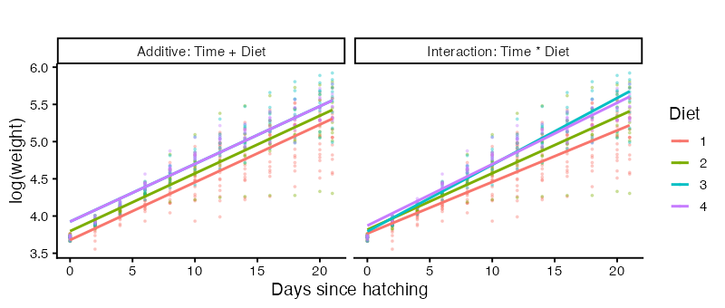

The left panel is the additive model claiming the diets were already apart at hatching, which the data say they were not.

## Diagnosing the Interaction Model

Part 3 of our regression series said to look at the residuals. 


```r
chicks$interactResid <- resid(interact)
round(tapply(chicks$interactResid, chicks$Time, mean), 3)
```

```
     0      2      4      6      8     10     12     14     16     18     20 
-0.088 -0.064 -0.022  0.033  0.075  0.077  0.091  0.040  0.033 -0.006 -0.067 
    21 
-0.111 
```

**The fit bends.** Mean residuals run negative, then positive, then negative. The model is below the data at both ends and above it in the middle, which is a straight line fitted to a curve. Growth slows as chicks get older. We will address this problem shortly.


```r
chickMeans <- tapply(chicks$interactResid, chicks$Chick, mean)
round(c(sdOfChickMeans = sd(chickMeans),
        residualSd = sd(chicks$interactResid),
        lowestChick = min(chickMeans),
        highestChick = max(chickMeans)), 4)
```

```
sdOfChickMeans     residualSd    lowestChick   highestChick 
        0.1628         0.2210        -0.4637         0.3456 
```

**The residuals cluster by chick.** If residuals were independent, averaging twelve of them would give something near zero. Instead the chick means have a standard deviation of 0.163 against a residual standard deviation of 0.221. One chick sits 0.46 below its diet's line on average, another sits 0.35 above. Most of the residual variation is not noise. It is chicks.


```r
residFrame <- data.frame(
  Time = chicks$Time, resid = chicks$interactResid,
  Chick = chicks$Chick, Diet = chicks$Diet)

ggplot(residFrame, aes(x = Time, y = resid)) +
  geom_hline(yintercept = 0, linetype = "dashed", colour = "grey55") +
  geom_line(aes(group = Chick), colour = "grey75", linewidth = 0.35) +
  geom_smooth(method = "loess", formula = y ~ x, se = FALSE,
              colour = "darkorange", linewidth = 1) +
  labs(x = "Days since hatching", y = "Residual, log(weight)",
       title = "")
```

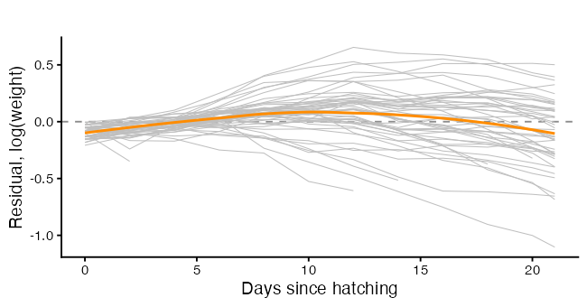


```r
clusterFrame <- data.frame(
  Chick = names(chickMeans),
  meanResid = as.numeric(chickMeans),
  n = as.vector(table(chicks$Chick)[names(chickMeans)]))
clusterFrame$Diet <- chicks$Diet[match(clusterFrame$Chick, chicks$Chick)]
clusterFrame <- clusterFrame[order(clusterFrame$meanResid), ]
clusterFrame$rank <- seq_len(nrow(clusterFrame))

ggplot(clusterFrame, aes(x = rank, y = meanResid, colour = Diet)) +
  geom_hline(yintercept = 0, linetype = "dashed", colour = "grey55") +
  geom_point(size = 2) +
  labs(x = "Chick, ordered by mean residual",
       y = "Mean residual, log(weight)", colour = "Diet", title = "")
```

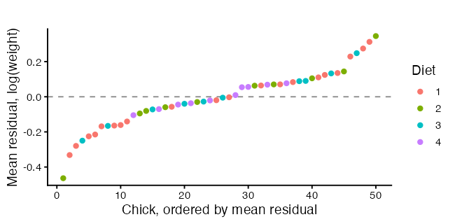

The first plot shows both problems at once. The orange curve is the bend. The grey lines are chicks, and they drift away from zero and stay there instead of crossing it. The second plot is the chick means sorted, which is the clustering on its own.

Both problems should be addressed, and arguable the phenomenon in the second plot has greater consequences. Correlated errors make the standard errors skewed everywhere, and nothing in the printed output warns you about this. Time to think of an alternative.

# Part B: Hierarchical Linear Models

## Three Ways to Handle the Chicks

**Complete pooling** ignores the chick. The model above does this, which is why its residuals cluster.

**No pooling** gives every chick its own intercept and slope.


```r
noPool <- lm(logWeight ~ Time * Chick, data = chicks)
c(parameters = length(coef(noPool)), observations = nrow(chicks))
```

```
  parameters observations 
         100          578 
```

One hundred parameters for 578 observations. Part 4 of our series called this overfitting, and the chick with two measurements is about to show us why.

There is a second problem. `Diet` cannot be in that model.


```r
aliased <- lm(logWeight ~ Time * Diet + Chick, data = chicks)
names(which(is.na(coef(aliased))))
```

```
[1] "Chick30" "Chick40" "Chick50"
```

Three coefficients come back as `NA`. Every chick stayed on one diet, so the chick indicators already encode the diet (remember the discussion on singularity?). If you give every group its own fixed effect, you cannot also estimate the effect of anything that is constant within a group. Diet is the thing we care about, so no pooling is unusable here on its own.

**Partial pooling** is the third option. Instead of 50 free parameters or none, treat the chick effects as draws from a distribution and estimate that distribution. For a random intercept,

$$\log(w_{ij}) = \underbrace{\beta_0 + \beta_1 \text{Time}_{ij} + \ldots}_{\text{fixed, shared by all chicks}} + \underbrace{u_j}_{\text{this chick}} + \varepsilon_{ij},
\qquad u_j \sim N(0, \tau^2), \qquad \varepsilon_{ij} \sim N(0, \sigma^2),$$

where $i$ indexes a measurement and $j$ indexes a chick. Two variances replace 50 parameters. The chick effects $u_j$ are not estimated as free quantities, so `Diet` stays in the model.

## Random Intercepts

The `(1 | Chick)` term reads as "an intercept that varies by chick".


```r
randomIntercept <- lmer(logWeight ~ Time * Diet + (1 | Chick),
                        data = chicks)
summary(randomIntercept)
```

```
Linear mixed model fit by REML ['lmerMod']
Formula: logWeight ~ Time * Diet + (1 | Chick)
   Data: chicks

REML criterion at convergence: -296

Scaled residuals: 
    Min      1Q  Median      3Q     Max 
-4.2030 -0.5479  0.1269  0.6332  2.8654 

Random effects:
 Groups   Name        Variance Std.Dev.
 Chick    (Intercept) 0.02580  0.1606  
 Residual             0.02585  0.1608  
Number of obs: 578, groups:  Chick, 50

Fixed effects:
            Estimate Std. Error t value
(Intercept) 3.768319   0.041194  91.477
Time        0.067537   0.001639  41.215
Diet2       0.048496   0.071074   0.682
Diet3       0.024561   0.071074   0.346
Diet4       0.104324   0.071125   1.467
Time:Diet2  0.008219   0.002716   3.026
Time:Diet3  0.022093   0.002716   8.134
Time:Diet4  0.014737   0.002751   5.356
```

The **Random effects** block is the new part, and it is a variance decomposition. Variation that the fixed effects do not explain gets split in two. A variance of 0.0258 sits between chicks, and a variance of 0.0259 sits within chicks, between one weighing and the next. The split is close to even.

The **Fixed effects** block is the familiar coefficient table minus its p-values, which we discuss below.

The intraclass correlation puts the split on one scale.

$$\text{ICC} = \frac{\tau^2}{\tau^2 + \sigma^2}.$$

It is the correlation between two measurements on the same chick once the fixed effects are accounted for.


```r
varFrame <- as.data.frame(VarCorr(randomIntercept))
icc <- varFrame$vcov[varFrame$grp == "Chick"] / sum(varFrame$vcov)
round(icc, 4)
```

```
[1] 0.4996
```

Half. Two weighings of the same chick are correlated at 0.50 after the diet and the day are taken out. The independence assumption from Part 1 of our series is clearly not met.

## What the Grouping Costs

Correlated observations carry less information than independent ones. The design effect says how much less.

$$\text{design effect} = 1 + (m - 1)\,\text{ICC},$$

where $m$ is the number of observations per group.


```r
designEffect <- 1 + (mean(table(chicks$Chick)) - 1) * icc
c(designEffect = round(designEffect, 2),
  effectiveN = round(nrow(chicks) / designEffect, 1))
```

```
designEffect   effectiveN 
        6.28        92.10 
```

For comparisons between chicks, 578 correlated observations carry about as much information as 92 independent ones. Not 578, and not 50 either. This is why a model that ignores grouping reports standard errors that are too small.

## Random Slopes

Chicks differ in starting weight, and the spaghetti plot says they also differ in growth rate. `(Time | Chick)` lets both vary.


```r
randomSlope <- lmer(logWeight ~ Time * Diet + (Time | Chick),
                    data = chicks)
summary(randomSlope)
```

```
Linear mixed model fit by REML ['lmerMod']
Formula: logWeight ~ Time * Diet + (Time | Chick)
   Data: chicks

REML criterion at convergence: -681.1

Scaled residuals: 
    Min      1Q  Median      3Q     Max 
-3.1774 -0.5638 -0.0403  0.5825  3.0850 

Random effects:
 Groups   Name        Variance Std.Dev. Corr 
 Chick    (Intercept) 0.003088 0.05557       
          Time        0.000349 0.01868  -0.57
 Residual             0.011374 0.10665       
Number of obs: 578, groups:  Chick, 50

Fixed effects:
            Estimate Std. Error t value
(Intercept) 3.785030   0.018386 205.861
Time        0.064705   0.004429  14.608
Diet2       0.031786   0.031428   1.011
Diet3       0.007850   0.031428   0.250
Diet4       0.090166   0.031505   2.862
Time:Diet2  0.011051   0.007522   1.469
Time:Diet3  0.024925   0.007522   3.313
Time:Diet4  0.017153   0.007531   2.278
```

The random effects block now has three numbers and a correlation.

- Chick intercepts have standard deviation 0.056, so chicks differ a little at hatching.
- Chick slopes have standard deviation 0.019. Against a mean slope near 0.065 that is large. A chick one standard deviation above average grows at 0.083 per day instead of 0.065.
- The correlation is $-0.57$. Chicks that start heavier grow proportionally more slowly.
- The residual standard deviation fell from 0.161 to 0.107. Variation that the random intercept model called noise was chicks growing at different rates.

Compare the two by likelihood ratio. Models that differ in their random effects must be compared on the same criterion, and `anova()` on `lmer` fits refits both by maximum likelihood to do it.


```r
riML <- lmer(logWeight ~ Time * Diet + (1 | Chick),
             data = chicks, REML = FALSE)
rsML <- lmer(logWeight ~ Time * Diet + (Time | Chick),
             data = chicks, REML = FALSE)
anova(riML, rsML)
```

```
Data: chicks
Models:
riML: logWeight ~ Time * Diet + (1 | Chick)
rsML: logWeight ~ Time * Diet + (Time | Chick)
     npar     AIC     BIC logLik deviance  Chisq Df Pr(>Chisq)    
riML   10 -335.24 -291.64 177.62  -355.24                         
rsML   12 -715.53 -663.22 369.77  -739.53 384.29  2  < 2.2e-16 ***
```

A $\chi^2$ of 384 on 2 degrees of freedom. Random slopes seem to be statistically meaningful here.

> **One caution on that p-value.** Testing whether a variance is zero puts the null on the boundary of the parameter space, since a variance cannot go below zero. The usual $\chi^2$ reference distribution is wrong there, and the test is conservative, meaning the true p-value is smaller than the printed one (Stram and Lee, 1994). 

## Fixed Effects and Random Effects

| | Fixed effects | Random effects |
|---|---|---|
| What they represent | Levels you chose and care about | Levels drawn from a population |
| Here | `Diet`, `Time`, their interaction | `Chick` |
| Estimated as | One coefficient per level | One variance, plus a deviation per level |
| Cost in parameters | One per level | One or two, whatever the number of levels |
| Question answered | What does diet 3 do | How much do chicks vary, and where does this one sit |
| New level in the data | Cannot be predicted | Predicted from the population distribution |
| Nested inside a factor | Blocks that factor from the model | No conflict |


A rough guide on numbers. A factor with few levels, say two or three, gives too little information to estimate a variance well, so fit it as fixed. A factor with many levels, especially one where the levels are a sample rather than the whole set, is a candidate for random.


## What Partial Pooling Does

`fixef()` gives the population coefficients, `ranef()` gives each chick's deviation, and `coef()` adds them.


```r
round(fixef(randomSlope), 4)
head(round(ranef(randomSlope)$Chick, 4))
round(colMeans(ranef(randomSlope)$Chick), 6)
head(round(coef(randomSlope)$Chick[, c("(Intercept)", "Time")], 4))
```

```
> round(fixef(randomSlope), 4)
(Intercept)        Time       Diet2       Diet3       Diet4  Time:Diet2 
     3.7850      0.0647      0.0318      0.0079      0.0902      0.0111 
 Time:Diet3  Time:Diet4 
     0.0249      0.0172 

> head(round(ranef(randomSlope)$Chick, 4))
   (Intercept)    Time
1      -0.0232  0.0109
10      0.0052 -0.0121
11      0.0650  0.0140
12     -0.0431  0.0139
13      0.0352 -0.0302
14     -0.0155  0.0312

> round(colMeans(ranef(randomSlope)$Chick), 6)
(Intercept)        Time 
          0           0 

> head(round(coef(randomSlope)$Chick[, c("(Intercept)", "Time")], 4))
   (Intercept)   Time
1       3.7618 0.0756
10      3.7902 0.0526
11      3.8500 0.0787
12      3.7420 0.0786
13      3.8203 0.0345
14      3.7695 0.0959
```

The random effects average to zero by construction. 

```r
ranefFrame <- as.data.frame(ranef(randomSlope, condVar = TRUE))
ranefFrame$term <- ifelse(ranefFrame$term == "(Intercept)",
                          "Chick intercept", "Chick slope on Time")
ranefFrame <- ranefFrame[order(ranefFrame$term, ranefFrame$condval), ]
ranefFrame$rank <- unlist(lapply(split(ranefFrame, ranefFrame$term),
                                 function(z) seq_len(nrow(z))))

ggplot(ranefFrame, aes(x = rank, y = condval)) +
  geom_hline(yintercept = 0, linetype = "dashed", colour = "grey55") +
  geom_errorbar(aes(ymin = condval - 1.96 * condsd,
                    ymax = condval + 1.96 * condsd),
                width = 0, colour = "grey65") +
  geom_point(colour = "darkorange", size = 1.6) +
  facet_wrap(~ term, scales = "free_y") +
  labs(x = "Chick, ordered by estimate",
       y = "Deviation from the diet mean", title = "")
```

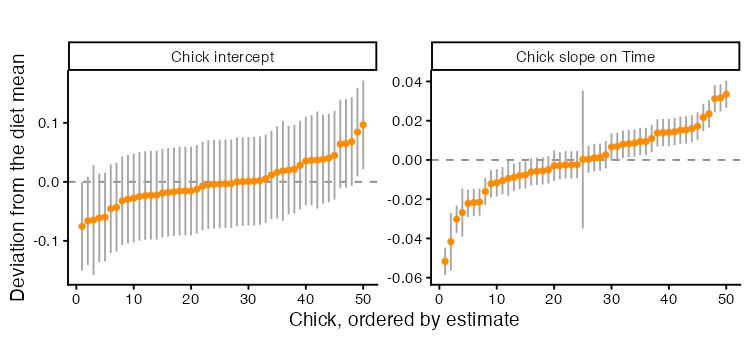

This is a caterpillar plot. Each chick gets an estimate and an interval. Intervals that clear the dashed line belong to chicks that differ from their diet's average. One interval in the slope panel is far wider than the rest, and that is the chick with two measurements.

## How Much of Its Own Data Does a Chick Keep

Partial pooling is a weighted average between a chick's own estimate and the population mean. For the random intercept model,

$$\hat{u}_j = \frac{n_j \tau^2}{n_j \tau^2 + \sigma^2} \times \bar{r}_j,$$

where $n_j$ is the number of measurements on chick $j$ and $\bar{r}_j$ is that chick's mean distance from the fixed-effect fit.


```r
varParts <- as.data.frame(VarCorr(randomIntercept))
tauSq <- varParts$vcov[varParts$grp == "Chick"]
sigmaSq <- varParts$vcov[varParts$grp == "Residual"]

fixedOnly <- as.vector(model.matrix(randomIntercept) %*% fixef(randomIntercept))
ownGap <- tapply(chicks$logWeight - fixedOnly, chicks$Chick, mean)
chickN <- as.vector(table(chicks$Chick)[names(ownGap)])

shrinkWeight <- chickN * tauSq / (chickN * tauSq + sigmaSq)
modelGap <- ranef(randomIntercept)$Chick[names(ownGap), "(Intercept)"]

max(abs(shrinkWeight * as.numeric(ownGap) - modelGap))
```

```
[1] 2.248202e-15
```


```r
shrinkFrame <- data.frame(
  Chick = names(ownGap),
  n = chickN,
  noPooling = round(as.numeric(ownGap), 4),
  weight = round(shrinkWeight, 3),
  partialPooling = round(modelGap, 4))
shrinkFrame$Diet <- chicks$Diet[match(shrinkFrame$Chick, chicks$Chick)]

head(shrinkFrame[order(shrinkFrame$n), ], 6)
round(c(sdNoPooling = sd(shrinkFrame$noPooling),
        sdPartialPooling = sd(shrinkFrame$partialPooling)), 4)
```

```
   Chick  n noPooling weight partialPooling Diet
10    18  2   -0.2264  0.666        -0.1508    1
8     16  7   -0.2724  0.875        -0.2383    1
7     15  8   -0.1595  0.889        -0.1417    1
39    44 10   -0.0696  0.909        -0.0632    4
49     8 11    0.0111  0.917         0.0102    1
1      1 12    0.0796  0.923         0.0735    1

     sdNoPooling sdPartialPooling 
          0.1635           0.1489 
```

Read the `weight` column. The chick with two measurements keeps 67 percent of its own estimate and borrows the other 33 percent from the other chicks. A chick with twelve keeps 92 percent. Groups with less data get pulled further towards the population.

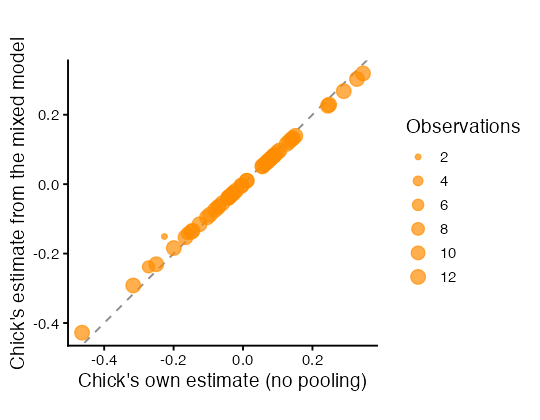

Points sit inside the dashed line of equality, and the small points sit furthest inside. The spread of the estimates narrows from 0.164 to 0.149.

Slopes shrink too.


```r
chickSplit <- split(chicks, chicks$Chick)
ownSlope <- vapply(chickSplit, function(d) {
  if (nrow(d) >= 3) unname(coef(lm(logWeight ~ Time, data = d))[2])
  else NA_real_
}, numeric(1))
pooledSlope <- coef(randomSlope)$Chick[, "Time"]
names(pooledSlope) <- rownames(coef(randomSlope)$Chick)
ownSlope <- ownSlope[names(pooledSlope)]

round(c(sdOwnSlope = sd(ownSlope, na.rm = TRUE),
        sdModelSlope = sd(pooledSlope)), 4)
```

```
  sdOwnSlope sdModelSlope 
      0.0214       0.0175 
```

Be careful reading individual chicks here. Intercepts and slopes are correlated at $-0.57$, so they shrink jointly, and one chick's slope can move either way. 

The clearest view is four chicks from diet 1, where the complete pooling line is the same in every panel.


```r
chick18 <- subset(chicks, Chick == "18")
chick18[, c("Time", "weight")]
round(exp(predict(lm(logWeight ~ Time, data = chick18),
                  newdata = data.frame(Time = 21))), 1)
```

```
    Time weight
195    0     39
196    2     35

   1 
12.5 
```

Chick 18 was weighed twice and lost weight between the two weighings, then the record stops. A straight line through two points fits them perfectly and predicts 12.5 grams at day 21, which is less than a third of its hatching weight.

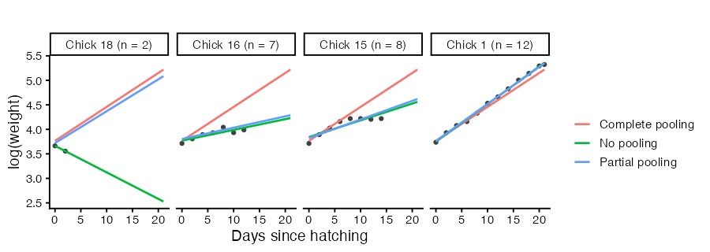

Complete pooling gives chick 18 the diet average and ignores that it was small and shrinking. Look along the row and the three lines converge as $n$ rises. By chick 1, with twelve measurements, no pooling and partial pooling are nearly the same line, which is the point. Partial pooling only overrides a group when that group has too little data to speak for itself.

## What the Grouping Does to the Standard Errors

The design effect said that ignoring the grouping should understate standard errors. So let's check that out.

A two-stage analysis will allow us to compare. First, fit each chick its own slope, then compare those slopes across diets. The second stage has one number per chick, so its observations are independent.


```r
stageOne <- data.frame(
  slope = as.numeric(ownSlope),
  Diet = chicks$Diet[match(names(ownSlope), chicks$Chick)])
stageOne <- stageOne[!is.na(stageOne$slope), ]
nrow(stageOne)

stageTwo <- lm(slope ~ Diet, data = stageOne)
round(summary(stageTwo)$coefficients, 5)
```

```
[1] 49

            Estimate Std. Error  t value Pr(>|t|)
(Intercept)  0.06402    0.00446 14.36208  0.00000
Diet2        0.01173    0.00759  1.54553  0.12922
Diet3        0.02561    0.00759  3.37312  0.00154
Diet4        0.01780    0.00759  2.34440  0.02353
```

Now put the same quantity side by side three ways.


```r
seCompare <- rbind(
  "complete pooling (578 rows)" =
    summary(interact)$coefficients["Time:Diet3", 1:2],
  "mixed model (Time | Chick)" =
    summary(randomSlope)$coefficients["Time:Diet3", 1:2],
  "two-stage (49 chicks)" =
    summary(stageTwo)$coefficients["Diet3", 1:2])
round(seCompare, 5)
```

```
                            Estimate Std. Error
complete pooling (578 rows)  0.02040    0.00373
mixed model (Time | Chick)   0.02493    0.00752
two-stage (49 chicks)        0.02561    0.00759
```

The mixed model and the two-stage analysis nearly agree, at 0.0075 and 0.0076. The complete pooling model reports 0.0037, which is about half as large. 

## Why There Are No P-Values

`lmer` prints t-statistics without p-values. A p-value needs a reference distribution, and for a t-statistic that means denominator degrees of freedom. With 578 observations, 50 chicks, 8 fixed effects and an unbalanced design, there is no single correct value and the common approximations disagree.

Three usable options exist.

**Profile confidence intervals.** No degrees of freedom needed.


```r
round(confint(randomSlope, parm = "beta_", method = "profile"), 4)
```

```
              2.5 % 97.5 %
(Intercept)  3.7497 3.8202
Time         0.0562 0.0732
Diet2       -0.0283 0.0921
Diet3       -0.0522 0.0682
Diet4        0.0299 0.1506
Time:Diet2  -0.0034 0.0255
Time:Diet3   0.0105 0.0393
Time:Diet4   0.0027 0.0316
```

The intervals for `Time:Diet3` and `Time:Diet4` exclude zero and the one for `Time:Diet2` does not, which matches what the t-statistics suggested. 

**A likelihood ratio test** between nested models, as above, now with both fitted by maximum likelihood.

**An approximation**, through the `lmerTest` package, which adds Satterthwaite or Kenward-Roger degrees of freedom to the `summary()` output.

## Diagnostics

The assumptions from Part 1 of this series still apply, and there are now two normality assumptions rather than one. The within-chick residuals should be normal, and so should the chick effects.


```r
diagFrame <- data.frame(
  fitted = fitted(randomSlope),
  resid = resid(randomSlope),
  Time = chicks$Time)

round(tapply(diagFrame$resid, diagFrame$Time, sd), 3)
round(tapply(diagFrame$resid, diagFrame$Time, mean), 3)
```

```
> round(tapply(diagFrame$resid, diagFrame$Time, sd), 3)
    0     2     4     6     8    10    12    14    16    18    20    21 
0.053 0.059 0.045 0.062 0.077 0.090 0.094 0.074 0.053 0.048 0.068 0.091 

> round(tapply(diagFrame$resid, diagFrame$Time, mean), 3)
     0      2      4      6      8     10     12     14     16     18     20 
-0.096 -0.068 -0.024  0.035  0.080  0.086  0.104  0.044  0.030 -0.008 -0.072 
    21 
-0.119 
```

Good news first. The residual standard deviation now varies by a factor of two across the study rather than the 13-fold spread we started with. Random slopes did what the log transformation could not, because the growing spread was chicks diverging rather than noise inflating.

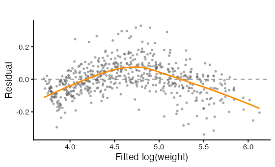

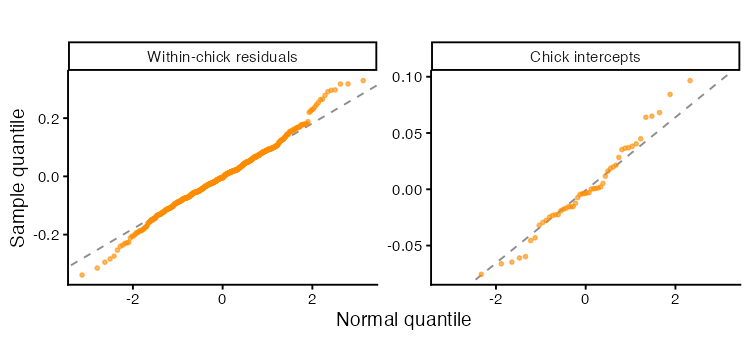

The bad news is the second table. The mean residuals still run from $-0.10$ up to $+0.10$ and back to $-0.12$. The bend from Part A survived, because random effects fix the grouping and have nothing to say about functional form. The quantile plots are reasonable, with heavy tails at the extremes of the within-chick residuals.

## Prediction at Two Levels

A mixed model predicts two different things, and `re.form` chooses between them.


```r
knownChick <- data.frame(Time = 10, Chick = "34")
knownChick$Diet <- chicks$Diet[match(knownChick$Chick, chicks$Chick)]

predict(randomSlope, newdata = knownChick, re.form = NA)
predict(randomSlope, newdata = knownChick)
```

```
> predict(randomSlope, newdata = knownChick, re.form = NA)
       1 
4.689181 

> predict(randomSlope, newdata = knownChick)
       1 
4.807631 
```

With `re.form = NA`, the answer is the diet 3 average at day 10, about 109 grams. Remember, the 4.689181 you see in the output is on the log-scale, so we get 109 grams by $e^{4.689181}$. 

With the second predict above, chick 34's own deviation is added, giving about 122 grams. Ask which question you are answering. Tracking a particular bird would likely want the second reported value.

A chick that was not in the data has no deviation to add.


```r
unseen <- data.frame(Time = 10, Chick = "new-chick",
                     Diet = factor("3", levels = levels(chicks$Diet)))
predict(randomSlope, newdata = unseen, re.form = NA)
predict(randomSlope, newdata = unseen, allow.new.levels = TRUE)
```

```
       1 
4.689181 

       1 
4.689181 
```

Both give the population answer. `allow.new.levels = TRUE` stops R from erroring and assigns the new chick a deviation of zero, which is the mean of the distribution.

Note what is missing. `lmer` has no `interval = "prediction"` argument, because a prediction interval would have to account for uncertainty in the fixed effects, in the variance components, and in the new chick's own deviation. Use `bootMer()` for a parametric bootstrap when you need one.

# Part C: Fixing the Curvature

Two problems were found in Part A. Part B fixed the grouping. This fixes the bend.

Growth slows with age, so add a quadratic term in `Time`. On the raw scale `Time` runs to 21 and `Time^2` runs to 441, and the optimizer reports a convergence warning. Rescaling fixes it and changes nothing else about the model.


```r
chicks$timeTen <- chicks$Time / 10

curved <- lmer(logWeight ~ (timeTen + I(timeTen^2)) * Diet +
                 (timeTen + I(timeTen^2) | Chick), data = chicks)
isSingular(curved)
```

```
[1] FALSE
```

A convergence warning is usually about scaling rather than about the model being wrong. Rescale the predictors first, before concluding anything. `isSingular()` returning `FALSE` says the random effects covariance matrix is not degenerate, which is the other thing to check on every `lmer` fit.

The random effects structure grew with the fixed effects. Each chick now gets its own intercept, slope, and curvature. The next section will try and convince you why this matters.


```r
summary(curved)
```

```
Random effects:
 Groups   Name         Variance Std.Dev. Corr       
 Chick    (Intercept)  0.002560 0.0506              
          timeTen      0.098088 0.3132   -0.72      
          I(timeTen^2) 0.015992 0.1265    0.28 -0.75
 Residual              0.002382 0.0488              
Number of obs: 578, groups:  Chick, 50

Fixed effects:
                    Estimate Std. Error t value
(Intercept)         3.688914   0.014054 262.485
timeTen             0.941711   0.073564  12.801
I(timeTen^2)       -0.146744   0.030527  -4.807
Diet2              -0.002233   0.024225  -0.092
Diet3              -0.002131   0.024225  -0.088
Diet4               0.001076   0.024250   0.044
timeTen:Diet2       0.218479   0.125924   1.735
timeTen:Diet3       0.282848   0.125924   2.246
timeTen:Diet4       0.462664   0.126047   3.671
I(timeTen^2):Diet2 -0.040677   0.051572  -0.789
I(timeTen^2):Diet3 -0.006058   0.051572  -0.117
I(timeTen^2):Diet4 -0.132516   0.051704  -2.563
```

Look at the three diet main effects. They are $-0.002$, $-0.002$, and $0.001$, with t-statistics below 0.1. The model now says the diets are indistinguishable at hatching, which is what the table at the top of Part A showed. In the straight-line model `Diet4` had a p-value of 0.026 and appeared to say that diet 4 chicks were 11 percent heavier at hatching. They were not. That coefficient was the straight line compensating for a curve, read at the far end of the data.

The quadratic term itself is a second kind of conditional effect. The slope in `timeTen` depends on `timeTen`, so the effect of a day of growth depends on which day.


```r
linML <- lmer(logWeight ~ timeTen * Diet + (timeTen | Chick),
              data = chicks, REML = FALSE)
curvedML <- lmer(logWeight ~ (timeTen + I(timeTen^2)) * Diet +
                   (timeTen + I(timeTen^2) | Chick),
                 data = chicks, REML = FALSE)
anova(linML, curvedML)
```

```
         npar      AIC      BIC logLik deviance  Chisq Df Pr(>Chisq)    
linML      12  -715.53  -663.22 369.77  -739.53                         
curvedML   19 -1375.25 -1292.42 706.63 -1413.25 673.72  7  < 2.2e-16 ***
```


```r
round(tapply(resid(curved), chicks$Time, mean), 3)
round(tapply(resid(curved), chicks$Time, sd), 3)
```

```
> round(tapply(resid(curved), chicks$Time, mean), 3)
     0      2      4      6      8     10     12     14     16     18     20 
 0.026 -0.015 -0.028 -0.010  0.010  0.005  0.027 -0.016 -0.001  0.009  0.002 
    21 
-0.011 

> round(tapply(resid(curved), chicks$Time, sd), 3)
    0     2     4     6     8    10    12    14    16    18    20    21 
0.042 0.049 0.046 0.053 0.037 0.034 0.042 0.040 0.046 0.029 0.025 0.034 
```

The bend is gone. Mean residuals were running to $\pm 0.10$ and now stay inside $\pm 0.03$, with no pattern in the order. AIC improved from $-715$ to $-1375$.

## Reporting a Rate That Changes


```r
growthRate <- function(fit, days) {
  diets <- factor(levels(chicks$Diet))
  out <- sapply(days, function(day) {
    a <- data.frame(timeTen = day / 10, Diet = diets)
    b <- data.frame(timeTen = (day + 1) / 10, Diet = diets)
    delta <- predict(fit, newdata = b, re.form = NA) -
             predict(fit, newdata = a, re.form = NA)
    round(100 * (exp(delta) - 1), 2)
  })
  dimnames(out) <- list(paste("Diet", levels(chicks$Diet)),
                        paste("day", days))
  out
}
growthRate(curved, c(2, 8, 14, 20))
```

```
       day 2 day 8 day 14 day 20
Diet 1  9.07  7.17   5.30   3.46
Diet 2 11.25  8.78   6.36   4.00
Diet 3 12.17 10.13   8.13   6.16
Diet 4 13.48  9.74   6.13   2.63
```

Every diet slows down, which the straight-line model could not express. The diets also slow at different rates, which is what the significant `I(timeTen^2):Diet4` term was saying.

Follow diet 4 across the row. It grows fastest of all at day 2, at 13.5 percent per day, and slowest of all by day 20, at 2.6 percent. Diet 3 starts lower and holds 6.2 percent at day 20. That is why diet 4 led at day 12 and diet 3 had overtaken it by day 20 in the very first table.

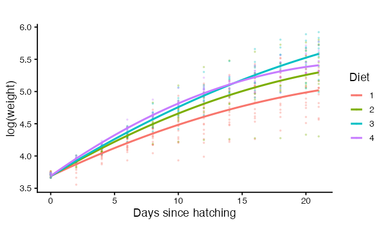

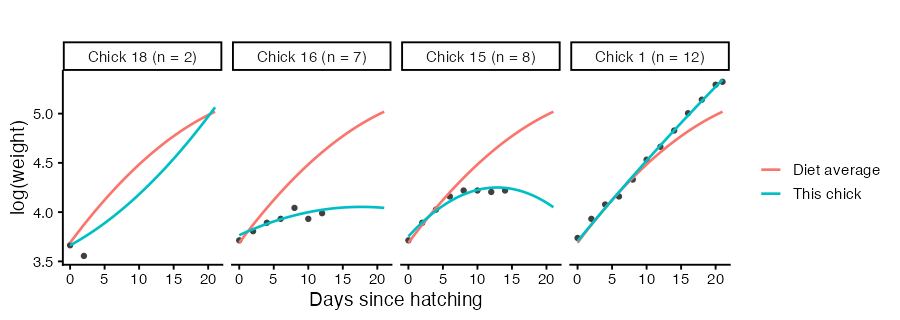

The second plot shows the fitted diet curve and the fitted chick curve for the same four chicks. For chick 1, with twelve measurements, the chick curve tracks its points. For chick 18, with two, the chick curve sits close to the diet average.

One caution. The chick curves for 16 and 15 turn downwards past day 12, which is beyond where those chicks were last weighed. A quadratic has to come down eventually, and nothing in the data stops it. Do not read a fitted curve outside the range the group was observed over.

## How Much Random Structure

The quadratic model gave each chick its own curvature. 

Put the quadratic in the fixed effects but leave the random effects at a straight line. The model converges and prints a full set of standard errors.


```r
underSpec <- lmer(logWeight ~ (timeTen + I(timeTen^2)) * Diet +
                    (timeTen | Chick), data = chicks)

structureCompare <- rbind(
  "random slope only"      = c(residualSd = sigma(underSpec),
      se = summary(underSpec)$coefficients["timeTen:Diet3", 2]),
  "random slope + curve"   = c(residualSd = sigma(curved),
      se = summary(curved)$coefficients["timeTen:Diet3", 2]))
round(structureCompare, 4)
```

```
                     residualSd     se
random slope only        0.0695 0.0910
random slope + curve     0.0488 0.1259
```

## How Good Is the Model?

Part 1 of this series reported $R^2$ and Part 4 reported RMSE on held-out data. Neither carries over
to a mixed model without some care, and `summary()` on an `lmer` fit prints no $R^2$
at all. This section fills that gap and compares every model in the workshop.

### There Is No Adjusted R-Squared Here

Adjusted $R^2$ charges a model for its parameters. A random effect has no clear number
to charge. Treated as a fixed factor, `Chick` would cost 50 parameters. Pooled away
entirely, it would cost none. 

### Two R-Squared Values Instead of One

A mixed model splits unexplained variation into a between-chick part and a within-chick
part, so it has two reasonable notions of variance explained. Nakagawa and Schielzeth
named them. Write $\sigma^2_f$ for the variance of the fixed-effect predictions,
$\sigma^2_\alpha$ for the variance the random effects contribute, and
$\sigma^2_\varepsilon$ for the residual variance. Then

$$R^2_{\text{marginal}} = \frac{\sigma^2_f}{\sigma^2_f + \sigma^2_\alpha + \sigma^2_\varepsilon},
\qquad
R^2_{\text{conditional}} = \frac{\sigma^2_f + \sigma^2_\alpha}{\sigma^2_f + \sigma^2_\alpha + \sigma^2_\varepsilon}.$$

The two answer different questions.

**Marginal** asks how much the day and the diet explain on their own. It is the number
to quote when the model will be used on a chick nobody has met.

**Conditional** asks how much the day, the diet, and knowing which chick explain
together. It is the number to quote when describing the chicks in hand.

### Computing Them

$\sigma^2_\alpha$ needs attention. For a random intercept it is just the chick variance.
With a random slope the random part of the prediction depends on `Time`, so each
observation has a different random-effect variance, and the right quantity is the
average of $z_i^\top \Sigma z_i$ over the observations, where $z_i$ holds the
random-effect design row for observation $i$ and $\Sigma$ is the random-effect
covariance matrix. 

```r
r2Mixed <- function(fit) {
  X <- model.matrix(fit)
  if (inherits(fit, "merMod")) {
    varFixed <- var(as.vector(X %*% fixef(fit)))
    Sigma <- VarCorr(fit)$Chick
    nm <- rownames(Sigma)
    Z <- matrix(sapply(nm, function(k)
      if (k == "(Intercept)") rep(1, nrow(X)) else X[, k]), nrow = nrow(X))
    varRandom <- mean(rowSums((Z %*% Sigma) * Z))
    varResid <- sigma(fit)^2
  } else {
    varFixed <- var(as.vector(X %*% coef(fit)))
    varRandom <- 0
    varResid <- summary(fit)$sigma^2
  }
  total <- varFixed + varRandom + varResid
  c(marginal = varFixed / total, conditional = (varFixed + varRandom) / total)
}

round(r2Mixed(randomSlope), 3)
```

```
   marginal conditional 
      0.831       0.967 
```

The function takes an `lm` fit as well, where the random variance is zero and the two
numbers agree. The `VarCorr(fit)$Chick` line assumes one grouping factor, which is we have for our purposes today.

Two packages will do this for you. `performance::r2_nakagawa()` and
`MuMIn::r.squaredGLMM()` both implement it.


```r
modelList <- list(
  "Time + Diet"       = additive,
  "Time * Diet"       = interact,
  "+ (1 | Chick)"     = randomIntercept,
  "+ (Time | Chick)"  = randomSlope,
  "quadratic + curve" = curved)

fitSummary <- do.call(rbind, lapply(names(modelList), function(nm) {
  f <- modelList[[nm]]
  r2 <- r2Mixed(f)
  mlFit <- if (inherits(f, "merMod")) update(f, REML = FALSE) else f
  data.frame(model = nm,
             par = attr(logLik(mlFit), "df"),
             margR2 = round(r2["marginal"], 3),
             condR2 = round(r2["conditional"], 3),
             residSd = round(if (inherits(f, "merMod")) sigma(f) else summary(f)$sigma, 4),
             mlAIC = round(AIC(mlFit), 1),
             row.names = NULL)
}))
fitSummary
```

```
              model par margR2 condR2 residSd   mlAIC
1       Time + Diet   6  0.848  0.848  0.2281   -61.1
2       Time * Diet   9  0.855  0.855  0.2223   -87.9
3     + (1 | Chick)  10  0.849  0.924  0.1608  -335.2
4  + (Time | Chick)  12  0.831  0.967  0.1067  -715.5
5 quadratic + curve  19  0.827  0.993  0.0488 -1375.3
```

The $R^2$ values come from the REML fits, which is what `lmer()` returns by default and
the better estimator for variance components. The AIC column comes from refitting each
model with `REML = FALSE`. A REML likelihood depends on
the fixed-effect structure, so REML values cannot be compared across models whose fixed
effects differ. The same model gives AIC of -657.1 under REML and -715.5 under ML.
Comparing an `lm` fit against an `lmer` fit works because `logLik.lm` is already the
maximum likelihood value.

### Reading the Table

Three columns move in the direction you would hope. Conditional $R^2$ climbs from 0.848
to 0.993. The residual standard deviation falls from 0.228 to 0.049. AIC falls by more than 1300.

The marginal $R^2$ column does something else. It starts at 0.848, peaks at 0.855 for
the interaction model with no random effects at all, and then drifts down to 0.827. The
best model by every other column is the worst by this one. This is likely due to the fact that random effects do
not help the fixed effects explain more. They explain the part the fixed effects
cannot. Adding `(Time | Chick)` moved variance out of the residual term and into a named
chick term, which raises the conditional $R^2$ and leaves the marginal $R^2$ alone.

Several definitions of $R^2$ for mixed models can fall as the model grows. So compare
marginal $R^2$ across models with the same random structure, and treat small differences in these values as possible noise
rather than evidence that one model is better than the other.

### Does the Best Model Predict a New Chick Better?

Marginal $R^2$ claims the five models are about equally good at describing an average
chick. Part 4 said to check a claim like that out of sample. The grouped version of a
train and test split is to hold out whole chicks, since holding out single weighings
would leave the same chick on both sides.

A held-out chick has no random effect to add, so predictions use `re.form = NA`. 

```r
specs <- list(
  "Time + Diet"       = function(d) lm(logWeight ~ Time + Diet, data = d),
  "Time * Diet"       = function(d) lm(logWeight ~ Time * Diet, data = d),
  "+ (1 | Chick)"     = function(d) lmer(logWeight ~ Time * Diet + (1 | Chick), data = d),
  "+ (Time | Chick)"  = function(d) lmer(logWeight ~ Time * Diet + (Time | Chick), data = d),
  "quadratic + curve" = function(d)
    lmer(logWeight ~ (timeTen + I(timeTen^2)) * Diet +
           (timeTen + I(timeTen^2) | Chick), data = d))

chickIds <- levels(chicks$Chick)
heldOut <- matrix(NA, length(chickIds), length(specs),
                  dimnames = list(chickIds, names(specs)))

for (i in seq_along(chickIds)) {
  trainChicks <- subset(chicks, Chick != chickIds[i])
  thisChick <- subset(chicks, Chick == chickIds[i])
  for (j in seq_along(specs)) {
    fit <- specs[[j]](trainChicks)
    predicted <- if (inherits(fit, "merMod")) {
      predict(fit, newdata = thisChick, re.form = NA)
    } else {
      predict(fit, newdata = thisChick)
    }
    heldOut[i, j] <- rmse(thisChick$logWeight, predicted)
  }
}

round(data.frame(meanRMSE = colMeans(heldOut),
                 sdAcrossChicks = apply(heldOut, 2, sd),
                 medianRMSE = apply(heldOut, 2, median)), 4)
```

```
                  meanRMSE sdAcrossChicks medianRMSE
Time + Diet         0.2089         0.1160     0.1776
Time * Diet         0.2049         0.1214     0.1656
+ (1 | Chick)       0.2052         0.1213     0.1673
+ (Time | Chick)    0.2061         0.1222     0.1685
quadratic + curve   0.1936         0.1296     0.1602
```

The four straight-line models are nearly indistinguishable, from 0.2049 to 0.2089 in mean RMSE, and adding
random effects to them doesn't add much to our analyses. 

The quadratic model is better in prediction, but the improvement seems pretty modest.

```r
gain <- heldOut[, "+ (Time | Chick)"] - heldOut[, "quadratic + curve"]
c(meanGain = round(mean(gain), 4), chicksImproved = sum(gain > 0))
round(t.test(gain)$conf.int, 4)
```

```
      meanGain chicksImproved 
        0.0124        32.0000 

[1] 0.0042 0.0206
```

Thirty-two of the fifty chicks were predicted better, and the mean gain of 0.012 has a
confidence interval clear of zero. On the log scale that is about six percent off the
error of predicting a new chick.

Set that against the table. AIC improved by 1300 and conditional $R^2$ reached 0.993,
while the error on a chick the model has never seen fell by six percent. Most of what
the random effects bought cannot be taken to a new chick.

### Which Model Is Best

The question has no answer until you say what for.

**For describing these chicks and estimating what the diets did**, the quadratic model
with random curves seems best. It has the lowest AIC by a wide margin, the highest conditional
$R^2$, residuals with no leftover pattern, and the standard errors that the earlier
section showed were honest.

**For predicting a chick that was never weighed**, the same model as above, but the case is much
weaker since we said its improvement seemed modest

## YOU TRY!

Work through these for the next 15 minutes. Use `sleepstudy`, which comes with `lme4`. It records average reaction time in milliseconds for 18 subjects over 10 days of restricted sleep.


```r
data(sleepstudy)
str(sleepstudy)
head(sleepstudy)
length(unique(sleepstudy$Subject))
```

Days 0 and 1 were adaptation and training and day 2 was baseline, with sleep restriction starting after day 2. For these exercises use the whole range and note where that assumption shows up.

**Part 1. Look first.**
Plot `Reaction` against `Days` with one line per subject. Do subjects differ more in where they start or in how fast they slow down?

**Part 2. Complete pooling.**
Fit `lm(Reaction ~ Days)`. Compute each subject's mean residual. Are they near zero? What does that tell you.

**Part 3. Random intercepts.**
Fit `lmer(Reaction ~ Days + (1 | Subject))`. Report the two variance components and compute the ICC. What fraction of unexplained variation is between subjects?

**Part 4. Random slopes.**
Fit `lmer(Reaction ~ Days + (Days | Subject))`. Compare it to the random intercept model with a likelihood ratio test, refitting both with `REML = FALSE`. Which wins, and by how much?

**Part 5. Shrinkage.**
Fit each subject its own `lm(Reaction ~ Days)` and compare those slopes against the slopes from `coef()` on the mixed model. The design is balanced, so every subject has the same number of observations. Does that change what shrinkage does compared with the chicks?

**Part 6. Standard errors.**
Compare the standard error on `Days` from the complete pooling model and from the mixed model. Which is larger, and why would you expect that before computing anything?

**Part 7. Prediction.**
Predict reaction time at day 10 for subject 308 and for a subject not in the data, using `re.form`. Explain the difference to someone who has not taken a statistics course.

**Part 8. An interaction, and a trap.**
`sleepstudy` has no grouping variable, so make one. Give each subject its own fitted slope, label the subjects above the median `"fast"` and the rest `"slow"`, then fit `Reaction ~ Days * fast + (Days | Subject)`.


```r
own <- vapply(split(sleepstudy, sleepstudy$Subject),
              function(d) unname(coef(lm(Reaction ~ Days, d))[2]), numeric(1))
sleepstudy$fast <- factor(ifelse(own[as.character(sleepstudy$Subject)] >
                                 median(own), "fast", "slow"))
```

Interpret the interaction coefficient the way Part A taught, then look at its t-statistic and ask where the grouping came from. What would you have to do differently to test this honestly? Part 4 flagged the same problem under a different name.

With 18 subjects this dataset is small. Fit `lmer(Reaction ~ Days + (Days | Subject))` on a random half of the subjects a few times and watch the variance components move.

## So... what did we learn?

1. An interaction lets the effect of one predictor depend on the value of another. `Time * Diet` in R expands to both main effects and their product.
2. An interaction coefficient is a difference between slopes, not a slope. Add it to the reference slope to get the group's own rate.
3. A main effect in an interaction model is conditional. It is the effect at zero on the other predictor, so centring moves it while leaving the interaction untouched.
4. Report quantities rather than coefficients. Slopes per group, and group gaps at stated values, say what the model means.
5. Test a factor's interaction as a whole with one F test. Do not drop single levels of a factor.
6. Grouped data break the independence assumption. Residuals that cluster by group are the symptom, and nothing in the standard output warns you.
7. Complete pooling ignores the group. No pooling gives each group its own parameters, overfits small groups, and cannot estimate anything constant within a group. Partial pooling sits between them.
8. The ICC is the share of unexplained variance sitting between groups. Here it is 0.50, giving a design effect of 6.3 and an effective sample size of 92 rather than 578.
9. Partial pooling weights a group's own estimate by $n_j \tau^2 / (n_j \tau^2 + \sigma^2)$. Small groups get pulled towards the population, large groups keep their own answer.
10. Ignoring the grouping halved the standard error on the diet 3 growth contrast, checked against a two-stage analysis that agreed with the mixed model.
11. `lmer` omits p-values because the denominator degrees of freedom are not well defined. Use profile intervals, likelihood ratio tests, or `lmerTest`.
12. Random effects fix the grouping and say nothing about functional form. The bend in the residuals survived until a quadratic term was added.
13. The random structure should match the fixed structure. A predictor that varies within a group is a candidate for a random slope on that group.
14. Mixed models predict at two levels. `re.form = NA` gives the population answer, which is also what a group not in the data receives.

## What Is Next

Every model today was fitted by least squares or maximum likelihood, and every term we added was kept or dropped by hand. We added a quadratic because a residual plot bent, and we kept random slopes because a likelihood ratio test said to. Part 4 showed where that leads when predictors are plentiful, which is a model that fits the data it has seen and fails on new data. Part C ended on the same question in a new form, which is how much flexibility a dataset can support.

Next workshop is Penalized Models. Instead of choosing predictors one at a time, we add a penalty on the size of the coefficients and let the fitting procedure shrink them. Ridge regression shrinks coefficients towards zero, the lasso can set them to zero and so performs selection while fitting, and the elastic net combines the two. The penalty is chosen by cross-validation, which is the tool from Part 4. The idea that shrinkage buys stability at the cost of a little bias is the same idea that made partial pooling work today, applied to coefficients rather than groups.

## References

**Interaction terms.**

- Aiken, L. S. and West, S. G. (1991). *Multiple Regression: Testing and Interpreting Interactions*. Sage. The standard reference on centring and conditional effects.

**Hierarchical models.**

- Laird, N. M. and Ware, J. H. (1982). Random-effects models for longitudinal data. *Biometrics*, 38(4), 963-974. The two-stage formulation the modern software implements.
- Raudenbush, S. W. and Bryk, A. S. (2002). *Hierarchical Linear Models: Applications and Data Analysis Methods*, 2nd edition. Sage.
- Snijders, T. A. B. and Bosker, R. J. (2012). *Multilevel Analysis*, 2nd edition. Sage. Covers the intraclass correlation and the design effect.

**Inference for mixed models.**

- Bates, D., Mächler, M., Bolker, B. and Walker, S. (2015). Fitting linear mixed-effects models using lme4. *Journal of Statistical Software*, 67(1), 1-48. The `lme4` paper, including the reasoning behind omitting p-values.
- Kuznetsova, A., Brockhoff, P. B. and Christensen, R. H. B. (2017). lmerTest package: tests in linear mixed effects models. *Journal of Statistical Software*, 82(13), 1-26.
- Satterthwaite, F. E. (1946). An approximate distribution of estimates of variance components. *Biometrics Bulletin*, 2(6), 110-114.

**Choosing the random effects structure.**

- Matuschek, H., Kliegl, R., Vasishth, S., Baayen, H. and Bates, D. (2017). Balancing Type I error and power in linear mixed models. *Journal of Memory and Language*, 94, 305-315. The reply to the above.

**Data.**

- Crowder, M. and Hand, D. (1990). *Analysis of Repeated Measures*. Chapman and Hall. Example 5.3 is the chick weight experiment.
- Belenky, G., Wesensten, N. J., Thorne, D. R., Thomas, M. L., Sing, H. C., Redmond, D. P., Russo, M. B. and Balkin, T. J. (2003). Patterns of performance degradation and restoration during sleep restriction and subsequent recovery: a sleep dose-response study. *Journal of Sleep Research*, 12, 1-12. The source of `sleepstudy`.
- Run `?ChickWeight` and `?sleepstudy` for the variable definitions.
