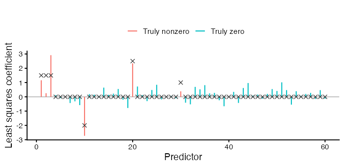
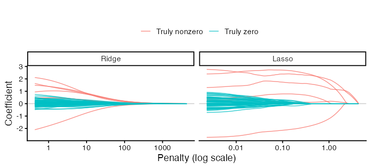
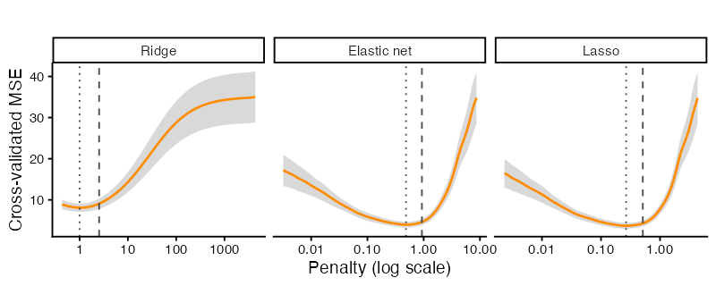
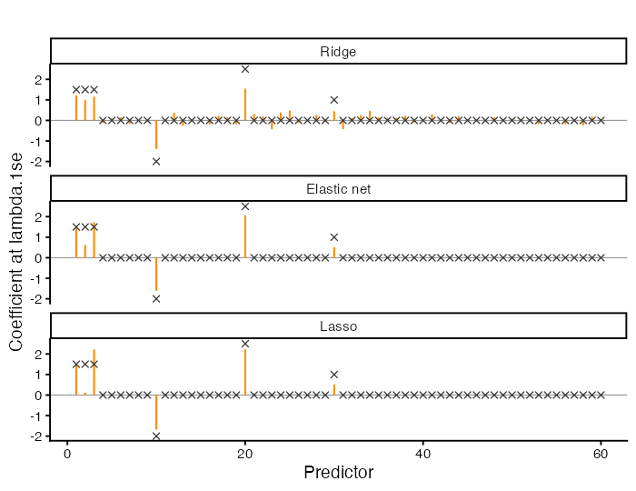
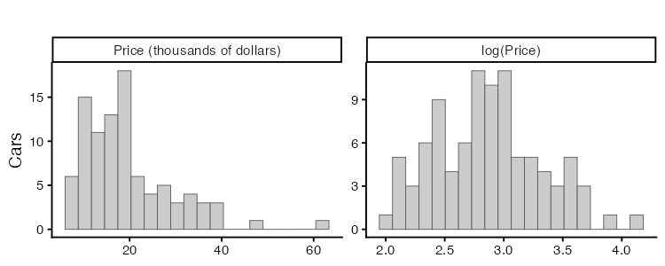
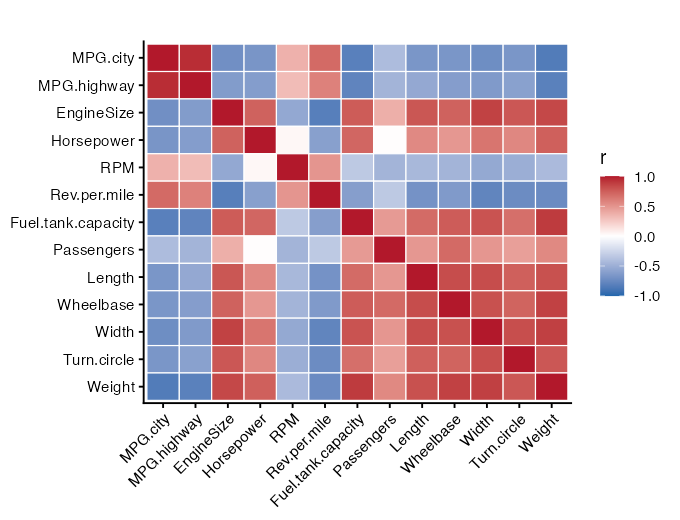
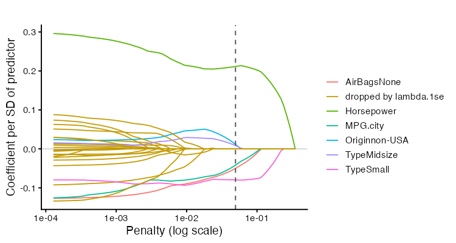
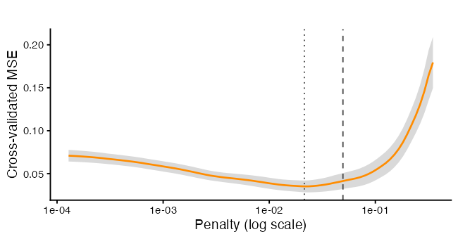
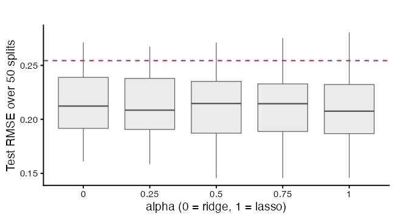
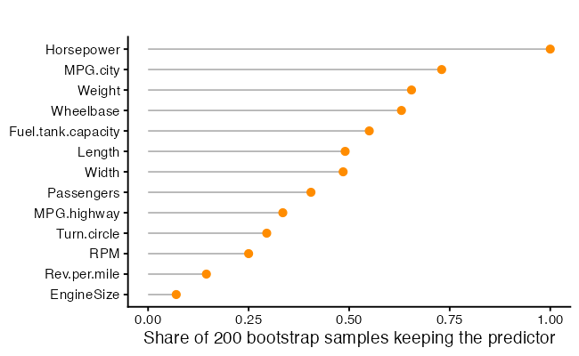

<script>
  MathJax = {
    tex: { inlineMath: [['$','$'], ['\\(','\\)']],
           displayMath: [['$$','$$'], ['\\[','\\]']] },
    svg: { fontCache: 'global' }
  };
</script>
<script src="https://cdn.jsdelivr.net/npm/mathjax@3/es5/tex-svg.js" id="MathJax-script" async></script>

<style>
  .site-footer,
  .footer { display: none; }
</style>

# Linear Regression in R (Part 6): Penalized Models

> This is the last workshop in a six-part series on linear regression. Part 2 found predictors that carried the same information and measured the damage with the variance inflation factor. Part 4 watched a flexible model fit its training data and fail on everything else. Neither part offered a fix beyond dropping things by hand. Today we change the thing being minimized. Adding a penalty on the size of the coefficients makes unstable models stable, and one choice of penalty sets coefficients to zero, which selects variables while fitting.

## What You Will Learn

By the end of this session you will be able to:

1. Say why least squares becomes unstable when predictors are many or related.
2. Write the ridge, lasso, and elastic net objectives, and say what each penalty does.
3. Explain why penalized regression requires the predictors to be on a common scale.
4. Fit all three with `glmnet()`, which takes a matrix rather than a formula.
5. Choose the penalty by cross-validation, and tell `lambda.min` from `lambda.1se`.
6. Read a coefficient path and a cross-validation curve.
7. Compare predictive performance across methods, and recognise when a difference is too small to act on.
8. Fit a model with more predictors than observations.
9. State what penalized models do not give you.

## Setup

We use `glmnet` for the penalized fits and `ggplot2` for plots. 

```r
packages <- c("ggplot2", "glmnet")
toInstall <- packages[!(packages %in% installed.packages()[, "Package"])]
if (length(toInstall)) install.packages(toInstall)

library(ggplot2)
library(glmnet)
library(MASS)
theme_set(theme_classic(base_size = 14))

rmse <- function(actual, predicted) sqrt(mean((actual - predicted)^2))
```

# Part A: What Goes Wrong, and What Shrinking Fixes

We start with simulated data, so we know which predictors matter.

<details markdown="1">
<summary>Show the code that generates this dataset (contains the answer)</summary>

```r
set.seed(2026)

p <- 60
nTrain <- 80
nTest <- 2000

simX <- function(n) {
  X <- matrix(rnorm(n * p), n, p)
  shared <- rnorm(n)
  X[, 1:3] <- 0.95 * shared + sqrt(1 - 0.95^2) * X[, 1:3]
  colnames(X) <- paste0("x", seq_len(p))
  X
}

trueBeta <- rep(0, p)
trueBeta[1:3] <- 1.5
trueBeta[10]  <- -2
trueBeta[20]  <- 2.5
trueBeta[30]  <- 1

xTrain <- simX(nTrain)
yTrain <- as.vector(xTrain %*% trueBeta + rnorm(nTrain, sd = 2))
xTest  <- simX(nTest)
yTest  <- as.vector(xTest %*% trueBeta + rnorm(nTest, sd = 2))
```

</details>

There are 80 observations and 60 predictors. Six of the predictors do something. The other 54 are noise. Three of the six are near copies of each other.


```r
dim(xTrain)
sum(trueBeta != 0)
round(cor(xTrain[, 1:3]), 3)
```

```
> dim(xTrain)
[1] 80 60

> sum(trueBeta != 0)
[1] 6

> round(cor(xTrain[, 1:3]), 3)
      x1  x2    x3
x1 1.000 0.9 0.922
x2 0.900 1.0 0.900
x3 0.922 0.9 1.000
```

This is not an unrealistic dataset we may see in reality. A survey with sixty questions, a panel of sixty blood markers, or a car described by sixty measurements may all look like this, and in each case some of the columns say the same thing twice.

## Least Squares on Sixty Predictors


```r
olsFit <- lm(yTrain ~ xTrain)

c(rSquared = round(summary(olsFit)$r.squared, 4),
  trainRMSE = round(rmse(yTrain, fitted(olsFit)), 3),
  testRMSE = round(rmse(yTest, cbind(1, xTest) %*% coef(olsFit)), 3),
  nullRMSE = round(rmse(yTest, mean(yTrain)), 3))
```

```
 rSquared trainRMSE  testRMSE  nullRMSE 
   0.9784    0.8560    4.0700    5.8230 
```

The model explains 97.8 percent of the variation in the data it was fitted to. On 2000 new observations it scores 4.07, against 5.82 for predicting the training mean and ignoring all sixty predictors. Sixty predictors, a near-perfect fit, and most of the gain is gone the moment the data changes. Part 4 called this overfitting, and the only new thing here is how little flexibility it took.

Look at where the fit went.


```r
olsCoef <- coef(olsFit)[-1]
round(c(trueMax = max(abs(trueBeta)),
        olsMax = max(abs(olsCoef)),
        olsMaxAmongZeros = max(abs(olsCoef[trueBeta == 0]))), 3)
```

```
         trueMax           olsMax olsMaxAmongZeros 
           2.500            2.916            1.015 
```



The crosses are the truth and the bars are the estimates. A predictor that does nothing has picked up a coefficient of 1.015, larger than the true effect of `x30`. With 80 observations and 60 predictors there is enough freedom to fit the noise, and least squares has no reason not to.

This is the problem Part 2 described through the variance inflation factor. The variance of a least squares coefficient grows as predictors become harder to tell apart, and it grows without limit as they approach being indistinguishable. 

## Three Penalties

Least squares minimizes the residual sum of squares alone,

$$\sum_{i=1}^{n}\left(y_i - \beta_0 - \sum_{j=1}^{p} x_{ij}\beta_j\right)^2.$$

Penalized regression adds a term that charges for the size of the coefficients. **Ridge** charges squared size,

$$\sum_{i=1}^{n}\left(y_i - \beta_0 - \sum_{j=1}^{p} x_{ij}\beta_j\right)^2 + \lambda \sum_{j=1}^{p} \beta_j^2 .$$

**Lasso** charges absolute size,

$$\sum_{i=1}^{n}\left(y_i - \beta_0 - \sum_{j=1}^{p} x_{ij}\beta_j\right)^2 + \lambda \sum_{j=1}^{p} \left|\beta_j\right| .$$

The **elastic net** charges a mixture of the two, with $\alpha$ setting the blend,

$$\sum_{i=1}^{n}\left(y_i - \beta_0 - \sum_{j=1}^{p} x_{ij}\beta_j\right)^2
+ \lambda \sum_{j=1}^{p} \left(\alpha \left|\beta_j\right| + \tfrac{1}{2}(1-\alpha)\beta_j^2\right).$$

Setting $\alpha = 1$ gives the lasso and $\alpha = 0$ gives ridge. The intercept is never penalized, since shrinking it would just move the predictions off centre.

$\lambda$ controls how hard the penalty bites. At $\lambda = 0$ every method returns least squares. As $\lambda$ grows, coefficients shrink towards zero, and in the limit every slope is zero and the model predicts the mean.

Squared size has a shallow gradient near zero, so ridge keeps shrinking a coefficient without ever quite arriving at zero. Absolute size has a constant gradient, so once the lasso has shrunk a coefficient to zero there is nothing pulling it back out. 

> **The predictors have to be on a common scale.** The penalty adds up coefficients, so a predictor measured in grams and one measured in kilograms are charged differently for the same relationship. `glmnet()` standardizes the columns before fitting and converts the coefficients back to the original scale when it reports them, so you do not have to do it yourself. 

## What the Paths Look Like

`glmnet()` takes a matrix of predictors and a response vector. There is no formula interface and no data argument.


```r
ridgePath <- glmnet(xTrain, yTrain, alpha = 0)
lassoPath <- glmnet(xTrain, yTrain, alpha = 1)

round(range(ridgePath$lambda), 3)
round(range(lassoPath$lambda), 3)
```

```
> round(range(ridgePath$lambda), 3)
[1]    0.434 4337.382

> round(range(lassoPath$lambda), 3)
[1] 0.002 4.337
```

One call fits the whole sequence of penalties, not a single model. `glmnet` starts at a $\lambda$ large enough to zero everything and works down. The ridge sequence runs much higher, because a squared penalty needs a larger multiplier to flatten the same coefficients.



Each line is one coefficient as the penalty changes. Read right to left, from heavy penalty to light.

In the ridge panel every line leaves zero at once and they descend together. No line ever reaches zero. In the lasso panel the lines leave zero one at a time, and at any penalty most of them are sitting flat on zero. The red lines, which are the six that matter, are the ones that hold out longest.


```r
lassoNonzero <- data.frame(lambda = lassoPath$lambda,
                           nonzero = lassoPath$df)
head(lassoNonzero, 4)
tail(lassoNonzero, 4)
```

```
> head(lassoNonzero, 4)
    lambda nonzero
1 4.337382       0
2 3.952061       2
3 3.600971       2
4 3.281070       2

> tail(lassoNonzero, 4)
        lambda nonzero
79 0.003059937      59
80 0.002788101      58
81 0.002540414      59
82 0.002314730      59
```

## Cross-Validation Picks the Penalty

Part 4 of our series built k-fold cross-validation by hand. `cv.glmnet()` does it for a whole path at once. Give every method the same folds, so a comparison between methods is not partly a comparison between random splits.


```r
set.seed(7)
foldId <- sample(rep(seq_len(10), length.out = nTrain))

cvRidge <- cv.glmnet(xTrain, yTrain, alpha = 0,   foldid = foldId)
cvLasso <- cv.glmnet(xTrain, yTrain, alpha = 1,   foldid = foldId)
cvNet   <- cv.glmnet(xTrain, yTrain, alpha = 0.5, foldid = foldId)

round(c(ridgeMin = cvRidge$lambda.min, ridge1se = cvRidge$lambda.1se), 3)
round(c(lassoMin = cvLasso$lambda.min, lasso1se = cvLasso$lambda.1se), 3)
```

```
> round(c(ridgeMin = cvRidge$lambda.min, ridge1se = cvRidge$lambda.1se), 3)
ridgeMin ridge1se 
   1.002    2.540 

> round(c(lassoMin = cvLasso$lambda.min, lasso1se = cvLasso$lambda.1se), 3)
lassoMin lasso1se 
   0.266    0.510 
```

Two penalties come back from every fit.

`lambda.min` is the one with the lowest cross-validated error. `lambda.1se` is the largest penalty whose error is still within one standard error of that minimum. The cross-validation curve is flat near its bottom, and the rule takes the simplest model that is indistinguishable from the best one.



The grey band is one standard error either side. The dotted line is `lambda.min` and the dashed line is `lambda.1se`. The curve is nearly flat between them, which is the whole justification for preferring the simpler model.

## Scoring the Three Penalties

Because this data is simulated, we can ask more than which model predicts well. We can ask which predictors it found.


```r
scoreFit <- function(cv, label) {
  out <- lapply(c("lambda.min", "lambda.1se"), function(s) {
    cf <- as.vector(coef(cv, s = s))[-1]
    data.frame(method = label, rule = sub("lambda.", "", s, fixed = TRUE),
               lambda = cv[[s]],
               testRMSE = rmse(yTest, predict(cv, newx = xTest, s = s)),
               nonzero = sum(cf != 0),
               trueFound = sum(cf[trueBeta != 0] != 0),
               falsePositives = sum(cf[trueBeta == 0] != 0))
  })
  do.call(rbind, out)
}

simScores <- rbind(scoreFit(cvRidge, "Ridge"),
                   scoreFit(cvNet,   "Elastic net"),
                   scoreFit(cvLasso, "Lasso"))
simScores$testRMSE <- round(simScores$testRMSE, 3)
simScores$lambda <- round(simScores$lambda, 3)
simScores
```

```
       method rule lambda testRMSE nonzero trueFound falsePositives
1       Ridge  min  1.002    2.924      60         6             54
2       Ridge  1se  2.540    3.004      60         6             54
3 Elastic net  min  0.485    2.139      13         6              7
4 Elastic net  1se  0.930    2.275       7         6              1
5       Lasso  min  0.266    2.142      13         6              7
6       Lasso  1se  0.510    2.252       6         6              0
```


```r
round(c(ols = rmse(yTest, cbind(1, xTest) %*% coef(olsFit)),
        nullModel = rmse(yTest, mean(yTrain)),
        irreducible = 2), 3)
```

```
        ols   nullModel irreducible 
      4.070       5.823       2.000 
```

Four things to take from that table.

**Every penalized fit beat least squares.** Ridge scored 2.92 against 4.07 on the test RMSE, and the lasso 2.25. The noise in this data has standard deviation 2, so no model can score below that. 

**Ridge never sets any predictors to zero.** It keeps all 60 predictors at every penalty, although many get really close to zero.

**The lasso at `lambda.1se` found the six predictors and nothing else.** Six nonzero coefficients, six of them real, no false positives. This will not always happen, especially on real data.

**The two rules trade prediction against sparsity.** `lambda.min` scored slightly better, 2.142 against 2.252, and paid for it with seven false positives. `lambda.1se` gave up 0.11 of RMSE to return a model with nothing extra in it. 



Ridge spreads small coefficients across everything. The elastic net keeps a handful. The lasso keeps six.

## The Three Near-Copies

Now the correlated group. All three of `x1`, `x2`, and `x3` have a true coefficient of 1.5, and the three are correlated at about 0.9.


```r
getCoef <- function(cv) as.vector(coef(cv, s = "lambda.1se"))[-1]

blockFrame <- data.frame(
  variable = paste0("x", 1:3),
  truth = trueBeta[1:3],
  ridge = round(getCoef(cvRidge)[1:3], 3),
  elasticNet = round(getCoef(cvNet)[1:3], 3),
  lasso = round(getCoef(cvLasso)[1:3], 3))
blockFrame
```

```
  variable truth ridge elasticNet lasso
1       x1   1.5 1.220      1.451 1.523
2       x2   1.5 1.001      0.622 0.121
3       x3   1.5 1.159      1.732 2.217
```

Ridge gives the three coefficients similar values when we compare to elasticNet and lasso. The lasso gives `x3` a large coefficient and `x2` a small estimate at 0.121. The elastic net sits between them.

This is the behaviour Zou and Hastie described when they proposed the elastic net. When predictors are strongly correlated the lasso tends to pick one of the group and does not much care which. A different sample would produce a different pick. Mixing in the ridge penalty encourages correlated predictors to enter or leave together, which they called the grouping effect.

This matters for how you read the output. The lasso underestimating `x2` is not evidence that `x2` is irrelevant. It is evidence that `x2` carries information already supplied by `x1` and `x3`. **A variable the lasso dropped is not a variable with no effect.**

## What the Penalty Buys

Part 4 of our workshop series split expected prediction error into irreducible noise, squared bias, and variance. Penalized regression focusses on balancing this decomposition. Shrinking a coefficient towards zero biases it, and every penalized estimate here is biased. In exchange the estimate moves less from one sample to the next.

Here the trade was worth making. Least squares is unbiased and scored 4.07. The lasso is biased and scored 2.25. The penalty bought a large reduction in variance for a small amount of bias, which is the whole idea, and it is the same bargain partial pooling made in Part 5 with groups in place of coefficients.

# Part B: Doing It on Real Data

## The Data

`Cars93` is in the R package `MASS`. It records 93 cars from the 1993 model year, with price, fuel economy, engine and body measurements, and several categorical descriptions.


```r
data(Cars93)
dim(Cars93)
```

```
[1] 93 27
```

Two columns have to go before anything else. `Price` is the midpoint of `Min.Price` and `Max.Price`, so including those as predictors would be handing the model the answer.


```r
round(cor(Cars93$Price, (Cars93$Min.Price + Cars93$Max.Price) / 2), 5)
```

```
[1] 1
```

A predictor that contains the response produces a wonderful model that is of no use, and penalized methods will not warn you, because a predictor that works perfectly is the kind they are built to keep.


```r
numericVars <- c("MPG.city", "MPG.highway", "EngineSize", "Horsepower",
                 "RPM", "Rev.per.mile", "Fuel.tank.capacity", "Passengers",
                 "Length", "Wheelbase", "Width", "Turn.circle", "Weight")
factorVars <- c("Type", "AirBags", "DriveTrain", "Cylinders",
                "Man.trans.avail", "Origin")

cars <- Cars93[, c("Price", numericVars, factorVars)]
c(rows = nrow(cars), columns = ncol(cars), missingValues = sum(is.na(cars)))
```

```
         rows       columns missingValues 
           93            20             0 
```

One factor needs attention. `Cylinders` has levels holding only one or two cars, and a level that thin cannot be estimated well. It also breaks a random split, since every car with that level can land on one side.


```r
table(cars$Cylinders)

cars$Cylinders <- as.character(cars$Cylinders)
cars$Cylinders[cars$Cylinders %in% c("3", "5", "rotary")] <- "other"
cars$Cylinders <- factor(cars$Cylinders, levels = c("4", "6", "8", "other"))
table(cars$Cylinders)
```

```
     3      4      5      6      8 rotary 
     3     49      2     31      7      1 

    4     6     8 other 
   49    31     7     6 
```

## Price Gets a Log


```r
summary(cars$Price)
cars$logPrice <- log(cars$Price)
```

```
   Min. 1st Qu.  Median    Mean 3rd Qu.    Max. 
   7.40   12.20   17.70   19.51   23.30   61.90 
```

Prices run from 7,400 dollars to 61,900, with a mean well above the median. 


```r
rawFit <- lm(Price ~ . - logPrice, data = cars)
logFit <- lm(logPrice ~ . - Price, data = cars)
round(c(adjRsqRaw = summary(rawFit)$adj.r.squared,
        adjRsqLog = summary(logFit)$adj.r.squared,
        shapiroRaw = shapiro.test(resid(rawFit))$p.value,
        shapiroLog = shapiro.test(resid(logFit))$p.value), 4)
```

```
 adjRsqRaw  adjRsqLog shapiroRaw shapiroLog 
    0.7766     0.8367     0.0033     0.0663 
```



Every model below predicts `logPrice`.

## The Predictors Describe the Same Car Several Times

Part 2 measured redundancy among predictors with the variance inflation factor, where a value above 10 is usually taken as a problem.


```r
vifLike <- sapply(numericVars, function(v) {
  others <- setdiff(numericVars, v)
  rsq <- summary(lm(cars[[v]] ~ ., data = cars[others]))$r.squared
  1 / (1 - rsq)
})
round(sort(vifLike, decreasing = TRUE), 1)
```

```
            Weight           MPG.city        MPG.highway         Horsepower 
              22.4               17.5               15.3               12.9 
        EngineSize          Wheelbase              Width Fuel.tank.capacity 
              11.8                8.1                7.9                6.3 
            Length                RPM       Rev.per.mile         Passengers 
               5.3                4.9                4.2                3.8 
       Turn.circle 
               3.5 
```

Five predictors sit above 10, which makes sense if we look at the variables and know just a bit about cars. A heavy car is often a long car with a big engine that has high fuel consumption, and those are five columns are arguably multicollinear.



The heatmap shows the structure of collinearity. One block of size and power measurements moves together, the two fuel economy measurements move together, and the two blocks move against each other.

Part 2's advice was to drop predictors until the inflation came down. Penalized regression does not ask you to decide.

## Building the Design Matrix


```r
modelFrame <- cars[, c("logPrice", numericVars, factorVars)]
X <- model.matrix(logPrice ~ ., data = modelFrame)[, -1]
y <- modelFrame$logPrice
dim(X)

set.seed(2026)
trainRows <- sample(nrow(X), size = floor(0.7 * nrow(X)))
testRows <- setdiff(seq_len(nrow(X)), trainRows)
c(train = length(trainRows), test = length(testRows), predictors = ncol(X))
```

```
> dim(X)
[1] 93 27

> c(train = length(trainRows), test = length(testRows), predictors = ncol(X))
     train       test predictors 
        65         28         27 
```

`model.matrix()` turns the factors into the indicator columns from Part 2 of our series. The `[, -1]` drops the intercept column, which `glmnet` supplies itself.

Build the matrix on all 93 rows and then split, rather than building it separately on each half. A rare factor level that appears only in the training half would otherwise produce a column that does not exist in the test half. 

## Fitting All Three

```r
set.seed(11)
carFolds <- sample(rep(seq_len(10), length.out = length(trainRows)))

carRidge <- cv.glmnet(X[trainRows, ], y[trainRows], alpha = 0,   foldid = carFolds)
carNet   <- cv.glmnet(X[trainRows, ], y[trainRows], alpha = 0.5, foldid = carFolds)
carLasso <- cv.glmnet(X[trainRows, ], y[trainRows], alpha = 1,   foldid = carFolds)

carOls <- lm(y[trainRows] ~ X[trainRows, ])

carScore <- function(cv, label) {
  data.frame(
    method = label,
    lambda1se = round(cv$lambda.1se, 4),
    nonzero = cv$nzero[which(cv$lambda == cv$lambda.1se)],
    testMin = round(rmse(y[testRows],
                         predict(cv, newx = X[testRows, ], s = "lambda.min")), 4),
    test1se = round(rmse(y[testRows],
                         predict(cv, newx = X[testRows, ], s = "lambda.1se")), 4))
}
carResults <- rbind(carScore(carRidge, "Ridge"),
                    carScore(carNet,   "Elastic net"),
                    carScore(carLasso, "Lasso"))
rownames(carResults) <- NULL
carResults
```

```
       method lambda1se nonzero testMin test1se
1       Ridge    0.4725      27  0.2286  0.2469
2 Elastic net    0.0902       8  0.2455  0.2645
3       Lasso    0.0495       6  0.2475  0.2736
```


```r
round(c(ols = rmse(y[testRows],
                   cbind(1, X[testRows, ]) %*% coef(carOls)),
        nullModel = rmse(y[testRows], mean(y[trainRows]))), 4)
```

```
      ols nullModel 
   0.2574    0.5267 
```

Every method beats both least squares and the null model. The lasso holds 6 of 27 predictors, the elastic net 8, and ridge all 27.

On this split ridge predicts best. Don't be too convinced of this method yet... we will come back to this.


```r
lassoCoef <- coef(carLasso, s = "lambda.1se")
kept <- rownames(lassoCoef)[as.vector(lassoCoef) != 0]
keptSd <- c(1, apply(X[trainRows, ], 2, sd)[kept[-1]])
data.frame(predictor = kept,
           coefficient = round(as.vector(lassoCoef)[as.vector(lassoCoef) != 0], 4),
           perSd = round(as.vector(lassoCoef)[as.vector(lassoCoef) != 0] * keptSd, 4),
           row.names = NULL)
```

```
      predictor coefficient   perSd
1   (Intercept)      2.5062  2.5062
2      MPG.city     -0.0084 -0.0418
3    Horsepower      0.0044  0.2114
4   TypeMidsize      0.0199  0.0084
5     TypeSmall     -0.1875 -0.0796
6   AirBagsNone     -0.1028 -0.0500
7 Originnon-USA      0.0229  0.0115
```

From 27 predictors the lasso kept 6. Out of the whole block of size and power measurements it kept `Horsepower` and dropped `Weight`, `Length`, `Width`, `Wheelbase`, and `EngineSize`.

The two coefficient columns answer different questions. The first is the change in `logPrice` for a one-unit change in the predictor, so `Horsepower` looks small at 0.0044 because one horsepower is a small amount of horsepower. The second multiplies by the predictor's standard deviation, giving the change over a typical spread, and on that scale `Horsepower` at 0.21 is far and away the largest effect. For the indicator columns the first number is the interpretable one, since a standard deviation of a zero-one column means nothing.





The path is drawn on the per-standard-deviation scale for the same reason. The dashed line marks `lambda.1se`, and the six named predictors are the ones still standing there. `Horsepower` is the last to go.

## Choosing Alpha, Over Many Splits

`cv.glmnet()` chooses $\lambda$ and leaves $\alpha$ to you. Fit a grid of values and compare. With 93 cars, compare over many splits rather than one.


```r
alphaGrid <- c(0, 0.25, 0.5, 0.75, 1)
nRep <- 50

set.seed(99)
repList <- list()
olsRep <- numeric(nRep)
for (r in seq_len(nRep)) {
  tr <- sample(nrow(X), size = floor(0.7 * nrow(X)))
  te <- setdiff(seq_len(nrow(X)), tr)
  fid <- sample(rep(seq_len(10), length.out = length(tr)))
  fitOls <- lm(y[tr] ~ X[tr, ])
  olsRep[r] <- rmse(y[te], cbind(1, X[te, ]) %*% coef(fitOls))
  for (a in alphaGrid) {
    cv <- cv.glmnet(X[tr, ], y[tr], alpha = a, foldid = fid)
    repList[[length(repList) + 1]] <- data.frame(
      rep = r, alpha = a,
      minRule = rmse(y[te], predict(cv, newx = X[te, ], s = "lambda.min")),
      oneSeRule = rmse(y[te], predict(cv, newx = X[te, ], s = "lambda.1se")))
  }
}
repFrame <- do.call(rbind, repList)

alphaSummary <- aggregate(cbind(minRule, oneSeRule) ~ alpha, data = repFrame,
                          FUN = mean)
alphaSummary$sdMin <- aggregate(minRule ~ alpha, data = repFrame, FUN = sd)$minRule
round(alphaSummary, 4)
round(c(olsMean = mean(olsRep), olsSd = sd(olsRep)), 4)
```

```
> round(alphaSummary, 4)
  alpha minRule oneSeRule  sdMin
1  0.00  0.2144    0.2308 0.0297
2  0.25  0.2128    0.2264 0.0302
3  0.50  0.2118    0.2256 0.0314
4  0.75  0.2118    0.2259 0.0320
5  1.00  0.2112    0.2268 0.0329

> round(c(olsMean = mean(olsRep), olsSd = sd(olsRep)), 4)
olsMean   olsSd 
 0.2544  0.0359 
```



Read the two columns of numbers against each other. The five values of $\alpha$ span 0.2112 to 0.2144, a range of 0.003. The standard deviation across splits is about 0.03, ten times larger. **The differences between the methods are far smaller than the noise in measuring them.** Any of these is a defensible choice here, and tuning $\alpha$ carefully would be fitting the split rather than the data.

The single split earlier said ridge was best. Over fifty splits the margin is gone. 

Two differences are worth noting. All five penalized fits beat least squares in test RMSE, at about 0.21 against 0.254, which is the dashed line in the figure. And `lambda.min` beats `lambda.1se` on prediction at every $\alpha$, by about 0.015. The simpler model costs a little accuracy, as it did in Part A.

Compare this to Part A, where the lasso clearly beat ridge. The difference here is the data. In Part A only six of sixty predictors determined the model, and a method that can zero out the predictors was important. Here there is no reason to think any car measurement has zero effect on price. 

## More Predictors Than Cars

Part 5 of our series added interaction terms one at a time. Add every pairwise interaction among the numeric predictors at once and the design becomes wider than the training set is tall.


```r
wideFrame <- cars[, c("logPrice", numericVars)]
XWide <- model.matrix(logPrice ~ .^2, data = wideFrame)[, -1]
c(trainRows = length(trainRows), predictors = ncol(XWide))

wideOls <- lm(y[trainRows] ~ XWide[trainRows, ])
c(naCoefficients = sum(is.na(coef(wideOls))),
  rSquared = summary(wideOls)$r.squared,
  residualSd = summary(wideOls)$sigma)
```

```
> c(trainRows = length(trainRows), predictors = ncol(XWide))
 trainRows predictors 
        65         91 

> c(naCoefficients = sum(is.na(coef(wideOls))),
+   rSquared = summary(wideOls)$r.squared,
+   residualSd = summary(wideOls)$sigma)
naCoefficients       rSquared     residualSd 
            27              1            NaN 
```

Least squares has stopped working. Twenty-seven coefficients come back as `NA` because there is not enough data to identify them, $R^2$ is 1, and the residual standard deviation is `NaN` because there are no residuals and no degrees of freedom left. The model reproduces all 65 training cars perfectly and has learned nothing.

The penalty removes the problem.


```r
set.seed(11)
wideLasso <- cv.glmnet(XWide[trainRows, ], y[trainRows], alpha = 1,
                       foldid = carFolds)
c(nonzero = unname(wideLasso$nzero[which(wideLasso$lambda == wideLasso$lambda.1se)]),
  testRMSE = round(rmse(y[testRows],
                        predict(wideLasso, newx = XWide[testRows, ],
                                s = "lambda.1se")), 4))
```

```
 nonzero testRMSE 
  6.0000   0.2951 
```

From 91 candidate terms the lasso returns 6 and a working model. The penalty makes the estimate unique where least squares has infinitely many solutions that fit equally well.

Note the test RMSE. At 0.295 the interaction model is worse than the 0.274 the lasso managed on main effects alone, scoring both at `lambda.1se`. But remember that being able to fit a model is not a reason to prefer it. 

## How Stable Is the Selection?

The lasso returned a list of six predictors. It is tempting to read that list as the variables that matter. Test it by resampling.


```r
XNum <- model.matrix(logPrice ~ ., data = cars[, c("logPrice", numericVars)])[, -1]

set.seed(5)
chosen <- matrix(0, 200, ncol(XNum), dimnames = list(NULL, colnames(XNum)))
for (b in 1:200) {
  rows <- sample(nrow(XNum), replace = TRUE)
  fit <- cv.glmnet(XNum[rows, ], y[rows], alpha = 1)
  chosen[b, ] <- as.vector(coef(fit, s = "lambda.1se"))[-1] != 0
}
selectionRate <- sort(colMeans(chosen), decreasing = TRUE)
round(selectionRate, 3)
```

```
        Horsepower           MPG.city             Weight          Wheelbase 
             1.000              0.730              0.655              0.630 
Fuel.tank.capacity             Length              Width         Passengers 
             0.550              0.490              0.485              0.405 
       MPG.highway        Turn.circle                RPM       Rev.per.mile 
             0.335              0.295              0.250              0.145 
        EngineSize 
             0.070 
```



`Horsepower` survives every one of the 200 resamples. After that it falls away quickly. `Weight` is kept 66 percent of the time, `Wheelbase` 63 percent, `Length` 49 percent. Five of the thirteen land between 0.33 and 0.55, which is close to a coin flip.

So report the selection with the stability attached. "The lasso selected `Weight`" is a weak claim. "`Weight` was selected in 66 percent of resamples, along with four other size measurements that trade places with it" is a more accurrate description. Meinshausen and Bühlmann built this idea into a method, stability selection, which keeps the predictors that survive resampling often enough.

## What Penalized Models Do Not Give You

`summary()` on a `glmnet` fit does not return a coefficient table, and `confint()` does not work. 

**No standard errors and no p-values.** The estimates are biased, so the usual standard error does not describe what you want it to. Worse, the penalty was chosen by looking at the data, and the variables were selected by looking at the data. A lasso fit does the selecting and the reporting in one step. Post-selection inference becomes important for penalized methods.

**No causal reading.** A penalized coefficient is shrunk by an amount that depends on the other predictors and on $\lambda$. It is not an estimate of an effect.

**No guarantee the right variables were found.** Part A recovered the true six predictors. The bootstrap above on real data shows what happens when predictors are correlated.


## YOU TRY!

Work through these for the next 15 minutes. Use `mtcars`, which is built into R. Predict fuel economy `mpg` from the other ten variables. There are 32 cars, and the predictors are heavily correlated.


```r
data(mtcars)
X <- model.matrix(mpg ~ ., data = mtcars)[, -1]
y <- mtcars$mpg
dim(X)
```

**Part 1. See the problem.**
Compute the variance inflation factor for each predictor the way Part B did. How many are above 10? Fit `lm(mpg ~ .)` and look at how many coefficients are significant, given that $R^2$ is above 0.8.

**Part 2. Ridge.**
Fit `cv.glmnet(X, y, alpha = 0)`. Plot the cross-validation curve. Report `lambda.min` and `lambda.1se` and the coefficients at each.

**Part 3. Lasso.**
Fit the same thing with `alpha = 1`. How many predictors survive at `lambda.1se`? Which ones?

**Part 4. Compare the paths.**
Plot the coefficient paths for both. Rescale the coefficients by each predictor's standard deviation first. Why does that matter here, given that `disp` runs into the hundreds and `vs` is zero or one?

**Part 5. Elastic net.**
Fit `alpha` at 0.25, 0.5, and 0.75, using one shared `foldid` for every fit. Does the number of selected predictors change in the direction you would expect?

**Part 6. Compare honestly.**
With 32 cars a single train and test split is close to useless. Repeat a 70/30 split 50 times and record test RMSE for each method. Are the differences larger than the spread across splits?

**Part 7. Stability.**
Resample the rows with replacement 200 times and record how often each predictor is kept. `cyl`, `disp`, `hp`, and `wt` all describe engine size. What happens to them?

**Part 8. The honest summary.**
Write two sentences reporting what predicts `mpg`, suitable for someone who will act on them. Include the selection rates from Part 7 and do not include a p-value.

## So... what did we learn?

1. Least squares has no defence against many or redundant predictors. With 60 predictors and 80 observations it reached $R^2$ of 0.978 and barely beat predicting the mean on new data.
2. Penalized regression adds a charge for coefficient size to the quantity being minimized. $\lambda$ sets how hard it bites, from least squares at zero to an empty model in the limit.
3. Ridge penalizes squared size and shrinks without selecting. The lasso penalizes absolute size and sets coefficients to zero. The elastic net mixes them through $\alpha$.
4. Penalties compare coefficients, so predictors must share a scale. `glmnet()` standardizes internally and reports on the original scale.
5. `glmnet()` fits a whole path of penalties in one call, and `cv.glmnet()` cross-validates it.
6. `lambda.min` minimizes cross-validated error. `lambda.1se` takes the largest penalty within one standard error of it, which is Part 4's rule. In both examples here `lambda.min` predicted slightly better and `lambda.1se` returned a simpler model.
7. The penalty trades bias for variance on purpose. Every estimate is biased and the predictions are better for it.
8. Among correlated predictors the lasso picks one and drops the rest. A dropped variable is not a variable without an effect.
9. Which method wins depends on whether the truth is sparse. The lasso clearly won the simulation, where only six of sixty predictors mattered, and no method clearly won on the cars.
10. Compare methods over many splits. On 93 cars the gaps between methods were 0.003 while the spread across splits was 0.03.
11. Penalized models fit when $p$ exceeds $n$, where least squares returns `NA` coefficients and a perfect, useless fit.
12. Lasso selection is not stable. Across 200 resamples one predictor was kept every time and six were near a coin flip. Report selection frequencies, not a single list.
13. There are no standard errors or p-values, because the model was chosen from the data. Use these models to predict and to shortlist, not to make claims about effects.

## References

**Penalized regression.**

- Hoerl, A. E. and Kennard, R. W. (1970). Ridge regression: biased estimation for nonorthogonal problems. *Technometrics*, 12(1), 55-67. The original ridge paper, motivated by the instability covered in Part 2.
- Tibshirani, R. (1996). Regression shrinkage and selection via the lasso. *Journal of the Royal Statistical Society Series B*, 58(1), 267-288.
- Zou, H. and Hastie, T. (2005). Regularization and variable selection via the elastic net. *Journal of the Royal Statistical Society Series B*, 67(2), 301-320. The grouping effect, and why the lasso alone handles correlated predictors poorly.
- Friedman, J., Hastie, T. and Tibshirani, R. (2010). Regularization paths for generalized linear models via coordinate descent. *Journal of Statistical Software*, 33(1), 1-22. The `glmnet` paper. Run `citation("glmnet")` for the current entry.

**Selection and its limits.**

- Meinshausen, N. and Bühlmann, P. (2010). Stability selection. *Journal of the Royal Statistical Society Series B*, 72(4), 417-473. Resampling to decide which selected variables to believe.

**Textbooks.**

- James, G., Witten, D., Hastie, T. and Tibshirani, R. (2021). *An Introduction to Statistical Learning*, 2nd edition. Springer. Chapter 6 covers this material at this level.
- Hastie, T., Tibshirani, R. and Friedman, J. (2009). *The Elements of Statistical Learning*, 2nd edition. Springer. Chapter 3 in more depth.
- Hastie, T., Tibshirani, R. and Wainwright, M. (2015). *Statistical Learning with Sparsity: The Lasso and Generalizations*. CRC Press.

**Data.**

- Lock, R. H. (1993). 1993 new car data. *Journal of Statistics Education*, 1(1).
- Run `?Cars93` and `?mtcars` for the variable definitions.
