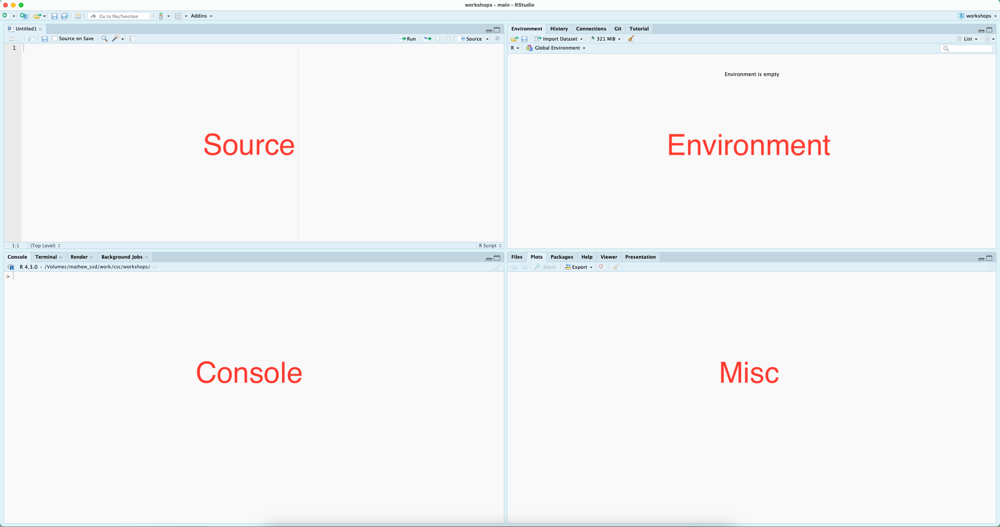
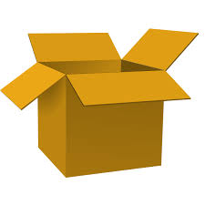

```{r setup, echo = FALSE, include = FALSE}
knitr::opts_chunk$set(echo = TRUE,
                      eval = TRUE)
suppressMessages(library(emoji))
```

# What is this series about?

```{r flat-only-css, echo = FALSE, results = "asis"}
if (!knitr::pandoc_to("revealjs")) {
  cat("<style>
  .notes { display: none; }
  hr { display: none; }
  .site-footer, .footer { display: none; }
</style>")
}
```

```{css, echo = FALSE}
/* Horizontal scroll for code, R output, and tables */
.reveal pre,
.reveal table {
  display: block;
  overflow-x: auto;
  max-width: 100%;
}

.reveal pre code {
  white-space: pre;  /* keep long lines intact instead of wrapping */
}

/* Vertical scroll for slides that are too tall */
.reveal .slides section {
  height: 100%;
  overflow-y: auto !important;
}
```

* Modern research consists of computing, lots and lots of *computing*
* This series is designed to introduce researchers to the basics of research 
computing through R
* *Warning*: assumes you've already installed Rstudio and R
  * If you have not done so please make an appointment with me through the CSC
  and I would happily assist you :)


:::notes
Modern research consists of computing, lots and lots of computing. This series
is designed to introduce researchers to the basics of research computing through
the popular statstical programming language R. We will cover topics ranging
from basics -- i.e., variables, data structures -- to conveying your findings
and basic *data wrangling* techniques. As a warning this series assumes you
have already installed Rstudio and R. If you have not, or have trouble doing so
feel free to set up a one-on-one and I would be happy to help you get started :).
:::

# A high-level data analysis workflow

Import (data) `r emoji::arrow("right")`  Tidy (data) `r emoji::arrow("right")` Visualize (data) `r emoji::arrow("right")` Communicate (findings)

:::notes
This is the general arc of most data projects, and roughly the arc of this
series. Today we don't touch real data yet. We learn the building blocks R
uses to represent data, so that when we import a dataset next session,
you'll understand what you're looking at.
:::

# Where we are in the series

1. **R: Fundamental Concepts with RStudio**

:::notes
Today is the foundation. Everything in later sessions builds on the vocabulary
we set up here: functions, variables, data types, and data structures. If
something feels abstract today, it will click once we start working with real
data.
:::

# Why R: supported and open source

* free and open source
* built for data analysis and statistics
* huge community and package ecosystem (20,000+ packages on CRAN)

:::notes
Compare this to point-and-click tools like Excel or SPSS. Clicking is quick,
but it leaves no record of what you did. A script is a recipe that anyone,
including future you, can follow exactly. It's part of a broader push in 
science (especially for researchers) to become more *reproducible*. Another
closely related but distinct topic is replicability. A scientific study is
reproducible if someone else *can* run your same analysis and get the same
results. However, a stronger condition is 
:::

# Why R: reproducibility and replicability

:::::: {.columns}

::: {.column width="55%"}

| Term            | Meaning                    |
| :-------------- | :------------------------- |
| Reproducibility | *Same* data, same methods  |
| Replicability   | *New* data, same methods   |

* A script records every step, which makes your work reproducible

:::

::: {.column width="45%"}

```{r echo = FALSE, fig.cap = "Most scientists report failing to reproduce others' results, and many their own. Survey of 1,576 researchers (Baker, 2016, *Nature*)."}
knitr::include_graphics("../assets/images/reproducibility-fig.png")
```

:::

::::::

:::notes

Figure on the right shows what has been dubbed the replicability or
reproducibility crisis in science (published in Nature 2016). This shows the
majority of 1576 scientists have failed to reproduce or replicate scientific
results from themeselves and peers.

Code is reproducible: anyone, including future you, can rerun, share, and
check your analysis. Reproducible code is a foundation for replicable
science, because others can see exactly what you did and apply the same
methods to new data.
:::

# Motivation `r emoji::emoji("thinking")`

* **Stand on the shoulders of giants:** others can only build on your work if
they can see what you did
* **Efficiency:** automate repetitive tasks, get to the important task of
*thinking*
* **Scale:** work with datasets far too large for a spreadsheet
* **Your future self:** six months from now, you'll need to know what you did, too

:::notes
The figure we just saw shows that most researchers have struggled to reproduce
published results. A big part of the problem is that methods sections rarely
capture every step of an analysis: which rows were dropped, how a variable was
recoded, which test was run. Code captures all of that.

Learning even basic programming gives you a complete record of your analysis,
lets you rerun it in seconds when your data change, and makes it easy to share.
Science works best when we can share and discuss results, and that only happens
when people know what you did. The most frequent person trying to reproduce
your work is you, months later, when a reviewer asks a question.
:::

# R vs. RStudio

* **R** is the engine: the language that does the computing
* **RStudio** is the dashboard: an interface that makes R easier to drive (an
integrated development environment or *IDE*)

:::notes
People often use these terms interchangeably, but they're separate programs. You
need R installed for RStudio to work. RStudio just gives you a friendlier place
to write code, see your results, and manage files.
:::

# Today's Goals

By the end of this session, you should be able to:

* Find your way around RStudio
* Install and load packages
* Run code and use functions
* Create and name variables
* Recognize R's main data types and data structures
* Know where to look for help


# RStudio

:::notes
R is great for interactive computational analysis, allowing for easy exploration and iteration. Using an IDE - Integrated Development Environment - such as RStudio, facilitates this interactivity, providing you with easy access to a place to quickly code (the console), a place to write saveable scripts (source editor), a place to view the objects that you create (environment pane), and a place to interact with your file system, visual outputs from your code, and help documentation (the miscellaneous pane, for lack of a better word).
:::

```{r echo = FALSE}

```

# Installing packages

```{r}
# install.packages("dplyr") # This call installs a package 
# library(dplyr) # This loads a package
# devtools packages
# install.packages("devtools")
# install_github("username/repositoryname")
```

:::notes
Base R (as it's affectionately called) is great, but the cool thing about R is it's huge ecosystem of packages which are constantly being expanded both on the central repository for the R programming language Comprehensive R Archive Network (CRAN) and outside of CRAN. As of the writing of this RMD there are over 22,000 packages on CRAN.  
:::

# Simple Math

```{r}
2 + 2 # add
3 - 2 # subtract
3 * 3 # multiply
4 / 2 # division
sqrt(9) # square root
```
:::notes
At it's most basic, R is a glorified calculator, capable of any operation might wish to throw at it...
:::

# Functions

```{r}
# c() is a common function for concatenating things together
c(1:10)
```
:::notes
At least initially, everything you do in R will be applying functions to data. In the above section, the mathematical operators, `sqrt()`, and `log10()`, are all functions. Functions take in data (or values) and process them, providing an output. The output is displayed in your console by default.
:::

<!--
S1 Variables
-->

# Variables

```{r echo = FALSE}

```

:::notes
While having outputs directed to the console is convenient for interactive
analysis, often we need to store data and / or outputs for later use. 
:::

# Creating variables

```{r}
# You can then recall the values (object) associated with your variable...
my_variable <- c(1:10)
myAlphabet <- letters[1:5]
myNumbers <- c(1:5)
#And plug it into functions, ie, do computations on it...

my_variable

my_variable * 2
```
:::notes
When naming variables in R, keep in mind that variable names. We do
this with variable assignment, where the greater than and dash are used to
assign the values (object) on the right to the name (variable) on the left.
:::

# Naming variables

```{r}
# camel case
myNumber <- "Hello" # bad naming
myNumber <- 10 # good naming
# skeleton case
my_number <- 10
```


:::notes
Should first and foremost be meaningful. This is not a rule, just best
practice. Cannot start with a number or a dot followed by a number. Cannot
contain spaces or hyphens. Can contain letters, numbers, dots, and underscores.

Additionally, some words are reserved and cannot be used, such as if and for.
More details can be found with `?make.names`
:::

# Data types

* data (and the variables that we use to store them) come in different
shapes and sizes
* think of a variable as a *box* and the data are the things you want to put
in, not all boxes fit all types of stuff (data)
* **note**: the function `typeof()`, will tell you what data type you have...

:::notes
Data types are elemental data constructs that R is able to distinguish between. The most common data types in R are numeric, character, and boolean. These come with intrinsic properties, for example, numeric data can be computed (added, divided, etc), character data can be strung together (character data, especially groups of characters are referred to as strings), and boolean data facilitates working with dichotomous values.
:::

# Boolean (Logical Data)

* `boolean` data are generally referred to as `logical`

```{r}
myBool <- TRUE # this is camel case
typeof(myBool)
```

# Numeric (Double)

* in `R` `numeric` data are subdivided into `double` and `integer`
```{r}
myDouble <- 10.5
typeof(myDouble)
```


---

# Numeric (Integer)

```{r}
myInteger <- 10L
typeof(myInteger)
```


---

# Characters

* `character` data always needs to be wrapped in single or double quotations.

```{r}
myChar <- "a" # Note that R does not distinguish between '' and "" but the use has to match
typeof(myChar)

```
---

# Complex

```{r}
myComplexNum <- 9 + 3i # remember sqrt(-1) :)
typeof(myComplexNum)
```

<!--
S2 Data Structures
-->

# Data Structures `r emoji::emoji("card_index_dividers")`

:::notes
Data structures are ways to hold multiple pieces of data together in a
meaningful way. R has four convenient ways of storing multiple pieces of data:
vectors, matrices, data frames, and lists. If a variable is a box, then imagine
that a data structure is way of organizing the box (e.g., dividers, egg carton
containers).
:::

---

# Vectors

:::notes
The most basic is a `vector`. In fact, everything in R is a vector, and all
other data structures are composed of vectors in various ways. It's convenient
to think of a vector as a simple list of like things; everything in a vector
needs to be of the same data type. So, a vector can be:

* numeric, holding numeric data;
* character, holding character data; or
* logical, holding boolean data.

A vector can be created with `c()`
:::

```{r}
# numeric vector
c(1:10)

# character vector
c("a", "b", "c")

# logical vector
c(TRUE, TRUE, FALSE)

# note that vectors do not allow you to mix types
# c(TRUE, 10) # this will convert TRUE to 1
# c(TRUE, "10") # this will convert TRUE to "TRUE"
```

# Matrices

```{r}
matrix(1:10, nrow = 2)
```

:::notes
A matrix is a vector with 2 dimensions; while a vector only has a length, a matrix is a grid with both length and width, or alternatively, rows and columns.

You can create a matrix with the `matrix()` function, providing it first with a series of values followed by an argument for the number of rows or columns you'd like. A matrix must be perfectly rectangular, that is, each column must be of equal length. R will recycle values to ensure this condition is met. A matrix must also be atomic - the data type must be the same throughout.
:::

# Data frames

```{r}
data.frame(letter = letters[1:5],
           nol = 1:5) # nol mean number of letter
```

:::notes
In general, these will be the most likely data structures that you'll encounter and the most familiar, as they are designed for tabular data and look like a spreadsheet.

Data frames are collections of vectors, where each vector must be of the same length, but can be of a different data type. If you import data from an Excel or csv file, these will be read in as a data frame. You can also create them with the `data.frame()` function.
:::

# Lists


```{r}
list(item_1 = myAlphabet,
     item_2 = c(1:3))
```

:::notes
Like data frames, lists are collections of vectors. However, unlike data frames, the length of these vectors can change. So far, this is the only non-rectangular data structure that we have to work with.

If you are importing tabular data, you are unlikely to create a list yourself, however, when performing operations (using functions) on your data, the output, or result, might be in the form of a list. For demonstration puropses, a list can be created with the `list()` function.
:::

# Arrays

* A matrix with more than two dimensions: rows, columns, *and* layers
* Like a stack of ice cube trays or milk carton containers

```{r}
my_array <- array(1:12, dim = c(2, 3, 2)) # 2 rows, 3 columns, 2 layers
my_array
```

:::notes
Arrays are an n-dimensional generalization of the matrix. A vector has one
dimension (length), a matrix has two (rows and columns), and an array can
have three or more. Like vectors and matrices, every element must be the
same data type.

When R prints an array, it shows one layer at a time: the ", , 1" and ", , 2"
headers mark each layer. Notice that R fills the values in column by column,
then moves to the next layer.

A real example: a colour image is a 3D array. Its height and width are the
rows and columns, and the three layers hold the red, green, and blue values
for each pixel. Similarly, monthly temperature readings at several sites
over several years could be stored as sites x months x years.

You won't use arrays often as a beginner, but they come up in fields like
imaging, climate data, and genomics.
:::

# Identifying Data Structures

```{r}
class(c(1:10))
class(matrix(1:10, ncol = 2))
class(data.frame(var_1 = letters,var_2 = 1:26))
class(list(item_1 = letters,item_2 = 1:10,item_3 = c(TRUE, FALSE)))
```

:::notes
The function `class()` will tell you what kind of structure your data are
held in. `class()`, when called on a vector, will report on the data type,
which should be read as the type of atomic vector you have. An array is a
multi-dimensional vector, a matrix is the special case where there are only two
dimensions.
:::

<!--
S3 Getting Help
-->

# Resources: getting help

1. Forums (e.g., Stack Overflow or Posit Community)
2. Blog posts and online tutorials (search for 'blogdowns' on a topic)
3. Package papers (often *Journal of Statistical Software*)
4. Books, many free online (see References)

* Want to practice? `r emoji::emoji('nerd')`
* Try `swirl`, which teaches R interactively in your console

:::notes
When you get stuck, there many places to look.

Forums are useful when you have a specific issue to resolve and can often
provide a quick fix, but the explanations also often require a degree of
familiarity to make sense.

Blog posts and online tutorials generally provide more context than forum
posts and are useful when trying to learn a new approach or package.

Journal publications that accompany the release of specific packages offer
in-depth descriptions of the packages and their arguments, often with
examples.

Finally, there are more in-depth texts, many available free online. Some are
listed on the References slide.
:::

---

# Resources: the `?` operator (and vignettes)

```{r, eval = FALSE}
?sqrt                    # help page for a function
??regression             # search all help pages for a topic
browseVignettes("dplyr") # long-form guides for a package
```

:::notes
A single question mark opens the help page for a function you know the name
of. Every help page has the same sections: Description, Usage, Arguments,
Value, and Examples. Tell learners to scroll straight to Examples first: it's
often the fastest way to see how a function works.

A double question mark searches all installed help pages, which is useful
when you know what you want to do but not the function name.

Vignettes are longer, tutorial-style guides that many packages include. They
are often a friendlier place to start than the help pages.

Help pages are built into R and are always available, but they can be both
enlightening and frustrating, as they assume some familiarity with the
concepts and with reading this kind of documentation.
:::

```{r}
#| label: knit to html
#| echo: FALSE
#| eval: FALSE

# this will render to reveal js for presentation purposes
rmarkdown::render(
    input = "ws1-fundamental-concepts-with-rstudio.RMD",
    output_format = "revealjs::revealjs_presentation",
    output_file = "ws1-fundamental-concepts-with-rstudio-js.html"
)

# this will render to a flat HTML
rmarkdown::render(
  input = "ws1-fundamental-concepts-with-rstudio.RMD",
  output_format = "md_document",
  output_file = "ws1-fundamental-concepts-with-rstudio-flat.md"
)
```


# References

* aRrgh: a newcomer’s (angry) guide to R, by Tim Smith and Kevin Ushey - [http://arrgh.tim-smith.us/](http://arrgh.tim-smith.us/)
* YaRrr! The Pirate’s Guide to R, by Nathaniel D. Phillips - [https://bookdown.org/ndphillips/YaRrr/](https://bookdown.org/ndphillips/YaRrr/)
* R for Graduate Students, by Wendy Huynh. - [https://bookdown.org/yih_huynh/Guide-to-R-Book/](https://bookdown.org/yih_huynh/Guide-to-R-Book/)
* Advanced R, by Hadley Wickham - [http://adv-r.had.co.nz/Introduction.html](http://adv-r.had.co.nz/Introduction.html)

And through the library, the [O'Reilly platform](https://resources.library.ubc.ca/page.php?details=oreilly-for-higher-education&id=2460) hosts a plethora of titles related to R.

* [https://www.w3schools.com/r/r_data_types.asp](W3 Schools)
* Baker, M. (2016). 1,500 scientists lift the lid on reproducibility. Nature, 533(7604), 452–454. https://doi.org/10.1038/533452a
