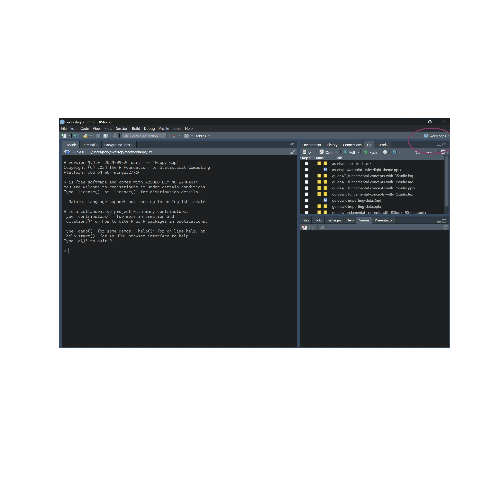
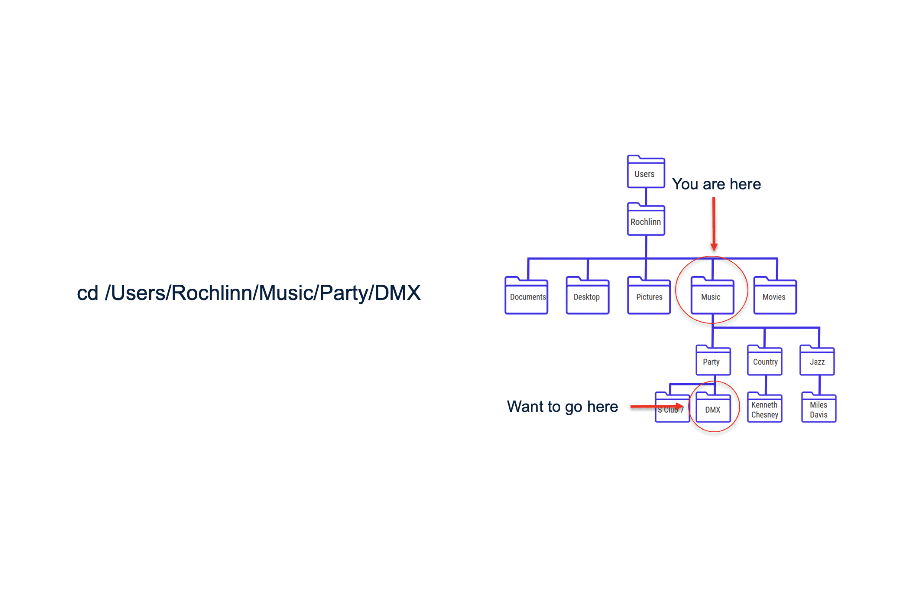

# R: Importing Data

<style>
  .notes { display: none; }
  hr { display: none; }
  .site-footer, .footer { display: none; }
</style>

### Where do your data live before R

<style type="text/css">
/* Horizontal scroll for code, R output, and tables */
.reveal pre,
.reveal table {
  display: block;
  overflow-x: auto;
  max-width: 100%;
}
&#10;.reveal pre code {
  white-space: pre;  /* keep long lines intact instead of wrapping */
}
&#10;/* Vertical scroll for slides that are too tall */
.reveal .slides section {
  height: 100%;
  overflow-y: auto !important;
}
</style>

- MS Excel, Google Sheets, CSV, Databases, Websites/APIs

### Importing versus opening data

- When you work with data in R you have move from *opening* data files
  to *importing* data into data structures.

- When you import data into R you aren’t clicking on rows, columns and
  cells in excel or google sheets anymore you are manipulating
  *objects*.

### Think-pair-share

- Lets say you have opened a file in R (health_data.csv). You edit a
  cell in the data structure in R. What happens to the original
  `health_data.csv` file?

### File structures

- File structures often referred to as **trees**
- Folders are often referred to as **directories**

&nbsp;

    ## C:/Users/alexj/Desktop/csc/workshops/./assets/demo-file-struct
    ## ├── mysubdir
    ## │   ├── mytext2.txt
    ## │   └── myword.docx
    ## └── mytext.txt

### The Working Directory

- The **working directory** is a *term of art* for the directory where
  your project lives

``` r
getwd()
```

    ## [1] "C:/Users/alexj/Desktop/csc/workshops/docs/r-fundamentals"

``` r
# This is not recommended
# setwd()
```

### R Projects

- The best way to keep track of files is with **R Projects**
- **Warning** you will want to turn off saving objects and memory to
  `.Rdata` (a special folder that holds session data)
  - can be turned off by going to `tools > global options > general`
    then under `workspace` toggle off
    `Restor .Rdata into workspace at startup`
- 



### Relative versus absolute filepaths



### Working with absolute and relative filepaths

``` r
# This is not recommended
# file.path("C:/Users/jackx/Desktop/csc/Workshops/docs/assets/")
# This is recommmended and reproducible
# file.path("../docs/assets/gifs/file-path-example.gif")
```

- Note that the `.` operator in a filepath signifies the current
  *working directory*.
- This operator can be used any number of times to specify higher levels
  of the file structure.

### Base R

``` r
badTable <- read.table("../../data/health_data.csv") # this will be an ugly mess of strings--trust me
badTable[1,]
```

    ## [1] "id,group,gender,age,smoker,weight_pre,weight_post,bmi_pre,bmi_post,vo2max_pre,vo2max_post,improved"

``` r
baTable <- read.table("../../data/health_data.csv", sep = ",", header=TRUE)
baTable |> head(1)
```

    ##   id   group gender age smoker weight_pre weight_post bmi_pre bmi_post vo2max_pre vo2max_post improved
    ## 1  1 Control Female  28     No       78.3        78.4    26.2     26.3       46.4        45.4    False

### `read.csv()`

``` r
# import from directory
data_local <- read.csv(file = "../../data/gapminder.csv")

# import from url
url <- 'https://raw.githubusercontent.com/jstaf/gapminder/master/gapminder/gapminder.csv'
data_url <- read.csv(url)
```

### Missing values and inconsistencies

``` r
# a set of possible NA values
na_values <- c("NULL", "NA", "N/A", "99", "", " ")
data_custom_na <- read.csv(file = "../../data/gapminder.csv", na.strings = na_values)

# a file with no header
data_no_header <- read.csv(file = "../../data/gapminder.csv", header = FALSE)

data_nows <- read.csv(file = "../../data/gapminder.csv", strip.white = TRUE)

# additional options can be found (as always with ?)
# ?read.csv()
```

### Tidyverse

``` r
library(readr)
data_readr <- read_csv(file = "../../data/gapminder.csv")
```

    ## Rows: 1704 Columns: 6
    ## ── Column specification ────────────────────────────────────────────────────────────────────────────────────────────────────────────────
    ## Delimiter: ","
    ## chr (2): country, continent
    ## dbl (4): year, lifeExp, pop, gdpPercap
    ## 
    ## ℹ Use `spec()` to retrieve the full column specification for this data.
    ## ℹ Specify the column types or set `show_col_types = FALSE` to quiet this message.

### Excel

``` r
library(readxl)
data_xls <- read_excel("../../data/gapminder.xlsx")
data_xls_df <- as.data.frame(read_excel("../../data/gapminder.xlsx"))
```

### More In-Depth with Tidyverse `read_excel`

``` r
data_xls <- read_excel("../../data/gapminder.xlsx", sheet = '1952', range = "A1:D5")
```

### Advanced topic: importing multiple files with `purr`

``` r
# Importing Multiple Files with purrr
suppressMessages(suppressWarnings(library(tidyverse)))

# identify all CSV files in a folder
files <- list.files(path = "../../data", pattern = "\\.csv$", full.names = TRUE)

# use purrr::map_dfr() to read and combine them
all_data <- files %>%
  set_names(basename) %>%                              # keep file names
  map_dfr(~ suppressWarnings(suppressMessages(head(read_csv(.x), 1))), .id = "source")            # combine into one tibble
```

### Glimpse and multiple files

``` r
all_data %>%
  select(1:5) %>%    # only the first 5 columns
  head(3) %>%        # only the first 3 rows
  glimpse()
```

    ## Rows: 3
    ## Columns: 5
    ## $ source    <chr> "gapminder.csv", "gapminder_nas.csv", "health_data.csv"
    ## $ country   <chr> "Afghanistan", "Afghanistan", NA
    ## $ continent <chr> "Asia", "Asia", NA
    ## $ year      <dbl> 1952, 1952, NA
    ## $ lifeExp   <dbl> 28.801, NA, NA

### After importing

- Now that we’ve imported data here are some common functions used to
  get oriented with a new dataset.

``` r
health_df <- read.csv("../../data/health_data.csv") 
str(health_df)
```

    ## 'data.frame':    40 obs. of  12 variables:
    ##  $ id         : int  1 2 3 4 5 6 7 8 9 10 ...
    ##  $ group      : chr  "Control" "Control" "Control" "Control" ...
    ##  $ gender     : chr  "Female" "Male" "Female" "Male" ...
    ##  $ age        : int  28 24 14 29 37 40 40 39 34 25 ...
    ##  $ smoker     : chr  "No" "No" "No" "Yes" ...
    ##  $ weight_pre : num  78.3 73.9 62.6 72.7 93.3 93 77.5 91.5 88 73.5 ...
    ##  $ weight_post: num  78.4 72 62 71.7 92.6 93.2 75.4 90.1 88.1 71.4 ...
    ##  $ bmi_pre    : num  26.2 24.5 21.8 24.1 24.6 25.1 30.7 27.3 21.6 21.9 ...
    ##  $ bmi_post   : num  26.3 23.4 21.1 23.1 25.6 25 31.4 25.9 22 22.1 ...
    ##  $ vo2max_pre : num  46.4 42.5 32.6 43.3 30 42.4 44 38.5 37.3 44.1 ...
    ##  $ vo2max_post: num  45.4 42.4 37.3 43.3 31.2 44.1 44.9 39.5 36.4 43.4 ...
    ##  $ improved   : chr  "False" "False" "True" "True" ...

### What is in a name?

``` r
health_df <- read.csv("../../data/health_data.csv")
names(health_df)
```

    ##  [1] "id"          "group"       "gender"      "age"         "smoker"      "weight_pre"  "weight_post" "bmi_pre"     "bmi_post"   
    ## [10] "vo2max_pre"  "vo2max_post" "improved"

## Long-format data

- *Note that* people will often use the terms **wide**, **long**, **wide
  format** or **long format** to describe their dataframes or
  `data.tables` once they have been read in. This is simply a
  description of the orientation of the data frame.

``` r
gap_df <- read.csv("../../data/gapminder.csv")
gap_df %>% head(2)
```

    ##       country continent year lifeExp     pop gdpPercap
    ## 1 Afghanistan      Asia 1952  28.801 8425333  779.4453
    ## 2 Afghanistan      Asia 1957  30.332 9240934  820.8530

### Wide-format data

``` r
gap_df <- read.csv("../../data/gapminder.csv")
gap_df %>% pivot_wider(names_from = c(year),
                       values_from = c(lifeExp, pop, gdpPercap)) %>% head(2) %>%
  select(1:5)
```

    ## # A tibble: 2 × 5
    ##   country     continent lifeExp_1952 lifeExp_1957 lifeExp_1962
    ##   <chr>       <chr>            <dbl>        <dbl>        <dbl>
    ## 1 Afghanistan Asia              28.8         30.3         32.0
    ## 2 Albania     Europe            55.2         59.3         64.8

### Big data big problems

``` r
# test file in a temp location
set.seed(42)
n <- 1e5
big <- data.frame(
  id      = seq_len(n),
  group   = sample(letters, n, replace = TRUE),
  value   = rnorm(n),
  count   = rpois(n, 10),
  flag    = sample(c(TRUE, FALSE), n, replace = TRUE)
)
tmp <- tempfile(fileext = ".csv")
fwrite(big, tmp)

# time each reader 5 times
timings <- bench::mark(
  base_read.csv  = read.csv(tmp),
  dt_fread       = fread(tmp),
  iterations = 5,
  check = FALSE 
) %>% mutate(expression = c("Base R", "data.table"))

timings[, c("expression", "median", "mem_alloc")]
```

    ## # A tibble: 2 × 3
    ##   expression   median mem_alloc
    ##   <chr>      <bch:tm> <bch:byt>
    ## 1 Base R        925ms   16.25MB
    ## 2 data.table     26ms    2.95MB

``` r
ms <- setNames(as.numeric(timings$median) * 1000, c("base", "dt"))
# double check that tmpfile is deleted
unlink(tmp)
```

## Takeaway

- R *imports* data into memory, it doesn’t “open” files
- Keep projects self-contained with R Projects
- Always use **relative paths**
- Use `read_csv()` / `read_excel()` for tidyverse workflows
- Explore your data with `str()`, `glimpse()`, `head()` and `names()`
- Know your data’s shape: *long vs. wide*
